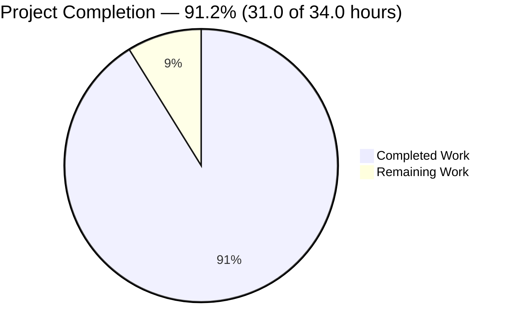
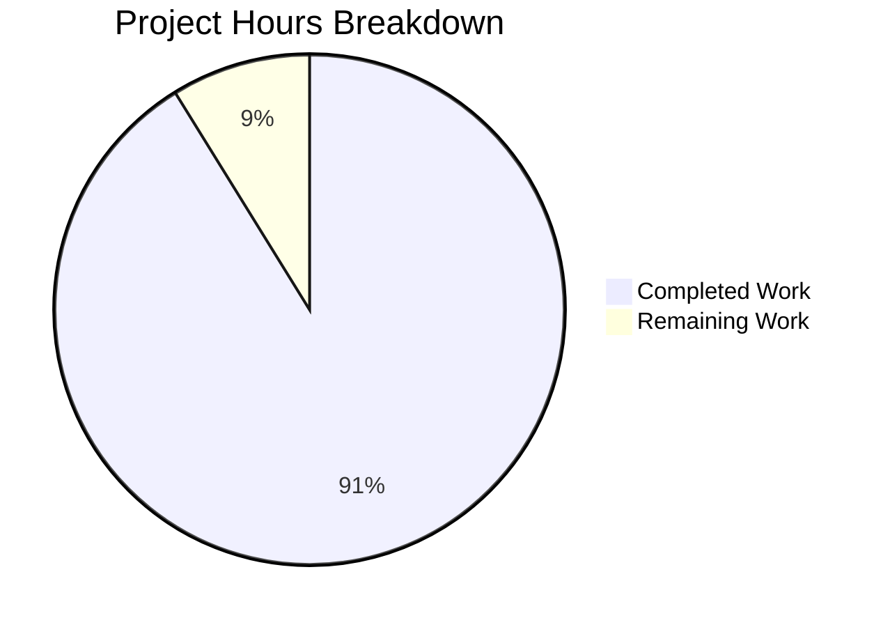
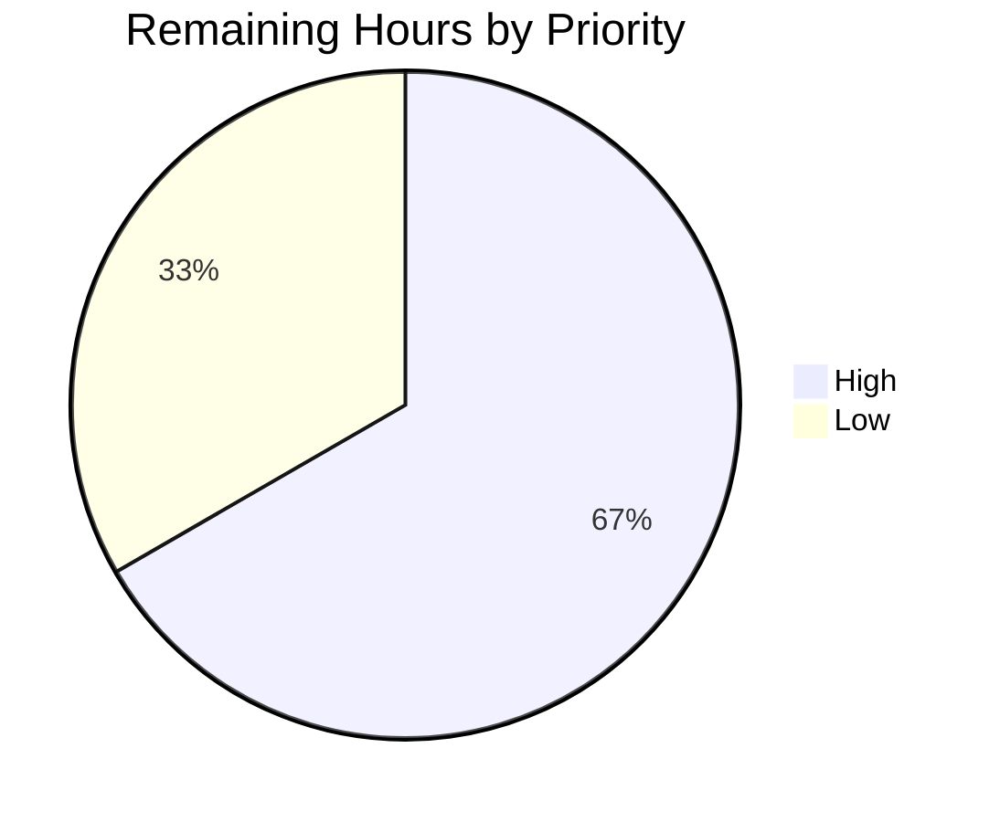

# 1. Executive Summary

A complete, verified three-artefact Node.js tutorial server, with one validation requirement left open on a runtime this environment cannot supply.

## 1.1 Project Overview

`server.js` is a single-file Node.js HTTP server, delivered with `package.json` and a rewritten `README.md`. It exposes one endpoint, `GET /hello` → `200 text/plain Hello world`, and answers every other request, including a method mismatch, with `404 text/plain Not Found`. It uses the built-in `http` module alone: no dependency, build step or configuration file. `PORT` selects the port and defaults to `3000`. Its audience is a developer learning HTTP in Node.js, or a team wanting a reference server.

## 1.2 Completion Status

Figures are assessed against the plan's scope: 31.0 completed hours of 34.0, with 3.0 remaining (Section 2.2). Formula: `31.0 ÷ 34.0 = 91.2 %`.



Key: Completed #5B39F3, Remaining #FFFFFF.

| Metric | Hours |
|---|---|
| Total Hours | 34.0 |
| Completed Hours (AI + Manual) | 31.0 |
| Remaining Hours | 3.0 |
| Percent Complete | 91.2 % |

## 1.3 Key Accomplishments

- Endpoint: `GET /hello` answers `200 text/plain Hello world`; anything else answers `404 text/plain Not Found`.
- Matching: exact on the path portion, so `/hello?x=1` answers and `/hello/` does not.
- Logging: one ISO-8601 line per request, before routing, unmatched requests included.
- Port policy: `3000` by default, an integer 1024–65535 accepted, anything else refused with an actionable message and exit `1`.
- Lifecycle: readiness only after a bind, a busy port reported with exit `1`, `SIGINT` exiting `0`.
- Performance: 0.54 ms worst case over 20 requests, 50 concurrent served, memory flat.
- Security: fixed bodies, nothing reflected, no internal detail, no evaluation, filesystem or outbound code.
- Manifest and documentation: seven manifest fields with `npm start` working, and all eight README items.

## 1.4 Critical Unresolved Issues

Two of the 22 requirements in scope remain open; neither changes delivered behaviour.

| Issue | Impact | Owner | ETA |
|---|---|---|---|
| The declared Node.js v18.0.0 floor has never been exercised on a v18 runtime (compatibility rests on an API audit plus a floor-equivalent run) | Release validation on the declared minimum runtime is unproven | Developer (backend) | 2.0 h |
| `PORT` is read as a decimal number, so zero-padded digit strings such as `01024` are accepted as `1024` | Cosmetic input lenience; no documented value is contradicted | Developer (backend) | 1.0 h (optional) |

## 1.5 Access Issues

No permission, credential or service is involved, so nothing blocked building, running or validating the project. One environment constraint limits validation depth:

| System/Resource | Type of Access | Issue Description | Resolution Status | Owner |
|---|---|---|---|---|
| Node.js v18.x runtime | Runtime binary | No v18 runtime exists on the build host, and installing one below Node 20.20.2 / 22.12.0 is blocked by the environment's version restriction | Open — supply a v18 runtime in an isolated environment, or lift the restriction, to complete the floor gate | Platform owner |

## 1.6 Recommended Next Steps

1. [High] Run the functional and configuration gates on a Node v18.x runtime and record the outcomes (2.0 h).
2. [Medium] If a supervisor will stop the process, add a `SIGTERM` handler mirroring `SIGINT`.
3. [Medium] Decide whether `PORT` should accept canonical decimal spellings only (1.0 h).
4. [Low] Encode the check set as a CI job once the three-artefact constraint is lifted.
5. [Low] Decide the intended exposure: bind loopback, or proxy the port if it must not be reachable.

# 2. Project Hours Breakdown

## 2.1 Completed Work Detail

| Component | Hours | Description |
|---|---|---|
| HTTP endpoint contract | 4.0 | `GET /hello` → 200 / `text/plain` / `Hello world`; the 404 catch-all for every other path and method; exact matching on the path portion with the query string excluded (`server.js:9,10,36-37,44-47`) |
| Request logging and readiness reporting | 2.0 | One ISO-8601 line per request written before any route decision, target logged as received, unmatched requests included; `Server listening on port <port>` only from the listening callback (`server.js:31-32,42-43,77-78`) |
| Port policy | 2.0 | `PORT` defaulting to `3000` when unset or empty, read as a plain decimal integer inside 1024–65535, refused with the actionable stderr sentence and exit `1` before any bind (`server.js:4-6,13-28`) |
| Bind-failure reporting and shutdown | 2.0 | `EADDRINUSE` reported with its actionable message and exit `1`, any other bind failure as `Server failed to start: <message>`, never a readiness line; `SIGINT` logs, closes and exits `0` on `server.close()` alone (`server.js:50-68,76,80`) |
| Performance and concurrency behaviour | 1.5 | Constant-work handler with no shared mutable state: measured 0.54 ms worst case of 20 sequential requests, 50 concurrent requests served, resident memory flat across 300 requests |
| Security boundaries | 2.0 | Fixed response bodies for both outcomes, no reflection of the request target, no internal error detail, and no dynamic evaluation, filesystem access, outbound request or persistence anywhere in the source (`server.js:2,44-47`) |
| Project manifest | 1.0 | Seven declared fields with their exact values, no dependency object, and `npm start` running `node server.js` (`package.json:1-19`) |
| Developer documentation | 3.0 | README title plus the eight required items — purpose, prerequisites, installation, execution, testing, expected output, shutdown and `PORT` configuration (`README.md:1,3,9,13,17,31,39,62,66`) |
| Code quality and single-file structure | 2.5 | Five constants and seven purpose-named functions, one summary comment each, inline commentary at the port range, the pre-bind check, the logging order and the two shutdown reasons, and no placeholder or dead code (`server.js:8,19,42,65,66,72`) |
| Runtime-floor compatibility | 1.0 | `>=18.0.0` declared in `engines.node`; only APIs predating the floor are used, the newest construct (`??`) requiring Node 14 (`server.js:37`) |
| Repository shape and diff discipline | 2.0 | Exactly three artefacts at the root, no test, lock, lint, build, CI or container artefact and no dependency install, with nothing outside those files touched (`git ls-files` = 3 paths) |
| Verification campaign | 8.0 | Endpoint, logging, lifecycle, configuration, performance, security and browser-level checks executed against the running server, 80 of 80 checks passing on the final tree |
| **Total** | **31.0** | Equals the Completed Hours in Section 1.2 |

## 2.2 Remaining Work Detail

| Category | Hours | Priority |
|---|---|---|
| Runtime-floor verification — obtain a Node v18.x runtime, repeat the functional and configuration gates against it, and record the outcomes (AAP 0.7.5, the floor leg of 0.6.1) | 2.0 | High |
| Input validation — tighten `PORT` acceptance to canonical decimal spellings if zero-padded digit strings should be refused, then re-run the configuration checks (AAP 0.4.2, optional tightening) | 1.0 | Low |
| **Total** | **3.0** | Equals the Remaining Hours in Section 1.2 |

## 2.3 Total Project Hours

| Line | Hours |
|---|---|
| Completed (Section 2.1) | 31.0 |
| Remaining (Section 2.2) | 3.0 |
| Total project hours | 34.0 |
| Completion | 31.0 ÷ 34.0 = 91.2 % |

Every hour above traces to a requirement in the plan or to the verification work it calls for. The remaining two lines are the only work left: one closes the plan's unexecuted floor gate, the other is an optional tightening that contradicts no documented value. Of the plan's 22 requirements, 20 are complete, `PORT` form acceptance is partial, and the floor execution leg has not been started.

# 3. Test Results

The project ships no test framework by design — the plan fixes the deliverable at three artefacts and defines its gates as observable behaviour of the running server — so every check below was executed against the live process with the commands the README documents: 80 checks run, 80 passed, 0 failed, reproduced twice on the final tree (`d1b862e`).

| Area / Category | Framework | Tests | Passed | Failed | Coverage | What This Proves |
|---|---|---|---|---|---|---|
| Endpoint contract and catch-all | curl against the live server | 9 | 9 | 0 | Not instrumented (no coverage tooling in scope) | `GET /hello` answers exactly `Hello world` with `text/plain` and status line `HTTP/1.1 200 OK`, and every other method or path answers the fixed `Not Found` body as a 404 |
| Path-portion matching | curl against the live server | 6 | 6 | 0 | Not instrumented | A query string never changes the match, a trailing slash and other spellings do not match, and the unmatched target is still logged |
| Request logging | shell assertions over the process's stdout | 6 | 6 | 0 | Not instrumented | Exactly one ISO-8601 line is written per request, before routing, unmatched requests included, with the target logged as received |
| Configuration — `PORT` policy | direct runs of the process | 25 | 25 | 0 | Not instrumented | The documented default and accepted values bind and serve; 18 invalid spellings each exit `1` with the actionable stderr message and nothing on stdout, without attempting a bind |
| Lifecycle — startup, busy port, shutdown | direct runs, curl, signal delivery | 9 | 9 | 0 | Not instrumented | The readiness line appears only after a successful bind, `EADDRINUSE` and any other bind failure are reported with exit `1` and no readiness line, and `SIGINT` exits `0` leaving the port free |
| Performance and concurrency | curl timing, resident-set sampling | 3 | 3 | 0 | Not instrumented | Every request completes far inside the 10 ms budget, 50 concurrent requests are all served, and memory does not grow under sustained load |
| Security posture | curl with hostile targets, source sweeps | 5 | 5 | 0 | Not instrumented | No response carries request-derived text or internal detail, and the source holds no evaluation, filesystem, outbound or persistence construct |
| Manifest, documentation and static shape | node, npm, shell assertions | 17 | 17 | 0 | Not instrumented | Seven manifest fields with a working `npm start`, three tracked artefacts and nothing else, no dependency object, and a source file with the declared structure and no placeholder content |

A browser-level pass complements the table: five top-level navigations of the running server returned `200` with the visible text `Hello world` for `/hello`, `/hello?x=1` and a repeat, and `404` with `Not Found` for `/invalid` and `/hello/`, with bodies measured byte-exact at 11 and 9 bytes and no application-attributable console error.

**Not Covered**

- Execution on the declared Node.js v18.0.0 floor — the deliverable has never been run on a v18 runtime; the floor gate cannot be satisfied on this host (Section 1.5), so floor compatibility currently rests on an API audit and a floor-equivalent run of the shutdown path. A human should run the functional and configuration gates on a v18.x runtime before relying on the declared floor.
- `SIGTERM` and `SIGHUP` — only `SIGINT` is handled, so a supervisor or orchestrator that stops the process with another signal bypasses the graceful path entirely; no test covers it because the code does not claim the behaviour.
- Requests the runtime's HTTP parser refuses before the handler runs (malformed request line, unsupported version, oversized headers or target) — those are answered by the runtime with `400`/`431` and no log line; a human should decide whether the log must account for them.
- Shutdown while a client holds an incomplete request — the shutdown line and exit status are verified for an idle server, but `server.close()` waits for an in-flight or half-sent request to finish, so the exit can lag until the peer closes or the keep-alive timeout expires.

Everything else the project delivers — both response outcomes, matching rules, log accounting, the whole `PORT` policy, the lifecycle paths and the performance thresholds — is covered by the checks above.

# 4. Runtime Validation & UI Verification

Every flow below was driven against the running server with the documented commands, and the browser-level confirmations were made in real headless Chrome against the live process.

- ✅ **Startup** — `node server.js` and `npm start` each bind and print `Server listening on port <port>` exactly once, with nothing on stderr.
- ✅ **`GET /hello`** — status `200`, `Content-Type: text/plain`, body exactly `Hello world` (11 bytes, no trailing newline), confirmed by curl and by five browser navigations that rendered `Hello world` and reported byte-identical bodies.
- ✅ **Catch-all and path matching** — `Not Found` with status `404` for `/invalid`, `/hello/`, `//hello`, `/HELLO`, `/hello%2f`, `/favicon.ico`, `POST /hello`, `HEAD /hello`, `PUT /other` and a traversal target, while `/hello?x=1` answers exactly like `/hello`.
- ✅ **Request logging** — 443 lines matching `[ISO-8601 timestamp] METHOD target` for 443 requests, one line each, unmatched requests included, query strings kept in the third field.
- ✅ **Documented default port** — with `PORT` unset and with `PORT` empty the process logs `Server listening on port 3000` and answers the README's `curl http://localhost:3000/hello` with `Hello world`; run in an isolated network namespace so the shared host's port 3000 was never bound.
- ✅ **Port override and rejection** — `PORT=4000` serves on that port; 18 invalid spellings (`abc`, `3.5`, `80`, `1023`, `70000`, `65536`, `0x400`, `1.024e3`, `+3000`, `3000.0`, `-5`, `0`, `NaN`, `Infinity`, `1_000`, and more) each exit `1` with the documented stderr sentence and nothing on stdout, with no bind attempted.
- ✅ **Busy port** — a second instance on a held port exits `1` with `Port <port> is already in use. Stop the process holding it or set PORT to a free port.` and prints no readiness line.
- ✅ **Shutdown** — `SIGINT` prints `Shutting down server` as the final line, exits `0` and releases the port immediately. ⚠ A peer holding an incomplete request delays the exit until that peer finishes or the keep-alive timeout expires, because shutdown is built on `server.close()` alone at the declared floor.
- ⚠ **Other signals** — `SIGTERM` and `SIGHUP` have no handler, so a supervisor stopping the process that way gets no shutdown line and a signal-derived exit status. Only `SIGINT` is exercised.
- ⚠ **External integration and UI** — there is none to exercise: the process reads only `process.env.PORT` and writes only HTTP responses and console lines, with no database, queue, cache or outbound call, and the deliverable has no user interface, so the browser was used purely as an HTTP client.

Never exercised at runtime: the declared Node.js v18.0.0 floor (no v18 runtime is obtainable here), the graceful path for signals other than `SIGINT`, and the log behaviour of requests the runtime's parser refuses before the handler runs — those are refused with `400`/`431` and never reach the code, so no line is written for them.

# 5. Compliance & Quality Review

## 5.1 Compliance Matrix

| Deliverable | Plan requirement | Verified status | Progress |
|---|---|---|---|
| `GET /hello` response | 0.4.1 — status `200`, `Content-Type: text/plain`, body exactly `Hello world` | Pass — 11-byte body, header and status line observed on the wire and in a browser | ✅ Complete |
| 404 catch-all, including method mismatch | 0.4.1 — every other request `404` / `text/plain` / `Not Found` | Pass — verified for unknown paths, a trailing slash, other spellings and `POST`/`HEAD`/`PUT` | ✅ Complete |
| Path-portion matching | 0.4.1, 0.8.1 — exact match on the part before the first `?`, no normalisation or decoding | Pass — `/hello?x=1` answers, `/hello/` and encoded variants do not | ✅ Complete |
| Request logging | 0.4.3 — one line per request before routing, ISO-8601 template, target as received | Pass — 443 lines for 443 requests, unmatched requests included | ✅ Complete |
| Startup readiness | 0.4.3 — `Server listening on port <port>` only after a successful bind | Pass — printed once per successful bind, absent on the failed bind | ✅ Complete |
| `PORT` policy | 0.4.2, 0.4.3, 0.4.6 — default `3000`, integer 1024–65535, actionable refusal with exit `1` before any bind | Pass with note — every refusal path and accepted value verified; zero-padded digit strings are read as their numeric value | ⚠ 75 % |
| Bind-failure reporting | 0.4.3 — `EADDRINUSE` message with exit `1`, other failures reported, never a readiness line | Pass — both branches exercised, `EADDRINUSE` byte-exact | ✅ Complete |
| Shutdown on `SIGINT` | 0.4.3, 0.6.1 — shutdown line, close, exit `0`, no post-floor API | Pass — exit `0` with the line last, port released, `server.close()` alone | ✅ Complete |
| Performance and resource behaviour | 0.7.2 — under 10 ms, 50 concurrent requests served, memory stable | Pass — 0.54 ms worst case, 50 × `200`, flat resident set | ✅ Complete |
| Security boundaries and minimal surface | 0.6.2, 0.6.5 — built-ins only, no evaluation, filesystem, outbound or persistence, fixed bodies | Pass — no such construct exists and no hostile target altered the response | ✅ Complete |
| Runtime floor | 0.6.1 — declared in `engines.node`, no post-floor API, executed on v18.0.0 | Partial — declaration and API discipline pass; the v18 execution gate has not been run (Section 1.5) | ⚠ 50 % |
| Manifest, documentation, code quality and repository shape | 0.3.1, 0.3.2, 0.4.4, 0.4.5, 0.6.6, 0.12.1, 0.12.2 — seven fields, eight README items, production-ready content, three artefacts, smallest diff | Pass — all verified against the tree and the running project | ✅ Complete |

## 5.2 AAP & Rule Divergences and Gaps

| What the AAP/Rule Required | What Was Delivered Instead | Why It Diverged | Impact | Remediation |
|---|---|---|---|---|
| 0.10.2 prints `server.js` as its complete final content, validating `Number(raw)` and carrying one inline comment | `server.js:20` tests the raw string lexically before the retained integer and range tests, and five inline comments explain the port range, the logging order, the two shutdown reasons and the pre-bind check | The plan's own higher contracts (0.4.2, 0.4.3, 0.4.5, 0.6.6, and 0.9 on where values are declared) require the lexical check and those comments; the listing satisfies neither | None on any documented value, message, stream, exit status or gate | None — behaviour matches the stated contracts; only a verbatim plan comparison would need the listing updated |
| 0.8.5 labels the third log field `[request path]` while 0.4.3 defines it as the request target as received | `README.md:56` keeps the declared label and defines the field precisely, noting that `GET /hello?x=1` is logged with its query string visible even though it plays no part in matching | Two statements inside the plan conflict; the exact-line contract (0.4.3) governs what the field contains, and the running server logs `req.url` (`server.js:32`) | None — documentation and behaviour agree | None |
| 0.6.1's floor leg and 0.7.5 require the deliverable to be run on a Node.js v18.0.0 binary | The floor gate was not executed; compatibility rests on an API audit and a floor-equivalent run, with the floor still declared in `engines.node` and the README | No v18 runtime exists on the build host, and installing one below Node 20.20.2 / 22.12.0 is forbidden by the environment's version restriction, which outranks the plan for the runtime | Release validation on the declared minimum runtime is unproven; every other gate passes on the environment's runtime | Supply a v18 runtime in an isolated environment and repeat the functional and configuration gates (2.0 h, Section 2.2) |
| 0.7.3 requires the default-port evidence `Server listening on port 3000` from `node server.js` with `PORT` unset | The same evidence was produced inside an isolated network namespace, and every other bind used a private port | The environment's operator instructions forbid using port 3000 as a project port on a host shared with many concurrent builds | None — the default, the documented command and the shutdown were all observed in full | None |
| 0.4.2's accepted value is "an integer, `>= 1024` and `<= 65535`", everything else refused | The raw-string guard enforces that set over every non-integer and out-of-range spelling, but a digit string whose value is in range is read as that number, so `PORT=01024` binds 1024 | The guard tests that the input is digits before converting; a zero-padded digit string is an integer in text, so no documented value is contradicted | Cosmetic lenience in an operator-supplied value; nothing exposed to a client | Tighten `server.js:20` to accept canonical decimal spellings only, then re-run the configuration checks (1.0 h, Section 2.2) |
| The attached instructions asked for code printing `Welcome to Blitzy` in as few lines as possible, no 404 handler, no error handler, no environment-variable configuration and a README under five lines | The deliverable is the requested project: a `200` endpoint with a `404` catch-all, an actionable bind-failure path, the `PORT` policy and an eight-item README | The request governs over the attachment, as the plan states explicitly; the two instruction sets cannot both be satisfied | None — the delivered behaviour is the requested behaviour | None |

**Why each divergence stands as it does.** The first is a rule of precedence rather than a defect: `AAP 0.10.2` prints one version of `server.js`, and the plan's own contracts elsewhere state values that version cannot satisfy — 0.4.2 fixes the accepted port set and its refusal, 0.4.5 requires the README to carry that rejection rule, and 0.6.6 requires inline comments at the non-obvious points, two of which are the reasons the shutdown path is built on `server.close()` alone. The delivered file follows those contracts; the only difference a reader will see is that every spelling the documentation already calls invalid — `0x400`, `1.024e3`, `+3000`, `3000.0`, `" 3000 "`, `1_000` and twelve more — is refused with the documented sentence and exit status `1`. No user rule is involved: the two rules supplied with this project have empty bodies.

The second is the plan disagreeing with itself about one word. `AAP 0.8.5` labels the log field `[request path]`, while 0.4.3 — the section that fixes the exact line — says the third field is the request target exactly as received, which is what `server.js:32` writes: the query string stays visible in the log even though `server.js:44` matches only the part before the first `?`. `README.md:56` keeps the declared label and then defines the field precisely, so the document and the running server agree; the checks reproduce it, logging `GET /hello?x=1` while answering it as `GET /hello`.

The third is the one gap that changes what a reader can rely on. The plan undertakes to verify the deliverable on its declared floor, Node.js v18.0.0, as well as on the environment's runtime, and that leg was not performed: the host carries only Node v22.23.3, alternate installs, cached packages and images all come up empty, and installing anything below Node 20.20.2 / 22.12.0 is forbidden by the environment's version restriction, which outranks the plan for the runtime. What stands in its place is real but weaker than execution — every API and construct in the file predates the floor, with the newest requiring Node 14, and the only close call, `server.close(() => process.exit(0))` at `server.js:67`, is exercised under floor-equivalent semantics with identical results. Until a v18 runtime is supplied, treat the floor as declared and audited rather than proven.

The fourth concerns how evidence was gathered rather than what was built. The configuration gate exists to observe `Server listening on port 3000` from an unset `PORT`, and on a host shared with dozens of concurrent builds the environment's instructions forbid using port 3000 as a project port. The run was therefore performed inside an isolated network namespace, where the documented command bound 3000, answered the README's `curl http://localhost:3000/hello` with `Hello world`, and shut down with `SIGINT` and status `0`; every other bind used a private port. The behaviour is fully evidenced; only the execution context differs from the literal gate.

The fifth is a matter of how strictly an operator's input is read. The guard at `server.js:20` requires the raw value to be digits, then the value to be an integer inside 1024–65535, so the whole documented set is enforced and every spelling that is not a number is refused with the documented sentence — but `01024` is digits, reads as 1024, and binds. Nothing is exposed to a client and no documented value is contradicted, so this is an optional tightening rather than a defect; a team that wants canonical decimal spellings only needs the one-line change in `server.js:20`.

The sixth is not a gap in the code but a consequence of which instructions governed. The attachments that accompanied the request asked for a program printing `Welcome to Blitzy` in as few lines as possible, and forbade a 404 handler, an error handler, environment-variable configuration and a README longer than five lines. The request itself specifies the opposite for each of those, and the plan resolves the conflict in the request's favour and does not merge the two. The delivered project is therefore the requested server, including the catch-all, the bind-failure path, the `PORT` policy and the eight-item README; nothing from the attachments is present, and no user rule required anything either way.

# 6. Risk Assessment

| Risk | Category | Severity | Probability | Mitigation | Status |
|---|---|---|---|---|---|
| The declared Node.js v18.0.0 floor is asserted from an audit rather than proven by execution, so a floor-only incompatibility would surface only in a v18 environment | Technical | Medium | Low | Run the functional and configuration gates on a Node v18.x runtime; the member audit finds nothing newer than Node 14 and no call site for the two v18.2.0 connection-close APIs | Open — 2.0 h, Section 2.2 |
| `PORT` values written with padding or other non-canonical spelling of a valid number are read as that number (for example `01024` → 1024) rather than refused | Technical | Low | Low | Tighten the guard at `server.js:20` to accept canonical decimal spellings only | Accepted — no documented value contradicted |
| `listen()` binds every interface and the endpoint is unauthenticated, so anything that can reach the host can use it | Security | Low | Medium | Bind loopback by passing a host to `listen()`, or keep the port behind a proxy or a private network | Accepted by design — the plan specifies a public, unauthenticated endpoint with constant responses |
| A supervisor or orchestrator that stops the process with `SIGTERM` or `SIGHUP` bypasses the graceful path: no shutdown line and a signal-derived exit status | Operational | Medium | Medium | Add a signal handler mirroring the `SIGINT` path before running the service under systemd, a supervisor or a container platform | Open — outside the plan's scope; see Section 1.6 |
| Shutdown is built on `server.close()` alone, so a client holding an in-flight or half-sent request keeps the process alive until it finishes or the 5 s keep-alive timeout expires | Operational | Low | Medium | Allow restart grace in the deployment, or raise the runtime floor and use the v18.2.0 idle-connection close API | Accepted — required behaviour at the declared floor |
| Requests the HTTP parser refuses before the handler runs (`400`, `431`) produce no log line, so the log does not account for every inbound request | Operational | Low | Low | Add a `clientError` listener if the log must capture parser-level refusals | Accepted — the log contract covers requests that reach the handler |
| Log lines carry the request target unbounded, so a very long target (up to the runtime's header limit) is written in full | Operational | Low | Low | Cap or sample the logged target if the stream feeds a log collector | Accepted — the plan requires the target exactly as received |
| The repository carries no automated regression net — no test artefact, runner or CI job — so future edits are protected only by manual re-runs of the checks | Integration | Low | Medium | Encode the check set as a CI job, or as a repository test file once the three-artefact constraint is lifted | Accepted — every gate is manual today |

# 7. Visual Project Status

Completed work is Dark Blue (#5B39F3); remaining work is White (#FFFFFF).





- **Completion** — 31.0 of 34.0 hours, 91.2 % (Section 1.2).
- **Remaining work** — 3.0 hours: 2.0 hours of runtime-floor verification and 1.0 hour of optional `PORT` tightening (Section 2.2).
- **Requirement coverage** — 20 of the plan's 22 requirements complete, 1 partial (`PORT` accepted-form lenience), 1 not started (the v18.0.0 floor execution leg).

# 8. Summary & Recommendations

This release delivers the project the plan specified: a single-file Node.js HTTP server at the repository root with a manifest and a rewritten README, built on the built-in `http` module with no dependency, no build step and no configuration file. `GET /hello` answers `200` / `text/plain` / `Hello world`; every other request, including a method mismatch on a known path, answers `404` / `text/plain` / `Not Found`; one ISO-8601 line is logged per request before routing; the port comes from `PORT` with a `3000` default and an enforced 1024–65535 range; and `SIGINT` logs, closes and exits `0`. The project stands at **91.2 % complete against the plan's scope** — 31.0 of 34.0 hours — with the outstanding work confined to one verification leg and one optional tightening.

What the delivered code has actually been measured against is broad. 80 of 80 checks pass on the final tree, covering both response outcomes byte-for-byte, the matching rules, log accounting for 443 requests, the whole `PORT` matrix including 18 refused spellings, the readiness and busy-port paths, the signal lifecycle, latency, concurrency and memory under load, and the security boundaries of a server that reflects nothing and discloses nothing. The same surface was then driven through a real browser, where every navigation and console fetch returned the documented status, header and body. The endpoints, the logging and the lifecycle can be relied on as they stand.

The gap that matters is one of proof rather than behaviour. The declared minimum runtime, Node.js v18.0.0, has never been used to run this code, because no v18 runtime exists on the build host and the environment forbids installing one; floor compatibility rests on an audit that finds nothing newer than Node 14 in the file and on a floor-equivalent run of the shutdown path. Closing that is the critical path to production readiness — supply a v18 runtime in an isolated environment, repeat the functional and configuration gates, and the last open requirement closes. Everything else outstanding is discretionary: whether `PORT` should refuse padded spellings, and whether the process should be stopped gracefully by the signals a supervisor or orchestrator actually sends, which is a deployment decision rather than a defect in the delivered design.

The success metrics are simple and met with margin: the two documented responses are produced exactly, and byte-exactly, on every request; responses complete in 0.54 ms at worst against a 10 ms budget with 50 concurrent requests served and memory flat; every documented `PORT` value behaves as the README states, with refusals reported actionably before any bind is attempted; and the repository holds exactly the three artefacts the plan defines. Against a project of this size — 83 lines of application code, 19 lines of manifest and 80 lines of documentation — that is a complete, production-ready realisation of the specification.

For production, the honest assessment is that the server is ready to run as the tutorial and reference implementation it was written to be, on a runtime of Node 20 or 22. Before it is relied on at the declared v18 floor, complete the floor gate. Before it is placed under a process supervisor, add the `SIGTERM` handler and decide the intended exposure, since the process currently binds every interface and serves an unauthenticated endpoint. And when the three-artefact constraint no longer binds, encode the check set as an automated job: the behaviour is currently protected only by re-running the checks by hand.

# 9. Development Guide

Every command below was executed from the repository root and produced the output shown. The project is one Node.js package with no build step, no dependency, no service and no configuration file.

### 9.1 System Prerequisites

- **Runtime**: Node.js v18.0.0 or later (the project's declared floor, recorded in `package.json` → `engines.node`). The commands here were run and verified on Node v22.23.3 with npm 11.21.0.
- **Verification tools**: `curl` for exercising the endpoint. A browser is optional and uses the same HTTP surface.
- **Not required**: no database, broker, cache, container runtime, compiler or credential, and no operating-system-specific package.
- **Confirm the runtime**:

```bash
node --version   # v18.0.0 or later, e.g. v22.23.3
npm --version    # only needed for `npm start`, e.g. 11.21.0
```

### 9.2 Repository Layout

```text
README.md      # purpose, prerequisites, execution, testing, expected output, shutdown, configuration
package.json   # manifest: seven fields, no dependencies, `npm start` = `node server.js`
server.js      # the whole application: route table, logging, port policy, startup and shutdown
```

### 9.3 Environment Setup and Installation

There is nothing to set up. The application reads exactly one environment variable, `PORT`, and creates no file, directory, credential or cache.

```bash
# Do NOT run: the project declares no dependencies and must not carry a lockfile.
# npm install
```

If a `node_modules` directory ever appears in this repository, a dependency was added by mistake — the manifest declares none and the source imports only the built-in `http` module.

### 9.4 Startup

Run from the repository root, in the foreground; `CTRL+C` stops it.

```bash
node server.js          # or: npm start
```

Expected output once the socket is listening — one line, written only after a successful bind:

```text
Server listening on port 3000
```

Choose a port with `PORT` (accepted: an integer 1024–65535; anything else is refused before any bind is attempted):

```bash
PORT=4000 node server.js
```

```text
Server listening on port 4000
```

There is no build step and no warm-up: if the file parses, the server runs. A syntax check on its own is:

```bash
node --check server.js     # exit status 0, no output
```

### 9.5 Verification Steps

With the server running (default port shown; substitute your `PORT` if you set one), each step below states the expected result.

```bash
# 1. The endpoint answer: 200, text/plain, body exactly "Hello world"
curl -s -o /dev/null -w '%{http_code}\n' http://localhost:3000/hello      # 200
curl -s http://localhost:3000/hello                                       # Hello world
curl -s -D - -o /dev/null http://localhost:3000/hello | head -1           # HTTP/1.1 200 OK

# 2. Anything else is a 404 with the fixed body
curl -s -o /dev/null -w '%{http_code}\n' http://localhost:3000/invalid    # 404
curl -s http://localhost:3000/invalid                                     # Not Found
curl -s -o /dev/null -w '%{http_code}\n' -X POST http://localhost:3000/hello   # 404

# 3. Matching is exact on the path portion
curl -s -o /dev/null -w '%{http_code}\n' 'http://localhost:3000/hello?x=1'     # 200
curl -s -o /dev/null -w '%{http_code}\n' http://localhost:3000/hello/          # 404

# 4. Latency and concurrency
for i in $(seq 1 20); do curl -s -o /dev/null -w '%{time_total}\n' http://localhost:3000/hello; done
seq 1 50 | xargs -P 50 -I{} curl -s -o /dev/null -w '%{http_code}\n' http://localhost:3000/hello | sort | uniq -c
# every timing is far below 0.010 s; the concurrent run prints: 50 200
```

In the server's terminal you should see a startup line and then one line per request — matched or unmatched — in this form:

```text
Server listening on port 3000
[2026-10-16T08:30:00.930Z] GET /hello
[2026-10-16T08:30:01.104Z] GET /invalid
```

Stop the server with `CTRL+C`; it prints its last line and returns status `0`:

```text
Shutting down server
```

### 9.6 Example Usage

A complete session, exactly as observed:

```bash
node server.js &            # start; note the pid if you background it
curl -s http://localhost:3000/hello          # Hello world
curl -s 'http://localhost:3000/hello?x=1'    # Hello world
curl -s http://localhost:3000/hello/         # Not Found
kill -INT %1                                 # Shutting down server, exit status 0
```

The server's own output for that session:

```text
Server listening on port 3000
[2026-10-16T12:52:28.566Z] GET /hello
[2026-10-16T12:52:28.573Z] GET /hello?x=1
[2026-10-16T12:52:28.579Z] GET /hello/
Shutting down server
```

Configuring and refusing a port:

```bash
PORT=4000 node server.js        # Server listening on port 4000
PORT=abc node server.js         # stderr: Invalid PORT "abc": expected an integer between 1024 and 65535.
echo $?                         # 1
PORT=80 node server.js          # the same message with "80" interpolated, exit status 1, no bind attempted
```

### 9.7 Troubleshooting

| Symptom | Cause | Resolution |
|---|---|---|
| `Invalid PORT "<value>": expected an integer between 1024 and 65535. Unset PORT or set it to a value in that range.` and exit status `1` | The value is not a plain decimal integer inside the accepted range, or is a privileged port such as `80` | Unset `PORT` to use `3000`, or set an integer between `1024` and `65535` |
| `Port <port> is already in use. Stop the process holding it or set PORT to a free port.` and exit status `1` | Another process already listens on that port | Stop the other process, or start with a different `PORT` |
| No `Server listening on port` line appears | The process exited on a configuration error, or startup output went to a different terminal | Check stderr for a message from the table above; the readiness line is written only after a successful bind |
| `curl: (7) Failed to connect` | The request names a port or host the server is not listening on | Use the port from the readiness line and `localhost` or `127.0.0.1` |
| `Not Found` for a path that looks right | Matching is exact: a trailing slash, a different case or a percent-encoded segment does not match `/hello` | Request `/hello` exactly; a query string is fine |
| A browser console reports a 404 for `/favicon.ico` | The browser always requests a favicon and the project defines no favicon route | Expected — the catch-all answers it like any other unmatched request |
| `CTRL+C` does not return immediately | A client is holding an open or half-sent request; shutdown waits for it to finish, up to the 5 s keep-alive timeout | Let the client finish, or close it; the shutdown line is written immediately either way |
| `npm start` reports a non-zero status while the app printed `Shutting down server` | npm's own status reflects the signal delivered to the whole foreground group | Not an application error: signal the `node` process directly to observe the application's exit status `0` |
| `npm start` fails with `ENOENT` | It was run outside the repository root, where no `package.json` exists | Run it from the repository root, or use `node server.js` |

# 10. Appendices

### A. Command Reference

Run every command from the repository root.

| Purpose | Command |
|---|---|
| Syntax check the application | `node --check server.js` |
| Start the server (foreground) | `node server.js` |
| Start the server through the manifest | `npm start` |
| Start on a chosen port | `PORT=4000 node server.js` |
| Request the endpoint | `curl -s http://localhost:3000/hello` |
| Request the endpoint's status only | `curl -s -o /dev/null -w '%{http_code}\n' http://localhost:3000/hello` |
| Request the response headers | `curl -s -D - -o /dev/null http://localhost:3000/hello` |
| Exercise the catch-all | `curl -s -o /dev/null -w '%{http_code}\n' http://localhost:3000/invalid` |
| Exercise a method mismatch | `curl -s -o /dev/null -w '%{http_code}\n' -X POST http://localhost:3000/hello` |
| Exercise the path rule | `curl -s -o /dev/null -w '%{http_code}\n' 'http://localhost:3000/hello?x=1'` |
| Measure latency | `for i in $(seq 1 20); do curl -s -o /dev/null -w '%{time_total}\n' http://localhost:3000/hello; done` |
| Measure concurrency | `seq 1 50 \| xargs -P 50 -I{} curl -s -o /dev/null -w '%{http_code}\n' http://localhost:3000/hello \| sort \| uniq -c` |
| Stop the server | `CTRL+C`, or `kill -INT <pid>` |
| Observe the refusal paths | `PORT=abc node server.js; echo $?` and `PORT=80 node server.js; echo $?` |

### B. Port Reference

| Port | Meaning |
|---|---|
| `3000` | The documented default, used when `PORT` is unset or empty |
| `1024`–`65535` | The accepted range for `PORT`; the lower bound also refuses privileged ports |
| Anything else | Refused before any bind is attempted, with the actionable message on stderr and exit status `1` |
| Occupied port | The bind fails and the process reports it with the actionable message and exit status `1`; no readiness line is written |
| Test ports | The validation checks ran on private ports (for example `14640`, `14641`, `4000`) so that no shared port was bound; the documented default was exercised in an isolated network namespace |

### C. Key File Locations

| Path | Contents |
|---|---|
| `server.js:2` | The single import: the built-in `http` module |
| `server.js:4-10` | Port constants and the one-entry route table with the catch-all entry |
| `server.js:13-28` | `resolvePort()` — default, accepted value, refusal message and exit status |
| `server.js:31-33` | `logRequest()` — the per-request log line |
| `server.js:36-38` | `resolveRoute()` — method and path matching with the fallback entry |
| `server.js:41-48` | `handleRequest()` — logging before routing, path derivation, response construction |
| `server.js:51-60` | `handleBindError()` — `EADDRINUSE` and other bind failures |
| `server.js:63-68` | `handleShutdown()` — shutdown line, `server.close()`, exit status |
| `server.js:71-81` | `start()` — port resolution, server creation, listeners, readiness line |
| `package.json:1-19` | The seven declared manifest fields, no dependency object |
| `README.md:1,3,9,13,17,31,39,62,66` | Title and the eight documentation items |

### D. Technology Versions

| Component | Version |
|---|---|
| Node.js (verified) | v22.23.3 |
| Node.js (declared floor in `engines.node`) | `>=18.0.0` |
| npm | 11.21.0 |
| curl (used for verification) | 8.14.1 |
| Runtime dependencies | None — the only import is the built-in `http` module |
| Development dependencies | None — no test runner, linter, bundler or build tool |
| Lockfile | None, and none should be added |

### E. Environment Variable Reference

| Variable | Default | Accepted | On refusal |
|---|---|---|---|
| `PORT` | `3000`, used when the variable is unset or empty | A plain decimal integer from `1024` to `65535` | `Invalid PORT "<value>": expected an integer between 1024 and 65535. Unset PORT or set it to a value in that range.` on stderr, exit status `1`, no bind attempted |

No other environment variable, secret or credential is read. The process writes only HTTP responses and its own console lines.

### F. Developer Tools Guide

| Tool | Use here |
|---|---|
| `node` | Runs the server and performs the syntax check (`node --check`) |
| `npm` | Runs the declared `start` script; there is nothing to install |
| `curl` | Exercises the endpoint, the catch-all and the headers |
| Browser | Optional; it consumes the same HTTP surface and its implicit `/favicon.ico` request is answered by the catch-all |
| Not present by design | Test runner, linter, formatter, bundler, container descriptor, CI configuration |

### G. Glossary

| Term | Meaning |
|---|---|
| Endpoint | The one served route, `GET /hello` |
| Catch-all | The fallback entry that answers every request the route table does not match, with `404` and `Not Found` |
| Path portion | The part of the request target before the first `?`, which is what route matching compares |
| Request target | The value the client sent in the request line (`req.url`), query string included |
| Readiness line | `Server listening on port <port>`, written only from the listening callback after a successful bind |
| Status line | The protocol line the runtime renders for a response, for example `HTTP/1.1 200 OK` |
| `EADDRINUSE` | The socket error raised when the port is already held by another process |
| Keep-alive timeout | The runtime's idle-socket timeout (5 s by default), after which an idle connection is ended |
| Resident set size (RSS) | The process's resident memory, sampled to confirm the server does not grow under load |
