# Technical Specification

# 1. Introduction

## 1.1 Executive Summary

`blitzy-20250604155138465` is an automatically created, public, and currently unimplemented repository. Its entire contents are a single 70-byte `README.md` holding two lines: a top-level heading that repeats the repository's own identifier, and the sentence "Auto-created public repository with README". The repository root (`""`) contains no sub-folders, no application code, no dependency manifest, no build or deployment configuration, no test suite, no continuous-integration workflow, no license file, and no documentation beyond that placeholder. Version control records exactly one commit — `1f7f073`, "Initial commit" — on a single branch, `main`; the git object database holds three objects in total (one commit, one tree, one blob).

Because the repository carries no implementation, this Introduction states what the artifacts establish and records, without embellishment, that the matters it would ordinarily cover — business problem, stakeholders, capabilities, success criteria — are not yet expressed anywhere in the repository. Readers should treat the remainder of this section as an accurate, evidence-bounded description of an unimplemented repository rather than as a design for a system.

| Attribute | Observed value | Evidence |
|---|---|---|
| Project identifier | `blitzy-20250604155138465` | `README.md`, line 1 |
| Repository nature | Public; auto-created; README-only | `README.md`, line 2 |
| Version control state | Branch `main`; commit `1f7f073` "Initial commit"; no tags | `git log`, `git show-ref` |
| Publishing namespace | GitHub owner `blitzytest02` | remote `origin` |

**Brief Overview.** The project is a scaffold: a named public location on GitHub containing a placeholder README and nothing else. No runtime behavior, interface, or executable action is defined anywhere in the tree, and the commit history shows no second commit that would mark the start of implementation. The repository therefore has no present-tense system behavior to summarize — only a provisioning act and its residue.

**Core Business Problem.** The repository expresses no business problem. Its only descriptive text asserts the mechanics of its own creation ("Auto-created public repository with README"), not a problem domain, customer need, or market opportunity. No problem statement, product brief, or requirements document exists in the repository to supply one, and this project supplies no attachments. The business problem being solved is consequently undetermined as of commit `1f7f073`; the repository's sole realized function is to reserve a named public location on GitHub while satisfying the convention that a repository carry a README.

**Key Stakeholders and Users.** Two parties are identifiable from repository evidence, and neither is an end user:

| Party | Basis for identification | Relationship to the system |
|---|---|---|
| `blitzytest02` | commit author and remote namespace | Owns and provisions the repository |
| Automated repository creator | README states "Auto-created"; the timestamp in the identifier (`20250604155138`) matches the commit time `2025-06-04 15:51:39 +0530` | Created the repository and its initial commit |
| End users / customers | No user-facing artifact, interface, or workflow exists | None identified |

No user group, persona, operator, administrator, or downstream consumer can be named from the repository contents, and no external user context was supplied with this specification.

**Expected Business Impact and Value Proposition.** No business impact, benefit statement, or value proposition is recorded in the repository, and none can be derived from its artifacts: there is no product surface whose effect could be measured, and no metric, target, or forecast appears anywhere in the tree. The value actually delivered at commit `1f7f073` is confined to scaffolding — a public GitHub repository name is reserved under the `blitzytest02` namespace, the README convention is satisfied, and a base branch (`main`) exists for future work. Any business impact beyond that provisioning step would have to be inferred from a source outside this repository, and no such source is attached to this specification.

## 1.2 System Overview

This overview describes the system as the repository evidences it at commit `1f7f073`. Because the repository holds only a placeholder README, the overview is correspondingly short: each sub-section below names the question it asks and reports the repository's answer, distinguishing facts the artifacts establish from matters they leave empty.

### 1.2.1 Project Context

**Business context and market positioning.** The repository documents no business context and no market positioning. There is no product description, target market, customer segment, competitive reference, pricing statement, or license declaration anywhere in the tree; the README's second line describes only how the repository came into existence. Position within a market is therefore unstated rather than merely undocumented — no artifact makes a claim that could be positioned.

**Current system limitations.** Not applicable. The repository neither replaces nor upgrades an existing system: its history is a single commit with no migration scripts, data-transfer utilities, deprecation notes, changelog, or references to any prior system, version, or vendor. There is no predecessor whose shortcomings this project exists to remedy, and no legacy limitation to enumerate.

**Integration with the existing enterprise landscape.** No integration surface exists. The repository declares no dependencies (no package manifest or lockfile), consumes no external APIs (no client code, SDK reference, or endpoint configuration), exposes no APIs, and defines no infrastructure, service descriptor, or CI/CD pipeline. Nothing in the tree connects this repository to any other system, so there is no enterprise integration to describe at this commit.

| Context dimension | Evidence sought in the repository | Finding at `1f7f073` |
|---|---|---|
| Business context | Product brief, problem statement, target market | Absent |
| Market positioning | Competitor, segment, pricing, license | Absent |
| Predecessor system | Migration scripts, changelog, deprecation notes | Absent; no system is replaced |
| Enterprise integration | Manifests, API clients, service or infra descriptors | Absent; no integration surface |

### 1.2.2 High-Level Description

**Primary system capabilities.** The repository implements no capabilities. Each capability area that would normally be summarized here has no corresponding artifact:

| Capability area | Expected artifact | Finding |
|---|---|---|
| Application logic | Source files in any language | Absent |
| Programmatic interface | API definitions or route handlers | Absent |
| Data persistence | Schema, migrations, or models | Absent |
| Automated verification | Test suite or CI workflow | Absent |
| Packaging and delivery | Manifest, container, or deploy configuration | Absent |

**Major system components.** The repository comprises exactly one component: the README file. It is documentation, not software — it defines no variables, functions, types, entry points, or interfaces, and imports nothing.

| Component | Path | Type | Role |
|---|---|---|---|
| Repository scaffold | `README.md` | Markdown file | Names the project and states it was auto-created with a README |

The composition of the repository is therefore best shown as a root with one artifact and one documented absence:

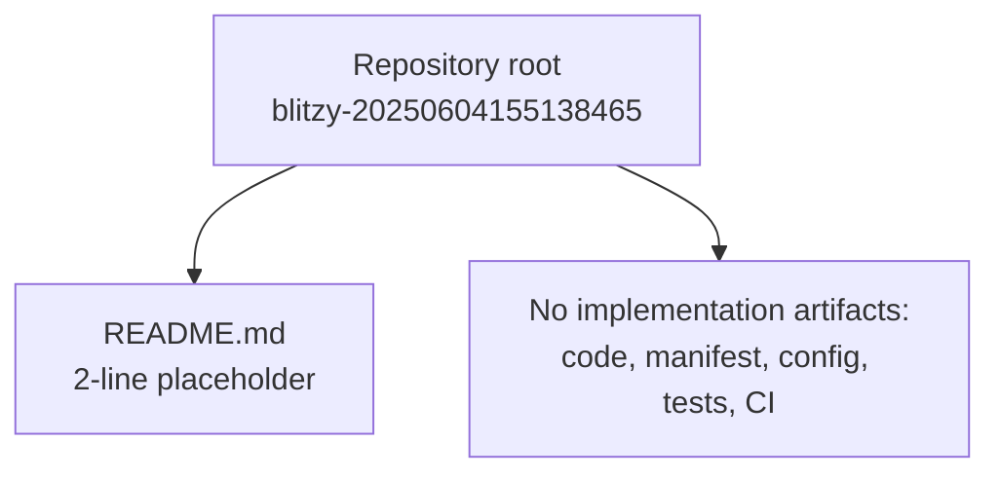

**Core technical approach.** Undetermined. The repository names no programming language, framework, runtime version, or library; contains no build, test, or deployment tooling; and declares no architectural pattern. Nothing in the tree constrains a future technical approach or evidences a present one. This is the most structurally significant fact about the system: the technical approach is not "chosen but undocumented" — no artifact makes a choice at all.

### 1.2.3 Success Criteria

**Measurable objectives.** None are recorded. The repository contains no acceptance criteria, test suite, benchmark, service-level objective, or definition of done, and no issue tracker content, roadmap, or milestone metadata.

**Critical success factors.** The only success criterion the repository itself evidences is that it must carry a README, a condition the initial commit satisfies. Beyond that, no critical success factor, dependency, or assumption is stated anywhere in the tree.

**Key performance indicators.** None are defined. The repository contains no instrumentation, analytics, metric definitions, dashboards, or reporting artifacts, and no target, threshold, or budget against which performance could be judged.

| Criteria category | Evidence sought | Finding |
|---|---|---|
| Measurable objectives | Acceptance criteria, tests, SLOs | None recorded |
| Critical success factors | README requirement, stated assumptions | One satisfied: the repository carries a README |
| Key performance indicators | Instrumentation, dashboards, metric definitions | None defined |

These criteria become documentable only when the repository gains an artifact that states them — a requirement statement, a manifest, a test suite, or an operational target. Until then, this sub-section reports a verified absence rather than an unverified target.

## 1.3 Scope

Scope is defined here from two directions: the elements the repository actually carries, and the elements it does not. Both lists are established by inspecting the repository at commit `1f7f073`, whose entire content is the single placeholder `README.md` described in section 1.1. The distinction matters throughout — several entries below are out of scope because no artifact exists to bring them in, which is a statement about the repository's state rather than a product decision made by a stakeholder.

### 1.3.1 In-Scope

**Core features and functionalities.** The following table records each capability class normally enumerated here against the artifact that would evidence it:

| Capability class | Expected evidence | Present at `1f7f073` |
|---|---|---|
| Must-have capabilities | Any implementation artifact | None; the only artifact is `README.md` |
| Primary user workflows | UI, CLI, or route definitions | None; no interface of any kind |
| Essential integrations | Dependency manifest or API client | None; no manifest or client code |
| Key technical requirements | Language, runtime, or build declaration | None; no technology is named |

The single capability the repository does exercise is that it carries a README naming the project and declaring its origin — the two lines documented in section 1.1.

**Implementation boundaries.** The boundaries of the system as it stands are minimal and precise:

| Boundary dimension | Position evidenced by the repository |
|---|---|
| System boundary | The repository root (`""`); it encloses `README.md` only and exposes no interface to any other system |
| User groups covered | None; no interface exists through which a user could act |
| Geographic or market coverage | None stated; no locale, region, distribution, or compliance scope appears |
| Data domains included | None; no schema, storage mechanism, dataset, or data-handling artifact exists |

For this Technical Specification, the in-scope evidence base is likewise bounded: the repository at the commit identified in section 1.1, comprising the README file and the git metadata surrounding it. Every other subject the specification would ordinarily describe awaits an implementation artifact to describe.

### 1.3.2 Out-of-Scope

**Explicitly excluded features and capabilities.** Each exclusion follows from the absence of a corresponding artifact rather than from a declared decision:

| Excluded element | Reason for exclusion |
|---|---|
| Functional software of any kind | No source files exist in the repository |
| Programmatic interfaces and user interfaces | No handlers, routes, screens, or commands are defined |
| Data persistence and data handling | No schema, model, migration, or storage configuration exists |
| External integrations | No manifest, dependency, or client code declares one |
| Delivery and operations | No container, deploy, infrastructure, or CI configuration exists |
| Automated quality processes | No tests, linters, or review configuration exist |

**Future phase considerations.** No future phase is recorded. The repository contains no roadmap, backlog, milestone, issue metadata, or design note, and its history is a single commit. The only forward-looking signals are structural: the README's word "Auto-created", which indicates the repository was provisioned as a starting point, and the existence of a `main` branch on which work would proceed. Because no phase, schedule, or planned capability is documented, future phases cannot be enumerated in this specification.

**Integration points not covered.** This category is empty by absence rather than by deferral. No integration point exists in the repository, so none has been consciously excluded from scope; nothing is awaiting a later phase in the integration dimension.

**Unsupported use cases.** No use case can be named as unsupported, because no capability exists that could support or fail to support one. Stated precisely, every conceivable use case is unsupported at this commit; enumerating them would add no information about the system.

This out-of-scope list describes the repository's current state. It should be revisited when the repository gains an artifact — a problem statement, a requirements document, a manifest, or source code — that records an actual scope decision, at which point in-scope and out-of-scope elements can be attributed to a deliberate choice.

## 1.4 References

- `README.md` — the repository's only artifact; established the project identifier `blitzy-20250604155138465` on line 1 and the declaration "Auto-created public repository with README" on line 2, and its two-line, 70-byte extent confirmed that no further documentation exists.
- `""` (repository root folder) — established that the repository has exactly one first-order child (`README.md`), no sub-folders, and therefore no manifests, source files, configuration, CI workflows, tests, or additional documentation.
- [web] remote `origin`, `https://github.com/blitzytest02/blitzy-20250604155138465.git` — confirmed the GitHub owner namespace `blitzytest02` and the public repository name.
- [repo metadata] git object database, refs, and commit log inspected in the working tree — established the single commit `1f7f073` ("Initial commit"), the sole branch `main` (with `origin/HEAD` and `origin/main` pointing at the same commit), the absence of tags, stashes, or dangling objects, a total of three git objects, and the commit author `blitzytest02` with timestamp `2025-06-04 15:51:39 +0530`, which matches the date encoded in the repository identifier.

# 2. Product Requirements

## 2.1 Feature Catalog

The Feature Catalog for this system is empty. No feature is admissible from the repository at commit `1f7f073`, and none has been invented to fill the catalog. The admission rule applied throughout this section is that a feature enters the catalog only when a repository artifact backs it: source code implementing behaviour, a manifest or configuration declaring a capability, an interface definition, or a requirement/backlog document naming it. Under that rule the catalog contains zero entries, and the material below records the evidence for that finding in place of a feature list.

| Evidence that would admit a feature | Where it would live | Finding at `1f7f073` |
|---|---|---|
| Code implementing behaviour | Source files in any language | Absent; a full working-tree enumeration returns only `README.md` |
| Declared capability or dependency | Manifest, lockfile, build script | Absent; `git ls-files` lists one path, and it is not a manifest |
| Interface definition | Route handlers, API schema, CLI entry point | Absent; the tree holds no executable or declarative interface |
| Named requirement or backlog item | `docs/`, `requirements/`, issue or project metadata | Absent; semantic searches for requirement and feature documents return no results |

The repository carries three git objects in total — one commit, one tree, one 70-byte blob (`README.md`) — and that object set is the complete evidence base from which a feature could be derived. Section 1.2.2 reaches the same conclusion from the component view, describing `README.md` as the repository's only component; the catalog below inherits that finding and carries it into the requirements dimension.

### 2.1.1 Feature Metadata

No feature metadata exists to record, because no feature exists to describe. The prompt-prescribed metadata schema is reproduced here with its observed value, so that the empty state is explicit rather than implied.

| Metadata field | Prompt-specified format | Observed value at `1f7f073` |
|---|---|---|
| Unique ID | `F-XXX` | None assigned; no feature exists to carry an identifier |
| Feature Name | Free text | None; no artifact names a capability |
| Feature Category | Categorical label | None; no artifact organises capabilities |
| Priority Level | Critical/High/Medium/Low | None; no artifact ranks any capability |
| Status | Proposed/Approved/In Development/Completed | None; no roadmap, design note, or issue metadata holds a status |

The ID series `F-001` onward therefore begins at the repository's first implementation artifact, not in this document. Two consequences deserve statement, because both are easy to get wrong when reading the repository's history. First, the single commit `1f7f073` cannot be read as a `Completed` feature: it records a provisioning act (the README's own words are "Auto-created public repository with README"), not the delivery of a capability. Second, the absence of categories and priorities is not a documentation gap that this specification is expected to close — no artifact expresses the underlying information, and no supplied user context adds it.

### 2.1.2 Feature Descriptions

No feature description can be written. Each description dimension the prompt prescribes would draw on a specific kind of artifact, and each such artifact is absent:

| Description dimension | Evidence sought | Finding at `1f7f073` |
|---|---|---|
| Overview | Any statement of what the system does | Only self-description: the repository was auto-created with a README |
| Business Value | Benefit statement, metric, cost, or revenue target | None; line 2 of `README.md` states how the file came to exist, not why the project exists |
| User Benefits | Persona, user group, or workflow | None; no user-facing surface and no artifact naming a user |
| Technical Context | Language, framework, runtime, library, or pattern | None; the tree names no technology, and contains no code to imply one |

The repository's entire prose is the two lines of `README.md`: the heading `# blitzytest02`-namespaced project identifier `blitzy-20250604155138465` on line 1, and "Auto-created public repository with README" on line 2. Both lines describe the repository itself. Neither makes a claim about behaviour, value, users, or technology, so the description dimension of the catalog has nothing to report beyond the verified absence of its inputs. Section 1.3.1 records the same state from the scope direction, noting that carrying a README is the single capability the repository exercises.

### 2.1.3 Feature Dependencies

The dependency dimension is empty in every class, and not because dependencies went unrecorded — no artifact declares one:

| Dependency class | Evidence sought | Finding at `1f7f073` |
|---|---|---|
| Prerequisite features | Cross-reference between features | None; there are no features between which a prerequisite could exist |
| System dependencies | Manifest, lockfile, module imports | None; the repository declares zero dependencies and imports nothing |
| External dependencies | API client, SDK reference, service descriptor | None; the tree consumes no external system |
| Integration requirements | Inbound or outbound interface definition | None; no interface is defined, exposed, or consumed |

With zero feature nodes, the dependency graph has neither edges nor parents, so this sub-section reports an empty graph rather than an unverified one. Sections 2.3 and 2.5 carry that empty graph forward into the relationships map and the traceability matrix.


## 2.2 Functional Requirements Table

No functional requirement is recorded for this system, and no requirement identifier of the prompt-specified form `F-XXX-RQ-YYY` has been assigned. The format itself explains why: it nests each requirement under a feature parent (`F-XXX`), and section 2.1 establishes that no feature exists. Assigning identifiers would therefore fabricate both a requirement and the feature it hangs from. The material below states the empty finding, records the one artifact-backed property of the repository that is testable, and retains the prescribed schema so the table can be populated as soon as a first requirement artifact appears.

| Requirement class | Evidence sought | Finding at `1f7f073` |
|---|---|---|
| Must-Have | Requirement statement with binding acceptance criteria | None; no requirement text exists anywhere in the repository |
| Should-Have | Requirement statement with target acceptance criteria | None; no requirement text exists anywhere in the repository |
| Could-Have | Requirement statement with optional acceptance criteria | None; no requirement text exists anywhere in the repository |
| Non-functional requirements | Performance, security, or compliance target | None; no target, threshold, or standard is stated |

### 2.2.1 Requirement Details

Each field of the prescribed requirement-details schema is listed against its observed value. Every field is unpopulated, and the reason is the same in each case: the repository holds no requirement artifact.

| Requirement field | Prompt-specified format | Observed value at `1f7f073` |
|---|---|---|
| Requirement ID | `F-XXX-RQ-YYY` | None assigned; no feature parent (`F-XXX`) exists to derive one from |
| Description | Statement of required behaviour | None; no behaviour is defined or described |
| Acceptance Criteria | Verifiable pass/fail condition | None; no criterion is stated for any capability |
| Priority | Must-Have/Should-Have/Could-Have | None; no artifact ranks or demands any capability |
| Complexity | High/Medium/Low | None; no artifact rates the effort of any capability |

**Sole artifact-backed property.** One property of the repository is stated in an artifact, is testable, and is satisfied. It is recorded here because it is the only content the functional-requirements dimension can carry, but it is labelled an observed repository property rather than a designed product requirement: no artifact states it as a requirement, and it therefore receives no requirement identifier.

| Observed repository property | Acceptance criterion | Verification at `1f7f073` |
|---|---|---|
| The repository carries a README at its root that names the project | `README.md` exists at the repository root and is non-empty | Satisfied; `README.md` is 2 lines and 70 bytes, tracked in commit `1f7f073` |
| The README states the repository's origin | Line 2 reads "Auto-created public repository with README" | Satisfied; content confirmed by direct file read |

This property aligns with section 1.2.3, which identifies the requirement that the repository carry a README as the only success criterion the repository itself evidences, and with section 1.3.1, which names it as the sole capability exercised.

### 2.2.2 Technical Specifications

No requirement exists whose technical specification could be written. Each prescribed dimension is listed against the artifact that would supply it:

| Specification dimension | Evidence sought | Finding at `1f7f073` |
|---|---|---|
| Input Parameters | Function signature, request schema, CLI arguments, config keys | None; no callable, route, command, or configuration key is defined |
| Output/Response | Return type, response schema, emitted artifact, stdout contract | None; no code path exists to produce output |
| Performance Criteria | Latency budget, throughput target, resource limit | None; no target, budget, or limit is stated in any artifact |
| Data Requirements | Schema, field definitions, storage format, retention rule | None; no model, migration, dataset, or storage configuration exists |

### 2.2.3 Validation Rules

No validation rule is defined, because there is no input, no state, and no executable path to validate. Each prescribed category is listed against its evidence:

| Validation category | Evidence sought | Finding at `1f7f073` |
|---|---|---|
| Business Rules | Domain constraint or policy encoded in code or configuration | None; no domain logic, policy, or constraint exists |
| Data Validation | Type check, range check, schema validation, sanitisation | None; no parser, validator, or schema exists in the repository |
| Security Requirements | Authentication, authorisation, secret handling, crypto use | None; the tree contains no session logic, credential material, cipher, or access-control configuration |
| Compliance Requirements | Standard reference, audit obligation, licence terms | None; no standard, obligation, or licence file appears in the tree |

Two security-relevant observations about the repository itself, as distinct from product requirements, are recorded here because they are verifiable from the checkout. First, the clone's `origin` remote carries its fetch and push URLs with an embedded short-lived access-token credential; the credential value is deliberately omitted from this document, but its presence in `.git/config` is an operational fact of the working copy rather than a designed requirement. Second, the repository is public, so anything committed to it becomes world-readable — a consequence of the provisioning act recorded on line 2 of `README.md`, not of any stated policy. Both observations are carried forward to section 2.4.4.


## 2.3 Feature Relationships

The relationships dimension of the product is empty in the same way the catalog is: there are no features to relate. This sub-section therefore documents the relationship structure that the repository actually evidences — a single documentation artifact under version control — and states plainly that no feature-to-feature, feature-to-service, or feature-to-component relationship exists to map. Section 2.1.3 established the empty dependency graph; the material here records it at the system level.

### 2.3.1 Feature Dependency Map

The map has no feature nodes and therefore no edges. No prerequisite relationship, no parent-child feature decomposition, no optional or alternative dependency, and no cross-feature data dependency is stated or implied anywhere in the repository, because no artifact describes a feature.

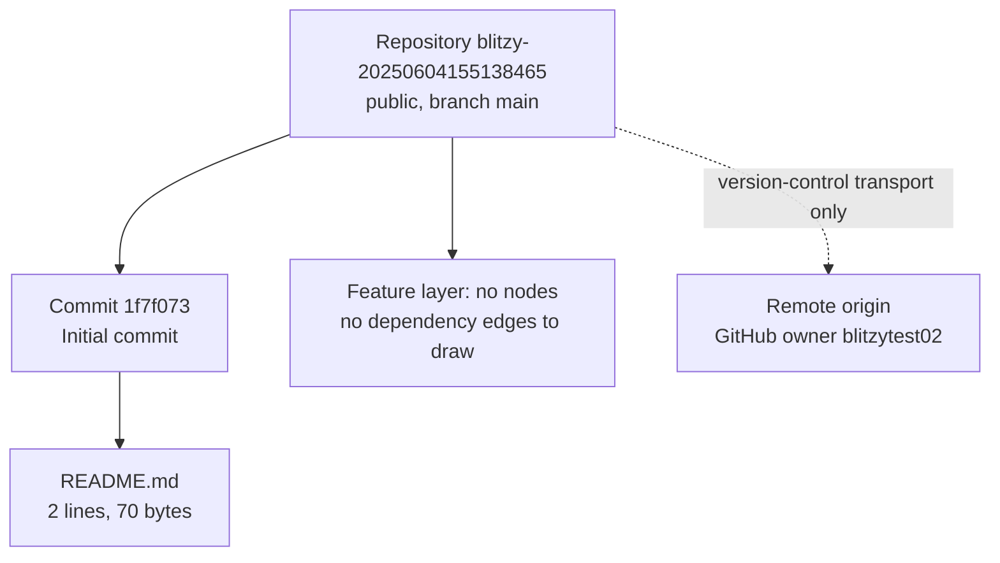

The diagram shows the complete relationship set the checkout supports. Every edge terminates in a version-control artifact — a repository, a commit, a file, or a remote — and none terminates in a feature. The dotted edge to the remote is a transport relationship, not a product integration, as 2.3.2 explains.

### 2.3.2 Integration Points

No integration point exists in either direction. Each class the prompt anticipates is listed against its evidence:

| Integration direction | Evidence sought | Finding at `1f7f073` |
|---|---|---|
| Outbound (systems this product calls) | HTTP client, SDK dependency, connection string, queue producer | None; no dependency is declared and no client code exists |
| Inbound (systems that call this product) | Route handler, exposed endpoint, webhook receiver, CLI contract | None; no interface of any kind is defined or exposed |
| Data-level (systems sharing state) | Shared schema, database connection, file exchange | None; no storage mechanism, schema, or exchange format appears |
| Operational (tooling around the product) | CI workflow, container definition, deploy descriptor, monitoring hook | None; the tree holds no workflow, Dockerfile, infrastructure file, or instrumentation |

The one external endpoint the checkout touches is the git remote `origin`, which resolves to the public GitHub repository under owner `blitzytest02`. That relationship carries source control traffic and nothing else: it exposes no product behaviour, transports no application data, and defines no interface a consumer could call. It is recorded here so that readers do not mistake the remote for a product integration point.

### 2.3.3 Shared Components and Common Services

No shared component and no common service exists:

| Shared element | Evidence sought | Finding at `1f7f073` |
|---|---|---|
| Shared code modules | Library package, utility module, shared type definitions | None; there is no code to factor or share |
| Common services | Logging, configuration, messaging, caching, identity service | None; no service is defined, configured, or consumed |
| Shared configuration | Central config file, environment contract, feature flags | None; no configuration artifact exists |
| Shared conventions | Lint config, editor config, commit or review policy | None; `.gitattributes`, `.gitignore`, and `.editorconfig` are all absent from the tree |

The single element common to the repository is `README.md` itself, and it is documentation rather than a component: it defines no symbol, exposes no interface, and declares no dependency, so nothing depends on it at runtime. Consequently there is no shared surface across which a future consistency or versioning concern could arise, and no component ownership boundary for section 2.4 to describe.


## 2.4 Implementation Considerations

Implementation considerations apply to a feature's construction. With no feature in the catalog, this sub-section inverts its usual subject: it documents the considerations the repository itself imposes on any future implementation, and states for each prescribed dimension that no feature-level requirement exists. Every finding below is bounded by commit `1f7f073` and by the artifact set described in section 1.2.2 — one commit, one branch, one README file.

### 2.4.1 Technical Constraints

The decisive constraint is that the repository fixes no technology. It names no language, framework, runtime version, library, or architectural pattern, and contains no build, test, packaging, or deployment tooling to imply one. The constraints that do exist are structural properties of the checkout:

| Constraint | Observed fact | Consequence for implementation |
|---|---|---|
| Version control layout | Branch `main` at commit `1f7f073`; no tags; no additional branches | Work starts from a single unreleased commit; no release or tagging convention is established |
| Documentation obligation | `README.md` exists and is the only artifact | The README is the sole carrier of project intent; nothing else records what the project is for |
| Repository visibility | Public | Any commit is world-readable from the moment it is pushed |
| Credential handling | `origin` fetch/push URLs embed a short-lived access token (value omitted here) | Access is mediated by an ephemeral credential in the working copy, not by a stored key or an SSH identity |
| Convention enforcement | No `.gitignore`, `.gitattributes`, or `.editorconfig`; no lint or format configuration | Nothing normalises line endings, paths, or style, and nothing excludes generated or local files from commits |
| Licence terms | No licence file in the tree | No terms of use, modification, or redistribution are granted by the repository |

Because no technology is fixed, no compatibility, migration, or platform constraint can be stated for future work, and no existing choice needs to be preserved. Conversely, nothing in the repository guides a future choice — the technology decision is entirely open at this commit, which is the most consequential fact for anyone planning implementation.

### 2.4.2 Performance Requirements

No performance requirement exists and none can be measured. There is no code path to time, no endpoint to benchmark, no query to profile, and no process to observe; the repository contains no instrumentation, no metric definition, no threshold, and no budget, and section 1.2.3 separately records that no key performance indicator is defined anywhere in the tree. The requirement set therefore places no latency, throughput, resource, or availability obligation on any future implementation, and the repository provides no basis for setting one. A performance requirement becomes expressible only when an artifact states a workload and a target.

### 2.4.3 Scalability Considerations

No scalability consideration is stated or implied. The repository defines no data layer, no service boundary, no concurrency model, no queue, and no external dependency whose capacity could constrain growth, and no artifact projects a load, user count, data volume, or growth trajectory. The only quantitative facts available describe the artifact set itself and are operational rather than architectural: three git objects, a 2 KB pack, and approximately 196 KB of working directory, of which the sole tracked file is 70 bytes. The repository consequently neither supports nor excludes any scaling strategy; the question is deferred until a first component defines a boundary that could scale or fail to.

### 2.4.4 Security Implications

The repository presents no application security surface. The tree contains no untrusted input, no authentication or session logic, no cryptography or key material, no deserialisation or dynamic code loading, no constructed SQL, shell, or filesystem path, and no access-control configuration; with zero declared dependencies, there is also no dependency chain to scan or patch. What can be stated is limited to repository-level operational implications, each verified from the checkout:

| Implication | Observed fact | Recommended treatment |
|---|---|---|
| Credential exposure in the working copy | The clone's `origin` remote URL embeds a short-lived access-token credential | Treat the credential as scoped and ephemeral; rotate it rather than relying on its expiry, and avoid copying `.git/config` outside the checkout |
| Irreversible public disclosure | The repository is public, as `README.md` line 2 records | Assume every commit is permanently readable; review content before pushing |
| Accidental inclusion of sensitive or generated files | No `.gitignore` exists in the tree | Add an ignore file before the first implementation commit, so environment, credential, and build artifacts cannot be staged by default |
| No automated security verification | No CI workflow or scan configuration exists | Any review or scanning control must be introduced alongside the first implementation; none is inherited |

These are properties of the repository's provisioning, not product requirements, and none of them constrains a future design beyond the hygiene measures listed. Section 2.2.3 records the first two observations in the requirements context.

### 2.4.5 Maintenance Requirements

There is no code, dependency, test, or pipeline to maintain, so the recurring maintenance burden the repository imposes at `1f7f073` is confined to repository hygiene. Four items follow from the evidence and are stated as the maintenance surface that exists today: keep `README.md` accurate, since it is the only artifact that carries project intent; manage the access credential embedded in the `origin` remote and avoid propagating it; add ignore and attribute configuration before implementation begins, since none exists to prevent unwanted staging or to normalise line endings; and decide the licence question, because the repository currently grants no rights and publishes no terms. Beyond these, there are no scheduled upgrades, no advisory tracking, no test upkeep, no build maintenance, and no release process to service. The change history gives no maintenance convention to follow: it consists of one commit by author `blitzytest02` dated 2025-06-04 15:51:39 +0530, with no changelog, no tagging, and no branch policy.

### 2.4.6 Assumptions and Constraints

**Assumptions.** First, this section assumes the checkout at commit `1f7f073` is authoritative for the product: the repository's objects are complete and no unpushed work exists elsewhere, which the object enumeration supports by finding no dangling objects, no notes, no stashes, and no refs beyond `main` and `origin/main`. Second, it assumes no requirements live outside the repository; this specification was supplied no attachments and no user context naming requirements, so no external requirement source is available to contradict the empty catalog. Third, it assumes the absence of a manifest is genuine rather than the result of incomplete retrieval, which the full working-tree enumeration and the semantic searches both support.

**Constraints.** The findings above are state-dependent: every absence this section reports is an accurate description of commit `1f7f073` and becomes stale the moment any artifact — a requirement document, a manifest, a source file, or a workflow — is added. The empty feature catalog, the empty requirement table, and the empty relationship map should therefore be revisited on the first commit after `1f7f073`, at which point identifiers, priorities, statuses, and dependencies can be assigned from that artifact rather than inferred.


## 2.5 Traceability Matrix

Traceability links a requirement to the feature that satisfies it and to the artifact that verifies it. This system has no requirement artifact, so the chain has no first link and the matrix below carries a single entry — the one repository property that is stated in an artifact, testable, and satisfied. It receives no requirement or feature identifier, because section 2.1 assigns none and section 2.2 explains why fabricating one would misrepresent the repository.

### 2.5.1 Requirement-to-Feature Traceability Matrix

| Requirement or property | Feature ID | Verification artifact | Verification method |
|---|---|---|---|
| No requirement artifact exists; no requirement identifier assigned | None assigned; catalog is empty (section 2.1) | No acceptance criteria or test artifact exists | Not verifiable; nothing to test |
| Repository carries a non-empty README naming the project | None; recorded as an observed repository property, not a feature | `README.md` (2 lines, 70 bytes) in commit `1f7f073` | Direct file inspection and `git ls-files` |

The full chain, stage by stage, is empty at every link except the last:

| Chain stage | Expected form | State at `1f7f073` |
|---|---|---|
| Requirement | `F-XXX-RQ-YYY` statement with acceptance criteria | Absent; no requirement text in the tree |
| Feature | `F-XXX` entry in the catalog | Absent; zero features (section 2.1) |
| Verification | Test suite, CI job, or manual check procedure | Absent; no test, workflow, or check procedure exists |

There is consequently nothing to trace forward from a requirement and nothing to trace backward from an implementation. Two categories the prompt anticipates are empty for the same reason: no requirement carries a Must-Have, Should-Have, or Could-Have priority to trace, and no requirement carries a complexity rating. When the first requirement artifact appears, the matrix expects one row per requirement linking its identifier to the feature that realises it and to the test or check that verifies it.

### 2.5.2 Requirement Versions and Change History

No requirement version exists to track. Version tracking presupposes requirement artifacts and their revisions; the repository holds none, and the only property recorded in 2.5.1 has a single state, introduced in commit `1f7f073` and unchanged since. The repository's own change history is correspondingly minimal and is the only chronological evidence available:

| Change record | Detail |
|---|---|
| Commit | `1f7f073` "Initial commit", author `blitzytest02`, 2025-06-04 15:51:39 +0530 |
| Files changed | 1 file changed, 2 insertions — `README.md` added in its entirety |
| Subsequent changes | None; `main`, `origin/main`, and `origin/HEAD` all resolve to `1f7f073`, with no tags and no additional commits |

The reflog adds no hidden history: it records the initial clone from `https://github.com/blitzytest02/blitzy-20250604155138465.git`, one detached-HEAD checkout of `1f7f073`, and a return to `main`. Version tracking for requirements therefore begins at the repository's first requirements artifact, at which point this sub-section should record the artifact's revision, its author, and the commit that introduced it. Until then, the version of the product requirements is, precisely, the version of a repository containing one placeholder README.

### 2.5.3 Related Specifications and Process Flowcharts

No process flowchart exists for any feature, because no feature process is defined. The diagrams that can be drawn for this system describe its artifacts rather than its behaviour: section 1.2.2 shows the repository's composition — a root containing one README and one documented absence — and section 2.3.1 shows the relationship graph, which has no feature nodes. Neither is a process flow.

The related specifications that exist are the sections of this document, all of which were written from the same evidence base and all of which report the same state:

| Related specification | Relationship to this section |
|---|---|
| [1.1 Executive Summary](#11-executive-summary) | Establishes the repository as public, auto-created, and unimplemented, and records the README as its only deliverable |
| [1.2 System Overview](#12-system-overview) | Identifies `README.md` as the sole component (1.2.2) and the README-presence condition as the only evidenced success criterion (1.2.3) |
| [1.3 Scope](#13-scope) | Establishes that no capability, integration, or data domain is in scope (1.3.1) and that exclusions follow from absent artifacts (1.3.2) |
| [1.4 References](#14-references) | Lists the complete evidence base: `README.md`, the repository root, the `origin` remote, and the git metadata |

No external specification is referenced by the repository: there is no API document, architecture decision record, design note, data dictionary, runbook, or linked wiki, and no URL appears anywhere in the tree. The only external source relevant to this section is the public GitHub repository named by the `origin` remote under owner `blitzytest02`.


## 2.6 References

- `README.md` — the repository's only artifact and the sole source of product intent; line 1 establishes the project identifier `blitzy-20250604155138465`, line 2 states "Auto-created public repository with README". Its 2-line, 70-byte extent is what makes the feature catalog empty and the functional-requirements table unpopulated.
- `""` (repository root folder) — established that the repository has exactly one first-order child and no sub-folders, so no manifest, source file, configuration, schema, interface definition, workflow, test, or requirement document exists to back a feature.
- `[repo metadata]` git object database, refs, reflog, and commit log inspected in the working tree — established the single commit `1f7f073` ("Initial commit", author `blitzytest02`, 2025-06-04 15:51:39 +0530, 1 file changed, 2 insertions), the sole branch `main`, `origin/main` and `origin/HEAD` at the same commit, the absence of tags, stashes, notes, and dangling objects, and a total of three objects (one commit, one 37-byte tree, one 70-byte blob). This object set is the complete evidence base from which features could have been derived, and it contained none.
- `[repo metadata]` full working-tree enumeration and `git ls-files` — confirmed that the only non-`.git` path is `README.md` and that no `.gitignore`, `.gitattributes`, `.editorconfig`, or `.blitzyignore` file exists anywhere in the checkout.
- `[web]` `origin` remote, `https://github.com/blitzytest02/blitzy-20250604155138465.git` — confirmed the public GitHub repository name and owner namespace, and established that the clone's fetch and push URLs carry an embedded short-lived access-token credential (value deliberately omitted from this document).
- `[document]` Sections 1.1 Executive Summary, 1.2 System Overview, 1.3 Scope, and 1.4 References of this Technical Specification — cross-referenced for consistent terminology and to avoid restating scope exclusions; 1.2.2 supplied the component view of `README.md`, and 1.2.3 supplied the README-presence success criterion recorded as the sole artifact-backed property in section 2.2.1.


# 3. Technology Stack

## 3.1 Programming Languages

No programming language is declared or evidenced anywhere in the repository at commit `1f7f073`. This sub-section is consequently an inventory rather than a selection: it maps each component the prompt's default stack would assign a language to, names the artifact that would declare that language, and records that no such artifact exists. Section 1.2.2 reaches the same conclusion from the architecture direction, stating that the core technical approach is undetermined because no artifact makes a technology choice at all.

**Languages by platform and component.** The table below is the prompt's platform/component breakdown with the repository's answer against each row. The middle column records only what the default technology stack proposes; no row in it is a repository finding, and the final column records the artifact that would have established the language choice.

| Platform / component | Language proposed by the default stack | Artifact that would declare it | Finding at `1f7f073` |
|---|---|---|---|
| Backend service | Python | `.py` source, `requirements.txt`, `pyproject.toml`, `setup.py`, `setup.cfg`, `Pipfile`, `environment.yml` | None; every candidate was tested for presence and none exists |
| Web frontend | TypeScript with React | `package.json`, `tsconfig.json`, `.tsx` source | None; no npm manifest or TypeScript source |
| Mobile / cross-platform | TypeScript with React Native | `package.json`, app manifest | None |
| iOS | Swift | `Package.swift`, Xcode project sources | None |
| Android | Kotlin | `build.gradle`, `build.gradle.kts`, `settings.gradle` | None |
| macOS | Objective-C | Xcode project sources, `Podfile`-style dependency manifests | None |
| Desktop | JavaScript with ElectronJS | `package.json`, entry-point source | None |
| Repository's only artifact | Not a programming language | `README.md` | Present: Markdown documentation, 2 lines / 70 bytes, with no executable content and no runtime |

The evidence for the "None" findings is stronger than an absent-name check. The full working-tree enumeration (`find` over the whole checkout) returns only `README.md`, so no source file of any language exists under any name, and `git ls-files` lists a single path. The git object database holds exactly three objects — one commit, one tree, and one 70-byte blob — so no source file is concealed in history, on another branch, or in an unreferenced object either. The only language-like content in the repository is the Markdown of `README.md`, whose line 1 (`# blitzy-20250604155138465`) is a level-one heading; Markdown is a documentation markup format interpreted by renderers, not a programming language, and it carries no interpreter version, entry point, or build step.

**Selection criteria.** No criterion was applied, because none is recorded. The repository contains no performance requirement, platform target, team-convention note, ecosystem or licence constraint, or interoperability need against which a language could be justified, and section 2.1 records the complementary fact that no feature exists to derive one from. Rather than a language chosen and left undocumented, the position at `1f7f073` is that no language-bearing artifact exists: the decision is open, not merely implicit.

**Constraints and dependencies.** Nothing in the tree constrains a future language choice, and equally nothing guides it. What the repository does impose on whichever language is adopted is a small set of repository-level conditions, all verified from the checkout and consistent with section 2.4.1:

| Condition | Observed fact | Effect on language selection |
|---|---|---|
| Publication surface | The repository is public (`README.md` line 2) | Every pushed source file is world-readable, from the first commit |
| Terms of use | No licence file anywhere in the tree | No rights of use, modification, or redistribution are granted to anyone |
| Toolchain baseline | No `.tool-versions`, `.nvmrc`, `.python-version`, or `runtime.txt` | No interpreter or runtime version is pinned, so no version compatibility baseline exists for the language chosen |
| Cross-platform hygiene | No `.gitattributes` and no `.gitignore` | Line-ending and path normalisation are unconfigured, and no built or generated file is excluded from staging by default |
| Version control | Branch `main` at commit `1f7f073`, no tags | The only tool any language must integrate with today is `git`; no release or tagging convention exists to satisfy |

The repository's technology surface is therefore two observed items and six empty categories, as the figure below summarises; sections 3.2 through 3.6 expand each empty category with its own evidence.

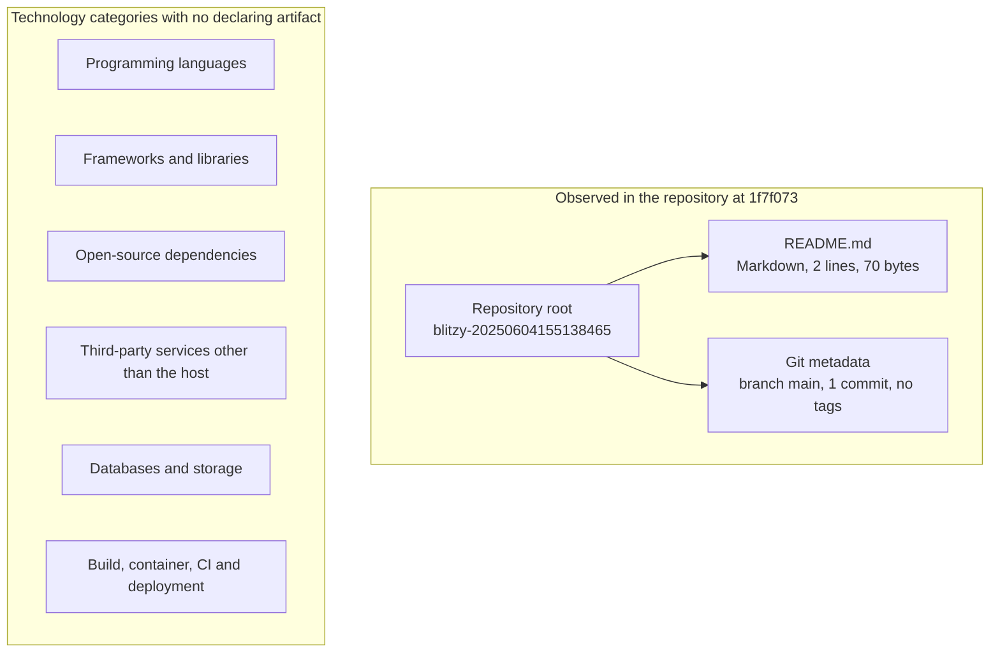

## 3.2 Frameworks &amp; Libraries

No framework or library is declared in the repository at commit `1f7f073`, so no framework version, supporting library, or compatibility requirement can be reported. The determination is direct: a framework enters a repository through a dependency manifest, an import in source code, or a version-pinning file, and none of the three exists here — the working tree holds only `README.md`, `git ls-files` lists that single path, and no manifest or lockfile of any ecosystem was found.

**Core frameworks with versions.** The default stack's major frameworks are listed below against the repository's answer. As in section 3.1, the proposal column reflects only the supplied default stack; no artifact in the repository makes any of these choices, and the "version" column is uniformly empty because nothing pins a version of anything.

| Framework / library | Ecosystem the default stack implies | Version declared in the repository | Artifact evidencing use |
|---|---|---|---|
| Flask (backend framework) | Python | None | No Python manifest or source file exists |
| React with TypeScript (web UI) | npm | None | No `package.json`, lockfile, or `.tsx` source exists |
| TailwindCSS (styling) | npm | None | No build or style configuration exists |
| Langchain (AI orchestration) | Python or npm | None | No manifest, and no model or prompt artifact exists |
| React Native with TypeScript (mobile) | npm | None | No mobile manifest or application entry point exists |
| ElectronJS (desktop shell) | npm | None | No `package.json` or main-process source exists |

**Supporting libraries.** None. There is no code in which a library could be imported and no manifest in which it could be listed, so the supporting-library layer is empty by construction rather than by omission. The repository's one artifact, `README.md`, contains prose and a heading and imports nothing.

**Compatibility requirements.** None can be stated, for two reasons that compound. First, no version is pinned anywhere: the candidate runtime-pinning files (`.tool-versions`, `.nvmrc`, `.python-version`, `runtime.txt`) are all absent, so there is no interpreter or runtime version to be compatible with. Second, no lockfile exists, so no resolved dependency set exists whose members would have to remain mutually compatible. Nothing therefore constrains an upgrade path, a framework's minimum runtime, or the interoperability of two frameworks — and conversely, any combination the project eventually adopts would have its compatibility envelope established from scratch. This mirrors section 2.4.1, which records that because no technology is fixed, no compatibility, migration, or platform constraint can be stated.

**Justification for each major choice.** No justification is available or required, because no choice has been made. Justification presupposes a requirement, workload, or constraint that the framework satisfies, and the repository records none of these: the feature catalog is empty (section 2.1), no performance requirement or scaling consideration exists (sections 2.4.2 and 2.4.3), and no measurable objective is defined (section 1.2.3). Adopting any framework named above would therefore be a net-new architectural decision whose rationale must be recorded in the repository as it is made, not read out of it today.

**Security implications.** With no framework and no dependency declared, the repository carries no framework advisory surface and no dependency chain to scan, patch, or pin — the state section 2.4.4 describes. The practical consequence for framework selection is that the first framework added is also the first item of third-party code the project will have to track for vulnerabilities, and no scanning control exists in the repository to do so, since there is no continuous-integration configuration (section 3.6).

## 3.3 Open Source Dependencies

The repository declares zero open-source dependencies at commit `1f7f073`. No manifest, lockfile, registry configuration, vendored copy, or third-party licence inventory exists in the tree, so this sub-section reports an empty dependency set and the evidence for each class of dependency declaration that would populate it.

**Declared dependencies.** A dependency is declared by a manifest or lockfile; the repository has neither, in any ecosystem. The candidate manifests and lockfiles tested for presence were `package.json` with `package-lock.json`, `yarn.lock`, and `pnpm-lock.yaml`; `requirements.txt`, `requirements-dev.txt`, `pyproject.toml`, `poetry.lock`, `Pipfile`, `Pipfile.lock`, `setup.py`, `setup.cfg`, and `environment.yml`; `go.mod` and `go.sum`; `Cargo.toml` and `Cargo.lock`; `pom.xml`, `build.gradle`, `build.gradle.kts`, and `settings.gradle`; `Gemfile` and `Gemfile.lock`; `composer.json`; `mix.exs`; and `Package.swift`. None is present. Because the working tree additionally contains no sub-folders at all and the object database holds a single 70-byte blob, no dependency declaration can be hiding under an unconventional name, in a nested module directory, or in an earlier commit.

| Dependency class | Artifact that would declare it | Finding at `1f7f073` |
|---|---|---|
| Direct dependencies | Any ecosystem manifest | None present |
| Transitive dependencies | Any lockfile or resolved dependency tree | None present; with no direct dependency, the transitive graph is necessarily empty |
| Registry configuration | Registry or scope configuration such as an npm or pip configuration file, or a private feed descriptor | None present |
| Vendored third-party code | A directory carrying external source under `vendor/`, `third_party/`, or similar | None present; the repository has no sub-folders |
| Third-party licence inventory | `NOTICE`, third-party licence list, or SBOM | None present |

**Packages, registries, and versions.** Because nothing is declared, no package, registry, or version can be reported as in use — and no version is pinned for anything in the repository, since no lockfile exists to fix one. For reference only, and not as repository evidence, the packages the supplied default stack names would arrive from the following canonical registries: Flask and Langchain from the Python Package Index; React, TailwindCSS, React Native, and ElectronJS from the npm registry. Nothing in the repository references either registry, and adopting any of those packages would introduce both the registry and the project's first lockfile.

**Supply-chain and licensing implications.** The security position follows directly from the empty set: there is no dependency to scan, no advisory to track, and no transitive package whose compromise could reach this repository — the state section 2.4.4 records from the security direction. On licensing, no third-party licence obligation has been incurred, because no third-party code is consumed; the outstanding licensing issue is the repository's own, since no licence file exists in the tree to grant terms for the code that will eventually be published. Two integration requirements follow for the first dependency added: the manifest and lockfile conventions it establishes become the project's baseline for all later dependencies, and there is no ignore configuration in the repository to keep dependency directories, caches, or generated lock artefacts out of commits by default (section 3.6).

## 3.4 Third-Party Services

Exactly one third-party service is evidenced by the repository at commit `1f7f073`: GitHub, as the host of the repository and the target of its pushes. Every other category the prompt asks about — external APIs, authentication services, monitoring tools, and cloud services — is absent, and absent for the same reason throughout: no client code, SDK dependency, endpoint configuration, or infrastructure descriptor exists in the tree to declare one.

| Service category | Artifact that would declare it | Finding at `1f7f073` |
|---|---|---|
| Source hosting and push target | Remote `origin` in the git configuration | Present: `https://github.com/blitzytest02/blitzy-20250604155138465.git`, owner namespace `blitzytest02`, repository public |
| External APIs and integrations | Client code, SDK dependency, endpoint or base-URL configuration | None; there is no code, dependency, or configuration file of any kind |
| Authentication services | Identity-provider configuration such as a tenant, client identifier, or secret reference | None; the default stack's Auth0 is not referenced anywhere |
| Monitoring and observability tools | Instrumentation, SDK dependency, agent or dashboard configuration | None |
| Cloud services | Infrastructure-as-code descriptor or provider configuration for AWS or any other provider | None; no Terraform, CloudFormation, serverless, or application platform descriptor exists |

**GitHub as the sole integration.** GitHub's role is confined to hosting and delivery: it holds the repository, it is the fetch and push target recorded in `origin`, and it publishes the repository to the world because the repository is public — a fact `README.md` line 2 itself asserts. Nothing else about the relationship is observable from the repository: no workflow definition, policy file, or deployment descriptor exists, so whether any of the hosting platform's own services are in use cannot be determined from the checkout (section 3.6 covers the absent pipeline). The default stack names GitHub Actions alongside GitHub; the host is confirmed, the automation is not, because no workflow file exists.

**Authentication and credentials.** No application authentication service, token issuer, or session mechanism is configured, because there is no application. The one credential the repository does expose is a provisioning credential for the hosting service: the clone's `origin` remote URL embeds a short-lived GitHub access token, whose value is deliberately not reproduced here. Its implications are operational rather than architectural, and are recorded in section 2.4.4 — it should be treated as scoped and ephemeral, rotated rather than relied on to expire, and kept out of anything copied beyond the checkout.

**Integration requirements.** None exist today, and introducing the first external service carries two requirements that follow from the checkout rather than from a stated design. First, the repository provides no configuration or secret-handling convention to inherit: there is no environment file, configuration directory, or template anywhere in the tree — the hidden-file scan finds none. Second, because the repository is public and no `.gitignore` exists to exclude local files by default, any credential introduced alongside a new service would be staged and published unless the ignore configuration is added first. That is the same recommendation section 2.4.4 derives from the security direction and section 2.4.5 lists as part of the maintenance surface.

## 3.5 Databases &amp; Storage

The repository defines no database, no persistence strategy, no cache, and no storage service at commit `1f7f073`. Each of those elements requires an artifact that names it — a driver dependency, a connection configuration, a schema or migration, a model definition, or a bucket descriptor — and the tree contains none, so the absence is verified rather than merely undocumented.

| Storage category | Artifact that would declare it | Finding at `1f7f073` |
|---|---|---|
| Primary database | Driver dependency, connection string or configuration, schema, migrations | None; no manifest lists a driver, and no configuration, schema, or migration file exists |
| Secondary database | The same artifacts | None; a second store presupposes a first |
| Caching layer | Cache client dependency and connection configuration | None |
| Object or file storage | Bucket or storage-service configuration, upload code | None |
| Data files and datasets | Tracked data files of any format | None; the only tracked file is `README.md` |
| Persistence strategy, retention, backup | Documentation or configuration recording any of them | None; no artifact states where data would live or for how long |

**The only persisted bytes.** Nothing in the repository stores data, because nothing in the repository handles data. The single persisted content is git's own object store, which holds exactly three objects — one commit, one tree, and one 70-byte blob (`README.md`) — and those bytes are version-control metadata and documentation, not application data. The default stack names MongoDB as the database; no MongoDB driver, connection string, collection definition, or configuration of any kind appears in the tree, so MongoDB is a proposal with no corresponding artifact.

**Persistence strategy.** None is stated or implied. No schema exists whose evolution would define a migration practice, no model or data-access code exists that would define read and write paths, and no retention, archival, backup, or recovery measure is recorded anywhere. This matches the scope finding in section 1.3.1, which records that no schema, storage mechanism, dataset, or data-handling artifact exists and therefore that no data domain is in scope, and the scalability finding in section 2.4.3, which records that no data layer and no external dependency constrain growth because none exists to scale.

**Selection criteria and security implications.** No database choice has been made, so no criterion — consistency model, query pattern, scale, operational cost — has been applied, and no datastore version is pinned anywhere in the repository since no version is declared for any component. On the security side, the corresponding surface is empty: there is no credential for a datastore, no connection string to leak, no data classification or retention obligation recorded, and no access-control configuration in the tree. The requirement this places on a future data layer is procedural rather than technical: because no `.gitignore` exists, a connection string or credential introduced with the first store would be staged and published to a public repository unless exclusion configuration is added first, the risk section 2.4.4 sets out.

## 3.6 Development &amp; Deployment

Development and deployment tooling is limited to version control. `git` is the only tool the repository evidences, and its evidence is structural rather than declarative: an object database containing one commit, a branch named `main`, `origin` refs pointing at the same commit, and no tags. Everything else the prompt asks about — build system, containerization, and CI/CD — is absent, and its absence is verified by name as well as by enumeration.

| Tooling category | Names tested for presence | Finding at `1f7f073` |
|---|---|---|
| Development tools | `.editorconfig`, `.gitattributes`, `.gitignore`, `Makefile`, `justfile`, `.vscode`, `.idea`, `.devcontainer` | None present; no lint, format, task-runner, or editor configuration exists |
| Build system | `CMakeLists.txt`, `Makefile`, and every ecosystem manifest a build would be defined in | None present; nothing is compiled, packaged, or resolved, so there is no build to run |
| Containerization | `Dockerfile`, `docker-compose.yml`, `docker-compose.yaml`, `compose.yaml`, `.dockerignore`; plus `k8s`, `kubernetes`, `helm`, and `charts` directories | None present; no image definition and no orchestration manifest |
| Infrastructure as code | `terraform.tf`, `main.tf`, `serverless.yml`, `template.yaml`, `app.yaml`, `Procfile`; plus `terraform`, `infra`, and `deploy` directories | None present; no provider, stack, or environment is described |
| Continuous integration and delivery | `.github`, `.gitlab-ci.yml`, `.circleci`, `.travis.yml`, `azure-pipelines.yml`, `.buildkite`, `Jenkinsfile` | None present; no pipeline runs, so no build, test, scan, or deploy stage exists |

**Version control and delivery as they exist.** The delivery path at this commit is a manual push of a Markdown file to a public remote. There is no build step, no automated test, no artefact published, and no environment to deploy into; commit `1f7f073` is the only commit, there are no tags, and no release convention or release artefact is recorded anywhere (section 2.4.5 makes the same point from the maintenance direction).

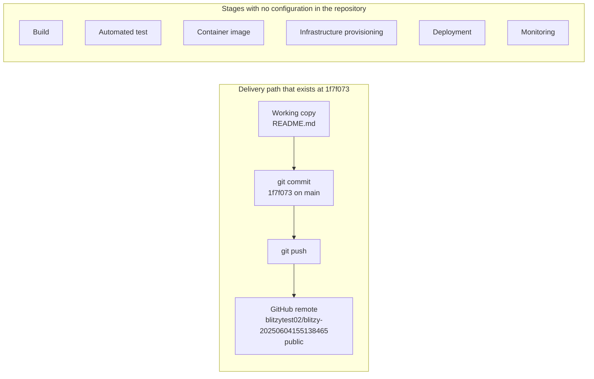

**Version numbers.** The prompt asks for version numbers across the stack; the repository declares none, and this table records that absence per component rather than leaving it implied, since no pinning file, lockfile, image tag, provider constraint, or workflow runner definition exists to carry a version.

| Component | Version declared in the repository | Evidence for the absence |
|---|---|---|
| Language runtime or interpreter | None | No `.tool-versions`, `.nvmrc`, `.python-version`, or `runtime.txt` (section 3.1) |
| Framework | None | No manifest or lockfile (section 3.2) |
| Dependency set | None | No lockfile, so nothing is resolved to a version (section 3.3) |
| Container base image | None | No `Dockerfile` or compose file |
| Infrastructure provider | None | No Terraform, CloudFormation, or serverless descriptor |
| CI/CD runner or action | None | No workflow file of any vendor |
| Version control | `git` is in use; no minimum version is recorded | Branch `main` at `1f7f073`, no configuration pins a git version |

**CI/CD requirements.** No pipeline requirement is stated, because no pipeline, deployment target, or environment is defined, and nothing exists that a pipeline would have to reproduce. What can be stated are the conditions any future pipeline inherits from the checkout, each consistent with section 2.4: the host is GitHub, confirmed by the `origin` remote, and it is the only confirmed platform fact a delivery design can build on; the repository is public, so every pushed commit is world-readable from the moment it lands; the repository grants no licence terms, since no licence file exists; and no ignore configuration exists, so build output, dependency directories, and credentials would be staged by default — the hygiene item sections 2.4.4 and 2.4.5 both recommend resolving before the first implementation commit. Beyond those conditions, containerizing, provisioning, or automating this repository would be a net-new decision: no artefact of the default stack's Docker, Terraform, or GitHub Actions proposal appears anywhere in the tree.

## 3.7 References

- `README.md` — the repository's only artifact and the only evidence of the project's own identity; established the project identifier `blitzy-20250604155138465` (line 1) and the declaration "Auto-created public repository with README" (line 2), and its 2-line, 70-byte extent confirmed that no further documentation, code, or configuration accompanies it.
- `""` (repository root folder) — established that the repository has exactly one first-order child, `README.md`, and no sub-folders; this ruled out manifests, lockfiles, source directories, build scripts, container definitions, pipeline definitions, infrastructure code, dependency listings, and vendored third-party code anywhere in the project.
- [repo metadata] working-tree enumeration and artifact-name scans run in the checkout at HEAD `1f7f073` — established that the candidate language, framework, dependency, registry, database, storage, build, containerization, infrastructure-as-code, CI/CD, and editor-configuration filenames and directories tested are all absent, that no source file of any language exists under any name, and that the working tree contains no hidden file and no `.blitzyignore`.
- [repo metadata] git object database, refs, and commit log — established the single commit `1f7f073`, the sole branch `main` (`origin/HEAD` and `origin/main` at the same commit), the absence of tags, and a total of three objects (one commit, one tree, one 70-byte blob), which confirmed that no source file or dependency manifest is concealed in history or in an unreferenced object.
- [repo metadata] git configuration, remote `origin` — `https://github.com/blitzytest02/blitzy-20250604155138465.git` — established GitHub as the sole evidenced third-party service, the owner namespace `blitzytest02`, and the repository's public visibility; the short-lived access credential embedded in the remote URL is recorded as an operational fact only, with its value omitted.
- [external reference] canonical package registries — Python Package Index and the npm registry — named only to identify where the default stack's proposed packages would originate; neither is referenced by any artifact in the repository.
- [specification] sections 1.2 System Overview, 1.3 Scope, 2.1 Feature Catalog, and 2.4 Implementation Considerations — cross-referenced for the repository's undetermined core technical approach, its empty scope and feature set, and its technical constraints and security implications, so that this section stays consistent with the findings already recorded there.

# 4. Process Flowchart

## 4.1 System Workflows

The repository at commit `1f7f073` executes no workflow. A workflow requires at least one executable or orchestrated step — a handler, a job, a pipeline, or a documented procedure — and the repository contains none: its entire content is `README.md` (70 bytes, 2 lines), it tracks exactly one file, and its git object database holds exactly three objects (one commit, one tree, one blob). Six semantic searches over the indexed repository for workflow-bearing artifacts (application entry points and routes, user-interface journeys, schedulers, queues, webhooks, external integrations, process or sequence documentation, and persistence layers) each returned no result, and a full working-tree enumeration returns only `./README.md`. The sections below therefore record, per prescribed workflow dimension, the artifact that would evidence it and the finding at this commit, then document the single end-to-end process the artifacts *do* evidence: the repository's own provisioning, commit, and publication. That process is an artifact-lifecycle process, not a business process; it produces a named public location and a two-line README, and it delivers no user-facing capability (section 1.1 reaches the same conclusion about delivered value).

### 4.1.1 Core Business Processes

No business process exists in the repository, which is a verified state rather than an undocumented one. Each prescribed dimension of a core business process was tested against the artifact that would carry it:

| Process dimension | Artifact that would evidence it | Finding at `1f7f073` |
|---|---|---|
| End-to-end user journeys | UI screens, CLI entry point, route handlers, or a documented journey | Absent; no file defines an interface, and no document describes a journey |
| System interactions | Module boundaries, service calls, message passing, controllers | Absent; no source file of any language exists under any name |
| Decision points | Conditional logic in code, or a decision recorded in a process document | Absent; no code exists, and `README.md` records only how the repository was created |
| Error handling paths | Exception handlers, retry configuration, alerting rules | Absent; no code and no configuration exist to hold one |

The absence is consistent with sections 1.3.2, 2.1 and 2.4: the scope records no primary user workflow, the feature catalog is empty, and the implementation considerations record that no technology is fixed. No user touchpoint can be named either, because no interface exists through which a user could act; the actors the repository evidences are the automated creator and the repository owner, neither of whom is an end user (section 1.1).

**The one process the artifacts evidence: repository provisioning and publication.** `README.md` line 2 states "Auto-created public repository with README", and the surrounding repository metadata records each step of how that state came to be. The chain below is the complete workflow evidenced anywhere in the repository, reconstructed from `README.md`, the commit object, and the refs; every step cites its evidence.

| Step | What happened | Evidence |
|---|---|---|
| P1 | A repository was created on GitHub under the owner namespace `blitzytest02` | `README.md` line 2 ("Auto-created public repository"); remote `origin` = `github.com/blitzytest02/blitzy-20250604155138465.git` |
| P2 | The repository was assigned the identifier `blitzy-20250604155138465`, whose numeric suffix encodes 2025-06-04 15:51:38 | `README.md` line 1; the commit timestamp is one second later |
| P3 | A README was authored with two lines: the identifier as a level-1 heading, and one sentence stating the repository's origin | `README.md` lines 1-2, 70 bytes total |
| P4 | The content was stored as git objects: blob `687701a0b9445a7539557e4c07695b4ba255695c` (70 bytes) and a tree, `e0c8e59c62a6a975a6a964845e82a5ab3bf30465`, holding a single entry, `100644 README.md` | `git cat-file -p HEAD^{tree}`; `git ls-tree -r HEAD` |
| P5 | A root commit was created — `1f7f073b9d8f818fa2b33fd38a98e391ed2026be`, message "Initial commit", stamped 2025-06-04 15:51:39 +0530, author `blitzytest02 <blitzytest02@gmail.com>`, committer `GitHub <noreply@github.com>` with an attached `gpgsig` block | `git cat-file -p HEAD`; `git rev-list --parents` shows no parent, so it is a root commit |
| P6 | Branch `main` was set to that commit, and no tag was created | `git show-ref`: `refs/heads/main` = `1f7f073`; `git tag` is empty |
| P7 | The commit was published to the remote, which advertises `refs/heads/main` at the same commit; no further commit followed | `git ls-remote --heads --tags origin` returns only `1f7f073 refs/heads/main`; `git rev-list --count HEAD` = 1 |

Two provenance details in P5 deserve statement because they bound what can be inferred. The committer identity `GitHub <noreply@github.com>` together with the PGP signature block is the signature GitHub applies to commits it creates on a user's behalf, and `README.md` line 2 describes the repository as auto-created; the evidence therefore indicates the initial commit was produced through GitHub's own interface rather than by a local `git commit` on a developer machine. The commit is also a root commit with no parent, no merge and no revert anywhere in history (`git rev-list --parents` returns a single SHA; `git fsck --no-progress` reports no dangling, unreachable, or corrupt objects; no stash and no note exists), so this workflow has executed exactly once and left exactly one terminal state.

### 4.1.2 Integration Workflows

No integration workflow is defined in the repository. Each prescribed class was tested against the artifact that would declare it:

| Integration class | Artifact that would evidence it | Finding at `1f7f073` |
|---|---|---|
| Data flow between systems | Client code, connector configuration, schema or payload definitions | Absent; no manifest, no dependency, and no client code exists |
| API interactions | Route definitions for inbound calls, SDK use or endpoint configuration for outbound calls | Absent; the tree defines no interface and consumes none |
| Event processing flows | Webhook receivers, subscribers, queue consumers, event schema | Absent; semantic searches for webhooks, queues and schedulers returned no result |
| Batch processing sequences | Scheduler entries, cron definitions, job descriptors, or CI stages that carry them | Absent; no CI/CD configuration of any vendor exists (section 3.6) |

The single boundary this repository crosses is version-control transport. A git client reaches `https://github.com/blitzytest02/blitzy-20250604155138465.git` over HTTPS, and the checkout's reflog records exactly one such exchange — `clone: from https://github.com/blitzytest02/blitzy-20250604155138465.git` — which materialised `README.md` in the working tree and the remote-tracking refs `refs/remotes/origin/HEAD` and `refs/remotes/origin/main` at commit `1f7f073`. That transport is the repository's only data flow, its only API interaction (the git smart-HTTP protocol exposed by GitHub), and its only cross-system interaction; it carries three objects totalling under 1 KB of packed content. No authentication service, monitoring service, payment service, or cloud resource is declared anywhere in the tree, which matches section 3.4, and the sole third-party service the repository evidences is GitHub itself.

One operational property of this transport is worth noting alongside the workflow, because it is the only authorization surface in the project: the clone's `origin` remote URL embeds a short-lived access-token credential, so remote access is mediated by an ephemeral credential rather than by a stored key or SSH identity (recorded as an operational fact in section 2.4.4, with its value omitted). Because no `.gitignore` or `.gitattributes` exists in the tree, nothing normalises what a future commit may stage — the hygiene condition sections 2.4.4 and 2.4.5 raise for the first implementation commit.

## 4.2 Flowchart Requirements

The flowchart requirements below are applied to the workflows that exist, which is one: the repository's own provisioning and publication recorded in section 4.1.1. For each prescribed flowchart element, the table names the artifact that would evidence it and the finding at `1f7f073`; where an element does exist, its evidence is stated exactly. No element has been supplied from outside the repository, and no business process was diagrammed, because none exists to diagram.

### 4.2.1 Workflow Elements and System Boundaries

| Flowchart element | Evidence sought | Finding at `1f7f073` |
|---|---|---|
| Start point | A trigger, request, or first step recorded in the repository | One exists: repository provisioning, evidenced by `README.md` line 2 ("Auto-created public repository with README") |
| End point | A terminal state the process reaches | One exists: `refs/heads/main` = `1f7f073`, also advertised as `refs/heads/main` on `origin`, with no later commit (`git ls-remote`, `git rev-list --count HEAD`) |
| Process steps | Ordered, individually evidenced steps | Seven, listed as P1-P7 in section 4.1.1, each backed by `README.md`, the commit object, the tree, or the refs |
| Decision diamonds | Conditional branches in code or in a recorded procedure | None in the repository's own logic. The gates that resolved during provisioning are platform-level and were each evaluated once, to a single recorded outcome (section 4.4.2) |
| System boundaries | A declared interface or deployment boundary | The boundary is the repository root, which encloses `README.md` only and exposes no interface (section 1.3.1); the boundary is crossed only by git transport to GitHub |
| User touchpoints | A screen, command, or documented interaction | None; no interface of any kind exists, so no user touchpoint can be placed on any flow |
| Error states and recovery paths | Handlers, retries, fallbacks, or a recorded failure | None; the history contains no failed, reverted, or retried operation (section 4.3.2) |
| Timing and SLA considerations | A latency target, service-level objective, or measured duration | No SLA, target, or budget is defined anywhere (sections 1.2.3 and 2.4.2). The only timing facts the artifacts carry are two timestamps one second apart |

**Timing, stated precisely because it is the sole quantitative flow evidence.** The identifier assigned in P2 is `blitzy-20250604155138465`, whose leading numeric run `20250604155138` reads as 2025-06-04 15:51:38; the initial commit P5 carries Unix time 1749032499, which is 2025-06-04 15:51:39 +0530 (10:21:39 UTC). Provisioning therefore occupied approximately one second, from identifier assignment to commit creation, and the repository has recorded no timing event since. There is no release cadence to state either: `git tag` is empty, there is a single branch (`main`), and section 3.6 records that no build, test, or deployment stage exists to bound a delivery interval. Any SLA, timeout, or throughput target for a future process would be a net-new commitment rather than a documented one.

**Validation Rules.** The prompt requires the business, data, authorization, and compliance rules that apply at each step of a flow. No step of the evidenced process accepts input, so no rule governs it, and the repository states no rule for any future step:

| Rule class | Artifact that would evidence it | Finding at `1f7f073` |
|---|---|---|
| Business rules at each step | Requirement text, policy document, or a check in code | None. The single rule the repository itself satisfies is that a repository carry a README — satisfied by `README.md` (section 1.3.1 records the same capability) |
| Data validation requirements | Input schema, validator dependency, or model constraints | None; there is no schema, no model, no dependency, and no code path that accepts data |
| Authorization checkpoints | Authentication or authorization logic, policy configuration, role definitions | None in the repository. The only authorization that occurs is the platform's HTTPS credential exchange when a client reaches the remote (section 2.4.4) |
| Regulatory compliance checks | Locale, region, data-classification, retention, or licence statement | None. No licence file exists, so the repository grants no terms of use or redistribution (section 2.4.4), and no artifact names a jurisdiction or a regulated data class |

The only validation the repository's own content has undergone is git's object integrity hashing, and it verified clean: `git fsck --no-progress` reports no missing, corrupt, dangling, or unreachable objects across the three objects in the object database. That result confirms the recorded state rather than establishing a validation requirement, and no repository artifact defines a further check — no CI workflow, no lint or format configuration, and no review rule exists (section 3.6). Because no validation rule is expressed anywhere, none can be lost or violated today; the first rule becomes documentable only when an artifact states one.

## 4.3 Technical Implementation

Technical implementation is limited to version control, because that is the only mechanism the repository contains. The prompt's implementation concerns are answered at the artifact level: the state that exists is git's object graph, the persistence point is git's object database, and the error handling that exists is the absence of any handler together with the absence of any recorded failure.

### 4.3.1 State Management

**State transitions.** Two commits never coexist in this repository's history, so its state machine is the sequence by which one revision came to exist and be published. Every state below is evidenced; the diagram form appears in section 4.4.5.

| State | Condition that establishes it | Evidence |
|---|---|---|
| S1 Repository exists | A public repository was created under `blitzytest02` | `README.md` line 2; remote `origin` path |
| S2 Content authored | Two lines of Markdown, 70 bytes | `README.md` (2 lines, 70 bytes) |
| S3 Objects stored | Blob `687701a0…` and tree `e0c8e59c…` exist, tree entry `100644 README.md` | `git cat-file -p HEAD^{tree}`; `git ls-tree -r HEAD` |
| S4 Revision committed | Root commit `1f7f073…`, "Initial commit", GitHub-signed | `git cat-file -p HEAD`; `git rev-list --parents` shows no parent |
| S5 Branch advanced | `refs/heads/main` = `1f7f073…` | `git show-ref` |
| S6 Published | `origin` advertises `refs/heads/main` = `1f7f073…`; `origin/HEAD` and `origin/main` resolve to it | `git ls-remote --heads --tags origin`; `git for-each-ref` |
| S7 Working copy | Clone materialises `README.md` and the remote-tracking refs at `1f7f073…` | Checkout reflog: `clone: from https://github.com/blitzytest02/blitzy-20250604155138465.git` |

S6 is the current terminal state of the remote and S7 that of the clone, and no transition out of either is recorded: `git rev-list --count HEAD` is 1, there are no tags, and the only refs that exist are `refs/heads/main`, `refs/remotes/origin/HEAD`, and `refs/remotes/origin/main`, all at the same commit. There is no runtime state of any kind — no session, no in-memory model, no cache entry — because no runtime process exists in the repository.

**Data persistence points.** Persistence occurs in exactly one place: git's object database, which holds three objects — commit `1f7f073b9d8f818fa2b33fd38a98e391ed2026be` (1003 bytes), tree `e0c8e59c…` (37 bytes, one entry), and blob `687701a0…` (70 bytes) — packed into `pack-ed1ca27110c511f453443b3cc4b1559c7baf593b.pack` (933 bytes) alongside its `.idx` (1156 bytes). The `.git` directory totals 188 KB, and the only persisted application-level content in the working tree is `README.md`. Object identity is content-addressed: a 40-character hexadecimal identifier names each object, and `core.repositoryformatversion=0` records the repository format in use. No other persistence mechanism exists — no database, no cache, no object storage, no data file — matching section 3.5, which finds no storage client, connection configuration, schema, or migration anywhere in the tree.

**Caching requirements.** None are stated or implied. The repository declares no cache client and no cache configuration, and nothing in the tree performs a read that could be cached. The only compression the repository exhibits is git's own packfile, which stores the three objects in under a kilobyte; that is a storage and transport optimisation of version control, not an application cache, and no invalidation policy, time-to-live, or eviction rule accompanies it.

**Transaction boundaries.** The repository's transactional unit is the git ref update: S5 is the only atomic state change in its history, and it moved `refs/heads/main` from an unborn ref to `1f7f073…` in one step. Because the commit is a root commit with no parent, there is no merge to reconcile and no conflict resolution to record, and because no second ref exists there is nothing to update in coordination with it. The consequence for a future flow is procedural: with no `.gitignore`, no CI gate, and no branch-protection artifact in the tree, no repository-level mechanism stages, rejects, or rolls back a commit after it is pushed, and the repository's public visibility makes the disclosure of a pushed commit irreversible (sections 2.4.4 and 3.6).

### 4.3.2 Error Handling

No error handling exists in the repository, and this is a verified absence across all four prescribed mechanisms:

| Mechanism | Artifact that would evidence it | Finding at `1f7f073` |
|---|---|---|
| Retry mechanisms | Retry or backoff logic, job retry configuration, CI retry policy | None; no code, no job descriptor, and no CI configuration exists |
| Fallback processes | Alternate path, degraded mode, secondary source or replica | None; there is one artifact and one revision, so nothing exists to fall back to |
| Error notification flows | Logging configuration, alert rules, notification channels, dashboards | None; no configuration file of any kind exists in the tree |
| Recovery procedures | Runbook, backup or restore configuration, retention policy | None; no operational document or configuration is tracked |

The history also contains no failure to recover from, which is the strongest evidence the repository offers on this subject: a single root commit (`git rev-list --parents` returns one SHA with no parent), no merge and no revert commit, no second branch and no stash (`git for-each-ref`; `git stash list` is empty), no note (`git notes list` is empty), and a clean integrity check — `git fsck --no-progress` reports no dangling, unreachable, missing, or corrupt objects. Nothing in the object database records an abandoned attempt, a rolled-back change, or a duplicated object set.

Two failure surfaces are documentable, and both are conditions of the repository rather than implemented handlers. First, credential handling: the clone's `origin` URL embeds a short-lived access token, so the transport's authentication is a perishable credential rather than a stored key, and its expiry would surface as an ordinary git transport failure with no repository-defined handling for it (section 2.4.4). Second, irreversible disclosure: the repository is public, so any commit pushed is permanently readable, and no artifact in the tree — no ignore file, no review rule, no pipeline gate — stands between a working-copy change and that publication. Both are properties the repository inherits from its provisioning; neither is a designed error path. Where the platform itself might fail a push, reject a ref update, or reject a signature is not recorded in this repository at all, because the single recorded transition succeeded and no policy file exists to describe an alternative outcome (section 4.4.3 diagrams that absence). Any retry, fallback, notification, or recovery procedure becomes documentable only when an artifact states one.

## 4.4 Required Diagrams

Each required diagram is supplied below, with one qualification applied consistently: because the repository defines no business process, the diagrams depict the artifact-level flow of the only process the repository records — its own provisioning, commit, and publication (section 4.1.1) — and each diagram states where a prescribed subject has no evidence at all. Every node value in these diagrams is drawn from `README.md`, the commit `1f7f073`, the tree `e0c8e59c`, the blob `687701a0`, or the refs and remote `origin`; nothing has been inferred beyond the provenance note in section 4.1.1.

### 4.4.1 High-Level System Workflow

The repository's complete end-to-end flow runs from provisioning to publication and ends with a published commit that carries no implementation. Each swimlane is an actor boundary from section 4.2.1: the GitHub platform, content authoring, the git object store, and publication with consumption. There is no user-facing lane, because no interface exists for a user to enter the flow through.

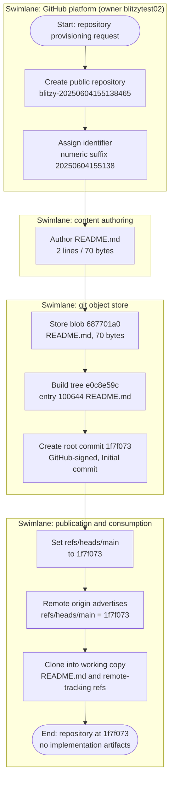

### 4.4.2 Core Feature Process Flows

No feature process flow can be drawn, because the feature catalog is empty (section 2.1): there is no feature, no entry point, and no handler in the repository. What follows is the closest evidenced substitute — the gate sequence the repository's single artifact passed through — and every gate shows the one outcome the history actually records. Each dashed edge marks a branch with no recorded outcome, so the diagram states the absence of alternatives rather than inventing them.

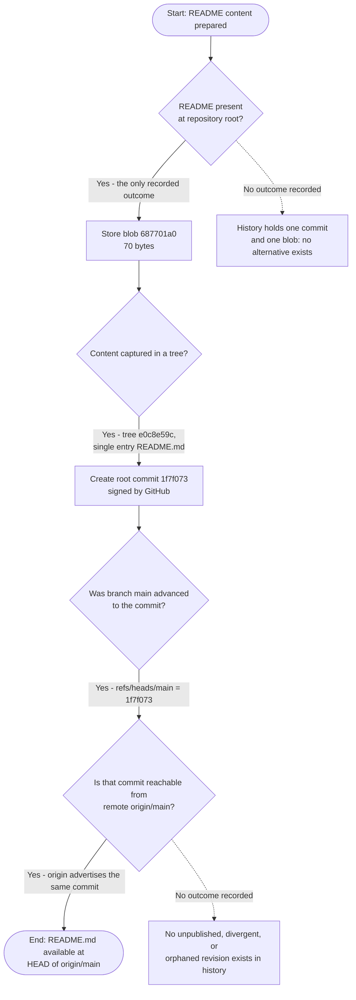

### 4.4.3 Error Handling Flowcharts

No error path exists to chart, so this diagram documents that absence directly: it is the flow a reader would follow looking for error handling, terminating at the point where every prescribed mechanism is found missing. Each negative result cites the verification behind it (section 4.3.2).

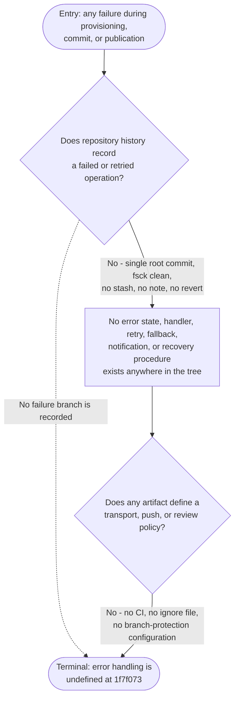

### 4.4.4 Integration Sequence Diagrams

The repository's only cross-system exchange is git transport over HTTPS between a client and the GitHub remote (section 4.1.2). The creation legs are evidenced by `README.md` line 2 and the commit's committer identity and signature; the consumption leg is evidenced by the checkout's reflog entry `clone: from https://github.com/blitzytest02/blitzy-20250604155138465.git` and by the working tree it produced. No API call, webhook, event, or batch exchange exists to diagram.

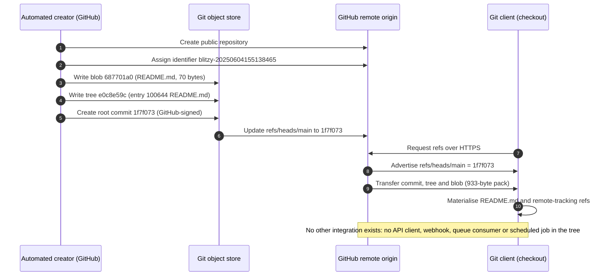

### 4.4.5 State Transition Diagrams

The states below are the ones section 4.3.1 enumerates from the object graph, reached in order by the evidenced process. The diagram carries no failure, retry, or rollback transition, because none exists; the final state is terminal, because no revision follows `1f7f073`.

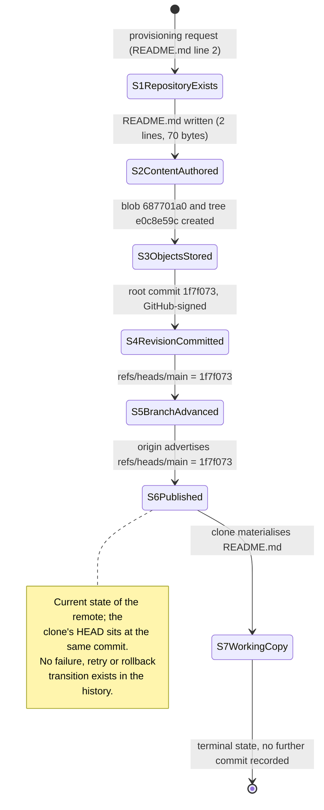

Two consequences follow for anyone extending the specification. First, each diagram has exactly one path, so no branch, alternative, or compensation logic is documented anywhere and none can be lost in a later change. Second, the diagrams are state-dependent on commit `1f7f073`: the first commit that adds an entry point, a job, or a pipeline introduces the first genuine process flow, at which point the swimlanes above acquire a user lane, a decision diamond acquires a real alternative, and the error diagram acquires a handler to name.

## 4.5 References

- `README.md` — the repository's only artifact and the sole evidence of project intent; established the identifier `blitzy-20250604155138465` (line 1), the declaration "Auto-created public repository with README" (line 2) that anchors the provisioning workflow in section 4.1.1, and its 2-line, 70-byte extent, which confirmed that no workflow, process, or interface documentation accompanies it.
- `""` (repository root folder) — established that the root has exactly one first-order child (`README.md`) and no sub-folders, which ruled out any process-bearing artifact: no source entry point, handler, job descriptor, route definition, or pipeline file exists anywhere in the project.
- [repo metadata] git object database at HEAD `1f7f073b9d8f818fa2b33fd38a98e391ed2026be` — established the root commit (no parent) with 1003-byte size, message "Initial commit", timestamp 2025-06-04 15:51:39 +0530, author `blitzytest02`, committer `GitHub <noreply@github.com>` with an attached PGP signature; the tree `e0c8e59c62a6a975a6a964845e82a5ab3bf30465` (37 bytes, single entry `100644 README.md`); the blob `687701a0b9445a7539557e4c07695b4ba255695c` (70 bytes); and a total of three objects packed into a 933-byte pack with a 1156-byte index. This object set is the entire basis for the P1-P7 steps in section 4.1.1 and the states in sections 4.3.1 and 4.4.5.
- [repo metadata] git refs, tags, stash, notes and integrity check — established `refs/heads/main`, `refs/remotes/origin/HEAD` and `refs/remotes/origin/main` all at `1f7f073`, no tags, an empty stash list, no notes, and a clean `git fsck` with no dangling, unreachable, missing, or corrupt objects. Together these support the finding that no failed, retried, reverted, or rolled-back operation is recorded anywhere in the history (section 4.3.2).
- [repo metadata] remote `origin` — `https://github.com/blitzytest02/blitzy-20250604155138465.git` — established GitHub as the sole third-party service and the owner namespace `blitzytest02`, and (via `git ls-remote`) that the remote advertises `refs/heads/main` at `1f7f073`, which evidences the publication step of the workflow and the sequence in section 4.4.4. The short-lived access credential embedded in the configured remote URL is recorded as an operational fact only, with its value omitted.
- [repo metadata] working-tree enumeration and semantic searches in the checkout at HEAD `1f7f073` — established that the working tree contains only `./README.md`, with no hidden file, no `.blitzyignore`, and no directory; and that semantic searches for application entry points and routes, user-journey or front-end components, schedulers, queues, webhooks and external integrations, workflow or sequence documentation, and persistence layers each returned no result. These are the evidence for the empty workflow dimensions in sections 4.1.1, 4.1.2 and 4.4.2.
- [specification] sections 1.1 Executive Summary, 1.2 System Overview, 1.3 Scope, 2.1 Feature Catalog, 2.4 Implementation Considerations, 3.5 Databases & Storage, 3.6 Development & Deployment and 3.7 References — cross-referenced for the repository's unimplemented state, its empty scope and feature set, its security and maintenance implications, the absence of any persistence or caching layer, the absence of build, containerization and CI/CD configuration, and the project identifier and remote namespace, so that this section's workflow, state, and error findings remain consistent with those already recorded.


# 5. System Architecture

## 5.1 High-Level Architecture

### 5.1.1 System Overview

At commit `1f7f073` the repository `blitzy-20250604155138465` contains exactly one tracked artifact — `README.md`, two lines and 70 bytes — and nothing else. `git ls-files` returns that single path, a full working-tree enumeration returns it alongside `.git`, and the object database holds three objects: commit `1f7f073b9d8f818fa2b33fd38a98e391ed2026be` (1003 bytes), tree `e0c8e59c62a6a975a6a964845e82a5ab3bf30465` (37 bytes, one entry) and blob `687701a0b9445a7539557e4c07695b4ba255695c` (70 bytes). No source file, dependency manifest, configuration file, test, container definition, infrastructure template or pipeline exists anywhere in the tree; section 3.6 reaches the same finding tooling category by tooling category.

This section therefore does not document an application architecture, because none has been expressed yet. Nothing in the repository defines a process, a service, a data model, or an interface between internal modules. What it documents instead, with complete evidence, is the architecture of the only machinery the repository actually runs on: git's artifact-handling layer and the single hosting interface that carries it.

**Overall architecture style and rationale.** No architectural style is recorded anywhere in the repository. The table below maps each style the prompt's default framing would normally place here to the artifact that would declare it.

| Style class | Evidence that would declare it | Finding at `1f7f073` |
|---|---|---|
| Layered / tiered | Module or package directories, layer separation in source | Absent; one file at the repository root and no directories at all |
| Client-server / API-centric | Route handlers, API schema, service descriptor | Absent; no interface is defined, exposed or consumed |
| Event-driven / message-based | Producer and consumer code, topic or queue configuration | Absent; no broker, subscriber or scheduler exists |
| Service-oriented / distributed | Multiple deployable units, service manifests | Absent; the tree contains no deployable unit |
| Pipeline / batch | Job or DAG definitions, scheduling configuration | Absent; no job descriptor of any kind |

The one style statement the artifacts support is descriptive, not designed: the repository is a flat, single-artifact, runtime-free **document repository**. Its shape is an artifact of provisioning rather than a decision — `README.md` line 2 records the repository as "Auto-created public repository with README", and the root commit was authored by `blitzytest02 <blitzytest02@gmail.com>` (1749032499 +0530, i.e. 2025-06-04 15:51:39 +0530) and committed by `GitHub <noreply@github.com>` under a PGP signature. The structure readers observe is the residue of that creation step, so any rationale attributed to it beyond "created from a template" would be invented.

**Architectural principles and patterns in effect.** The repository declares no principle or pattern, and this sub-section records none as its own. The only invariants that demonstrably hold are git's, and they hold because git runs here in a local configuration carrying only `core.*`, `remote.origin.*` and `branch.main.*` entries — no hooks path, no custom driver, no policy:

- **Content-addressed identity.** Each persisted object is named by a hash of its content; `README.md` is blob `687701a0b9445a7539557e4c07695b4ba255695c`, so identical bytes reuse one object.
- **Revision atomicity.** The unit of change is the ref update. `refs/heads/main` moved from unborn to `1f7f073` in a single step and has not moved since.
- **Single source of truth.** One branch, one root commit, no tags, and no remote other than `origin`; `git rev-list --count HEAD` is 1 and `git fsck --no-progress` reports nothing dangling, unreachable or corrupt.

Patterns the prompt's default framing would normally name — dependency inversion, repository pattern, MVC, CQRS, saga, circuit breaker, sidecar — have no artifact to attach to in this tree and are not documented as though they did.

**System boundaries and major interfaces.**

| Boundary or interface | What it delimits | Evidence | Status |
|---|---|---|---|
| Repository boundary (working tree) | The only files a consumer can obtain: `README.md` | Working-tree enumeration; `git ls-files` | Present, one artifact |
| Persistence boundary (`.git`) | The object and ref databases that hold the revision | Pack listing; `git count-objects -v` (in-pack 3, packs 1) | Present |
| Distribution interface (`origin`) | Exchange with the GitHub host over HTTPS | `remote.origin.url`; reflog entry `clone: from https://github.com/blitzytest02/blitzy-20250604155138465.git` | Present, read and write |
| Programmatic interface (API, CLI, event, webhook) | — | No code, descriptor or configuration in the tree | Absent |
| Data interface (schema, client, connection) | — | No schema, driver, connection string or migration | Absent |

The only interface a consumer can exercise is retrieval of `README.md` over HTTPS from the hosting platform; the repository itself exposes no API, no CLI entry point, no scheduled job, no webhook receiver and no data interface, which is the same conclusion sections 1.2.1 and 3.4 reach from the integration and third-party-service directions.

**Architectural assumptions.** The repository states no assumption; what it does supply are conditions any future architecture inherits, each verifiable from the checkout. They are recorded here as constraints rather than as assumed intent, because no artifact expresses intent.

| Condition | Observed value | Evidence | Consequence for later design |
|---|---|---|---|
| Hosting platform | GitHub, namespace `blitzytest02` | `remote.origin.url`; clone URL in reflog | Host is the only confirmed platform fact a delivery design can build on |
| Visibility | Public | `README.md` line 2 ("Auto-created public repository") | Every pushed file is world-readable and disclosure is irreversible |
| Licensing | None | No licence file anywhere in the tree | No rights of use, modification or redistribution are granted |
| Ignore and attribute rules | None | No `.gitignore` and no `.gitattributes` in the tree | Build output, dependency trees and credential files would be staged by default |
| Transport credential | A short-lived access token is embedded in the `origin` URL | `.git/config` `remote.origin.url` | Authentication is perishable; the value must never be copied into source, documentation or logs |
| Runtime version pinning | None | No version file of any ecosystem | No interpreter or runtime baseline exists for any future language choice |
| Revision policy | One branch (`main`), no tags, no in-tree branch policy | `git show-ref`; no configuration artifact | Release and versioning conventions are undefined |

No standard, specification or named pattern is referenced anywhere in the repository: there is no licence text, no contributing guide, no architecture note and no reference to any framework's conventions. Whether the host enforces a protection or review rule on `main` is not observable from the checkout, so this specification claims none.

### 5.1.2 Core Components Table

Section 1.2.2 counts a single component because it counts tracked artifacts; the table below presents that same inventory together with the version-control and distribution layers that carry it, so that integration points and critical considerations have somewhere to attach. The prompt's five-column schema is rendered in four columns, with "Key Dependencies" and "Integration Points" merged, to respect this specification's four-column table limit.

| Component Name | Primary Responsibility | Key Dependencies & Integration Points | Critical Considerations |
|---|---|---|---|
| Documentation artifact `README.md` (blob `687701a0`, 70 bytes, 2 lines) | Names the project and records that it was auto-created with a README | No declared dependency and no imports; consumed by any reader or renderer through the host's HTTPS delivery; mapped into tree `e0c8e59c` as entry `100644 README.md` | The repository's only tracked content; carries no licence, usage instructions, interface or behaviour; public from the first commit |
| Git object database under `.git` (pack `pack-ed1ca27110c511f453443b3cc4b1559c7baf593b.pack`, 933 bytes; `.idx` 1156 bytes; `.rev` 64 bytes) | Content-addressed persistence of the revision's three objects | Depends on git (2.43.0 in this checkout); integrated with the ref database and the working tree; read by the transport at fetch time | The only persisted state in the repository; a single pack with no backup or replication artifact in the tree; no `.gitignore` guards what a future commit may add |
| Revision pointers under `.git` (`refs/heads/main`, `refs/remotes/origin/HEAD`, `refs/remotes/origin/main`) | Name the current revision; the ref update is git's atomic unit of change | Depend on the object database; advertised to and read by the transport | All three resolve to `1f7f073`; there are no tags and no second branch, so nothing else in the repository records an alternative state |
| Publication channel `origin` (GitHub `blitzytest02/blitzy-20250604155138465`) | Distributes revision `1f7f073` to and accepts future revisions from the host | Depends on GitHub availability and the HTTPS credential in `.git/config`; integrated by fetch and push | Credential is short-lived, so transport authentication expires; a push to a public repository is immediately and permanently readable |
| Working-tree checkout (local `README.md` at HEAD) | Materialises the tracked artifact for reading and editing | Depends on the object database and the index; integrated with the operator's git client | Holds no state beyond the committed content; a local edit is invisible to any other party until pushed |

No further component exists. Component classes that would normally appear in this table have no artifact at all: there is no application service or runtime, no user interface, no data-store client, no job or worker, and no integration adapter, which the working-tree enumeration and `git ls-files` each confirm by returning a single path. This is consistent with section 1.2.2, which likewise finds no executable interface, no persistence schema and no automated verification.

### 5.1.3 Data Flow Description

Two flows exist, and both are git-level rather than application-level: the write path by which the single revision was created and published, and the read path by which a working copy obtained it. Section 4.4 diagrams the same provenance at process level; the account below is the architecture view of it.

**Write path (capture, commit, publish).** The bytes of `README.md` (2 lines, 70 bytes) were captured as blob `687701a0`, which retains the full 70 bytes. Path metadata was then bound to that blob in tree `e0c8e59c`, whose single entry is `100644 README.md`. The tree was bound into root commit `1f7f073` (1003 bytes) together with the author and committer identities and a GitHub-produced PGP signature. `refs/heads/main` was set to that commit in one atomic update, and the host then advertised the same commit as `origin/main`. There is no build step, no packaging step and no artefact promotion anywhere on this path.

**Read path (clone and fetch).** A git client requested refs from `origin` over HTTPS; the host advertised `refs/heads/main = 1f7f073`; the three objects arrived as the 933-byte packfile; the client materialised `README.md` in the working tree and wrote the remote-tracking refs. The checkout's reflog records exactly that: `clone: from https://github.com/blitzytest02/blitzy-20250604155138465.git` on `refs/heads/main`, `refs/remotes/origin/HEAD` and `HEAD`.

**Integration patterns and protocols.** The only protocol on the wire is HTTPS, evidenced by the `https://` scheme of the `origin` URL, and it carries git's packfile representation of objects. The exchange pattern is snapshot-based and client-initiated: a client fetches or pushes whole revisions, and the host neither calls back nor pushes unsolicited. No request/response API, publish/subscribe topic, streaming channel, webhook callback, batch job or file drop exists — and none could, because no process in the repository executes. Section 4.4.4 and section 4.1.2 describe the same transport from the workflow direction.

**Data transformation points.**

| Transformation | Input | Output | Evidence |
|---|---|---|---|
| Content capture | Working-tree bytes of `README.md` (70 bytes) | Content-addressed blob `687701a0` | `git ls-tree -r HEAD`; blob size 70 in `git cat-file --batch-all-objects --batch-check` |
| Path binding | Blob plus path and mode | Tree `e0c8e59c`, single entry `100644 README.md` | `git cat-file -p HEAD^{tree}` |
| Revision binding | Tree plus identities, timestamp and signature | Commit `1f7f073`, 1003 bytes, GitHub-signed | `git cat-file -p HEAD`, including the `gpgsig` block |
| Name binding | Commit object | `refs/heads/main` resolving to `1f7f073` | `git show-ref` |
| Transport packing | Three objects in repository format | One pack of 933 bytes plus `.idx` (1156 B) and `.rev` (64 B) | `.git/objects/pack/` listing; `git count-objects -v` reports in-pack 3, packs 1, size-pack 2 KiB |
| Markdown rendering (not a repository transformation) | `README.md` source text | Rendered presentation, for example the host's repository landing page | No renderer or conversion artifact exists in the tree; rendering is performed by whichever consumer reads the file, so it is a consumption-side activity rather than a data flow of this system |

**Key data stores and caches.** Persistence exists in exactly one place: git's object database, which holds all three objects in a single packfile and is the only store from which a revision can be reconstructed. The working tree is a materialised copy of that store, and three mechanisms resemble caches without being application caches — the git index (the staging area), the packfile's delta compression (a storage and transport optimisation), and the remote-tracking refs (a local mirror of the host's advertised state). No cache client, time-to-live, eviction rule or invalidation policy appears anywhere in the repository, and no application store exists at all: there is no database, queue, object store or data file, which matches section 4.3.1 on persistence points and section 3.5 on storage technology.

### 5.1.4 External Integration Points

The prompt's five-column schema is rendered in four columns below, with "Integration Type" and "Data Exchange Pattern" merged, to respect this specification's four-column table limit.

| System Name | Integration Type & Exchange Pattern | Protocol / Format | SLA Requirements |
|---|---|---|---|
| GitHub hosting platform — repository `blitzytest02/blitzy-20250604155138465` | Version-control host on the read-write path; client-initiated clone, fetch and push of whole revisions | HTTPS over the `https://` origin URL; git object transfer in packfile format (`.pack` with `.idx` and `.rev`) | None recorded. No availability target, throughput commitment, rate limit, retention term or support agreement appears anywhere in the repository |
| Local git toolchain on the operator's workstation (git 2.43.0 at `/usr/bin/git` in this checkout) | Developer client for the remote; the last recorded operation is the clone that produced this working copy | Local filesystem for the working tree and repository, git CLI for operations, HTTPS to `origin` | None recorded. The git version is unpinned in the repository, so no client baseline is declared |
| Content consumer — the host's rendering surface or any reader of the file | Consumption of the only artifact; read-only retrieval of `README.md` | HTTPS web delivery of Markdown text; rendering rules are the consumer's, not the repository's | None recorded. No performance, fidelity or compatibility expectation is expressed |

No other external integration exists. The repository contains no API client, no webhook endpoint, no message broker, no database or cache connection, no third-party service credential and no identity provider configuration; sections 1.2.1 and 3.4 reach the same conclusion about the enterprise landscape and third-party services respectively. One attribute that looks like an integration is not one the repository manages: the commit's PGP signature was produced by the host's committer identity (`GitHub <noreply@github.com>`), making signature and provenance integrity a host-supplied property of the stored revision rather than an interface this system operates.

## 5.2 Component Details

### 5.2.1 Component Specifications

The five components inventoried in section 5.1.2 are specified below against the five aspects the prompt prescribes. Because none of them contains a runtime process, "scaling" means growth of stored bytes and of the operator's workflow rather than capacity for concurrent load; each entry states that limitation where it applies.

**Documentation artifact — `README.md`**

- *Purpose and responsibilities.* Records the project's identity and its origin. It carries the heading `# blitzy-20250604155138465` on line 1 and the sentence "Auto-created public repository with README" on line 2, which together are the repository's entire prose.
- *Technologies and frameworks.* Markdown text, 2 lines and 70 bytes, stored as blob `687701a0b9445a7539557e4c07695b4ba255695c`. No Markdown processor, static-site generator, templating engine or linting configuration is present, so the format is declared only by the file's own extension.
- *Key interfaces and APIs.* None programmatic. The file itself is the interface: a consumer retrieves the path `README.md` and renders whatever the text contains. It defines no variables, functions, types, entry points or imports (section 1.2.2).
- *Data persistence requirements.* Its bytes persist only as the content-addressed blob inside the packfile; the working-tree copy is a materialisation that can be discarded and restored from `.git` without loss. Any change is durable only once a commit references a new blob, which no commit after `1f7f073` does.
- *Scaling considerations.* None of a runtime kind, since nothing executes. The only growth dimension is file size — a documentation artefact whose reader-side cost is borne by the consumer's renderer, with no page-size, payload or rendering limit declared in the repository.

**Git object database (`.git/objects`)**

- *Purpose and responsibilities.* The repository's sole durable store. It holds every persisted object and is the authority from which any revision is reconstructed: commit `1f7f073` (1003 bytes), tree `e0c8e59c` (37 bytes, one entry) and blob `687701a0` (70 bytes).
- *Technologies and frameworks.* Git in its packed-object format — the three objects sit in `pack-ed1ca27110c511f453443b3cc4b1559c7baf593b.pack` (933 bytes) with its `.idx` (1156 bytes) and `.rev` (64 bytes) files. The local configuration declares repository format version 0; the git version in this checkout is 2.43.0, which the repository itself does not pin.
- *Key interfaces and APIs.* The git command-line surface: `git cat-file` to read objects, `git ls-tree` to read the tree's single `100644 README.md` entry, `git ls-files` to enumerate tracked paths. The transport reads the same store when the host serves a fetch.
- *Data persistence requirements.* All three objects, one pack, no loose objects (`git count-objects -v` reports count 0, in-pack 3, packs 1, size-pack 2 KiB). Integrity is verifiable in place: `git fsck --no-progress` reports nothing dangling, unreachable, missing or corrupt, and no notes or stashes are stored. Nothing outside the packfile holds a copy of this content, and no backup or replication artefact appears in the tree.
- *Scaling considerations.* Bounded by the operator's disk and by the host's repository limits, and unmeasured in the repository. No garbage-collection policy, retention rule, size budget or archival configuration exists, and because the pack holds the complete history of a one-commit repository, the store is as small as a git repository can be.

**Revision pointers (refs under `.git`)**

- *Purpose and responsibilities.* Name the current revision and act as git's atomic unit of change. Three refs exist and all resolve to `1f7f073`: `refs/heads/main`, `refs/remotes/origin/HEAD` and `refs/remotes/origin/main`.
- *Technologies and frameworks.* Git's ref mechanism, advertised to clients during transport negotiation by the host.
- *Key interfaces and APIs.* `git show-ref` and `git for-each-ref` for inspection; the transport's ref advertisement for clients; the reflog as the append-only record of ref movement (`clone: from https://github.com/blitzytest02/blitzy-20250604155138465.git`, followed by two local checkouts).
- *Data persistence requirements.* A ref update is the only state transition the repository has recorded, and it is atomic: `refs/heads/main` went from unborn to `1f7f073` in one step and has not moved since. No tag, branch or remote-tracking ref other than the three above exists.
- *Scaling considerations.* None. Three refs exist; nothing in the repository declares a branching, tagging or release convention, so ref growth is ungoverned by any artefact rather than governed by a rule.

**Publication channel — remote `origin`**

- *Purpose and responsibilities.* Distributes revision `1f7f073` and would receive any future revision. The remote is GitHub-hosted at `blitzytest02/blitzy-20250604155138465`, and the checkout's reflog confirms the clone came from it.
- *Technologies and frameworks.* Git over HTTPS, authenticated by an access token embedded in `remote.origin.url`. The local configuration sets `credential.interactive=false` and an empty credential helper, so no interactive prompt is expected during transport.
- *Key interfaces and APIs.* Fetch and push of refs and objects. No API call, hook, webhook or event interface exists on either side of the exchange as far as the repository records.
- *Data persistence requirements.* None in the repository: the remote keeps its own object and ref databases. What the repository does record about this channel is an operational constraint — the embedded credential is short-lived (section 4.3.2), and publication to a public repository is irreversible from the moment it lands.
- *Scaling considerations.* Entirely host-managed, and unstated in the repository: no rate limit, quota, availability target or retention term is declared.

**Working-tree checkout**

- *Purpose and responsibilities.* Materialises the tracked artefact at HEAD so it can be read and edited, and holds the staging area (the git index) through which a change would be committed.
- *Technologies and frameworks.* The local filesystem plus git's index. The working tree contains exactly `README.md` and `.git`; no ignore file, attribute file, editor configuration or task runner is present, so staging behaviour is git's default.
- *Key interfaces and APIs.* File paths on the local filesystem and the git CLI. No build, test or run command exists to invoke, so the checkout has no executable entry point.
- *Data persistence requirements.* Ephemeral by design: everything in the working tree can be reconstructed from the packfile, and an uncommitted edit exists nowhere else. No local data directory, cache directory or generated output is present.
- *Scaling considerations.* None. There is one file, one operator and no concurrency; the absence of `.gitignore` is the only hygiene gap the checkout exposes, since build output, dependency trees or credential files added later would be staged by default (sections 2.4.4 and 3.6).

### 5.2.2 Component Interaction Diagram

The diagram shows every interaction the repository evidences at `1f7f073`. It is an artefact-handling diagram, not a runtime call graph: no component here executes, so each edge is either a storage relation recorded in the object model or a transport relation recorded in the refs and the remote configuration. The scope boundary is drawn to show that the application tier the prompt would normally depict is empty rather than omitted.

```mermaid
flowchart TD
    subgraph WorkingTree["Working-tree boundary (only files a consumer can obtain)"]
        ReadmeNode["README.md<br/>Markdown, 2 lines, 70 bytes"]
    end
    subgraph ObjectStore["Persistence boundary: git object database"]
        BlobNode["Blob 687701a0<br/>70 bytes"]
        TreeNode["Tree e0c8e59c<br/>entry 100644 README.md"]
        CommitNode["Commit 1f7f073<br/>1003 bytes, GitHub-signed"]
        PackNode["Pack-ed1ca271.pack<br/>933 bytes + idx + rev"]
    end
    subgraph Refs["Revision pointers under .git"]
        MainRef["refs/heads/main = 1f7f073"]
        RemoteHead["refs/remotes/origin/HEAD"]
        RemoteMain["refs/remotes/origin/main"]
    end
    subgraph Host["Hosting boundary: GitHub origin"]
        OriginNode["blitzytest02/blitzy-20250604155138465<br/>public, HTTPS"]
        CredNode["Access token in origin URL<br/>short-lived credential"]
    end
    subgraph AbsentTier["No component exists in this tier"]
        NoRuntime["No service, job, API, worker,<br/>queue consumer or scheduled task"]
    end
    ReadmeNode -->|"captured as content-addressed object"| BlobNode
    BlobNode -->|"bound to path and mode"| TreeNode
    TreeNode -->|"bound into revision with signature"| CommitNode
    BlobNode -.->|"stored in"| PackNode
    TreeNode -.->|"stored in"| PackNode
    CommitNode -.->|"stored in"| PackNode
    CommitNode -->|"named by atomic ref update"| MainRef
    MainRef -->|"advertised over HTTPS"| OriginNode
    CredNode -.->|"authenticates fetch and push"| OriginNode
    OriginNode -->|"clone writes remote-tracking refs"| RemoteMain
    RemoteMain -.->|"same commit as"| RemoteHead
    AbsentTier -.->|"would mediate any runtime behaviour"| WorkingTree
```

Three properties of this graph are worth stating explicitly, because they are what a reader should carry away. The object relations form a single chain with no branching, so there is one path from the working-tree file to the published revision. The dashed storage edges to the pack simply record where the three objects physically live, not additional logic. And the empty tier is not a stylistic flourish: `git ls-files` returns one path and a full tree enumeration returns one file, so no component exists that could call or be called at runtime.

### 5.2.3 State Transition Diagram

The only state-bearing subject in the repository is the artefact set, and it passed through the sequence below exactly once. Section 4.4.5 records the same lifecycle from the process direction; it is restated here so this section remains self-contained, with the same single-path property. There is no failure, retry, rollback or fork transition, because none is recorded: history contains one root commit with no parent (`git rev-list --parents`), no revert or merge commit, no second branch, no stash and no note.

```mermaid
stateDiagram-v2
    [*] --> Uncreated
    Uncreated --> Authored: README.md written (2 lines, 70 bytes)
    Authored --> Stored: blob 687701a0 and tree e0c8e59c created
    Stored --> Committed: root commit 1f7f073, GitHub-signed
    Committed --> Referenced: refs/heads/main = 1f7f073
    Referenced --> Published: origin advertises the same commit
    Published --> CheckedOut: clone materialises README.md and remote-tracking refs
    CheckedOut --> [*]: terminal state at this commit; no later revision recorded
    note right of Published
        One path, no alternatives: no failure,
        retry, rollback or divergent revision
        appears anywhere in the history.
    end note
```

The terminal state is genuinely terminal at `1f7f073`: `git rev-list --count HEAD` is 1, no tags exist, and the only refs that exist all point at that commit. A first runtime component — a service, a job or a pipeline step — would introduce the first state that can hold a value while the system runs, and this diagram is the baseline against which that change would be visible.

### 5.2.4 Sequence Diagram — Key Flows

Two flows are diagrammable: the historical creation and publication of the revision, and the read path that produced this working copy. The second is the one the evidence records directly — the reflog entry `clone: from https://github.com/blitzytest02/blitzy-20250604155138465.git` on `refs/heads/main`, `refs/remotes/origin/HEAD` and `HEAD`. The diagram also records the write path's present state, which is that no push has followed the clone: the reflog holds the clone plus two checkouts and nothing else.

```mermaid
sequenceDiagram
    autonumber
    participant Op as Operator (git client 2.43.0)
    participant Local as Local object and ref database
    participant Remote as GitHub origin
    participant Reader as Consumer or renderer
    Op->>Remote: Request refs over HTTPS
    Remote->>Op: Advertise refs/heads/main = 1f7f073
    Remote->>Op: Transfer pack (3 objects, 933 bytes)
    Op->>Local: Write commit, tree and blob, plus remote-tracking refs
    Local->>Op: Materialise README.md in the working tree
    Note over Op,Remote: No reverse flow is recorded: the reflog shows the clone and two local checkouts, so no push has followed
    Reader->>Remote: Retrieve README.md for rendering
    Remote-->>Reader: Serve the Markdown text; rendering rules belong to the consumer
    Note over Local,Reader: No API, webhook, event, stream or batch exchange links any pair of participants
```

Because the exchange is snapshot-based and client-initiated, no participant state persists between interactions: the client holds a complete copy of the revision and the host holds the authoritative refs, so a fetch is idempotent at this commit. Any future flow that introduces server-side state, asynchronous messaging or a second writer would break that property, and it would be the first such flow in the repository's history.

## 5.3 Technical Decisions

### 5.3.1 Decision Inventory and Tradeoff Analysis

Five decisions the prompt names have no recorded outcome at `1f7f073`. For each, the table records the artefact that would carry the decision, the state of the record, and the tradeoff that is nonetheless in effect — a tradeoff the repository inherited from its creation template rather than one it selected.

| Decision class | Artefact that would record it | Recorded choice | Tradeoff in effect at this commit |
|---|---|---|---|
| Architecture style | Module or package layout, design note, ADR | None; the repository is a runtime-free document scaffold (section 5.1.1) | No architectural cost is paid today and no structural benefit is captured; the first implementation commit is unconstrained by anything in the tree |
| Communication pattern | API definition, client stub, queue or topic configuration | None; the only transport is git over HTTPS (section 5.1.3) | Client-initiated snapshot synchronisation needs no broker or contract registry, but cannot support notifications, streaming or concurrent writers |
| Data storage solution | Schema, driver or client, connection configuration | None; the only store is git's object database (section 5.2.1) | Zero storage operating cost, with no query, index or transaction capability; any data requirement is net-new work |
| Caching strategy | Cache client, time-to-live, invalidation rule | None; the packfile and index are version-control internals, not an application cache (section 5.1.3) | No staleness or invalidation burden, at the cost of re-materialising content from `.git` on each checkout |
| Security mechanism | Authentication code, policy file, secret store, TLS configuration | None; the only credential is the host access token embedded in `.git/config` | No application attack surface exists, while two inherited exposures remain live: a perishable transport credential and irreversible public disclosure (section 4.3.2) |

**Why these are open rather than implicit.** A reader could mistake "no decision recorded" for "the simplest option was chosen". The evidence rules that out: a choice made and left undocumented would still leave traces — a lockfile resolves dependencies to versions, a build script encodes a pipeline, a schema file encodes a model, a connection string encodes an endpoint. None of these traces exists. The working tree holds one file, `git ls-files` returns one path, and the object database holds three objects, so no technology, pattern or provider has been selected even implicitly (sections 3.1, 3.2 and 3.5 each confirm this class by class).

**Decisions the repository does embody** fall into three groups, and the tradeoffs below are the ones actually in force.

- *Public hosting.* Creating the repository as public (README line 2) buys frictionless access to the README and costs all control over disclosure: any future commit is world-readable the moment it is pushed, and no in-tree artefact — no ignore file, review rule or pipeline gate — stands between a working-copy change and that publication.
- *Runtime-free scaffold.* Delivering no executable content means nothing needs to be built, tested, containerised or deployed, and the repository requires no runtime baseline to run. The corresponding cost is that the repository also fixes nothing: no dependency is pinned, no reproducible build exists, and no artefact records how any future code should be verified (section 3.6).
- *Single-lineage revision model.* One branch, one root commit, no tags and no release artefact give the repository a history that cannot diverge and cannot conflict. It also has no version identity: a consumer can only refer to commit `1f7f073`, and no artefact states a branching, review or release convention that future work would have to follow.

The absence of a licence file belongs with the first group and deserves separate mention, because it is a decision by omission with an external effect: the repository grants no rights of use, modification or redistribution to anyone, so its public visibility and its usability are not aligned.

### 5.3.2 Decision Tree Diagram

The tree below is the test this section applied to each decision class, and it also states the route by which any future decision becomes documentable. The left-hand outcome is the one every class takes at `1f7f073`; the right-hand outcome has no instance in the repository, and its node is retained because it is the branch the next implementation commit would enter.

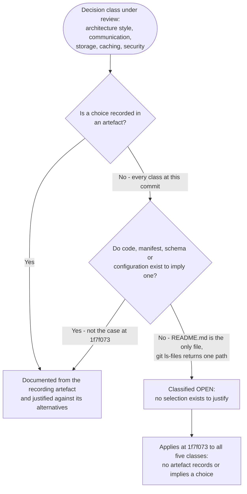

The tree encodes one practical consequence. A decision enters the documented set only when an artefact records it, so the act of choosing and the act of recording must be the same commit; anything chosen in conversation but not written into the tree will leave this section reporting an open decision.

### 5.3.3 Architecture Decision Records

Five decisions are recorded below as *Accepted by evidence* — each is established by an artefact in the tree, and three of them were made by the creation template rather than by a human author. None of the ADR identifiers here corresponds to a file in the repository; the records are reconstructed from the artefacts they left.

| ADR | Decision | Status | Basis and consequence |
|---|---|---|---|
| ADR-001 | Host the project as a public repository on GitHub under the `blitzytest02` namespace | Accepted by evidence | `README.md` line 2; `remote.origin.url`; clone URL in the reflog. Consequence: every pushed byte is public and disclosure is irreversible, with no protection or review artefact visible in the tree |
| ADR-002 | Deliver the scaffold as a single `README.md` at the repository root | Accepted by evidence | Initial commit's tree `e0c8e59c` contains exactly one entry, `100644 README.md`, and the commit is a root commit. Consequence: project identity and provenance are recorded; no licence, documentation directory or interface accompanies them |
| ADR-003 | Keep one long-lived branch, `main`, with no tags and no release artefact | Accepted in effect, recorded nowhere | `git show-ref` lists three refs, all at `1f7f073`; no tags exist; no policy file states a convention. Consequence: a single lineage with no divergence, and no version identity other than the commit SHA |
| ADR-004 | Rely on the hosting platform for revision provenance and signature | Accepted by evidence | Commit `1f7f073` is committed by `GitHub <noreply@github.com>` and carries a `gpgsig` PGP block. Consequence: provenance is a host-supplied property; verification depends on trusting the host's signing identity rather than a repository-held key |
| ADR-005 | Authenticate transport with a token embedded in the remote URL, expecting no interactive prompt | Accepted by configuration | `.git/config` holds the tokenised `remote.origin.url` and `credential.interactive=false` with an empty credential helper. Consequence: no secret store exists, the credential is short-lived, and the value must never be copied into source, documentation or logs |

The open decisions are the five classes of section 5.3.1 plus the four cross-cutting areas of section 5.4, and each is recorded with the artefact that would close it.

| Open decision | Status | Artefact that would close it |
|---|---|---|
| Architecture style, communication pattern, storage solution, caching strategy, security mechanism | Open | A design note or ADR file, a service or module layout, an interface definition, and the manifests and configuration that imply the choices |
| Monitoring, observability, logging and tracing | Open | Instrumentation code, a logging or tracing configuration, an alert rule or a dashboard definition |
| Error handling and recovery | Open | Handler code, CI or job retry configuration, a notification rule or an operational runbook |
| Authentication and authorisation for any future interface | Open | Identity configuration, policy file, middleware, or a service's access-control definition |
| Performance targets, SLAs and disaster recovery | Open | A service-level objective, a capacity or load target, a backup or restore configuration, or a retention policy |

## 5.4 Cross-Cutting Concerns

### 5.4.1 Monitoring and Observability

The repository contains no monitoring or observability mechanism, because it contains no running process to instrument. There is no metrics library, no health or readiness endpoint, no dashboard definition, no alert rule, no service-level objective and no configuration file of any kind — the working tree holds only `README.md` and `.git`, so nothing exists in which such a mechanism could be declared.

| Signal class | Artefact that would provide it | Finding at `1f7f073` |
|---|---|---|
| Application metrics | Metrics client, exporter or instrumentation code | Absent; there is no code and no runtime |
| Health and liveness | Health endpoint, probe configuration | Absent; nothing serves a request |
| Platform telemetry | Host-side analytics, commit-activity reporting configured in the repository | Absent; the host may record its own telemetry, but the repository neither configures nor retains it |
| Build and delivery telemetry | Pipeline status, build or deploy logs | Absent; no pipeline exists (section 3.6) |
| Alerting and notification | Alert rules, notification channels, on-call configuration | Absent; no channel or escalation path is defined |

What the repository does support is ad hoc inspection rather than observability: `git fsck --no-progress` verifies object integrity, `git rev-list --count HEAD` reports one revision, `git show-ref` reports the refs, and the reflog reports recent ref movement. These are operator-invoked commands that return the state of a static store; none of them emits a metric, a log line or an event, and none runs on a schedule. Any future monitoring requirement is therefore net-new work, and the decision to instrument is recorded as open in section 5.3.3.

### 5.4.2 Logging and Tracing

No logging or tracing strategy exists. The repository declares no logging framework or configuration, contains no log statement, defines no log level, format, sink, rotation or retention rule, and has no tracing instrumentation, span, trace-context propagation or correlation identifier. There is also no artefact in which such a strategy could be expressed: no application code, no configuration file and no operational document.

One chronological record does exist, and it belongs to version control rather than to an application: the local reflog. It holds five entries — three produced by the clone (`refs/heads/main`, `refs/remotes/origin/HEAD` and `HEAD`) and two local checkouts — and it records the origin URL `https://github.com/blitzytest02/blitzy-20250604155138465.git`. Three properties limit its value as a log. It is local to a working copy and is not part of the published repository, so a clone does not receive the history of another clone's operations. It records ref movement only, so it says nothing about content changes within a commit. And it is not configured for retention by any artefact in the tree. For tracing, there is nothing to correlate: the only cross-system exchange is a single client-initiated HTTPS fetch of three objects (section 5.2.4), and no request identifier or span accompanies it.

### 5.4.3 Error Handling Patterns

No error handling pattern is implemented: not fail-fast, not retry with backoff, not a circuit breaker, not a fallback path, not a dead-letter queue, and not a compensating action. Section 4.3.2 verifies the same absence mechanism by mechanism, and the reason is structural rather than an oversight — there is no code in which a handler could sit, and the history records no failure that a handler would have had to catch. The repository's only recorded transaction is the single atomic ref update that placed `refs/heads/main` at `1f7f073`, and it succeeded.

| Mechanism | Artefact that would evidence it | Finding at `1f7f073` |
|---|---|---|
| Retry and backoff | Retry logic, job retry policy, pipeline retry configuration | Absent; no code, job descriptor or pipeline exists |
| Fallback path | Alternate route, degraded mode, replica or secondary source | Absent; one artefact and one revision leave nothing to fall back to |
| Error notification | Logging configuration, alert rule, notification channel | Absent; no configuration file of any kind |
| Recovery procedure | Runbook, backup or restore configuration, retention policy | Absent; no operational document is tracked |
| Input validation and guard clauses | Validation code, schema, pre-receive hook | Absent; no code to validate and no hook configured in the local configuration |

Two failure surfaces are documentable, and both are inherited properties of the repository rather than designed paths. The first is the transport credential: the access token embedded in the `origin` URL is short-lived, so its expiry would appear as an ordinary git transport failure with no repository-defined handling and no notification. The second is irreversible publication: a push to a public repository is readable immediately and permanently, and no in-tree artefact — no ignore file, review rule or pipeline gate — intervenes between a working-copy change and that publication.

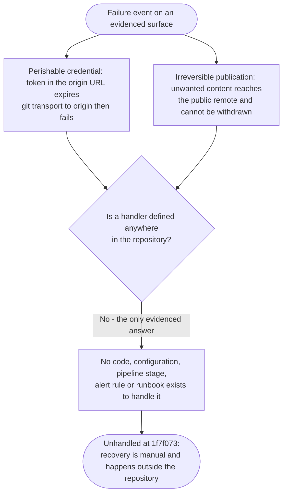

Both surfaces are conditions the repository inherits from its provisioning, and neither is a designed error path: where the host itself might reject a ref update or reject a signature is not recorded here at all, because the one transition that exists succeeded and no policy artefact describes an alternative outcome.

### 5.4.4 Authentication and Authorization

The repository implements no authentication or authorisation. It defines no identity provider, no session or token validation, no role or permission model, no policy file and no access-control middleware, and it contains no code that could perform any of these functions.

| Control | Artefact that would provide it | Finding at `1f7f073` |
|---|---|---|
| Transport authentication | Credential in the remote configuration, key material, credential helper | Present but perishable: an access token embedded in `remote.origin.url`, with `credential.interactive=false` and an empty helper in `.git/config` |
| Application authentication | Login flow, token issuance or validation, session store | Absent; there is no application and no interface to authenticate to |
| Authorisation and roles | Policy file, role definitions, permission checks | Absent; write access to the repository is whatever the host grants, and no in-tree artefact records a permission model |
| Branch or content protection | Pre-receive hook, protection configuration, required-review rule | Absent; the repository records no protection or review rule, and whether the host enforces one is not observable from this checkout |
| Revision provenance | Signing key material, verification configuration | Host-supplied: commit `1f7f073` was committed by `GitHub <noreply@github.com>` under a `gpgsig` PGP signature (ADR-004) |

Two boundaries matter for how these controls are read. First, the credential's presence in `.git/config` is itself a security consideration: the value authenticates the operator's transport session, it expires, and it must never be copied into source, documentation, logs or any artefact that would be committed — doing so on a public repository would disclose it irreversibly. Second, the PGP signature on the commit is an integrity and provenance attribute produced by the host, not an end-user authentication mechanism: it establishes which platform created the revision, not which person authorised a change. Any identity, session or permission requirement for future functionality is recorded as an open decision in section 5.3.3.

### 5.4.5 Performance Requirements and SLAs

The repository states no performance requirement and no service-level agreement. There is no service-level objective or indicator, no latency, throughput, concurrency or availability target, no rate limit, no capacity plan, no benchmark and no load or performance test. No artefact exists in which such a requirement could be expressed.

| Requirement class | Artefact that would declare it | Finding at `1f7f073` |
|---|---|---|
| Latency and throughput | SLO or indicator definition, load test, benchmark | Absent; nothing in the tree states a target or measures one |
| Availability and reliability | Availability target, error-budget definition, uptime report | Absent; the host provides whatever availability it provides, and the repository records no expectation of it |
| Capacity and limits | Rate-limit configuration, quota, scaling policy | Absent; no interface exists to throttle and no scaling rule to declare |
| Recovery objectives | RTO and RPO statements | Absent; no recovery objective is recorded anywhere (section 5.4.6) |

What the repository does supply are sizing facts rather than targets, and they are small by any measure: the tracked content is a 70-byte file of two lines; the tree object is 37 bytes; the commit object is 1003 bytes; all three objects together occupy 1110 bytes of content held in a 933-byte packfile. A complete clone of the repository therefore transfers under a kilobyte of packed data plus the pack's index, and any latency an operator experiences is that of the host's HTTPS endpoint, which the repository neither measures nor constrains. Because nothing executes, there is no runtime performance dimension at all — no request path, no query, no cache-hit ratio and no concurrency limit — and the first performance requirement will arrive with the first executable component.

### 5.4.6 Disaster Recovery

No disaster recovery provision exists in the repository. There is no backup or restore configuration, no replication or off-site copy, no retention or archival policy, no failover mechanism, no runbook and no objective for recovery time or recovery point.

| Disaster recovery element | Artefact that would provide it | Finding at `1f7f073` |
|---|---|---|
| Backup | Backup configuration, scheduled export, replication job | Absent; no scheduled job and no configuration file exists |
| Off-site copy | Replica remote, mirror configuration, object-storage target | One remote only: `origin`. The host holds the sole copy outside an operator's workstation, and the repository records no second remote, mirror or export |
| Restore procedure | Runbook, restore script, documented steps | Absent; no operational document is tracked |
| Retention and archival | Retention policy, archive target, tag-based release | Absent; no tags and no retention rule exist |
| Recovery objectives | RTO and RPO statements | Absent; none recorded |
| Credential recovery | Re-issuance procedure or secret store | Absent; the transport token is short-lived, so a lapse in transport credentials is recovered by re-obtaining one outside the repository |

Recovery capability today rests entirely on the hosting platform and on the size of the content. Because the repository's only tracked content is two lines of Markdown whose text is known — a project heading and the sentence "Auto-created public repository with README" — a total loss of the workstation and of the remote would cost nothing that could not be retyped, and `git fsck --no-progress` reports the local object database intact with no dangling, unreachable or corrupt objects. That is a property of the content, not a recovery plan: no artefact states an acceptable downtime, an acceptable data loss window, or who performs a restore, and no artefact records an expectation about the host's durability. Every element in the table above becomes documentable only when an artefact states it, and each is recorded as an open decision in section 5.3.3.

## 5.5 References

Every claim in this section rests on the artefacts listed below. No web source, external standard or vendor document was consulted, because the repository references none and makes no external technology claim that would require one.

**Files**

- `README.md` — the repository's only tracked artefact (blob `687701a0b9445a7539557e4c07695b4ba255695c`, 2 lines, 70 bytes). Line 1 establishes the project identifier `blitzy-20250604155138465`; line 2 ("Auto-created public repository with README") establishes the provisioning origin and the public visibility that section 5.1.1 records as an inherited condition.
- `.git/config` — establishes the single remote: `origin` pointing at `https://github.com/blitzytest02/blitzy-20250604155138465.git`, the access token embedded in that URL, `credential.interactive=false` with an empty credential helper, `branch.main.remote=origin` and repository format version 0. It is the sole evidence for the transport-credential consideration in sections 5.1.1, 5.2.1, 5.4.4 and 5.4.6.

**Folders**

- Repository root (`""`) — contains exactly `README.md` and `.git`, with no sub-folders. This enumeration is the evidence for every absence this section reports: no code, manifest, configuration, test, container definition, infrastructure template or pipeline.
- `.git/objects/pack/` — contains `pack-ed1ca27110c511f453443b3cc4b1559c7baf593b.pack` (933 bytes), its `.idx` (1156 bytes) and `.rev` (64 bytes). This is the physical container of the repository's only persisted state, cited in sections 5.1.2, 5.1.3, 5.2.1 and 5.4.5.
- `.git/` (repository metadata) — holds the three objects (commit `1f7f073b9d8f818fa2b33fd38a98e391ed2026be`, 1003 bytes, GitHub-signed; tree `e0c8e59c62a6a975a6a964845e82a5ab3bf30465`, 37 bytes, single entry `100644 README.md`; blob `687701a0`, 70 bytes), the refs `refs/heads/main`, `refs/remotes/origin/HEAD` and `refs/remotes/origin/main` (all at `1f7f073`), the reflog with its five clone and checkout entries, and the local configuration cited above.

**Sections of this specification cross-referenced**

1.2.1 and 1.2.2 (integration landscape, single-component inventory), 2.4.4 and 2.4.5 (credential handling and repository hygiene), 3.1, 3.2, 3.4 and 3.5 (no language, framework, third-party service or storage technology declared), 3.6 (no build, container, infrastructure-as-code or CI/CD tooling), 4.1.2 and 4.4.4 (git transport over HTTPS), 4.3.1 (state, persistence and caching at the object level), 4.3.2 (error-handling absence and the two failure surfaces), 4.4.5 (the single-revision lifecycle restated in section 5.2.3).

**No web sources** were used: the section documents a repository whose entire content is a two-line README, and the only external system it names is the hosting platform, which the repository itself records through its remote configuration and reflog.

# 6. SYSTEM COMPONENTS DESIGN

## 6.1 Core Services Architecture

### 6.1.1 Applicability Determination

**Core Services Architecture is not applicable for this system.**

At commit `1f7f073` the repository `blitzy-20250604155138465` is a runtime-free document scaffold. The working tree holds exactly one file, `README.md` (2 lines, 70 bytes), and no directories outside `.git`; `git ls-files` returns that single path; and the entire object database holds three objects — blob `687701a0`, tree `e0c8e59c` and root commit `1f7f073`. Nothing in the tree executes: there is no source file, dependency manifest, container definition, orchestration manifest, infrastructure descriptor or pipeline. A core services architecture presupposes deployable units that run independently and communicate across a network, and not one of those preconditions is met here.

This is a determination about verified absence, not a simpler design that was chosen. Section 5.3.1 classifies architecture style as an open decision precisely because no artifact selects one, and a monolith is no more present than a service mesh — there is no code at all.

**Applicability tests applied.** Four tests decide the question, and each resolves negative against artifacts in the tree rather than against an assumption.

| Applicability test | Artifact that would satisfy it | Finding at `1f7f073` | Verification |
|---|---|---|---|
| More than one deployable unit exists | Source tree or module layout, one manifest per unit | None; one tracked file at the repository root, no directories outside `.git` | `git ls-files` returns `README.md` alone |
| Units are independently runnable | Entry point, `main`, process definition, container image | None; no executable artifact of any kind | Full working-tree enumeration returns one file |
| Units communicate over a network protocol | Route handler, API description, IDL, client stub | None; no interface is exposed or consumed | Sections 1.2.2 and 5.1.3 |
| Distribution machinery is configured | Service registry, orchestrator, load balancer, policy file | None; all 34 artifact classes tested are absent | Name-based absence check across the whole tree |

**Entities that could be mistaken for services.** The repository does define entities, and section 5.1.2 inventories them, but none of them is a service. The table records why each fails that classification rather than restating its specification from section 5.2.1.

| Inventoried entity | Service? | Reason |
|---|---|---|
| `README.md` (blob `687701a0`, 70 bytes) | No | Passive Markdown content that defines no interface, no runtime and no callable surface |
| Git object database (one pack of 933 bytes plus `.idx` and `.rev`) | No | A local content-addressed file store; runs no process and answers no request |
| Three refs under `.git`, all at `1f7f073` | No | Revision pointers written by git, not network-addressable endpoints |
| Working-tree checkout at HEAD | No | A materialisation of tracked content on local disk, with no runtime |
| Remote `origin` — GitHub `blitzytest02/blitzy-20250604155138465` | No, for this system | A host-operated distribution channel the repository uses; the system neither defines, deploys nor configures it |

**Boundaries the repository does have.** The absence of a service architecture is not an absence of boundaries. Two boundaries are real and are documented in section 5.1.1: the persistence boundary at `.git`, which delimits the objects and refs that constitute the revision, and the distribution boundary at `origin`, across which revisions travel over HTTPS. Both are artifact-handling boundaries rather than service boundaries — neither side of either one is a process this repository owns. The prompt's own framing supplies the distinction: a service boundary separates independently deployable units, and there is exactly one unit here, a Markdown file, with nothing to separate it from.

**Scope of the determination.** This finding holds for revision `1f7f073` specifically, verified against `git rev-list --count HEAD` returning 1 with no parent commit and against a clean `git fsck`. It is a statement about the repository as it stands, not a claim about the project's intent. Section 6.1.6 records the conditions under which the determination would change, and each of them is a condition that no artifact in the tree currently expresses.

### 6.1.2 Service Components

Because section 6.1.1 determines that a core services architecture does not apply, this sub-section assesses each area the prompt prescribes and reports both the artifact that would evidence it and the finding at `1f7f073`. The repository's entity inventory is in section 5.1.2 and its per-entity specifications are in section 5.2.1; the assessment below takes the services view of that same inventory.

**Service boundaries and responsibilities.** No unit owns any service responsibility, because no unit runs. Each responsibility a service decomposition would allocate has no corresponding artifact in the tree.

| Responsibility class | Artifact that would evidence a boundary | Finding at `1f7f073` |
|---|---|---|
| Request handling or API surface | Route handler, controller, API description | Absent; nothing serves or consumes a request |
| Domain or business logic | Service class, domain module | Absent; no code exists |
| Data access | Repository layer, query module, schema | Absent; the only store is git's object database (section 5.2.1) |
| Identity and access control | Middleware, policy file, session store | Absent; assessed in section 5.4.4 |
| Messaging or scheduling | Producer, consumer, job descriptor | Absent; no broker subscription and no scheduled task |

**Inter-service communication patterns.** No inter-service communication exists, because there is no second service to communicate with; a single unit has no interface to expose. The one exchange the system records is client-initiated and snapshot-based — a git client fetching or pushing whole revisions over HTTPS to `origin`, as described in sections 5.1.3 and 5.2.4. It carries no request/response semantics, no correlation identifier and no acknowledgment beyond the ref advertisement itself.

| Pattern class | Artifact that would evidence it | Finding at `1f7f073` |
|---|---|---|
| Synchronous request/response | Server stub, IDL, route table | Absent; no endpoint, contract or schema is defined |
| Asynchronous messaging | Broker configuration, queue or topic, consumer | Absent; no broker, queue or topic appears anywhere |
| Publish/subscribe or event bus | Topic, subscription, event schema | Absent; no producer and no subscriber exist |
| Streaming or callback | Stream handler, socket configuration, webhook receiver | Absent; the host neither calls back nor pushes unsolicited |
| Shared-store coupling | A second writer, connection configuration | Absent; one store, one branch, one writer lineage (ADR-003) |

**Service discovery mechanisms.** None exists. There is no service registry, service descriptor, discovery client, health-registration file, or orchestrator object of any kind — the 34 artifact classes tested in section 6.1.1 are all absent, including every container and orchestration manifest. The only network name anywhere in the system is `github.com`, embedded in `remote.origin.url`, and it is resolved by public DNS on the client's side; discovery is therefore a host-supplied fact rather than a mechanism this system implements. Client-side addressing is a single static URL recorded in `.git/config`, with no second address, alias or virtual name to resolve to.

**Load balancing strategy.** None is declared or needed. The system has one client class (an operator's git client), one remote endpoint, and one revision, so there is no request stream to distribute, no target group, no health check and no session-affinity rule. `remote.origin.fetch` maps exactly one ref pattern, `+refs/heads/*:refs/remotes/origin/*`, and `git show-ref` reports the three refs all resolving to `1f7f073`; nothing in the tree records a second endpoint. Whether the GitHub platform balances inbound traffic across its own infrastructure is not observable from this checkout, which is why section 5.1.4 records the host's SLA as unstated rather than assumed.

**Circuit breaker patterns.** None. The repository contains no resilience library, no error-rate threshold, no sampling or half-open policy, no timeout configuration and no file in which any of them could be expressed. Section 5.4.3 verifies the same absence mechanism by mechanism. One failure surface on the transport path is nonetheless identifiable: the access token embedded in the remote URL is short-lived (ADR-005), so its expiry surfaces as an ordinary git transport failure with no repository-defined handling. Holding that failure open, which is what a circuit breaker would accomplish, is not implemented.

**Retry and fallback mechanisms.** None. No retry policy, attempt limit, backoff interval or job retry configuration exists, and git performs no automatic re-drive of a failed fetch or push. Fallback has nothing to fall back to, because the system's only redundancy-free assets are single instances: one remote, one branch, one root commit and one blob.

| Mechanism | Artifact that would evidence it | Finding at `1f7f073` |
|---|---|---|
| Retry with backoff | Retry policy, attempt limit, backoff setting | Absent; no code, job or pipeline carries a retry rule |
| Idempotent re-drive | Job descriptor, idempotency token, dedupe key | Absent; no job exists to re-drive |
| Failover to a secondary target | Second remote, replica URL, mirror configuration | Absent; `origin` is the only remote (section 5.4.6) |
| Degraded or cached fallback | Secondary provider, cached copy, default asset | Absent; the packfile and index are version-control internals, not a fallback source |
| Dead-letter or quarantine | DLQ configuration, quarantine path | Absent; no message system exists |

Every area above resolves to the same shape: a defined responsibility with no owning unit, and a mechanism with no artifact. That similarity is the substance of the finding rather than a repetition of it — the areas do not degrade independently, because the first commit that adds a running component introduces service boundaries, an inter-service protocol, addressing, distribution and failure handling together, as section 6.1.6 sets out.

### 6.1.3 Scalability Design

Scaling here means growth of stored bytes and of the operator's workflow rather than capacity for concurrent load, because nothing in the repository executes; section 5.2.1 states the same limitation per entity.

**Horizontal scaling approach.** Not applicable to any running component, because none exists: horizontal scaling replicates stateless instances behind a router, and the system has no instantiator, no router and no second instance. One property of the architecture is nonetheless worth documenting as a genuine horizontal characteristic. Git is a distributed version-control system, so every clone is a complete replica of revision `1f7f073`: a consumer that has cloned `README.md` reads it from its own disk and imposes no further load on `origin`. Read capacity therefore scales with the number of consumers at no cost to the repository. That property covers reads only — the write path stays single-leader by git's own design, since `refs/heads/main` has one authoritative instance on the host and one branch and one commit exist (ADR-003).

**Vertical scaling approach.** None is declared. No instance size, pod resource request, volume size, runtime baseline or sizing recommendation appears in the tree, and section 3.6 confirms that no runtime version is pinned at all, so there is no declared baseline to scale against. The resources actually consumed are the operator's disk and the host's storage, and the amounts are measurable and minute: the three objects total 1110 bytes of content (blob 70, tree 37, commit 1003) held in a 933-byte pack with a 1156-byte index and a 64-byte reverse index, reported as in-pack 3, packs 1, size-pack 2 KiB. Section 5.2.1 records the resulting bound: growth is limited by the operator's disk and the host's repository limits, both unmeasured in the repository.

**Auto-scaling triggers and rules.** None exist. There is no autoscaler, scaling policy, target metric, threshold, cooldown or schedule, and no artifact class in which such a rule would live — the container, orchestration and infrastructure directories that were tested are all absent. There is also nothing an autoscaler could measure: section 5.4.1 finds no metrics library, no exporter, no health endpoint and no dashboard in the repository, so the input a scaling rule would consume does not exist either. No capacity target is recorded against which a threshold could be set (section 5.4.5).

**Resource allocation strategy.** None is declared in any dimension.

| Resource dimension | Artifact that would declare it | Finding at `1f7f073` |
|---|---|---|
| Compute | Instance type, pod specification, runtime baseline | None; no runtime is pinned (section 3.6) |
| Memory | Limit or request in a manifest | None; no manifest of any kind exists |
| Storage | Quota, volume definition, retention rule | Unstated; measured only by what exists — 933-byte pack, 1156-byte index, 64-byte reverse index |
| Network | Bandwidth reservation, rate limit, egress rule | None declared; the host's limits are not observable from this checkout |

**Performance optimization techniques.** The repository performs no performance work, and section 5.4.5 records that it declares no latency, throughput or availability target to optimize toward. One optimization is present as an incidental property of the delivery mechanism rather than as a configured technique: git's packfile delta compression, which holds the complete repository in 933 bytes and makes a full clone transfer under a kilobyte of packed data plus the index.

| Optimization class | Artifact that would declare it | Finding at `1f7f073` |
|---|---|---|
| Payload and transport | Compression setting, content-delivery network, cache headers | Present incidentally — one 933-byte packfile; no delivery tuning, CDN or cache header is configured in the tree |
| Query or index | Index definition, query plan, materialised view | Absent; the store offers no query capability (section 5.3.1) |
| Caching | Cache client, time-to-live, invalidation rule | Absent; caching is recorded as an open decision in section 5.3.1 |
| Concurrency and batching | Worker or thread configuration, batch size | Absent; nothing executes, so nothing is parallelised |

**Capacity planning guidelines.** No guideline, target or quota is recorded, so none can be derived; what the artifacts support is a measured size and a set of limits that are somebody else's. The practical capacity statement is that a full clone of this repository transfers under a kilobyte, requires no runtime to serve, and depends for its availability on the hosting platform, whose rate limits, quotas and retention terms the repository does not state (section 5.1.4). Growth is ungoverned: section 5.2.1 finds no quota, garbage-collection policy, retention rule or archival configuration anywhere in the tree.

| Capacity dimension | Basis at `1f7f073` | Status |
|---|---|---|
| Tracked content | 1110 bytes across three objects, packed to 933 bytes | Measured; no size budget is declared |
| Clone transfer cost | Under one kilobyte of packed data plus the pack index | Measured; no throughput or latency target exists |
| Read concurrency | Effectively unconstrained, because a read happens after the clone, on the consumer's own disk | Host-managed and unstated |
| Growth headroom | Bounded by the operator's disk and the host's repository limits | Ungoverned — no quota, retention, GC or archival rule |

The first component that serves a request will introduce the first dimension in which capacity can be planned, because it will also be the first thing that can be measured, throttled or scaled; section 5.3.3 records capacity targets as an open decision and section 5.4.5 records the same for service-level objectives.

### 6.1.4 Resilience Patterns

No resilience mechanism is implemented at `1f7f073`, and the reason is structural: no process runs, so there is no request path to protect, no replica to promote and no partial-capability mode to enter. Sections 5.4.3, 5.4.5 and 5.4.6 verify the absence of error handling, performance targets and disaster recovery provision respectively; the assessment below takes the architecture view of that same evidence.

**Fault tolerance mechanisms.** None is implemented: no redundant instance, no health probe or restart policy, no timeout, no bulkhead and no lifecycle hook exists, and no artifact class that would carry one is present in the tree.

| Mechanism | Artifact that would evidence it | Finding at `1f7f073` |
|---|---|---|
| Redundant instances | Replica definition, replica count, standby | Absent; a single unit exists and nothing to replicate |
| Health checking and self-healing | Liveness probe, restart policy, supervisor | Absent; nothing runs and nothing supervises |
| Timeouts and bulkheads | Timeout setting, resource isolation rule | Absent; no configuration file of any kind exists |
| Integrity verification in operation | Periodic verification job, corruption handler | Present only as a git property — see below |

The one fault-tolerance property in effect belongs to the storage format rather than to the system. Because git objects are content-addressed, corruption is detectable by construction, and `git fsck --no-progress` reports nothing dangling, unreachable, missing or corrupt. Nothing invokes that check on a schedule: section 5.4.1 records integrity verification as an operator-invoked command that emits no metric, log line or alert.

**Disaster recovery procedures.** No procedure exists — no backup or restore configuration, no replication job, no runbook, no retention policy and no recovery-time or recovery-point objective, as verified in section 5.4.6. What stands in place of a procedure is recoverability by construction: the repository's entire tracked content is two lines of known text, so the loss of both the workstation and the remote would cost nothing that could not be retyped. That is a property of the content's size and simplicity, not a recovery plan, and it will not survive the first substantive implementation commit. The structural gap remains as section 5.4.6 records it: `origin` is the only remote, so the host holds the sole copy outside an operator's disk.

**Data redundancy approach.** No redundancy is configured in any layer.

| Redundancy layer | Artifact that would provide it | Finding at `1f7f073` |
|---|---|---|
| Replica or mirror store | Second remote, mirror configuration, scheduled export | Absent; `origin` is the only remote |
| Object-level duplication | Loose-object copies, a backup pack | Absent; three objects in one pack, zero loose objects (`git count-objects -v`) |
| Geographic or zone redundancy | Region, zone or multi-site configuration | Not declared, and not observable from this checkout |
| Host-side durability guarantee | Retention or replication term stated in the repository | Absent; section 5.1.4 records no retention or availability commitment |

The only redundancy that exists today is incidental: a clone is a complete replica of the revision, so the operator's working copy plus the host's copy constitute two copies of a 70-byte file. No artifact declares how many copies should exist, where they should live or how they would be restored, so this redundancy is not a documented approach and cannot be relied upon as one.

**Failover configurations.** None exists. There is no secondary remote, no failover target, no promotion rule, no DNS-level switch and no documented recovery path; with one remote and one branch, a failure or withdrawal of `origin` leaves no configured alternative. This is a configuration absence rather than a capability limit — git supports multiple remotes and a local object database is already a complete copy of the revision, so a failover remote could be registered in a single command, but no artifact records one and the reflog shows only the clone from `origin` (ADR-003, ADR-005). The only operational recovery currently available is to re-obtain a transport credential or introduce a new remote by hand, outside anything the repository specifies.

**Service degradation policies.** None exists. There is no degraded mode, feature flag, load-shedding rule, read-only switch or priority policy, and no policy file in which one could be expressed. Two candidates are structurally available but undeclared: git's object model would allow an existing revision to be served while writes are refused, and a consumer could render a cached copy of `README.md`, which is the only asset involved. Neither is configured anywhere in the tree, and neither is under this repository's control. The degradation the repository would actually experience is loss of its transport credential, which fails closed with no reduced-capability mode and no handler — the failure surface section 5.4.3 diagrams.

Read together, the five areas describe a single posture: one copy in one place behind one credential, with no automation, no replica and no stated objective. Recovery today depends on two properties the repository does not manage — the host's durability and the smallness of the content — and the first component that serves a request will need its fault tolerance, redundancy, failover and degradation decisions made as one decision, since none of them currently has an artifact to inherit. Section 5.3.3 records error handling and recovery, and performance and disaster recovery, as open decisions.

### 6.1.5 Required Diagrams

Three diagrams are prescribed. Each is drawn from the same evidence base as the rest of this section — `README.md`, commit `1f7f073`, tree `e0c8e59c`, blob `687701a0`, the refs and remote `origin` — and each names the subject the prompt prescribes in a distinct node so that the absence is visible in the diagram rather than only in the prose. They complement rather than repeat section 5.2.2, which diagrams the artifact chain, and section 5.4.3, which diagrams the unhandled failure surfaces.

**Figure 6.1.5-1: Service interaction topology.** Every interaction the repository evidences is shown. The two endpoints exchange version-control objects, not service calls, and the deployable-unit tier that a service interaction diagram would normally connect is drawn as an explicit absence because the repository contains nothing in it (section 6.1.1).

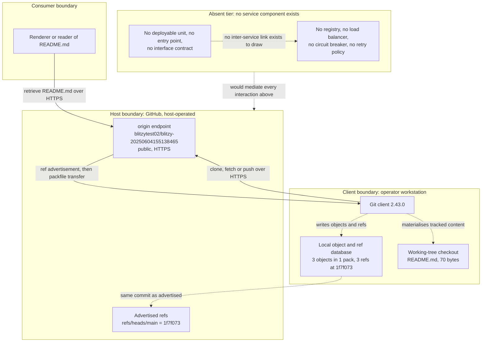

**Figure 6.1.5-2: Scalability architecture.** The read path is horizontally scalable by construction because a clone is a complete replica; the write path is single-leader by git's design. The machinery a scalability diagram would normally depict — autoscaler, target metric, resource allocation, capacity target — has no artifact in the tree, so it appears as one block of absence (sections 6.1.3 and 5.4.1).

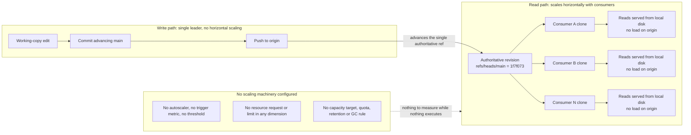

**Figure 6.1.5-3: Resilience pattern implementation.** The diagram pairs the three failure surfaces the artifacts evidence with the resilience patterns that would address them, and marks each pattern as absent. The copy inventory is the other half of the picture: the host copy is the sole copy outside a workstation, and no replica is configured (sections 6.1.4 and 5.4.6).

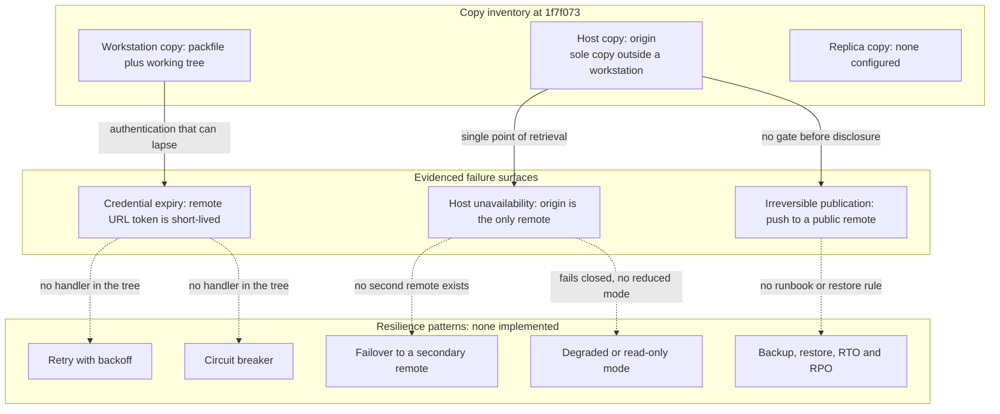

The three diagrams carry one message between them: the repository's interaction graph, its scaling behaviour and its failure handling are all determined by properties of version control rather than by components this system operates. The interaction graph has two endpoints and no service tier, the read path scales because clones are replicas while the write path cannot, and resilience consists of content-addressed integrity plus the recoverability of a 70-byte file, with no retry, breaker, failover, degraded mode or restore procedure behind it. A first commit that adds a deployable unit fills the absent tier in all three diagrams at once, which is why section 6.1.6 treats those as one set of conditions rather than three.

### 6.1.6 Conditions That Would Change This Determination

The determination in section 6.1.1 is specific to revision `1f7f073`, and it changes only when an artifact makes it change. Documentation alone cannot alter it: editing `README.md` to describe services would still leave one tracked file and no deployable unit, which is the reasoning section 5.3.2 applies to decision records — the act of choosing and the act of recording must be the same commit. The table lists the observable triggers and what each would bring into scope.

| Trigger condition | Artifact that would evidence it | What would become documentable |
|---|---|---|
| The first runnable component is committed | Entry point, executable source file, process definition | Service boundaries, responsibilities and lifecycle for that unit |
| A second deployable unit appears | A second manifest or a module layout separating units | Inter-service communication protocol and addressing between them |
| An interface is exposed to consumers | Route handler, API description, interface definition | Request routing, load balancing, versioning and contract ownership |
| An external dependency is called at runtime | API client, connection configuration, endpoint settings | Circuit breaking, retry with backoff, timeouts and fallback paths |
| Persistent application state is introduced | Schema, driver, migration, connection configuration | Replication, backup, restore procedure and recovery objectives |
| A pipeline is configured | A workflow file, for example under `.github/workflows` | Health gating, deployment strategy and release verification |
| Orchestration is adopted | Orchestrator or container manifests | Autoscaling rules, probes, resource requests and limits |
| An availability or performance target is stated | A service-level objective or capacity plan | Scaling thresholds, capacity planning and degradation policy |

Two properties of this list matter for planning. First, the triggers are not independent: committing a runnable component typically brings addressing, failure handling and resource allocation with it, which is why the diagrams in section 6.1.5 fill their absent tiers together rather than one at a time. Second, none of the eight triggers can be satisfied by prose in an existing file; each requires a new artifact class, and section 5.3.3 records the corresponding decisions as open with the artifact that would close each one. Until one of these artifacts lands, this section continues to report that core services architecture is not applicable, and the correct reading of that statement remains "no service decomposition exists" rather than "a monolithic decomposition was chosen".

### 6.1.7 References

- `README.md` — the repository's only tracked artifact (2 lines, 70 bytes, blob `687701a0`); established the project identity `blitzy-20250604155138465` and that the repository was auto-created with a README.
- Root folder (`""`) — its single first-order child, `README.md`, and the absence of any sub-folder established that no source tree, manifest, container definition, orchestration manifest or infrastructure descriptor exists.
- `.git/config` (local configuration in the checkout, untracked) — established `remote.origin.url` pointing at `blitzytest02/blitzy-20250604155138465` with a short-lived `x-access-token` credential (the value is deliberately not reproduced here), `credential.interactive=false` with an empty credential helper, and branch tracking via `branch.main.remote=origin` and `branch.main.merge=refs/heads/main`.
- `.git` object database and refs, inspected through `git ls-files`, `git ls-tree -r HEAD`, `git show-ref`, `git count-objects -v`, `git rev-list --count HEAD`, `git rev-list --parents HEAD`, `git tag -l`, `git fsck --no-progress`, `git stash list`, `git notes list` and `git reflog --all` — established one root commit (`1f7f073`), three objects in one 933-byte pack (index 1156 bytes, reverse index 64 bytes), three refs all resolving to `1f7f073`, zero tags, zero stashes and notes, a clean integrity check, and the clone-only reflog that evidences `origin` as the sole remote.
- Terminal absence checks over the full working tree — a 34-class name test (container, orchestration, build, CI/CD, infrastructure and source directories and files) plus filename-keyword and content-keyword sweeps for service, cluster, replica, load-balance, circuit, retry, failover, autoscale, kubernetes, docker, healthcheck, uptime, SLA, RTO and RPO — established that no service, scaling or resilience artifact exists anywhere in the repository.
- Technical Specification section 1.2 (System Overview) — one component, no capabilities, no programmatic interface and no enterprise integration.
- Technical Specification section 3.6 (Development & Deployment) — no build system, containerization, infrastructure as code or CI/CD, and no pinned runtime version.
- Technical Specification section 4.4 (Required Diagrams) — the diagram conventions and the artifact-level workflow followed by the figures in section 6.1.5.
- Technical Specification section 5.1 (High-Level Architecture) — the component inventory, the persistence and distribution boundaries, and the data flow this section's diagrams build on.
- Technical Specification section 5.2 (Component Details) — per-entity specifications, including the scaling limitations of each inventoried component.
- Technical Specification section 5.3 (Technical Decisions) — ADR-001 through ADR-005 and the open-decision inventory that section 6.1.6 refers to.
- Technical Specification section 5.4 (Cross-Cutting Concerns) — the verified absence of error handling, performance targets and service-level objectives, and of disaster recovery provision, cited in sections 6.1.2 through 6.1.4.
- No web sources were used; every statement in this section is grounded in the repository artifacts listed above.

## 6.2 Database Design

### 6.2.1 Applicability Statement

**Database Design is not applicable to this system.**

A database design presupposes a component that opens a connection, declares a schema, or moves records. At commit `1f7f073` the repository `blitzy-20250604155138465` contains exactly one tracked artifact — `README.md`, two lines and 70 bytes — and no executable content of any kind. No component reads or writes data, so every dimension this section is normally asked to document (schema design, data management, compliance considerations, performance optimization) has no subject to describe. The absence is verified rather than merely undocumented:

| Check | Artifact or command | Finding at `1f7f073` |
|---|---|---|
| Tracked files | `git ls-files` | One path: `README.md` |
| Working tree | Full checkout enumeration | `README.md` only; no directories exist |
| Datastore artifacts | Scan for `*.sql`, `*.db`, `*.sqlite*`, `*.csv`, `*.json`, `*.yaml`, `*.yml`, `*.toml`, `*.ini`, `*.env*`, `*.lock`, `*.xml` | No match |
| Application source | Scan for `*.py`, `*.js`, `*.ts`, `*.go`, `*.java`, `*.rs`, `*.rb` | No match |
| Persistence vocabulary | Content scan for `sql\|database\|postgres\|mysql\|mongo\|redis\|sqlite\|schema\|migration\|orm\|jdbc\|persist` | No match in tracked content |
| Dependency declaration | Any package manifest or lockfile | None present, so no driver or ORM is declared |
| Historical removal | `git log --all --diff-filter=D` | Empty; no persistence code was ever added and deleted |
| Revision history | `git log --oneline --all` | One commit, `1f7f073` |

**The only persisted bytes.** Persistence exists in exactly one place, and it is version-control machinery rather than application data: git's own object store, which holds three objects — commit `1f7f073b9d8f818fa2b33fd38a98e391ed2026be` (1003 bytes), tree `e0c8e59c62a6a975a6a964845e82a5ab3bf30465` (37 bytes, whose single entry is `100644 README.md`), and blob `687701a0b9445a7539557e4c07695b4ba255695c` (70 bytes) — all carried in one packfile, `pack-ed1ca27110c511f453443b3cc4b1559c7baf593b.pack` (933 bytes, with `.idx` 1156 bytes and `.rev` 64 bytes). Those bytes are git metadata and documentation, not records, documents, or datasets. Section 5.1.3 reaches the same conclusion from the architecture direction, and section 3.5 from the storage-technology direction.

**The proposed store has no artifact.** Section 3.5 records that the default stack names MongoDB as the database. Nothing in the repository declares it: there is no driver dependency, no connection string, no collection or model definition, and no configuration file of any kind, and the persistence-vocabulary scan above — which includes the term `mongo` — returns no match. MongoDB is therefore a proposal with no corresponding artifact, not a partially implemented store whose schema remains to be documented.

**What would make this section applicable.** A single one of the following artifacts would create a database design to document: a driver or ORM dependency in a manifest; a connection, credential, or pool configuration; a schema, migration, or entity/model definition; or a tracked data file. Until one lands, sub-sections 6.2.2 through 6.2.5 record each prescribed dimension as a verified absence together with the artifact that would declare it, and 6.2.6 diagrams the only persistence structure that exists. These findings are state-dependent: they describe commit `1f7f073` and go stale on the first commit that introduces such an artifact, the same constraint section 2.4.6 records for the specification as a whole.


### 6.2.2 Schema Design

No schema exists, because no stored data exists. A schema is a declaration of entities, their attributes and their relationships, and every artifact that would carry such a declaration — a table definition, a model or entity class, a collection descriptor, a DDL script, or a migration — is absent from the tree. The table below records each schema dimension the section prompt prescribes against the artifact that would establish it.

| Schema dimension | Artifact that would declare it | Finding at `1f7f073` |
|---|---|---|
| Entity relationships | Model or entity definitions, foreign keys, association mappings, an ERD source | Absent; no model, mapping, or relationship declaration exists |
| Data models and structures | Table DDL, ORM models, DTOs, JSON/Protobuf schemas, API data schemas | Absent; no source file of any kind exists |
| Indexing strategy | Index DDL, index annotations on models, query-pattern documentation | Absent; nothing is queryable, so no access path is defined |
| Partitioning approach | Partition or shard key declarations, range/hash partition DDL | Absent; no store exists to partition |
| Replication configuration | Replica-set or cluster configuration, replica topology descriptor, failover settings | Absent; no connection, cluster, or topology artifact exists |
| Backup architecture | Backup job or snapshot configuration, retention schedule, restore procedure | Absent; no backup artifact and no stated recovery objective |

**Entity relationships and data structures.** No application entity relationship exists, so no entity-relationship diagram of stored data can be drawn. The only structural graph the repository does contain is git's own object graph — commit `1f7f073b9d8f818fa2b33fd38a98e391ed2026be` referencing tree `e0c8e59c62a6a975a6a964845e82a5ab3bf30465`, whose single entry `100644 README.md` references blob `687701a0b9445a7539557e4c07695b4ba255695c`. That graph is a content-addressed storage structure for revision control; it declares no entity, no attribute type, and no cardinality in the application sense, and section 6.2.6 diagrams it as the only persisted structure that exists rather than as a data model. The only structured content anywhere in the system is the Markdown text of `README.md`: a level-one heading on line 1 and one sentence on line 2, carrying no field, column, type, key, or relationship.

**Indexing strategy and constraints.** Zero database indexes and zero database constraints exist, because no store and no schema exist to index or constrain. The inventory is exhaustive:

| Class | Count at `1f7f073` | Note |
|---|---|---|
| Primary keys, foreign keys | 0 | No table or entity exists to key |
| Unique, check, not-null constraints | 0 | No column exists to constrain |
| Secondary and full-text indexes | 0 | No queryable store exists |
| Partition or shard keys | 0 | Nothing is partitioned (see above) |
| Query-optimization indexes | 0 | No query exists to optimize (see 6.2.5) |

The only index-like structures in the repository are git's, and they index object identity rather than data: `pack-ed1ca27110c511f453443b3cc4b1559c7baf593b.idx` (1156 bytes) maps object hashes to pack offsets for random access, and the companion `.rev` file (64 bytes) provides the reverse mapping for offset-to-hash lookup. Both are version-control machinery that ships with git and are neither created nor tuned by this repository; they impose no constraint on, and provide no precedent for, a future data index.

**Replication and backup.** No replication and no backup architecture is configured at the application level. Revision state is duplicated in one sense only: the local branch `refs/heads/main` and the remote-tracking refs `refs/remotes/origin/main` and `refs/remotes/origin/HEAD` all resolve to `1f7f073`, so the host holds a copy of the same single commit. That is distribution of a revision through the `origin` remote — a client-initiated push/fetch channel, described in section 5.1.4 — not replication of a datastore: there is no replica set, no read replica, no failover or promotion rule, no consistency setting, and no topology descriptor anywhere in the tree. Likewise there is no backup job, snapshot policy, retention period, or restore procedure; durability of the committed bytes is a property of the GitHub host's repository storage, which is outside the checkout and therefore not observable and not claimed here. No recovery-point or recovery-time objective is recorded anywhere in the repository.


### 6.2.3 Data Management

No data management practice exists, because there is no stored data to manage, migrate, version, archive, or cache. Each prescribed dimension is recorded below against the artifact that would establish it.

| Data-management dimension | Artifact that would declare it | Finding at `1f7f073` |
|---|---|---|
| Migration procedures | Migration scripts or tool configuration, schema changelog, DDL directory | Absent; no DDL and no migration tool reference exists |
| Versioning strategy | Schema-version table, migration history, model version field | Absent; the only version identity in the repository is git's |
| Archival policies | Lifecycle or retention rule, TTL configuration, cold-storage descriptor | Absent; no data lifecycle artifact exists |
| Storage and retrieval | Data-access code, repository or DAO class, query builder, client library | Absent; no code reads or writes data |
| Caching policies | Cache client dependency, TTL or eviction setting, invalidation logic | Absent; no cache component is declared |

**Migration procedures.** None exist and none are needed today. A migration procedure governs how a schema changes from one shape to the next, so it requires a schema to evolve; the repository has no schema, no DDL, no migration directory, and no reference to any migration framework (no Alembic, Flyway, Liquibase, Django, Rails, or Prisma artifact appears anywhere in the tree). There is equally no data-migration utility or transfer script: section 1.2.1 records that no predecessor system and no data-transfer tooling are referenced, so there is no existing dataset to move into a new store. Introducing a data layer would therefore start migration practice from zero rather than inherit one.

**Versioning strategy.** No schema versioning exists: there is no `schema_version` table, no migration history file, no model version attribute, and no changelog. What the repository does have is revision versioning of its files, which is a different concern and should not be read as a data-versioning practice. At `1f7f073` it comprises one commit on one branch with no tags (`git rev-list --count HEAD` is 1; `git tag -l` returns nothing), and each stored object is identified by the hash of its content, so identical bytes reuse one object and no object can be altered in place — a change is expressed as a new commit. No release, schema, or format version convention is declared anywhere, and no artifact records which store or model version a running component would expect.

**Archival policies.** None are stated, and none can be inferred. The repository defines no retention window, no time-to-live, no archival or cold-storage tier, no purge rule, and no data-lifecycle documentation. There is also nothing eligible for archival: the checkout contains no tracked data file of any format, and the only persisted content is the three git objects holding `README.md` — a 70-byte blob plus its tree and commit. Section 3.5 records the same finding from the storage direction: no artifact states where data would live or for how long.

**Data storage and retrieval mechanisms.** No application-level storage or retrieval mechanism exists: the tree contains no repository or data-access class, no query builder, no client library, no serialization code, and no read or write path of any kind. Retrieval is confined to the two git-level paths below, both of which move the revision rather than records, and neither of which involves a query language, a connection, or a data API.

| Mechanism | What it retrieves | Evidence |
|---|---|---|
| Working-tree read | The 70 bytes of `README.md` from the local checkout | `README.md` present at HEAD; blob `687701a0b9445a7539557e4c07695b4ba255695c` |
| Object-database read | Any revision object by its content hash | `git cat-file` enumeration resolves three objects: commit, tree, and blob |
| Remote fetch | Revision `1f7f073` as a packfile over HTTPS from `origin` | `remote.origin.url`; clone reflog entry against `https://github.com/blitzytest02/blitzy-20250604155138465.git` |
| Query interface (SQL, driver, endpoint) | — | Absent; the persistence-vocabulary scan of tracked content returns no match |

**Caching policies.** No caching policy, cache client, time-to-live, eviction rule, or invalidation mechanism exists; no dependency manifest declares a cache library, and no configuration names a cache endpoint. Three git mechanisms superficially resemble caching and are explicitly not application caches, which section 5.1.3 also records: the git index is a staging area that records what the next commit will contain rather than a cache of query results; packfile delta compression is a storage and transport optimisation applied when objects are packed; and the remote-tracking refs are a local mirror of the host's advertised state, refreshed on fetch rather than expired on a policy. None has a configurable lifetime, and none is consulted by application code, because no application code exists.


### 6.2.4 Compliance Considerations

No compliance obligation is discharged by this repository, and none is triggered by it, because no component collects, processes, or stores subject data. There is no user input path, no form, no session, no telemetry, no analytics, and no logging in the tree, so no personal, financial, or regulated data category enters the system and no privacy, retention, or audit control has a subject. What can be reported are the repository-level conditions a future data layer would inherit, each verified from the checkout.

| Compliance dimension | Artifact that would establish it | Finding at `1f7f073` |
|---|---|---|
| Data retention rules | Retention schedule, TTL setting, deletion or purge procedure, legal-hold rule | Absent; no retention artifact and no data category to retain |
| Backup and fault tolerance | Backup configuration, replica topology, RPO/RTO statement | Absent; durability rests on the host's repository storage, outside the checkout |
| Privacy controls | Consent artifact, PII field definitions, masking or encryption configuration | Absent; no data-processing code exists |
| Audit mechanisms | Application or access log, audit record schema, tamper-evident trail | Absent; only git's revision history records changes |
| Access controls | Authentication or authorization configuration, role or permission model, credential store | Absent; access is mediated by the host and by the ephemeral transport credential |

**Data retention rules.** None are recorded: the repository contains no retention window, no time-to-live, no purge or deletion procedure, and no legal-hold rule, and no data classification that would attract one. Section 1.3.1 reaches the same conclusion from the scope direction, recording that no data domain is in scope because no schema, storage mechanism, dataset, or data-handling artifact exists.

**Backup and fault tolerance policies.** No backup architecture, snapshot policy, retention period, recovery-point objective, or recovery-time objective is stated anywhere in the tree. The committed revision exists in two places — the local object database and the GitHub host reached through `origin` — but that duplication is revision distribution, not a backup of application data (6.2.2 records the same distinction). At the application level there is no availability obligation to meet: no process executes, so nothing can fail over, and section 2.4.2 records that the repository places no availability obligation on any future implementation.

**Privacy controls.** No personal data is collected or processed, so no consent flow, masking rule, encryption-at-rest configuration, or data-subject procedure exists. Two categories of personal-data-adjacent bytes are present, both of them version-control provenance rather than processed data: the commit's author identity (`blitzytest02 <blitzytest02@gmail.com>`, timestamp 1749032499 +0530) and the host-supplied committer identity (`GitHub <noreply@github.com>`), published with the commit because the repository is public. Separately, the `origin` URL embeds a short-lived access-token credential. Section 2.4.4 treats that credential as scoped and perishable and recommends rotating it rather than relying on expiry, and section 5.1.1 warns that its value must never be copied into source, documentation, or logs; this specification likewise does not reproduce it.

**Audit mechanisms.** The only audit trail in existence is git's revision history, and at `1f7f073` it consists of a single commit: authored by `blitzytest02 <blitzytest02@gmail.com>` and committed by `GitHub <noreply@github.com>` at 1749032499 +0530 under a host-produced PGP signature, with no prior revision and no file ever deleted (the deletion filter over all history returns empty). That record shows what changed in the working tree; it does not record who read or wrote data, because no data is read or written. No application log, access log, or audit-record schema exists, and whether the host enforces branch protection or review rules on `main` is not observable from the checkout, so no such control is claimed here.

**Access controls.** No application-level access control exists: the tree contains no authentication, authorization, role, permission, session, or credential-store configuration. Access to repository content is mediated entirely by the hosting platform and by the credential embedded in the `origin` URL, which is scoped to this repository and expires. Four conditions constrain whatever access control a future data layer adopts. The repository is public, so every pushed byte is world-readable and disclosure cannot be reversed. No `.gitignore` exists, so a connection string or credential introduced with the first store would be staged and committed by default unless exclusion configuration is added first — the risk section 2.4.4 sets out. No licence file exists anywhere in the tree, so the repository grants no terms of use, modification, or redistribution. And no CI workflow or scan configuration exists, so no automated verification would catch a leaked credential or a non-compliant change; any such control must be introduced alongside the first data layer rather than inherited.


### 6.2.5 Performance Optimization

No performance obligation exists and none can be measured. There is no code path to time, no endpoint to benchmark, no query to profile, and no process to observe; the repository contains no instrumentation, no metric definition, no threshold, and no performance budget, and sections 1.2.3 and 2.4.2 record the same absences from the success-criteria and implementation directions. Every optimization dimension the section prompt prescribes is therefore reported as a verified absence against the mechanism that would implement it.

| Optimization dimension | Mechanism that would implement it | Finding at `1f7f073` |
|---|---|---|
| Query optimization | Query planner, ORM query API, index selection, execution-plan review | Absent; no query, no ORM, and no index exists to optimize |
| Caching strategy | Cache client, cache-aside or read-through logic, TTL and eviction settings | Absent; no cache dependency or configuration exists |
| Connection pooling | Pool configuration (size bounds, idle timeout, max lifetime), pool manager | Absent; no driver, connection, or pool artifact exists |
| Read/write splitting | Primary and replica endpoints, routing or load-balancing layer | Absent; no topology and no routing artifact exists |
| Batch processing | Job or DAG definition, scheduler, queue consumer, chunking parameters | Absent; no job descriptor, scheduler, or queue exists |

**Query optimization patterns.** None apply, because no query exists. There is no SQL, no query builder, no ORM, no data-access class, and no index whose selectivity could be improved, so there is no predicate to push down, no join order to consider, and no result set to page. The persistence-vocabulary scan over tracked content returns no match for any query or driver term, and section 6.2.2 records that zero indexes and zero constraints exist.

**Caching strategy.** No caching strategy exists at any layer. No dependency manifest declares a cache library, no configuration names a cache endpoint or region, and no code performs a cache lookup, write-through, or invalidation. The three git mechanisms that resemble caching — the index (staging area), packfile delta compression, and remote-tracking refs — are version-control machinery with no configurable lifetime, and section 6.2.3 records why none of them is an application cache. A cache tier, its key design, its time-to-live, and its invalidation rule would all be new work introduced with the first data layer.

**Connection pooling.** None exists. There is no driver to pool, no connection string, no credential, and no configuration parameter for pool size, idle timeout, or maximum lifetime anywhere in the tree, and the artifact scan found no `.ini`, `.env`, `.yaml`, `.yml`, `.toml`, or `.json` file that could carry one. Pool sizing becomes a decidable question only once a store is chosen and the concurrency model is known; section 2.4.3 records that no concurrency model exists today.

**Read/write splitting.** No read/write split exists: there is no primary, no replica, no read endpoint, and no routing or load-balancing layer to direct traffic between them. The only read/write distinction visible in the repository is git's own direction of transport — `fetch` reads from the host, `push` writes to it — which is a property of the distribution channel described in section 5.1.4, not a routing strategy for a datastore. Section 6.2.2 records the same finding for replication configuration.

**Batch processing approach.** None exists: the tree contains no job definition, no DAG, no scheduler, no queue, no worker, and no chunking or commit-size parameter, and section 5.1.1 finds no pipeline or batch architectural style for the same reason. Nothing in the repository executes, so there is no offline or bulk path to design.

**Quantitative facts available.** The only figures the repository yields describe the artifact set rather than a workload: three git objects in one pack (pack 933 bytes, `.idx` 1156 bytes, `.rev` 64 bytes), a single tracked file of 70 bytes, and a working directory of roughly 196 KB as section 2.4.3 records. None of them is a performance measurement, because no operation is instrumented. The practical consequence for a future data layer is procedural: no latency, throughput, or resource budget can be inherited, so targets must be defined and measured when the first store and its access patterns exist, and section 2.4.6's advice to revisit the empty findings after the next commit applies to this sub-section as well.


### 6.2.6 Required Diagrams

Three diagram classes are prescribed for a database design: a database schema or entity-relationship diagram, a data flow diagram, and a replication architecture diagram. With no database in the system, the first and third have no subject, and the second has only version-control flows to show. Each diagram below therefore renders what actually exists at `1f7f073` and marks the absent structure explicitly, rather than implying a data model that no artifact declares.

| Required diagram | What exists at `1f7f073` | What it will show once a data layer exists |
|---|---|---|
| Schema / ERD | Only git's object graph: one commit referencing one tree referencing one blob | Entities, attributes, keys, and relationship cardinalities |
| Data flow | The write and read paths that created and distributed the single revision | Application write paths, transform points, and read paths |
| Replication architecture | One local object database and one host-held copy of the revision | Primary, replicas, failover rules, and synchronisation direction |

**Schema diagram — the only persisted structure.** No entity, table, or field exists to draw, so the schema diagram shows the one content-addressed object graph the repository contains. It is revision-control structure, not an application data model: the tree's single entry binds a path to a blob, and the commit binds the tree to its provenance. Section 6.2.2 records the corresponding count of application indexes and constraints, which is zero.

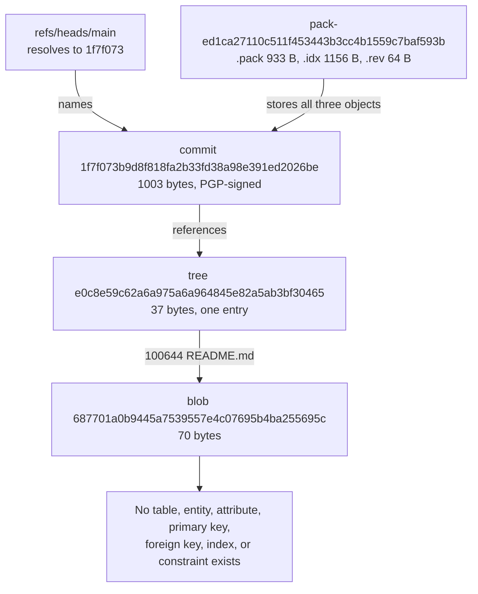

**Data flow diagram — the only persisted artifact's lifecycle.** Two flows exist, both git-level and both terminating at the hosting platform: the write path that captured, committed, and published the revision, and the read path by which a client obtained it. No arrow crosses between the two flows, because no application process sits between them — the host's advertisement of the ref is the only hand-off. Section 5.1.3 describes these same paths from the architecture direction, and no data transformation beyond content addressing, path binding, revision binding, and transport packing occurs on either.

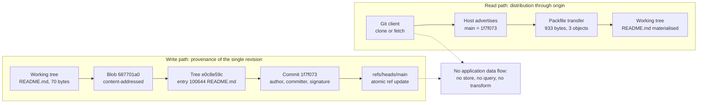

**Replication architecture — the absent topology.** No primary store, replica set, read replica, failover rule, or backup target is configured, because no application datastore exists. The only duplication in the system is a copy of the same single revision: the local object database holds it, and the GitHub host holding `origin/main` holds it too, exchanged by client-initiated push and fetch over HTTPS. The diagram marks that existing link and lists the missing topology as unconnected nodes, so the absence is visible rather than implied. Section 6.2.2 records the same finding, and section 5.1.4 records that no availability target, throughput commitment, or retention term is stated for the host relationship.

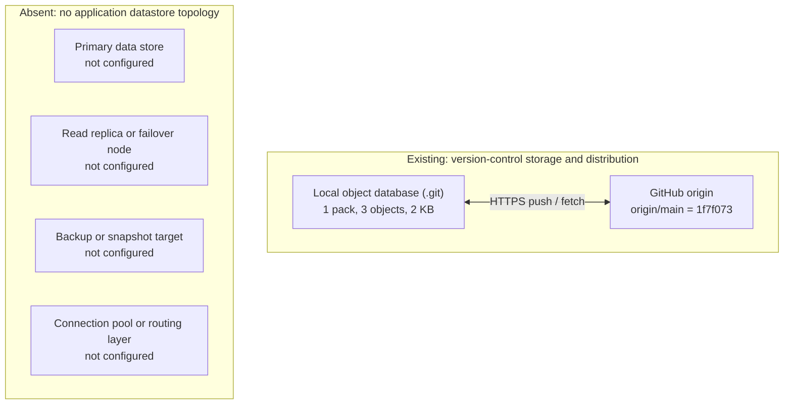

**Diagram maintenance.** All three diagrams are state-dependent and describe commit `1f7f073` only. The schema diagram is superseded the moment a model, migration, or table definition lands; the data flow diagram gains an application flow when a component reads or writes data; and the replication diagram acquires edges when a second datastore instance, replica, or backup target is configured.


### 6.2.7 References

- `README.md` — the repository's only tracked artifact and the sole carrier of project intent; two lines and 70 bytes, with no executable content, establishing that no database, schema, driver, or data-handling artifact accompanies the project (blob `687701a0b9445a7539557e4c07695b4ba255695c`).
- Repository root folder (path `""`) — established that the checkout has exactly one first-order child, `README.md`, and no sub-folders at any depth.
- `.git/objects/pack/` — the only persisted store in the repository: three objects (commit `1f7f073`, tree `e0c8e59c`, blob `687701a0`) in `pack-ed1ca27110c511f453443b3cc4b1559c7baf593b.pack` (933 bytes) with `.idx` (1156 bytes) and `.rev` (64 bytes); established that all persistence is version-control metadata, and the git object graph and index files drawn in 6.2.6.
- `.git/config`, `.git/refs/` and the clone reflog — established the single `origin` remote on GitHub (`blitzytest02/blitzy-20250604155138465`) over HTTPS with an embedded short-lived access token, and that `refs/heads/main`, `refs/remotes/origin/main` and `refs/remotes/origin/HEAD` all resolve to `1f7f073`.
- No `.blitzyignore` file exists anywhere in the checkout, so no path was excluded from this investigation.

Cross-referenced specification sections (no repository file backs these directly; they are cited for document consistency): 1.2.2 (no capability, persistence, or interface artifact), 1.3.1 (no data domain in scope), 2.4.2 and 2.4.4 (no performance requirement; repository-level security implications), 2.4.6 (state-dependence of empty findings), 3.5 (no database, cache, or storage service; the default stack's MongoDB proposal has no artifact), 4.3.1 (no persistence points), 5.1.1, 5.1.3 and 5.1.4 (object identities, git-level data flow, host integration with no recorded SLA).

No web sources were consulted for this sub-section: every statement rests on the checkout at commit `1f7f073`.


## 6.3 Integration Architecture

### 6.3.1 Applicability Statement

**Integration Architecture is not applicable for this system.**

An integration architecture describes the interfaces a system exposes to other systems and consumes from them — an API surface, a message or event channel, a batch exchange, or a gateway that mediates them. At commit `1f7f073` the repository `blitzy-20250604155138465` holds exactly one tracked artifact, `README.md` (2 lines, 70 bytes), no executable content of any kind, and no configuration beyond git's own. Nothing in the tree defines an endpoint, a client, a producer, a consumer, a job or a gateway; no process executes, so nothing can accept a request, emit a message or answer a callback. The absence is verified rather than merely undocumented:

| Check | Artifact or command | Finding at `1f7f073` |
|---|---|---|
| Tracked content | `git ls-files`; extension census of tracked paths | One path, `README.md` (the only `.md`); no source, descriptor or configuration file exists |
| Working tree | Full enumeration excluding `.git` | One file and no directories at any depth |
| Interface descriptors | Scan for OpenAPI or Swagger, GraphQL SDL, `.proto`, AsyncAPI, WSDL | No match; no interface is defined in either direction |
| Messaging artifacts | Vocabulary grep over tracked content for broker, queue, topic, stream, webhook and scheduler terms | No match (exit 1); the same grep finds no API, endpoint, OAuth or rate-limit term |
| Runtime surface | Any listener, port binding, route table, job descriptor or scheduler entry | None; no runtime exists, so no interface can be served |
| Configuration scopes | `git config --list --show-origin` | Only `file:.git/config`; no system or global config supplies a transport, proxy or credential |
| Revision history | `git log --all --diff-filter=D` | Empty; no integration code was ever added and then removed |
| Object database | `git cat-file --batch-all-objects --batch-check` | Three objects only: commit `1f7f073` (1003 B), tree `e0c8e59c` (37 B), blob `687701a0` (70 B) |

**The one boundary the repository does cross.** A single cross-system interface exists, and it is version-control transport rather than application integration: a git client reaches `https://github.com/blitzytest02/blitzy-20250604155138465.git` over HTTPS and exchanges whole revisions with the GitHub host. Its workflow view is recorded in section 4.1.2, its architecture view in section 5.1.4, and the host itself as the sole third-party service in section 3.4. Three of its properties matter to this section and are documented in it rather than repeated: the protocol is HTTPS carrying git's packfile representation (`remote.origin.url` scheme, `remote.origin.fetch` = `+refs/heads/*:refs/remotes/origin/*`); the exchange is client-initiated, snapshot-based, and never solicited by the host; and the credential is a short-lived bearer token embedded in the remote URL, so the interface's authentication is perishable by construction. No inbound path exists at all — the repository runs no listener, so nothing external can call into it.

**What would make this section applicable.** Any one of the following artifacts would create an integration architecture to document: an HTTP route handler, controller or API schema in the repository; a client SDK dependency or base-URL configuration for an outbound call; a broker, queue, topic or subscription configuration; a webhook or callback receiver; a gateway, ingress or infrastructure descriptor that routes traffic; or a scheduled or event-triggered job. Until one lands, sub-sections 6.3.2 through 6.3.4 record each prescribed dimension as a verified absence together with the artifact that would declare it, and 6.3.5 diagrams both the one transport boundary that exists and the integration tiers the repository does not have. These findings are state-dependent: they describe commit `1f7f073` and go stale on the first commit that introduces an interface, exactly as section 2.4.6 records for the specification as a whole.


### 6.3.2 API Design

No API exists to design. The repository defines no interface it serves — no route, controller, schema or handler appears anywhere in the tree — and no client interface it consumes, since no dependency manifest, SDK import or endpoint configuration exists. What the checkout does support is the interface layer of the single transport described in 6.3.1: the git smart-HTTP exchange with the GitHub host on the `origin` remote. Each prescribed API-design dimension is therefore recorded below against the artifact that would declare it, with the transport's observable interface properties stated where they apply.

#### 6.3.2.1 Protocol Specifications

| Protocol dimension | Artifact that would declare it | Finding at `1f7f073` |
|---|---|---|
| Application protocol | Route handlers, API schema, IDL or interface descriptor | Absent; no REST, GraphQL, gRPC, WebSocket or SOAP artifact exists |
| Transport and scheme | Remote URL scheme in `.git/config` | Present: `https://` only — HTTPS is the sole protocol on the wire, as section 5.1.3 records |
| Inbound surface | Listener, port binding, ingress rule or server bootstrap | Absent; nothing in the repository can accept an inbound call |
| Wire format | Payload or object definitions | git's packfile representation of content-addressed objects: `pack-ed1ca27110c511f453443b3cc4b1559c7baf593b.pack` (933 B) with `.idx` (1156 B) and `.rev` (64 B) |

The transport is client-initiated and snapshot-based: a client fetches or pushes whole revisions, and the host neither calls back nor pushes unsolicited (section 5.1.3). No request/response API for data, no publish/subscribe channel, no streaming channel and no file-drop interface exists anywhere in the tree. Two client-side protocol details are observable and both are unconfigured: `protocol.version` is unset, so the transport negotiation is git 2.43.0's own default rather than a pinned choice; and no `http.proxy`, `http.version` or `http.sslVerify` override is set in any scope, since `.git/config` is the only configuration file present. TLS termination occurs at the GitHub host and is therefore outside the checkout and not documented here. Section 4.1.2 describes the same exchange as the repository's only integration workflow.

#### 6.3.2.2 Authentication Methods

No application authentication mechanism exists: the tree contains no login flow, session store, identity-provider configuration, API-key store, OAuth client registration or SSH key. The only authentication that operates on any interface is the credential carried by the `origin` URL.

| Authentication fact | Observed value | Evidence |
|---|---|---|
| Mechanism | Bearer credential in the URL userinfo, sent as HTTP basic authentication on every transfer | `remote.origin.url` = `https://x-access-token:<token>@github.com/...` |
| Credential form | 390-character token with the `ghs_` prefix (a GitHub installation access token); value withheld from this document | Measured from the configured URL |
| Token claims | `iss` = `github`, `aud` = `authnd`, `ver` = 3, with `iat`, `exp`, `jti` and a `ctx` claim | Decoded JWT payload segment of the token |
| Lifetime | `iat` 1792061877 to `exp` 1792065477 — 3600 seconds, one hour | Same decoded claims |
| Client credential handling | No helper and no prompt: `credential.helper` is empty, `credential.interactive` is `false`, `core.askpass` is `echo` | `.git/config`; no global or system config exists to supply a helper |

Because no credential helper is configured and interactive prompting is disabled, the URL token is the only authentication factor available to the transport, and there is no second factor, no stored key material and no SSH identity anywhere in the checkout. Authentication is therefore single-factor, bearer-style, and perishable: once the hour elapses, transport authentication fails until a fresh credential is supplied. Section 2.4.4 records the operational consequence, and section 5.1.1 warns that the token value must never be copied into source, documentation or logs; this section does not reproduce it.

One further authenticity mechanism is present but is not this system's to operate: the commit carries a `gpgsig` block produced by the host's committer identity (`GitHub <noreply@github.com>`). `git log -1 --pretty=%G?` returns `E` for that commit — a signature exists but cannot be verified in this checkout, because the signing key (id `B5690EEEBB952194`) is not available locally. Host-supplied provenance is thus unverifiable by a clone, which is a property of the host relationship rather than of any repository code.

#### 6.3.2.3 Authorization Framework

No authorization framework exists. The tree holds no role, scope, policy, permission, tenant or access-control list definition, and no code exists that could evaluate one, so there is nothing to authorize within the system.

| Authorization dimension | Artifact that would declare it | Finding at `1f7f073` |
|---|---|---|
| Role and permission model | Policy files, role definitions, permission mappings | Absent; no authorization artifact of any kind exists |
| Enforcement point | Middleware, interceptor, gateway rule or guard clause | Absent; there is no request path to guard |
| Credential scope | Scope field in the credential or permission descriptor | Not expressed: the decoded token claims carry `aud`, `ctx`, `exp`, `iat`, `iss`, `jti` and `ver`, and no scope list, so the granted permission set is opaque to this checkout |
| Content admission | Ignore or attribute rules controlling what may be committed | Absent; no `.gitignore` and no `.gitattributes` exists |

The authorization that actually governs the interface is GitHub's repository permission model, applied outside the repository and therefore not observable from it. Two consequences follow from the tree itself. Read access is unauthenticated and worldwide, because the repository is public — `README.md` line 2 states it was auto-created as a public repository, and section 5.1.1 records the resulting irreversibility of disclosure. Write access is mediated solely by the embedded bearer credential from 6.3.2.2. Whether the host enforces branch protection, review requirements or push restrictions on `main` cannot be determined from the checkout, so no such control is claimed. Because no `.gitignore` exists, there is also no content-admission control: any file staged in a future commit is published, which is the condition section 2.4.4 recommends correcting before the first implementation commit.

#### 6.3.2.4 Rate Limiting Strategy

No rate limiting exists on either side of the boundary as configured here, and none is planned by any artifact. There is no quota, throttle, token bucket, concurrency cap, retry budget or backoff parameter anywhere in the tree; the vocabulary grep over tracked content returns no match for rate-limit terms, and no configuration scope beyond `.git/config` exists to hold one. Any consumption limit is imposed by the GitHub host and is not observable from the checkout, and the repository declares no client-side accommodation for it — no retry, backoff or circuit-breaker logic exists, which section 5.4.3 records as an unhandled concern. The single transport operation the checkout evidences is one clone, recorded in the reflog as `clone: from https://github.com/blitzytest02/blitzy-20250604155138465.git`; no push appears in the local history, and no automation, pipeline or scheduled job exists that would generate repeated calls. Rate limiting is therefore recorded as not applicable at this commit for the same reason as the rest of this section: no caller, no callee and no traffic.

#### 6.3.2.5 Versioning Approach

No API versioning approach exists, because no API exists to version: no version segment appears in any route (no routes exist), no version header or media-type negotiation is defined, and no schema carries a version field. What the repository does version is its content, and it does so through revision control rather than through an API contract.

| Versioning dimension | Artifact that would declare it | Finding at `1f7f073` |
|---|---|---|
| Interface version | Versioned route path, version header, or versioned schema field | Absent; no interface definition exists |
| Content revision identity | Commit hash and content-addressed object names | Present: commit `1f7f073b9d8f818fa2b33fd38a98e391ed2026be`; blob `687701a0`; tree `e0c8e59c` |
| Release convention | Tags, release artifacts, changelog | Absent: zero tags (`git tag -l` is empty), one branch (`main`), one commit (`git rev-list --count HEAD` = 1), no changelog file |
| Protocol and client version | Pinning file or transport configuration | Absent: `protocol.version` is unset and the git client version (2.43.0) is unpinned in the repository, as section 3.6 records |

Content-addressed naming is the repository's only identity scheme: an object is named by the hash of its content, so identical bytes reuse one object and a change is expressed as a new commit rather than an edited object. No version, release, compatibility or deprecation convention is stated anywhere in `README.md`, and no artifact records which protocol or interface version a consumer should expect. The only version-like tokens present are the repository identifier `blitzy-20250604155138465` and the commit hash itself; section 5.1.1 records the same finding.

#### 6.3.2.6 Documentation Standards

No API documentation standard is applied. There is no OpenAPI or Swagger document, no AsyncAPI definition, no GraphQL schema, no Postman collection, no generated reference and no documentation site, because there is no interface to describe. Equally, no code-comment or docstring convention exists, because the tree contains no code to annotate.

The repository's only documentation artifact is `README.md`: 2 lines and 70 bytes, a level-one heading naming the project on line 1 and one sentence of provenance on line 2, with no sections, lists, tables, links, badges or usage instructions. Markdown is the only markup format in the tree, and no `CONTRIBUTING`, `LICENSE`, `CHANGELOG` or architecture note accompanies it. Three documentation surfaces do exist as a by-product of the tooling and are the only machine- and human-readable descriptions a consumer can obtain: the commit message (one: `Initial commit`), the ref names (`refs/heads/main`, `refs/remotes/origin/main`, `refs/remotes/origin/HEAD`, all at `1f7f073`), and the host's rendered presentation of `README.md` — the last being a consumption-side rendering rather than a transformation this system performs, as section 5.1.3 notes. Any documentation standard for an interface would therefore have to be introduced with the first interface; none can be inherited.


### 6.3.3 Message Processing

No message processing exists in this system, at any layer. The tree contains no producer, consumer, broker, topic, subscription, stream, job or scheduler, and no process executes, so no message can be produced, routed or delivered. The only exchange on any boundary is the client-initiated git transport of 6.3.1, which transfers whole revisions on request and terminates; it carries no message envelope, routing key, offset or acknowledgement protocol, as section 5.1.3 records. Each prescribed message-processing dimension is therefore reported below against the artifact that would declare it.

#### 6.3.3.1 Event Processing Patterns

| Event dimension | Artifact that would declare it | Finding at `1f7f073` |
|---|---|---|
| Producer and consumer roles | Publisher or subscriber code, event handler, listener registration | Absent; no source file exists in any language |
| Event schema and contract | Event definition, topic schema, Avro/Protobuf/JSON schema | Absent; no schema artifact of any kind exists |
| Dispatch model | Event bus, fan-out rule, subscription or routing configuration | Absent; the vocabulary grep over tracked content finds no pub/sub, broker or webhook term |
| Delivery semantics | At-least-once or exactly-once setting, ordering rule, idempotency key | Absent; no delivery configuration exists to state a semantic |

Nothing in the repository emits or reacts to an event. The two candidate analogues both fail the definition. The ref update that created `refs/heads/main` is a state transition performed by a client, not an event delivered to a handler — section 5.1.3 records it as git's atomic unit of change, and it triggered nothing. The host's advertisement of `refs/heads/main = 1f7f073` is pulled by a client during a fetch rather than pushed to a subscriber, so it is a response, not an event notification. There is no webhook receiver and no webhook emitter, no event log and no dead-letter destination, which matches the integration-workflow finding in section 4.1.2.

#### 6.3.3.2 Message Queue Architecture

No message queue architecture exists in any form: no broker is declared, no queue or topic is configured, and no client library for one appears in the tree. Because the repository also contains no dependency manifest or lockfile, no messaging client dependency can be declared even implicitly, and the tracking vocabulary scan for broker and queue technologies returns no match. The table below records each architectural element a queue would require.

| Queue element | Artifact that would declare it | Finding at `1f7f073` |
|---|---|---|
| Broker endpoint | Connection string, host and port, cluster or namespace configuration | Absent; the only URL in the tree is the HTTPS `origin` remote |
| Queue or topic definition | Queue declaration, topic name, partition scheme, retention policy | Absent; no configuration file beyond `.git/config` exists |
| Client dependency | Broker client library in a manifest or lockfile | Absent; no manifest or lockfile exists at all |
| Reliability settings | Acknowledgement mode, visibility timeout, dead-letter queue, redelivery rule | Absent; nothing consumes or acknowledges a message |

The packfile transfer that the repository does perform must not be mistaken for queueing. It is a synchronous request/response exchange over HTTPS, initiated by a client, carrying three objects in a 933-byte pack, with no buffer, no competing consumer, no retention window and no delivery guarantee other than the integrity of the transfer itself. Nothing is decoupled, nothing is buffered, and nothing is retried by any repository-side mechanism.

#### 6.3.3.3 Stream Processing Design

No stream processing exists: there is no streaming runtime, no consumer group, no windowing or watermarking, no checkpointing or state store, no backpressure control and no streaming client dependency. A stream processor requires a continuously arriving sequence of records and a component that transforms them; this repository has neither, since no code executes and no record-oriented source is configured.

| Stream element | Artifact that would declare it | Finding at `1f7f073` |
|---|---|---|
| Stream source | Topic subscription, socket or feed configuration | Absent; no feed, socket or subscription is configured |
| Processing topology | Operator graph, pipeline definition, transformation code | Absent; no transform exists beyond git's own object construction |
| State and checkpointing | Offset store, checkpoint directory, state backend | Absent; no offset or checkpoint artifact exists |
| Delivery guarantee | Processing-semantics setting, replay policy | Absent; nothing is processed, so no semantic is declared |

One object on the wire is a byte stream, and it is worth stating precisely so the distinction is not blurred: the transport streams a 933-byte packfile containing one commit, one tree and one blob, and the exchange completes and ends. That is a bounded snapshot transfer of a revision, not the processing of an unbounded record stream — section 5.1.3 describes the same exchange as snapshot-based and client-initiated.

#### 6.3.3.4 Batch Processing Flows

No batch processing flow exists. The repository defines no job, no DAG, no scheduler entry, no cron expression, no worker and no chunking or commit-size parameter, and no CI/CD system of any vendor exists to carry pipeline stages, as section 3.6 records. Consequently there is no window, no trigger, no retry schedule and no partial-failure policy for a batch to obey.

| Batch element | Artifact that would declare it | Finding at `1f7f073` |
|---|---|---|
| Job definition | Job descriptor, DAG, pipeline file, Makefile target | Absent; no job, pipeline or build descriptor exists |
| Schedule or trigger | Cron entry, timer, trigger rule, event binding | Absent; nothing schedules or triggers anything |
| Work partitioning | Chunk size, shard configuration, parallelism setting | Absent; no partitioning configuration exists |
| Offline data path | Import, export or ETL script, staging area | Absent; no script of any kind exists |

Two operations in the repository have a batch-like shape and are explicitly not batch flows. The ref update that set `refs/heads/main` to `1f7f073` was a single atomic write of one commit, performed once by hand rather than on a schedule. The packfile construction that grouped the repository's three objects into one transport unit is a storage and transport optimisation applied when git packs objects, not a partitioned job with stages. Sections 5.1.1 and 5.4.6 reach the same conclusion from the style and recovery directions: no pipeline, batch or scheduled processing exists.

#### 6.3.3.5 Error Handling Strategy

No error handling strategy exists for any interface, because no interface is implemented in the repository. No handler, retry, exponential backoff, circuit breaker, timeout, fallback, bulkhead, dead-letter destination or compensating action appears anywhere in the tree, and section 5.4.3 records the same finding as a cross-cutting concern. The table below pairs each failure the transport boundary can actually encounter with the handling that exists.

| Failure mode on the only boundary | Handling that exists | Finding at `1f7f073` |
|---|---|---|
| Credential expiry or rejection | Retry with refreshed credential, credential helper, fallback identity | None: the token's 3600-second lifetime is the only expiry control, `credential.helper` is empty and prompting is disabled (6.3.2.2) |
| Push rejected by the host | Retry logic, conflict resolution, notification | None: no push is recorded in the local history and no handling artifact exists |
| Transfer interrupted or corrupt | Integrity check, resume, retry budget | git's own transfer integrity checks, performed by the client outside the repository; no repository-side policy exists |
| Irreversible public disclosure | Pre-commit guard, secret scan, ignore rules | None: no `.gitignore`, no `.gitattributes` and no CI exist, which is the condition section 2.4.4 raises |
| Local commit or push interception | Git hook | None: `.git/hooks` contains only `*.sample` files and zero active hooks |

Error handling is therefore entirely delegated to the git client and the GitHub host, both outside the repository's control, and its observable evidence is limited to the client-side messages a failed operation would print — none of which is captured anywhere, since no log, alerting rule or monitoring artifact exists. Section 4.1.2 records the same delegation from the workflow direction, and section 5.4.3 records the two unhandled failure surfaces this table repeats.


### 6.3.4 External Systems

Exactly one external system is evidenced at `1f7f073`: GitHub, as the host of the repository and the counterparty of its transport. Section 3.4 reaches the same conclusion from the third-party-service direction and section 5.1.4 from the architecture direction. Every other external-system category — an application API, an identity provider, a monitoring service, a cloud resource, a message broker, a database service — has no artifact in the tree to declare it, and section 6.3.1 records the absence for the whole family.

| External system | Role and exchange pattern | Protocol and format | Recorded contract terms |
|---|---|---|---|
| GitHub — repository `blitzytest02/blitzy-20250604155138465` | Host and read/write counterparty; client-initiated, snapshot-based exchange of whole revisions | HTTPS over the `https://` origin URL; git object transfer in packfile format (`.pack` with `.idx` and `.rev`) | None recorded: no availability target, throughput commitment, rate limit, retention term or support agreement appears anywhere in the repository |
| Local git toolchain (git 2.43.0 in this checkout) | Client for that host; the last recorded operation is the clone that produced this working copy | Local filesystem for repository and working tree; git CLI for operations; HTTPS to `origin` | None recorded; the client version is unpinned in the repository, as section 5.1.4 notes |
| Reader of the published artifact | Consumption of the only artifact; unauthenticated retrieval of `README.md` from a public repository | HTTPS delivery of Markdown text, rendered by the consumer | None recorded; no fidelity, compatibility or performance expectation is expressed |

#### 6.3.4.1 Third-Party Integration Patterns

| Integration pattern | Artifact that would declare it | Finding at `1f7f073` |
|---|---|---|
| Outbound API client | HTTP client code, SDK dependency, base-URL configuration | Absent; no dependency manifest, no client code and no endpoint configuration exists |
| Inbound callback or webhook | Receiver route, signing-secret reference, subscription registration | Absent; nothing can receive a call, since no process executes |
| Scheduled synchronisation or polling | Scheduler entry, sync job, cursor or watermark state | Absent; no scheduler, job or state artifact exists |
| File or batch exchange | Transfer script, drop directory, import or export definition | Absent; the working tree contains one file and no directories at all |
| Message bridge, sidecar, service mesh or adapter | Broker configuration, proxy sidecar, adapter module | Absent; no such artifact appears anywhere in the tree |

The pattern the repository does implement is narrower than any of these: client-initiated retrieval and publication of whole revisions over HTTPS, with the host acting as the sole system of record for the published branch. There is no adapter or anti-corruption layer between the two sides — the git client and the host exchange repository-format objects directly — and there is no callback, no long-lived session and no background channel. Each exchange authenticates with the short-lived bearer credential described in 6.3.2.2, so the integration holds no persistent session state on the repository side. No third party other than the host is integrated in any direction, which matches sections 3.4 and 4.1.2.

#### 6.3.4.2 Legacy System Interfaces

No legacy system interface exists, and no predecessor system is referenced anywhere in the repository: section 1.2.1 records that the tree names no prior system and no data-transfer tooling. There is consequently no compatibility shim, no protocol translation layer, no fixed-width or flat-file interface, no mainframe or batch-file handoff, and no bridging component of any kind.

| Legacy interface element | Artifact that would declare it | Finding at `1f7f073` |
|---|---|---|
| Predecessor system reference | Migration plan, interface specification, integration note | Absent; `README.md` states only that the repository was auto-created with a README |
| Compatibility layer or adapter | Translation module, mapping table, shim | Absent; no source file exists to contain one |
| Data migration path | Import script, extract/transform job, mapping document | Absent; there is no dataset to move, as section 6.2 records |
| Decommissioning or cutover record | Cutover plan, deprecation notice, redirect rule | Absent; no such record exists in the tree |

The repository's own history confirms that nothing was ported: `git log --all --diff-filter=D` is empty, so no file was ever added and then removed, and the single commit `1f7f073` is a root commit with no parent and no merge. The one artifact that could be mistaken for a legacy interface is the local git client, version 2.43.0, but it is a developer and automation tool for the remote rather than a legacy system this repository interfaces with, and its version is not pinned by any file in the tree.

#### 6.3.4.3 API Gateway Configuration

No API gateway is configured, and none could be provisioned from this repository: the tree contains no gateway artifact (no Kong, AWS API Gateway, Apigee, nginx, Traefik or Envoy configuration), no ingress or route resource, and no infrastructure descriptor of any kind — no Terraform file, no `serverless.yml`, no `app.yaml`, no `template.yaml` and no Kubernetes manifest, as sections 3.6 and 6.1 record. Nor is there an inbound listener for a gateway to front.

| Gateway element | Artifact that would declare it | Finding at `1f7f073` |
|---|---|---|
| Gateway or ingress definition | Gateway config, ingress rule, virtual service, listener definition | Absent; no configuration file beyond `.git/config` exists |
| Routing rules | Path or host routing table, upstream mapping | Absent; the repository defines no route and no upstream |
| Cross-cutting policies | Authentication, throttling, CORS or TLS policy at the edge | Absent; no policy artifact exists, and no rate limit is configured (6.3.2.4) |
| Provisioning path | Infrastructure-as-code descriptor or deployment pipeline | Absent; no IaC and no CI/CD of any vendor exists (section 3.6) |

The only ingress into anything this repository publishes is GitHub's own HTTPS service, which is host-managed and not configured from here; the repository supplies no routing, no throttling and no edge policy to it. Should a service be added, its gateway would have to be introduced as new infrastructure rather than derived from any artifact present at `1f7f073`.

#### 6.3.4.4 External Service Contracts

No external service contract is recorded. There is no contract document, no published API description, no consumer-driven contract test, no version-negotiation clause and no data-processing or retention agreement anywhere in the tree. Section 5.1.4 records the same silence as "None recorded" against the host relationship.

| Contract dimension | Artifact that would declare it | Finding at `1f7f073` |
|---|---|---|
| Interface and version terms | Contract file, API description, contract test | Absent; no interface description exists and no versioning convention is stated (6.3.2.5) |
| Availability and performance commitments | SLA document, SLO definition, capacity plan | Absent; no availability, latency or throughput target is stated anywhere (section 5.4.5) |
| Rate limit and quota terms | Quota definition, throttling policy, usage budget | Absent; any host-side limit is unrecorded in the repository (6.3.2.4) |
| Data handling, retention and provenance | Retention term, privacy clause, signature or key material | Absent; no retention term is stated, and the host's commit signature cannot be verified locally (6.3.2.2) |

Three contract-like facts are nonetheless observable, and they are properties of the exchange rather than agreed terms. The host advertises `refs/heads/main = 1f7f073` on request, so the read direction is defined by git's ref-advertisement protocol rather than by a negotiated contract. The host accepts a push only when the presented bearer credential authorizes it, which is an authorization decision made outside the checkout. The host signs the commit it created on the author's behalf — committer `GitHub <noreply@github.com>` with a `gpgsig` block — but the signature cannot be checked from this checkout (`%G?` = `E`, key `B5690EEEBB952194` unavailable), so provenance is host-asserted and locally unverifiable. No contract term, service boundary, data-sharing rule or escalation path is recorded anywhere in the repository, and none can be inferred from it.


### 6.3.5 Required Diagrams

Four diagram classes are prescribed for an integration architecture: integration flow, API architecture, message flow, and sequence diagrams for key flows. Only the first and fourth have a subject at `1f7f073`, and only in their version-control-transport form; the second and third have no subject at all, so their diagrams render the existing transport alongside the interface tiers the repository does not have, marking the absences explicitly rather than implying an API or a messaging layer that no artifact declares.

| Prescribed diagram | What exists at `1f7f073` | What it will show once interfaces exist |
|---|---|---|
| Integration flow | One boundary: client-initiated HTTPS exchange of whole revisions with GitHub | Additional endpoints, credentials, callbacks and data contracts per integrated system |
| API architecture | No API tier: no client SDK, gateway, route, authorization middleware or rate limit | Consumers, gateway and edge policy, service routes, and the middleware chain around them |
| Message flow | No producer, broker, topic, consumer or dead-letter destination | Topics or queues, dispatch pattern, delivery semantics, retry and dead-letter paths |
| Key-flow sequences | Two flows actually execute: inbound clone/fetch and outbound push | Request and response sequences per endpoint, including failure and retry paths |

#### 6.3.5.1 Integration Flow Diagram

Figure 6.3.5-1 shows every integration edge the repository evidences and every one it lacks. Solid edges are the two directions of the only boundary: an inbound `fetch` or `clone` that returns the advertised ref and the packfile, and an outbound `push` that presents the same bearer credential and updates the ref. Both are client-initiated, and both consume the credential held in `remote.origin.url`, whose 3600-second lifetime (6.3.2.2) is the integration's only session control. The `Absent - no other integration exists` cluster lists the integration routes a repository of this kind would normally have and states, in the diagram itself, that none of them exists.

```mermaid
flowchart LR
    subgraph Client["Client side - repository checkout"]
        WT["Working tree<br/>README.md, 70 bytes"]
        OBJ["Object database<br/>pack 933 B, 3 objects"]
        CRED["Credential in remote.origin.url<br/>x-access-token, expires in 3600 s"]
    end
    subgraph Boundary["Only boundary - HTTPS, git packfile protocol"]
        FETCH["fetch or clone<br/>client-initiated"]
        PUSHF["push<br/>client-initiated"]
    end
    subgraph Host["GitHub host - the sole external system"]
        REFS["Advertises refs/heads/main = 1f7f073"]
        GPGS["Host-supplied commit signature<br/>gpgsig, key B5690EEEBB952194"]
    end
    subgraph Absent["Absent - no other integration exists"]
        NA1["No application API<br/>no endpoint, no schema"]
        NA2["No message channel<br/>no broker, no topic"]
        NA3["No host-initiated call<br/>no webhook, no listener"]
    end
    WT --> OBJ
    OBJ --> FETCH
    CRED --> FETCH
    REFS --> FETCH
    FETCH --> WT
    OBJ --> PUSHF
    CRED --> PUSHF
    PUSHF --> REFS
    REFS --> GPGS
```

#### 6.3.5.2 API Architecture Diagram

Figure 6.3.5-2 sets the existing interface layer against the API tiers that would normally sit around it. The existing layer is one path — git client, transport, host endpoint — with no mediation of any kind: no gateway, no route, no middleware and no application protocol. The `Absent API tiers` cluster shows the layers that would sit between a consumer and a service, each labelled with the artifact that would declare it; the dashed edge records that there is no inbound path from the host endpoint into any listener, because no process executes. Nothing in this diagram is configured by the repository: the transport's negotiation is git's default (`protocol.version` unset) and the endpoint is host-managed.

```mermaid
flowchart TB
    subgraph Existing["Existing interface layer - transport only"]
        C1["git client 2.43.0<br/>protocol.version unset"]
        T1["HTTPS git smart transport<br/>packfile format"]
        H1["GitHub endpoint<br/>blitzytest02/blitzy-20250604155138465"]
    end
    C1 --> T1
    T1 --> H1
    subgraph AbsentApi["Absent API tiers - no artifact declares them"]
        L1["Client SDK or generated client<br/>no dependency manifest"]
        L2["Gateway or ingress<br/>no IaC descriptor"]
        L3["Service routes or handlers<br/>no source file"]
        L4["Authorization middleware<br/>no policy artifact"]
        L5["Rate limiting or quota<br/>no configuration"]
        L6["Inbound listener<br/>no process executes"]
    end
    L1 -.-> L2
    L2 -.-> L3
    L3 -.-> L4
    L4 -.-> L5
    H1 -.->|"no inbound path"| L6
```

#### 6.3.5.3 Message Flow Diagram

Figure 6.3.5-3 contrasts the messaging topology the repository does not have with the single exchange it does perform. Every edge in the upper cluster is dashed because the cluster is a list of absent components — a producer, a broker, a topic or queue, a consumer and a dead-letter destination — none of which any artifact declares, as 6.3.3 records. The lower cluster is the actual exchange: a synchronous, client-initiated request for refs, a response carrying the advertised ref and a 933-byte packfile of three objects, and then termination, with nothing buffered and nothing acknowledged. No message is exchanged anywhere in this system in the messaging sense of the term.

```mermaid
flowchart TB
    subgraph AbsentMsg["Absent messaging topology - no artifact declares any of it"]
        P1["Producer<br/>no publisher code"]
        B1["Broker<br/>no broker client dependency"]
        Q1["Topic or queue<br/>no configuration"]
        CS1["Consumer<br/>no subscriber code"]
        DL1["Dead-letter destination<br/>no error-handling artifact"]
    end
    P1 -.-> B1
    B1 -.-> Q1
    Q1 -.-> CS1
    CS1 -.-> DL1
    subgraph PresentMsg["Present exchange - synchronous, client-initiated, terminating"]
        E1["git client requests refs from origin"]
        E2["Host advertises refs/heads/main = 1f7f073"]
        E3["Packfile delivered - 933 B, 3 objects"]
        E4["Transfer ends - nothing buffered or acknowledged"]
    end
    E1 --> E2
    E2 --> E3
    E3 --> E4
```

#### 6.3.5.4 Sequence Diagrams for Key Flows

Two flows actually execute against the one interface, and both are shown below. They are the repository's only request/response sequences; no other sequence of calls exists, because nothing else in the system makes or receives one.

**Figure 6.3.5-4a — inbound clone or fetch.** The client reads the credential from its configured remote URL, presents it over HTTPS, receives the ref advertisement, receives the packfile, and materialises the working tree and the remote-tracking refs. The reflog records exactly this sequence once: `clone: from https://github.com/blitzytest02/blitzy-20250604155138465.git`, resolving `refs/heads/main`, `refs/remotes/origin/HEAD` and `HEAD` to `1f7f073`. No callback follows, and no session survives the transfer — the credential is the only state either side retains.

```mermaid
sequenceDiagram
    participant C as git client 2.43.0
    participant U as origin URL credential
    participant H as GitHub host
    participant W as working tree
    C->>U: read remote.origin.url
    U->>H: HTTPS basic auth with x-access-token
    Note over U,H: credential value is not reproduced here
    H-->>C: advertises refs/heads/main = 1f7f073
    H-->>C: packfile, 933 B, 3 objects
    C->>W: materialise README.md and remote-tracking refs
    Note over C,H: no callback, no session persists after transfer
```

**Figure 6.3.5-4b — outbound push, including the failure path.** The push direction is the reverse of the fetch: objects built locally are offered to the host with the same bearer credential, and the host either accepts the ref update or rejects the operation. Both branches are drawn because both are unhandled by this repository: on success the published bytes become world-readable immediately, since the repository is public, and on failure there is no retry, no fallback credential and no alerting — the credential's one-hour lifetime is the only expiry control either in place or planned. The sequence also records that zero active git hooks intercept the operation: `.git/hooks` holds only `*.sample` files, so nothing local can veto, amend or observe a push.

```mermaid
sequenceDiagram
    participant D as operator
    participant C as git client
    participant H as GitHub host
    D->>C: create blob, tree and commit objects
    C->>H: push refs/heads/main with bearer credential
    alt credential valid - within the 3600 s window
        H-->>C: ref update accepted
        Note over H: published bytes are world-readable at once
    else credential expired or unauthorized
        H-->>C: authentication or authorization failure
        Note over C,H: no retry, fallback or alerting exists here
    end
    Note over C,H: zero active git hooks intercept the operation
```

**Diagram maintenance.** All four figures describe commit `1f7f073` only. Figure 6.3.5-1 gains nodes when a second external system, callback or message channel is introduced; Figure 6.3.5-2 gains real edges the moment a client SDK, gateway, route or middleware artifact lands, at which point its dashed chain becomes the documented API path; Figure 6.3.5-3 is superseded when a broker or queue is configured or a scheduled job is defined; and Figures 6.3.5-4a and 6.3.5-4b are replaced by per-endpoint sequences once an application interface exists to call.


### 6.3.6 References

- `README.md` — the repository's only tracked artifact and sole carrier of project intent: two lines and 70 bytes, a level-one heading naming the project and one sentence recording that it was auto-created with a README; establishes that the repository declares no interface, protocol, dependency or integration, and that this file is the entirety of its documentation (blob `687701a0b9445a7539557e4c07695b4ba255695c`).
- Repository root folder (path `""`) — established that the checkout has exactly one first-order child, `README.md`, and no sub-folders at any depth, so no API, messaging, gateway or client artifact can exist beneath it.
- `.git/config` — the only configuration scope present (no global or system config file exists): established the sole interface endpoint (`remote.origin.url` over HTTPS with an embedded `x-access-token` bearer credential, value withheld), the fetch refspec `+refs/heads/*:refs/remotes/origin/*`, `branch.main.remote` and `branch.main.merge`, and the credential posture (`credential.helper` empty, `credential.interactive` false, `core.askpass` `echo`); also established the absence of `protocol.version`, `http.proxy`, `http.sslVerify`, `http.version`, `remote.origin.push` and `core.hooksPath` overrides.
- `.git/hooks/` — established that zero active hooks exist (only `*.sample` files), so no local interception of commit, push or transport exists.
- `.git/objects/pack/` — the only persisted transport unit: `pack-ed1ca27110c511f453443b3cc4b1559c7baf593b.pack` (933 bytes) with `.idx` (1156 bytes) and `.rev` (64 bytes), carrying three objects; established the wire format and size cited in 6.3.2.1, 6.3.3.3 and 6.3.5.3, and left nothing in the object database to document an integration with.
- `.git/logs/HEAD` (reflog) — established the single transport operation in the checkout's history, `clone: from https://github.com/blitzytest02/blitzy-20250604155138465.git`, diagrammed in 6.3.5.4.
- `.git/refs/` and `refs/heads/main`, `refs/remotes/origin/main`, `refs/remotes/origin/HEAD` — established the single revision (`1f7f073`) that the integration boundary carries, and that no tag or release convention qualifies it (6.3.2.5).
- Commit object `1f7f073b9d8f818fa2b33fd38a98e391ed2026be` and its `gpgsig` block (key id `B5690EEEBB952194`, `%G?` = `E`) — established the host-supplied, locally unverifiable provenance described in 6.3.2.2 and 6.3.4.4.
- No `.blitzyignore` file exists anywhere in the checkout, so no path was excluded from this investigation.
- No web source was consulted for this section: every statement rests on the checkout at commit `1f7f073` and on the git commands and vocabulary scans recorded above.

Cross-referenced specification sections (no repository file backs these directly; they are cited for document consistency): 1.1 and 1.3.2 (no delivered capability or workflow in scope), 1.2.1 (no predecessor system, integration surface or data-transfer tooling), 2.4.1 (public repository, no tag convention, credential embedded in the remote URL), 2.4.4 (repository-level security implications of the credential and the absent ignore rules), 2.4.6 (state-dependence of empty findings), 3.1 and 3.6 (no language, framework or dependency declared; no build, container, infrastructure or CI/CD tooling), 3.4 (GitHub is the sole third-party service), 3.5 (no database, cache or storage service), 4.1.2 (the repository's only integration workflow), 5.1.1, 5.1.3 and 5.1.4 (artifact identities; git-level write and read flows; the host integration with no recorded SLA), 5.4.3 and 5.4.5 (no error-handling and no performance or SLA target), 6.1 (no service decomposition, discovery, load balancing or resilience pattern), and 6.2 (no persistence layer, connection or query interface).


## 6.4 Security Architecture

### 6.4.1 Applicability Determination

**Detailed Security Architecture is not applicable for this system.**

At commit `1f7f073` the repository `blitzy-20250604155138465` is a runtime-free document scaffold. The working tree holds exactly one tracked artifact, `README.md` (2 lines, 70 bytes, blob `687701a0`, mode `100644`), and no directory other than `.git`; `git ls-files` returns that single path; the entire object database holds three objects — blob `687701a0`, tree `e0c8e59c` and root commit `1f7f073` — inside one 933-byte packfile, and `git rev-list --count HEAD` reports 1. Nothing in the tree executes, serves a request, accepts input or stores application data. A security architecture presupposes a system to secure: principals to authenticate, actions to authorise, sessions or tokens to manage, data to protect, and events to audit. Not one of those preconditions is met here, and no artifact exists in which a control could be declared.

| Security domain | Precondition it presupposes | Finding at `1f7f073` |
|---|---|---|
| Authentication | A principal presenting credentials to a running interface | No interface, no sign-in surface, no user store, no token service. The only credential in existence authenticates the operator's git transport to the host, not a user of any application |
| Authorization | Protected resources plus a policy deciding access to them | No resource beyond a 70-byte Markdown file; no policy file, permission model, role definition or enforcement point anywhere in the tree |
| Data protection | Application data, secrets or key material to encrypt, mask or manage | No data store, no schema, no key material, no field-level data. The only secret is the transport credential in the untracked `.git/config` |
| Compliance controls | Regulated data, audit records, or a stated standard to conform to | No personal data, no audit log, no licence file, no privacy notice and no compliance statement in the tree |

**Evidence basis.** The determination rests on verified absence rather than on a security posture that was chosen and left undocumented. A name-based class test over every path outside `.git` exercised 48 security artifact classes — `auth`, `authentication`, `authz`, `authorization`, `rbac`, `role`, `permission`, `session`, `token`, `jwt`, `oauth`, `oidc`, `sso`, `mfa`, `2fa`, `password`, `passwd`, `secret`, `credential`, `vault`, `kms`, `crypto`, `encrypt`, `cipher`, `tls`, `ssl`, `certificate`, `pem`, `key`, `mask`, `anonymiz`, `audit`, `log`, `policy`, `iam`, `acl`, `access-control`, `compliance`, `gdpr`, `hipaa`, `pci`, `soc2`, `iso27001`, `license`, `security`, `scanner`, `dependabot` and `codeql` — and each returned zero matching paths. A keyword scan of tracked content for authentication, authorisation, role, permission, session, token, encryption, secret, policy, compliance and audit terms returned zero matches. The tracked file list is `README.md` alone. Section 5.4.4 reaches the same finding from the cross-cutting-concerns direction, and section 6.1.1 from the services direction.

**Security-relevant facts the repository does supply.** Absence of a security architecture is not absence of security-relevant conditions, and the conditions below are the substance of the rest of this section: they are the assets and surfaces a future implementation inherits, each verifiable from the checkout.

| Condition | Observed value | Security bearing |
|---|---|---|
| Publication surface | Public repository (`visibility: public`, `private: false` from `api.github.com`; README line 2 states "Auto-created public repository with README") | Every pushed byte is world-readable immediately and permanently. No ignore rule, review rule or pipeline gate stands between a working-copy edit and that disclosure |
| Transport credential | `remote.origin.url` = `https://x-access-token:<390-character opaque value>@github.com/blitzytest02/blitzy-20250604155138465.git`; the value is deliberately not reproduced anywhere in this document | The token authorises pushes to the public repository. It is stored in plaintext inside an untracked file whose mode is `0644`, and it is the only credential in the checkout |
| Transport confidentiality | TLSv1.3 negotiated with `TLS_AES_128_GCM_SHA256` over X25519, certificate `CN=github.com` issued by Sectigo Public Server Authentication CA DV E36 | Credentials and content travel encrypted in transit. No certificate pinning, proxy or custom trust setting is configured in `.git/config` |
| Revision provenance | Commit `1f7f073` carries a `gpgsig` PGP signature (RSA key `B5690EEEBB952194`); `git log -1 --show-signature` reports "Can't check signature: No public key" and `git log -1 --format=%G?` returns `E` | Integrity provenance exists but cannot be verified in this checkout. It attests that the hosting platform created the revision, not that a named person authored it |
| Enforcement configuration | `.git/hooks` holds 14 files, all `*.sample`, none active; no `.gitignore`, no `.gitattributes`, no `.github` directory, no active rule in `.git/info/exclude` | Nothing screens content or secrets before a commit or a push. Secret-scanning and content-gating are unconfigured |
| Licensing and disclosure channel | `api.github.com` reports `license: null`; no licence file, no `SECURITY.md`, no `CONTRIBUTING.md` in the tree | No rights of use, modification or redistribution are granted, and no channel exists through which a vulnerability could be reported |

**Reading of this determination.** The verdict is a statement about verified absence, not a claim that a deliberately lightweight security design was selected. It also matches the conditional in this section's requirements literally: the system does not require specific security considerations beyond standard practice, because there is no system behaviour to which a specific consideration could attach — no authentication boundary to defend, no privileged operation to gate, no stored data to classify. The correct reading is "no security architecture has been expressed", never "a minimal one was chosen".

**Standard practices that stand in place of an architecture.** The practices that apply today are platform- and operator-level, and each prescribed area records the practice that substitutes for the missing control: transport authentication with a short-lived bearer credential over TLS (section 6.4.2), host-side permissioning of the single repository with revision provenance (section 6.4.3), protection of the sole secret and of the public disclosure surface with in-transit encryption (section 6.4.4), the full control matrix including the gaps (section 6.4.5), and the licensing and compliance position (section 6.4.6). Every one of these practices is followed rather than enforced: no artifact in the repository implements, configures or verifies any of them, and each sub-section names that gap explicitly. Section 6.4.8 records the artifacts that would bring each security area into scope.

### 6.4.2 Authentication Framework

No authentication framework exists in the repository, and no artifact exists in which one could be declared: there is no identity provider, credential store, sign-in surface, token service, session mechanism or authentication configuration file — the tracked file list is `README.md` alone, and the 48-class name sweep in section 6.4.1 returns zero matches. What does exist is a single transport authentication mechanism inherited from version control, described below after the area-by-area assessment. Section 5.4.4 documents the same absence from the cross-cutting-concerns direction.

| Authentication area | Artifact that would evidence it | Finding at `1f7f073` | Standard practice in place |
|---|---|---|---|
| Identity management | Identity provider or directory integration, user registry, claim or subject mapping | Absent. The only identities anywhere in the system are git metadata fields and the host account namespace `blitzytest02` | Identity is held and authenticated by the hosting platform; this repository neither defines nor maps a principal |
| Multi-factor authentication | Second-factor enrolment record, verification code path, policy requiring MFA | Absent; no code, configuration or policy artifact exists | MFA is an account-level requirement on the publishing account, enforced outside the repository. Nothing in the tree records whether it is enabled |
| Session management | Session store, cookie or token lifetime configuration, idle timeout, revocation list | Absent; nothing executes, so no session is ever created or terminated | The validity window of the transport token is the only session-like attribute; no lifetime or revocation rule is recorded in the tree |
| Token handling | Token issuance, scoped credentials, secret-manager storage, rotation schedule | Present in one form only: a plaintext bearer token embedded in the untracked `.git/config`. No issuance, scope, rotation or expiry record exists | Treat the URL-embedded credential as a secret: never copy it into tracked content, rotate it on any exposure, and prefer a secret store over a URL |
| Password policies | User store plus length, complexity, reuse and lockout rules | Absent; no user store exists, so no password is ever verified by this system | Not applicable: no password-authenticated account exists. Credential hygiene around the sole bearer token substitutes for a password policy |

**The only authentication mechanism present: transport authentication to `origin`.** A git client authenticates to the host by presenting a credential carried in the remote URL. The URL's userinfo segment has the literal username `x-access-token` and a password field 390 characters long; the value is a bearer token, is not reproduced in this document, and is read by the transport on every fetch and push. Three settings in `.git/config` shape how that credential may be supplied, and together they close every alternative source: `credential.helper` is present with an empty value (no helper program can supply or cache a credential), `credential.interactive=false` (the client is forbidden to prompt), and `core.askpass` is set to `echo` (anything that asks for a password program receives an empty string). Authentication material therefore comes from the URL or from nowhere, and the failure mode on expiry is a plain transport error rather than a recovery prompt — the failure surface section 5.4.3 diagrams. No `http.*`, `core.sshCommand` or `receive.*` setting exists, so there is no alternative transport, no proxy trust rule and no server-side gate configured here.

**Where the credential lives, and where it does not.** The token is held in `.git/config`, a file of mode `0644` that is untracked and therefore absent from every clone. A content search for the credential across the working tree returns no file; the same search across `.git` returns `.git/config` alone. A scan of tracked content for token, password, secret, API-key and private-key patterns returns zero matches, and the only tracked file is two lines of Markdown, so the secret has not been published — on a repository whose contents are world-readable, that distinction is the whole of the current control. Two consequences follow and are recorded here as practices rather than as implemented controls: the credential must never be copied into a source file, a log line, an issue, a commit message or a document, because disclosure to a public repository cannot be withdrawn; and because the file is readable by any account with filesystem access to the checkout, credential hygiene depends on the host of that checkout rather than on any repository artifact.

**Identity management.** Three identities are observable, and none of them is an access-control principal.

| Identity | Source | Authentication status |
|---|---|---|
| `blitzytest02 <blitzytest02@gmail.com>` | author field of commit `1f7f073` | Not authenticated. A git author field is self-asserted metadata; nothing in the revision proves who wrote it, and it must not be treated as a principal |
| `GitHub <noreply@github.com>` | committer field of `1f7f073`, and the `gpgsig` block signed with RSA key `B5690EEEBB952194` | Authenticated at creation time by the hosting platform's signing key, but unverifiable in this checkout: `git log -1 --show-signature` reports "Can't check signature: No public key" and `%G?` returns `E` |
| Account namespace `blitzytest02` | `remote.origin.url`, and the repository's owner on the host | Host-authenticated account; the URL token is issued to it, so write access follows that account's permissions |

The distinction between the first two rows is the security fact of this area: the signature covers the revision's content and attests the platform's commit operation, while the human-readable author line remains an unauthenticated claim. An identity-based control built on the author field would therefore be trivially forgeable, and no such control exists.

**Multi-factor authentication, sessions and passwords.** None of the three has an implementation, a configuration or a recording artifact. MFA would sit with the host account that owns the credential, so its presence or absence is not observable from the checkout and this specification claims neither. Session management has no subject: the repository creates no session, holds no session state and defines no lifetime, and the only time-bounded attribute in the system is the transport token's own validity, whose expiry and issuance terms appear nowhere in the tree. Password policies have no subject either, because the system verifies no password; the closest equivalent requirement is the handling and rotation of the single bearer token, which is a practice recorded in this sub-section rather than a control the repository enforces.

The first component that authenticates a caller will introduce this entire framework as net-new work — principal model, credential issuance, session or token lifetime and password or key policy together, because none of them has an artifact to inherit. Section 6.4.8 records the triggering conditions, and section 6.4.5 maps the resulting control gaps.

### 6.4.3 Authorization System

The repository implements no authorization system. There is no role model, no permission or policy definition, no access-control list, no ownership or attribute rule, no enforcement middleware and no authorization decision recorded anywhere in the tree; the 48-class name sweep in section 6.4.1 returns zero matches for `rbac`, `role`, `permission`, `iam`, `acl`, `access-control`, `policy` and `authorization`, and no artifact exists in which such a decision could be expressed. Section 5.4.4 records the same absence. What the system does have is one coarse authorization decision that the hosting platform makes for the single repository, assessed below alongside the areas where nothing exists.

| Authorization area | Artifact that would evidence it | Finding at `1f7f073` | Standard practice in place |
|---|---|---|---|
| Role-based access control | Role definitions, role-to-permission bindings, principal-to-role assignment | Absent. No role is defined and no principal is assigned one; the only permission granularity is the host's repository-level access to the account namespace `blitzytest02` | Access is granted repository-wide at the host. Least privilege means keeping the account's collaborators minimal and the transport credential scoped to this repository alone |
| Permission management | Permission catalogue, grant or revocation workflow, approval record | Absent; no artifact lists who may read or write, and no grant or revocation is recorded in the tree | Read access is open to everyone and write access is granted administratively on the host. Because publication is irreversible, revocation limits future writes only |
| Resource authorization | Protected resource identifiers plus a policy binding each to a permitted action | Absent. The system's only resource is a 70-byte Markdown file with no privileged operation attached: no API, no query, no administrative action, no data record | No resource-level authorization is required while the sole artifact is public reference text. Any future protected resource needs its own policy artifact |
| Policy enforcement points | Hook, filter, gate or interceptor that evaluates a policy before the action | Absent on the client side: `.git/hooks` holds 14 files, all `*.sample`, none executable as a gate, and no `.github` directory exists, so no workflow and no pre-commit, pre-push or pre-receive check is configured. On the host side a ref-update gate necessarily exists, but its configuration is not observable from the checkout | The only enforcement that can be relied on is the host's own ref-update decision; anything else — protection rules, required reviews, signing checks — is followed as practice and must be configured on the host |
| Audit logging | Append-only audit log, access record, authorization-decision log with retention | Absent. No logging framework, configuration, sink or retention rule exists in the tree (section 5.4.2) | Revision history and the hosting platform's own activity records substitute. Neither is configured, retained or exported by any repository artifact, and the local reflog is neither replicated nor retained by policy |

**The one authorization decision in the system.** Everything git does on the network resolves to a single coarse question that the hosting platform answers when it accepts or refuses a ref update: may this credential advance `refs/heads/main`? For this repository the answer is derived from the account namespace `blitzytest02` in `remote.origin.url` and from the bearer token issued to it, and it is all-or-nothing — a principal that may push may change any path in the repository, including replacing `README.md` wholesale. There is no path-level, branch-relevant or operation-level rule, and `git branch -vv` and `git show-ref` show a single branch with one commit, so no alternative target exists against which a narrower rule could even be expressed. The read side is not an authorization decision at all: `api.github.com` returns HTTP 200 to an unauthenticated request, so anyone may read every byte of the repository without presenting a principal.

**Enforcement points on the write path.** The client presents authentication (section 6.4.2); the host authorizes the update. Two consequences follow from the checkout's configuration. First, because `credential.interactive=false` and the credential helper is empty, the operator cannot switch identities mid-session: every operation from this working copy acts as the account the token represents, so any mistake is made with that account's full authority over the repository. Second, because the token is stored in plaintext in an untracked file of mode `0644`, whoever can read the checkout can also exercise that authority — the effective permission boundary is the filesystem, not the repository. No `receive.*` setting, hook path or policy file exists that could tighten either consequence locally, and no `.gitignore` exists to prevent a future commit from adding files the operator did not intend to publish.

**Revision provenance as a partial substitute.** The only mechanism in the system with any bearing on who changed what is the PGP signature on commit `1f7f073` (RSA key `B5690EEEBB952194`, host-produced). It establishes that the hosting platform created the revision and that its content is unmodified since, which is a provenance and integrity guarantee; it does not establish which person authorized the change, and it cannot be verified in this checkout because the signing key is absent (`git log -1 --show-signature` reports "Can't check signature: No public key"; `%G?` returns `E`). Correspondingly, no `user.signingkey` and no `commit.gpgsign` are set in `.git/config`, so future commits from this working copy would be unsigned unless the operator configures signing — and no rule in the tree requires them to be signed.

**Audit logging.** No audit trail of authorization decisions exists. The repository holds two chronological records, neither of which is an audit log and neither of which is governed by any repository artifact: the revision history, which at `1f7f073` is a single commit with one author line and no prior state, and the local reflog, which holds five entries (three written by the clone, two by local checkouts) and lives only in the working copy — a clone receives no other clone's operations, and nothing retains, exports or protects it (section 5.4.2). No record answers who granted access, when, to what, or on whose authority; on the host such records may exist, but the repository neither configures nor retains them.

Read together, the picture is a system whose authorization surface consists of one account's all-or-nothing write authority over one public file, with provenance as its only integrity control and no audit record of its own. The practices that stand in place — least privilege on the account, host-side protection rules where they can be configured, and careful credential handling — are followed rather than enforced by anything in the tree. Section 6.4.8 names the artifacts that would turn each of them into an implemented control.

### 6.4.4 Data Protection

The repository contains no data-protection mechanism: no cryptographic code or library, no cipher or key configuration, no secret store, no field-level masking rule and no compliance control. It also contains almost nothing to protect — one 70-byte Markdown file of public reference text — so the assessment below separates the two assets that do carry a protection requirement (the transport credential and the published revision metadata, including an email address) from the categories that have no subject at all.

| Data protection area | Artifact that would evidence it | Finding at `1f7f073` | Standard practice in place |
|---|---|---|---|
| Encryption standards | Cryptographic library, cipher suite configuration, encryption-at-rest setting | Absent. No cryptographic code, dependency or configuration exists in the tree, and no `http.sslVersion`, pinning or trust setting exists in `.git/config` | Encryption in effect is transport-only and host-supplied: the connection to `github.com` negotiates TLSv1.3 with `TLS_AES_128_GCM_SHA256` over X25519, validated against a certificate `CN=github.com` issued by Sectigo Public Server Authentication CA DV E36. Nothing at rest is encrypted by this repository's own provision |
| Key management | Key store, KMS or vault integration, key generation, rotation or distribution record | Absent. No key material is tracked (zero matches for `pem`, `key`, `kms`, `vault`, `crypto`); the only secret is the bearer token in the untracked `.git/config`, with no rotation artifact. The verification key for the commit signature is missing from the checkout, so signature trust is unmanaged | Treat credentials as external secrets: rotate on exposure, keep them out of tracked content, and accept signed revisions only where the signing key can actually be obtained and pinned |
| Data masking rules | Masking, redaction or pseudonymisation rule over a defined data class | Absent, and with no subject: tracked content is a project heading and one sentence, and there is no application data, no log stream, no test fixture and no export to mask | Do not introduce personal data or secrets into tracked content at all. No `.gitignore` exists to enforce that rule technically, so it depends on operator discipline |
| Secure communication | Transport scheme, TLS enforcement, alternative transport inventory | Configured only insofar as the single remote uses HTTPS. There is no second remote, no `ssh` or bare-git transport, no `http.proxy` and no `core.sshCommand` setting | All exchange with the host is encrypted and server-authenticated in transit; a plaintext transport must not be introduced for this repository, since a push would then expose the credential and the content together |
| Compliance controls | Privacy notice, data-retention rule, licence, security policy, control attestation | Absent. No licence file (`license: null` from `api.github.com`), no `SECURITY.md`, no `CONTRIBUTING.md`, no privacy or retention statement, and no stated standard such as ISO 27001 or SOC 2 in the tree | Publish the obligations the repository can meet — a licence, a security-reporting channel and a retention convention — and treat the published email address as personal data that cannot be withdrawn |

**Secure communication.** The single exchange path is HTTPS: `remote.origin.url` uses the `https://` scheme, the clone reflog records the same URL, and no alternative transport is registered (`git remote -v` lists `origin` twice, for fetch and push). A live probe of the host performed for this specification negotiated TLSv1.3 with the cipher suite `TLS_AES_128_GCM_SHA256`, the key-exchange group X25519 and an ECDSA certificate chaining to Sectigo Public Server Authentication CA DV E36, with HTTP/2 selected by ALPN. That establishes that credential and content travel encrypted and that the server is authenticated by public certificate authority; it does not establish anything about bytes at rest, and neither pinning nor a custom trust anchor is configured in the checkout, so trust rests entirely on the client's default trust store.

**Key management and the credential.** No key material of any kind is tracked, and the only secret the system holds is the bearer token embedded in `remote.origin.url` (username `x-access-token`, password field 390 characters; the value is deliberately not reproduced in this document). Its management position is precisely assessable: it lives in one untracked file of mode `0644`, has no recorded issue date, expiry or scope, is subject to no rotation schedule, and is not retrievable from any configured secret store — `credential.helper` is present with an empty value, `credential.interactive=false` and `core.askpass=echo`, so the URL is the sole source. Two protections are nonetheless verifiable and matter on a public repository: a content search across the working tree finds the credential in no file, only `.git/config` contains it, and a scan of tracked content for token, password, secret, API-key and private-key patterns returns zero matches — the secret has not been published. The commit signature belongs to the same area from the other direction: signing exists but its trust anchor does not, since the signing key (`B5690EEEBB952194`) is absent from the checkout and `git log -1 --show-signature` reports "Can't check signature: No public key".

**Data classification and handling.** Because the tracked content is public by design, the classification question is not what to encrypt but what may never be written down.

| Data class | Where it exists | Handling in place |
|---|---|---|
| Public project text | `README.md` (2 lines, 70 bytes), blob `687701a0`, in the public repository | World-readable by design; no masking applies and no confidential content exists alongside it |
| Transport credential | `.git/config` only; untracked, mode `0644`, held in plaintext within the URL | Not published — verified absent from the working tree and from tracked content. No store, scope, expiry or rotation rule exists, and disclosure here would be irreversible |
| Revision metadata, including an email address | Commit `1f7f073`: author `blitzytest02 <blitzytest02@gmail.com>` (2025-06-04 15:51:39 +0530), committer `GitHub <noreply@github.com>` | Permanently public and effectively immutable: the address is inside the commit object and is delivered to every clone. Removal would require rewriting history and invalidating the signature, so the practical control is to prevent personal addresses from entering commits |

**Compliance controls.** No compliance artifact exists: no licence, no security policy, no privacy notice, no retention or deletion rule, no data-processing record, and no attestation or standard named anywhere in the tree. Three obligations are nevertheless live facts of this repository rather than hypothetical ones. First, no licence means no rights of use, modification or redistribution are granted, which is a compliance gap in its own right (`api.github.com` reports `license: null`). Second, the author email address in commit `1f7f073` is personal data published irreversibly on a public repository, in every clone, and its presence — not the presence of any regulated dataset — is the repository's only identifiable personal-data exposure. Third, the repository provides no channel through which a security issue can be reported, since no `SECURITY.md` exists. No regulated data class was found: a keyword scan for `gdpr`, `hipaa`, `pci`, `soc2` and `iso27001` returns zero matches, and the tracked content contains no customer, payment, health or credential data. The obligations that follow, and the controls that would satisfy them, are tabulated in section 6.4.6.

### 6.4.5 Security Control Matrix

The matrix below records, for every control area the discipline would normally expect, the objective it serves, the mechanism actually present at revision `1f7f073`, and its status. Status values are used consistently and are defined here, because the difference between "in effect because the platform provides it" and "implemented by this system" is the whole of the finding.

| Status | Meaning |
|---|---|
| Absent | No artifact implements, configures or verifies the control, and a defined subject for it exists |
| Host-supplied only | In effect because the hosting platform or the transport provides it; no artifact in the repository configures, selects or verifies it |
| Practice only | Followed by operator convention; nothing in the repository enforces, records or checks it |
| Not applicable | No subject exists for the control, because nothing in the repository executes, stores or accepts input |

**Identity and access controls.**

| Control objective | Mechanism at `1f7f073` | Status | Where it would be configured |
|---|---|---|---|
| Authenticate the publisher | Bearer token in `remote.origin.url` (username `x-access-token`, 390-character value) presented to the host over HTTPS | Host-supplied only | `.git/config` stores it; the host issues it. No artifact records expiry, scope or rotation |
| Identify the human author of a change | Author field `blitzytest02 <blitzytest02@gmail.com>` on commit `1f7f073`; a self-asserted metadata field | Absent | A signing key and a `commit.gpgsign` rule would be required; neither is configured |
| Verify revision integrity and provenance | `gpgsig` PGP block on `1f7f073`, RSA key `B5690EEEBB952194`, produced by the hosting platform | Host-supplied only, unverifiable locally (`%G?` = `E`, "No public key") | The signing key must be obtained and trusted by each consumer; nothing distributes it |
| Require a second authentication factor | None. No MFA record, code path or policy artifact exists | Absent | The account owning the credential on the host; not observable from the checkout |
| Manage a session lifetime | None. No session is created; the token's own validity window is the only time-bounded attribute | Not applicable | Would require a session store or token-lifetime rule, neither of which exists |
| Enforce a password policy | None; the system verifies no password | Not applicable | Credential rotation and secret-store handling substitute for the policy |
| Authorize a write | One coarse host-side decision: may this credential advance `refs/heads/main`? All-or-nothing across every path | Host-supplied only | The host's repository permission model; the checkout records no rule |
| Limit privilege (least privilege) | Whatever the account `blitzytest02` holds. Any reader of the `0644` `.git/config` can exercise the same authority | Practice only | A scoped, minimally privileged credential and restricted filesystem access |
| Gate a change before publication | None on the client side: 14 hook files all `*.sample`, no `.github` directory, no CI workflow | Absent | A pre-commit or pre-push hook, or a host protection rule requiring review |
| Prevent unintended publication | None: no `.gitignore`, no `.gitattributes`, no ignore rule in `.git/info/exclude` | Absent | A `.gitignore` plus a review gate; on a public repository, an unintended push is irreversible |

**Data protection controls.**

| Control objective | Mechanism at `1f7f073` | Status | Where it would be configured |
|---|---|---|---|
| Encrypt data in transit | TLSv1.3 with `TLS_AES_128_GCM_SHA256` over X25519, certificate `CN=github.com` from Sectigo Public Server Authentication CA DV E36 | Host-supplied only | The client's trust store and the host's TLS termination; no pinning or SSL setting exists in `.git/config` |
| Encrypt data at rest | None provided by this system. The packfile (933 bytes) and the working copy hold plaintext bytes on the operator's disk; host-side storage encryption is not observable | Not applicable | No repository artifact governs storage; host-side encryption is unstated and not claimed here |
| Protect secret material | The sole secret is held in plaintext in the untracked `.git/config` (mode `0644`) with no store, scope, expiry or rotation rule; it appears in no other file and in no tracked content | Practice only | A secret manager plus a rotation schedule; the empty `credential.helper` closes the store path today |
| Manage cryptographic keys | No key material in the tree (zero matches for `pem`, `key`, `kms`, `vault`); the commit's verification key is absent from the checkout | Absent | A key store and a distribution or trust mechanism for signing keys |
| Mask or redact data | None, and no subject: tracked content is one heading and one sentence of public text | Not applicable | Would require a defined data class; a future implementation that introduces personal or regulated data needs a masking rule before it lands |
| Keep personal data out of published history | None. The address `blitzytest02@gmail.com` is inside commit `1f7f073` and every clone of it, and cannot be withdrawn without rewriting history | Practice only | Commit-time discipline; a `.gitignore` and hooks cannot remove data already published |
| Classify and inventory data | No classification scheme, data inventory or processing record exists | Absent | A data-classification document; section 6.4.4 supplies the observed class inventory as a starting point |

**Operational and supply-chain controls.**

| Control objective | Mechanism at `1f7f073` | Status | Where it would be configured |
|---|---|---|---|
| Record an audit trail of access decisions | None of the repository's own. Revision history (one commit) and the local five-entry reflog are the only chronological records, and neither is replicated or retained by policy | Absent | Host audit-log export and retention, or an application-level audit log once code exists |
| Monitor and alert on security events | None: no metrics, no logs, no alert rule, no dashboard (sections 5.4.1 and 5.4.2) | Absent | A monitoring and alerting configuration, plus the security events worth alerting on |
| Manage third-party and supply-chain risk | No dependency manifest, lockfile or vendored code exists, so no third-party code is fetched or executed by this repository. Correspondingly, no scanner is configured: zero matches for `dependabot`, `codeql` and `scanner` | Not applicable to dependencies; Absent for scanning | A dependency manifest with automated scanning and an update policy, introduced with the first dependency |
| Scan for committed secrets | None. No secret-scanning configuration, hook or workflow exists, and the host's advanced-security settings are unconfigured (`security_and_analysis` is `null` for this repository) | Absent | Host secret scanning with push protection, plus a pre-commit check; both are absent today |
| Verify the state of the object store | `git fsck --no-progress` reports no dangling, unreachable or corrupt objects; content-addressed naming makes corruption detectable by construction | Practice only, and operator-invoked | No scheduled verification job exists; the check is run by hand |
| Recover from loss | No backup, replica, retention rule, runbook, RTO or RPO exists; `origin` is the only remote (section 5.4.6) | Absent | A second remote or backup target and stated recovery objectives |

**How to read the matrix.** No row reaches the strongest position of containing a configured control: the rows that are in effect are host-supplied or practice-only, and the rows that would need a repository artifact are absent. Four rows carry more weight than the rest because they are the ones a public repository with a live credential actually exposes — the plaintext credential with no scope or rotation, the absence of any gate before publication to a public remote, the publication of a personal email address in immutable history, and the absence of secret scanning on a repository where disclosure cannot be undone. Section 6.4.6 states the obligations these gaps create, and section 6.4.8 names the artifacts that would close them.

### 6.4.6 Compliance Requirements

The repository states no compliance requirement, references no standard and names no regulation: a keyword scan of the tree for `gdpr`, `hipaa`, `pci`, `soc2`, `iso27001`, `compliance` and `license` returns zero matches, and no policy, notice, retention rule or control attestation exists in any file. Because the repository also carries no regulated dataset, no regime attaches to its current content by way of the data it processes. What it does carry are three live facts — a public publication surface, a plaintext credential, and a personal email address embedded in immutable history — from which obligations follow if the repository is ever treated as part of a governed operation. Those obligations are listed below as facts with practices, not as an assertion that any particular statute binds this repository, because the applicable regime is unstated and depends on facts outside the tree.

| Requirement area | Basis at `1f7f073` | Status | Practice required |
|---|---|---|---|
| Licensing and rights of use | No licence file exists and `api.github.com` reports `license: null`; no rights of use, modification or redistribution are granted | Absent | Add an explicit licence before accepting contributions or redistributing content; without one, default copyright applies to the whole repository |
| Personal-data handling | Author address `blitzytest02@gmail.com` is inside commit `1f7f073` and delivered to every clone; no privacy notice, lawful-basis record or processing register exists | Gap — irreversible | Prevent personal addresses from entering commits; where personal data must be handled, record a lawful basis, notice and retention rule before it is committed, since publication on a public repository cannot be withdrawn |
| Data retention and deletion | No retention, archival or deletion rule exists; history is permanent by construction, and no tag or release convention is defined (0 tags) | Absent | State a retention convention and a history-rewrite procedure; accept that rewriting history invalidates the commit signature and any downstream reference |
| Auditability of access | No audit log, no retained access record, no authorization-decision record (sections 6.4.3 and 5.4.2) | Absent | Enable and retain the hosting platform's audit records, or add an application-level audit log with the first executable component |
| Access-control governance | No role model, no grant or revocation record, no least-privilege artifact; write authority is all-or-nothing for the single account | Absent | Keep collaborator grants minimal, scope the credential to this repository, and require a second factor on the owning account |
| Secret and credential management | The sole credential sits in plaintext in an untracked file of mode `0644` with no store, scope, expiry or rotation rule; `credential.helper` is empty | Practice only | Rotate on any exposure, move credentials to a secret store, and never write one into tracked content — the check applied here (zero matches in tracked content, credential present only in `.git/config`) is the control of record |
| Encryption in transit | TLSv1.3 is negotiated with the host; no pinning or custom trust anchor is configured | In effect, host-supplied | Keep every exchange on HTTPS; introducing an `ssh` or plaintext transport would place credential and content on the same unprotected channel |
| Supply-chain and vulnerability management | No dependency exists, so no third-party code runs; equally, no scanner, workflow or advisory subscription is configured (`scanner`, `dependabot`, `codeql`: zero matches) | Not applicable, then Absent | Introduce a manifest, a scanning configuration and an update policy together with the first dependency, and enable secret scanning with push protection on the repository |
| Security-incident reporting | No `SECURITY.md`, no contact channel and no disclosure process in the tree | Absent | Publish a reporting channel and a handling expectation before the repository is consumed by others |
| Availability and recovery | No backup, replica, retention rule or recovery objective; `origin` is the only remote (section 5.4.6) | Absent | State recovery objectives and configure a second copy; today a total loss of the remote and a workstation costs only retyping two lines of Markdown |

**Position on named standards.** No certification, framework or control catalogue is referenced anywhere in the repository, and this specification therefore claims conformance with none. The three rows marked as live exposures are the ones that would determine which regime applies if the project enters a governed context: publishing a personal email address on a public repository makes data-protection obligations concrete; holding an unmanaged push credential on a public repository makes access-control and secret-management obligations concrete; and publishing content with no licence makes intellectual-property obligations concrete. Each is stated as a requirement of the repository's actual contents, and each practice above is a convention to be followed until an artifact enforces it — no repository file today records, checks or verifies any of them. Section 6.4.8 records what would have to land for these requirements to become implemented controls.

### 6.4.7 Required Diagrams

Three diagrams are prescribed — authentication flow, authorization flow and security zones. Each is drawn from the same evidence base as the rest of this section: `README.md` (blob `687701a0`, 70 bytes), commit `1f7f073`, tree `e0c8e59c`, the refs and remote `origin`, and the local configuration in `.git/config`. Because no authentication or authorization machinery exists in the repository, each figure shows the one mechanism that is actually present and marks the prescribed machinery as an explicit absence, so that the gap is visible in the diagram rather than only in the prose.

**Figure 6.4.7-1: Authentication flow.** The only path that authenticates anything runs from the operator's git client to the host over HTTPS, carrying a bearer token read from the remote URL. No sign-in surface, identity provider, session store, second factor or password policy exists on either side of that path, and the refusal outcome has no handler in the repository (sections 6.4.2 and 5.4.3).

```mermaid
flowchart TD
    subgraph OperatorSide["Operator side: workstation trust boundary"]
        GitClient["Git client 2.43.0<br/>reads .git/config on every operation"]
        UrlCredential["Bearer credential inside remote.origin.url<br/>username x-access-token, no expiry or scope recorded"]
        NoSignInSurface["No sign-in surface, no identity provider,<br/>no prompt path: credential.interactive=false"]
    end
    subgraph TransportSide["Transport: HTTPS exchange with github.com"]
        TlsHandshake["TLSv1.3 handshake<br/>TLS_AES_128_GCM_SHA256 over X25519"]
        ServerCertificate["Server certificate CN=github.com<br/>issued by Sectigo Public Server Authentication CA DV E36"]
        CredentialPresentation["Credential presented on every<br/>fetch and push; no second factor recorded"]
    end
    subgraph HostSide["Host side: public GitHub repository"]
        HostVerification["Host verifies the token against<br/>account namespace blitzytest02"]
        RefAdvertisement["Ref advertisement<br/>refs/heads/main = 1f7f073"]
        Refusal["Ref update refused on expiry<br/>recovery is manual, outside the repository"]
        NoSessionState["No session store, no token-lifetime rule,<br/>no MFA record, no password policy"]
    end
    GitClient --> UrlCredential
    UrlCredential --> CredentialPresentation
    GitClient --> TlsHandshake
    TlsHandshake --> ServerCertificate
    ServerCertificate --> CredentialPresentation
    CredentialPresentation --> HostVerification
    HostVerification -->|"accepted"| RefAdvertisement
    HostVerification -->|"refused"| Refusal
    NoSignInSurface -.->|"no alternative credential source exists"| UrlCredential
    NoSessionState -.->|"nothing to manage or revoke"| HostVerification
```

**Figure 6.4.7-2: Authorization flow.** The write path reaches exactly one authorization decision, made by the host on the ref update, and it is all-or-nothing across every path in the repository. The read path involves no authorization decision at all, because an unauthenticated request receives the full content. The client-side gate a policy would occupy does not exist: no active hook, no workflow, no ignore rule.

```mermaid
flowchart TD
    subgraph WritePath["Write path: one coarse host-side decision"]
        LocalEdit["Working-copy edit<br/>no .gitignore, no .gitattributes"]
        CommitStep["Commit created in the working copy<br/>no pre-commit hook: 14 files, all samples"]
        PushAttempt["Push attempted as account blitzytest02"]
        HostGate{"Host ref-update gate:<br/>may this credential advance refs/heads/main?"}
        Accepted["Accepted: every path writable,<br/>publication immediate and irreversible"]
        Refused["Refused: no fallback, no retry,<br/>no alert rule in the tree"]
        LocalEdit --> CommitStep
        CommitStep --> PushAttempt
        PushAttempt --> HostGate
        HostGate -->|"permitted"| Accepted
        HostGate -->|"denied"| Refused
    end
    subgraph ReadPath["Read path: no authorization decision"]
        AnonymousRequest["Anonymous HTTPS request<br/>no principal presented"]
        PublicRead["HTTP 200 and full read access<br/>to every tracked byte"]
        AnonymousRequest --> PublicRead
    end
    subgraph AbsentAuthorization["Authorization machinery that is absent"]
        NoRoles["No roles, no permission model,<br/>no grant or revocation record"]
        NoPolicyPoint["No policy file and no client-side<br/>enforcement point of any kind"]
        NoAuditTrail["No audit log of access decisions,<br/>no retention rule"]
        NoProtectedResource["No protected resource: a 70-byte<br/>Markdown file with no privileged action"]
    end
    Accepted --> PublicRead
    NoPolicyPoint -.->|"nothing evaluates a policy before publication"| PushAttempt
    NoRoles -.->|"no principal is assigned a role"| HostGate
    NoAuditTrail -.->|"no decision is recorded by the repository"| Accepted
    NoProtectedResource -.->|"nothing to bind a policy to"| PublicRead
```

**Figure 6.4.7-3: Security zones.** Three zones exist and one boundary is real. The operator zone holds the secret-bearing configuration file inside a filesystem trust boundary; the transport zone is an encrypted, server-authenticated channel; and the public zone holds every tracked byte and the immutable commit metadata, including the author email address. There is no fourth zone of any kind: no private data store, no application or identity-provider zone, and no private repository area — which is why the single boundary that matters is the operator's decision to push.

```mermaid
flowchart TB
    subgraph PublicZone["Zone 1: public - GitHub repository blitzytest02/blitzy-20250604155138465"]
        PublishedContent["Published content: README.md, blob 687701a0<br/>world-readable, anonymously fetched"]
        ImmutableHistory["Commit 1f7f073 with author email address<br/>permanent and delivered to every clone"]
        SignedRevision["gpgsig with RSA key B5690EEEBB952194<br/>unverifiable here: no public key present"]
        PublishedContent --> ImmutableHistory
        ImmutableHistory --> SignedRevision
    end
    subgraph OperatorZone["Zone 2: operator workstation - filesystem trust boundary"]
        WorkingCopy["Working tree: README.md, mode 0644"]
        ConfigWithCredential["Secret-bearing .git/config, mode 0644<br/>plaintext bearer token, no scope or rotation"]
        NoPrePublicationGate["No .gitignore and no active hook:<br/>no gate between intent and publication"]
        WorkingCopy -->|"same boundary as"| ConfigWithCredential
    end
    subgraph TransportZone["Zone 3: transport - encrypted channel"]
        TlsChannel["TLSv1.3 to github.com<br/>server authenticated by a public CA"]
        NoPinning["No pinning and no custom trust anchor<br/>configured anywhere in the checkout"]
        TlsChannel --> NoPinning
    end
    subgraph NonExistentZones["Zones that do not exist at 1f7f073"]
        NoDataZone["No private data-store or database zone"]
        NoApplicationZone["No application or service zone, and no<br/>interface to authenticate a caller against"]
        NoIdentityZone["No identity-provider zone and no<br/>secrets-manager or key-store zone"]
        NoPrivateRepoZone["No private repository zone: every<br/>tracked byte sits in the public zone"]
    end
    ConfigWithCredential -->|"credential presented over"| TlsChannel
    WorkingCopy -->|"content written through"| TlsChannel
    TlsChannel -->|"authenticated write lands in"| PublishedContent
    NoPrePublicationGate -.->|"no gate on this path"| PublishedContent
    NoPrivateRepoZone -.->|"no boundary to cross"| PublishedContent
    NoApplicationZone -.->|"no caller to authenticate"| WorkingCopy
    NoIdentityZone -.->|"no principal registry"| ConfigWithCredential
    NoDataZone -.->|"no protected store exists"| ImmutableHistory
```

The three figures carry one message between them. Authentication reduces to a single bearer token presented over TLS with no second factor, no session state and no alternative credential source; authorization reduces to one all-or-nothing host decision on the ref update, with the read path entirely unauthenticated and no audit record; and the security landscape consists of one public zone and one operator zone joined by an encrypted channel, with the trust boundary sitting at the operator's filesystem rather than at any control the repository implements. A first commit that adds a runnable component or real data would introduce all three missing tiers at once, which is why section 6.4.8 treats the triggers as one set.

### 6.4.8 Conditions That Would Change This Determination

The determination in section 6.4.1 is specific to revision `1f7f073` and to the configuration observable from this checkout, and it changes only when an artifact makes it change. Two classes of trigger exist. The first is repository-side: a commit that introduces an artifact bringing a control area into scope. The second is host-side: a change to the repository's settings or the owning account that alters the security posture without any commit, and that this checkout therefore cannot observe. Prose alone can alter neither — editing `README.md` to describe a security framework would still leave one tracked file, no credential store and no enforcement point, which is the reasoning section 5.3.2 applies to decision records generally.

| Trigger condition | Artifact that would evidence it | What would become documentable |
|---|---|---|
| An interface accepts requests from callers | Route handler, API description, service entry point | The full authentication framework: principal model, credential issuance, session or token lifetime, MFA decision and password or key policy (section 6.4.2) |
| A protected resource or privileged operation appears | Schema, ownership field, operation definition | Resource authorization, a permission catalogue and named enforcement points in the request path (section 6.4.3) |
| A second contributor, collaborator or automation joins | Host permission record, CI identity, code-owner or review rule | Role definitions, grant and revocation records, least privilege and pre-publication review (section 6.4.3) |
| Any secret is needed beyond the existing token | Secret-manager configuration, environment template, pipeline secret definition | Key management, rotation schedule, scope definition and a masking rule for logs and outputs (section 6.4.4) |
| Personal, regulated or customer data is introduced | Data model, fixture, input handler, export path | Data classification, masking and retention rules, deletion procedure and a privacy notice, replacing the practice-only handling of the published email address (section 6.4.4) |
| Application logging or tracing is added | Logging configuration, sink definition, trace exporter | An audit trail of access and authorization decisions with a retention rule (section 6.4.3) |
| A build, test or delivery pipeline is configured | A workflow file, for example under `.github/workflows` | Pre-publication gates: secret scanning, dependency scanning, and a blocking check before content reaches the public remote (section 6.4.5) |
| A dependency manifest is added | Package manifest and lockfile | Supply-chain obligations and the third-party code inventory that vulnerability management, update policy and provenance statements attach to (section 6.4.5) |
| A licence, security policy or privacy notice is committed | `LICENSE`, `SECURITY.md`, policy document | Asserted compliance requirements in place of the inferred ones in section 6.4.6, and a channel for vulnerability reports |
| A second remote, mirror or backup target is registered | Changed remote configuration, replication job | Credential rotation for a second credential, plus the recovery objectives section 5.4.6 records as absent |
| A different transport is introduced, such as SSH or a plaintext scheme | Changed `remote.origin.url` scheme, host-key or proxy configuration | Transport-encryption rules, host-key verification and a revised security zone diagram in which the channel is no longer solely CA-authenticated HTTPS |
| Repository visibility or host security settings change | Host-side setting, not a repository artifact: a private visibility, secret scanning, push protection, required reviews or required MFA | A private zone appears in the security zone diagram, anonymous read disappears, and the controls in section 6.4.5 move from absent to host-supplied in effect |
| Commit signing becomes required or keys are distributed | `user.signingkey` or `commit.gpgsign` setting, published trust anchor, required-signature rule | Verifiable provenance in place of the signature that `%G?` currently reports as `E`, with a key-distribution and trust story behind it |

Three properties of this list matter for planning. First, the triggers cluster rather than arriving singly: a first runnable component typically brings authentication, authorization, audit logging and secret handling into scope together, which is why the three diagrams in section 6.4.7 fill their absent tiers as a set. Second, several triggers are host-side and can change today's posture without a commit — enabling secret scanning with push protection, requiring a second factor on the owning account, or restricting collaborators would each improve the position recorded in section 6.4.5 while leaving every repository artifact identical, so this section's "absent" verdict describes unenforced practices rather than an unchangeable condition. Third, none of the thirteen triggers can be satisfied by prose in an existing file; each requires either a new artifact class or an administrative change on the host, and until one of them lands the correct reading of this section remains "no security architecture has been expressed" rather than "a minimal one was chosen".

### 6.4.9 References

- `README.md` — the repository's only tracked artifact (2 lines, 70 bytes, blob `687701a0`, mode `100644`); established the project identity `blitzy-20250604155138465`, the statement that it is an auto-created public repository, and that no security artifact, licence or policy text exists in the tracked content.
- Root folder (`""`) — its single first-order child, `README.md`, and the absence of any sub-folder established that no source tree, configuration file, pipeline, container definition or policy file exists anywhere in the repository.
- `.git/config` (local checkout configuration, untracked) — established the transport authentication facts: `remote.origin.url` = `https://x-access-token:<390-character value>@github.com/blitzytest02/blitzy-20250604155138465.git` (the credential value is deliberately not reproduced), `credential.helper` present with an empty value, `credential.interactive=false`, `core.askpass=echo`, `branch.main.remote=origin`, `branch.main.merge=refs/heads/main`, and the absence of any `http.*`, `core.sshCommand`, `gpg.*`, `user.signingkey`, `commit.gpgsign`, `transfer.fsckObjects` or `receive.*` setting. Its mode (`0644`) and its status as the only file in the checkout containing the credential were verified separately.
- `.git/hooks` — 14 files, every one a `*.sample` and none active, establishing that no pre-commit, pre-push or pre-receive gate screens content or secrets before publication.
- `.git/info/exclude` and the working tree — established that no ignore rule is active and that no `.gitignore`, `.gitattributes`, `.github`, `.env` or `.npmrc` exists, so nothing prevents unintended content from being staged and pushed.
- `.git` object database, refs and reflog, inspected through `git ls-files`, `git ls-tree -r HEAD`, `git show-ref`, `git cat-file -p HEAD`, `git count-objects -v`, `git rev-list --count HEAD`, `git fsck --no-progress`, `git status`, `git branch -vv`, `git remote -v`, `git tag -l`, `git stash list`, `git notes list`, `git log -1 --format=%H.%T.%an.%ae.%cn.%ce.%G?` and `git log -1 --show-signature` — established one root commit (`1f7f073`, 1003 bytes) authored by `blitzytest02 <blitzytest02@gmail.com>` (2025-06-04 15:51:39 +0530) and committed by `GitHub <noreply@github.com>`, tree `e0c8e59c` with the single entry `README.md`, three objects in one 933-byte packfile (index 1156 bytes, reverse index 64 bytes), three refs all resolving to `1f7f073`, zero tags, stashes, notes and submodules, a clean integrity check, and a `gpgsig` block signed with RSA key `B5690EEEBB952194` that the checkout cannot verify (`gpg: Can't check signature: No public key`; `%G?` = `E`).
- Full working-tree enumeration and name-based absence sweep (48 security artifact classes from `auth` through `codeql`) plus a keyword scan of tracked content — established that no authentication, authorization, session, token, cryptographic, key-management, masking, audit, policy, compliance, licence or scanning artifact exists anywhere outside `.git`.
- Terminal content searches across `.git` and the working tree for the credential string and for token, password, secret, API-key and private-key patterns — established that the credential appears in no file other than `.git/config` and in no tracked content.
- [web] `https://api.github.com/repos/blitzytest02/blitzy-20250604155138465` (unauthenticated repository metadata request) — confirmed `visibility: public`, `private: false`, `license: null`, `default_branch: main`, `size: 0`, `allow_forking: true`, `created_at`/`pushed_at` `2025-06-04T10:21:39Z`, and `security_and_analysis: null`; this request's HTTP 200 response also demonstrated anonymous read access.
- [web] TLS probe of `https://github.com` — confirmed the transport in use negotiates TLSv1.3 with `TLS_AES_128_GCM_SHA256`, the X25519 key-exchange group and an ECDSA certificate `CN=github.com` issued by Sectigo Public Server Authentication CA DV E36, with HTTP/2 accepted via ALPN.
- Technical Specification section 1.2 (System Overview) — one component, no capabilities, no programmatic interface, no integration surface.
- Technical Specification section 5.1 (High-Level Architecture) — the component inventory, the public-visibility and missing-licence constraints, the transport credential in `.git/config`, and the absence of ignore and attribute rules.
- Technical Specification section 5.4 (Cross-Cutting Concerns) — sections 5.4.2 (no logging, reflog only), 5.4.3 (the unhandled failure surfaces) and 5.4.4 (authentication and authorization absent, credential and signature findings), relied on in sections 6.4.1 through 6.4.3.
- Technical Specification section 6.1 (Core Services Architecture) — the applicability-determination pattern and the verified-absence evidence base reused by section 6.4.1, and the shared finding that no deployable unit, interface or store exists.

## 6.5 Monitoring and Observability

### 6.5.1 Applicability Determination

**Detailed Monitoring Architecture is not applicable for this system.**

At commit `1f7f073` the repository `blitzy-20250604155138465` is a runtime-free document scaffold. The working tree holds exactly one tracked artifact, `README.md` (2 lines, 70 bytes, blob `687701a0b9445a7539557e4c07695b4ba255695c`, mode `100644`), and no directory other than `.git`; `git ls-files` returns that single path; `git rev-list --count HEAD` reports 1 and the whole object database holds three objects in one 933-byte packfile. Nothing in the tree executes, listens, accepts input or stores application data. Monitoring presupposes a running system that emits signals — a process with a lifetime, a request path with a latency, a service with an availability expectation, and a recipient who receives an alert. Not one of those preconditions is met here, and no artifact exists in which a signal, a rule, a threshold or a dashboard could be declared.

| Monitoring domain | Precondition it presupposes | Finding at `1f7f073` |
|---|---|---|
| Metrics collection | A running component that emits counters, gauges, histograms or events, plus a client or exporter to ship them | No process, no metrics client, no exporter, no scrape endpoint and no configuration file. `git count-objects -v` (in-pack 3, packs 1, size-pack 2 KiB) inspects a static store; it emits nothing and runs on no schedule |
| Log aggregation | An application writing records to stdout, a file, a socket or an agent | No logging framework, no log statement, no level or format rule, no sink, no rotation and no retention. The only logging-related key anywhere is `core.logallrefupdates = true` in `.git/config`, which makes git append ref movement to the local reflog |
| Distributed tracing | More than one component exchanging calls while propagating a trace context | One client-initiated HTTPS exchange of a whole revision; nothing to correlate. The only per-request identifier in existence is the host's own `x-github-request-id` response header, which the repository neither reads nor retains |
| Alert management | A condition to evaluate, a threshold, a rule engine, a channel and a recipient | No rule, no threshold, no channel and no recipient: `watchers_count`, `subscribers_count`, `stargazers_count` and `forks_count` are all 0 on the host, so no notification of any kind could arrive even if a condition were defined |
| Dashboard design | Time-series signals to plot and a viewer to plot them in | No dashboard definition, no metrics store, no query and no viewer configuration. The host renders a repository page and a status page; the repository configures neither |

**Evidence basis.** The determination rests on verified absence rather than on a monitoring posture that was chosen and left undocumented. A name-based class test over every path outside `.git` exercised 36 monitoring artifact classes — `metric`, `prometheus`, `grafana`, `datadog`, `sentry`, `otel`, `opentelemetry`, `jaeger`, `zipkin`, `newrelic`, `cloudwatch`, `statsd`, `actuator`, `health`, `healthcheck`, `healthz`, `readiness`, `liveness`, `probe`, `alert`, `dashboard`, `monitor`, `observabil`, `trace`, `log`, `logging`, `sli`, `slo`, `sla`, `runbook`, `incident`, `pagerduty`, `opsgenie`, `oncall`, `uptime` and `kpi` — and each returned zero matching paths. A keyword scan of tracked content for metrics, monitoring, observability, health, probe, alert, log, trace, dashboard, SLA, SLO, incident, runbook, uptime, heartbeat, KPI and telemetry terms returned zero matches. A semantic search for monitoring, log-aggregation, alerting and dashboard configuration returned an empty result set. `.git/hooks` holds 14 files, every one a `*.sample` and none active, so no `post-update` or `pre-receive` stage could emit or gate anything; there is no `.github` directory, so no scheduled workflow exists; and `.git/config` sets neither `core.fsmonitor` nor `gc.auto` nor `maintenance.auto`. The tracked file list is `README.md` alone. Section 5.4.1 reaches the same finding from the cross-cutting-concerns direction and section 5.4.2 from the logging and tracing direction; section 6.1.1 reaches it from the services direction.

**The conditional in this section's requirements, read precisely.** The requirements contemplate a system that needs no monitoring "beyond basic health checks". This repository does not reach even that tier: a health check presupposes an addressable process with a reachable surface, and no `health`, `healthcheck`, `healthz`, `readiness`, `liveness` or `probe` artifact exists under any name, because nothing serves a request, binds a socket or runs under a supervisor. What the repository does supply is platform telemetry that the host emits on its own behalf, and operator-invoked inspection of a static object store. Those practices, and only those, stand in place of a monitoring architecture, and section 6.5.2 sets them out one by one.

**Monitoring-relevant facts the repository does supply.** Absence of a monitoring architecture is not absence of monitoring-relevant conditions, and the conditions below are the substance of the rest of this section.

| Condition | Observed value | Monitoring bearing |
|---|---|---|
| Publication surface | Public repository (`visibility: public`, `private: false` from `api.github.com`; README line 2 states "Auto-created public repository with README") | The only externally observable behaviour of this system is retrieval of a published file. Availability, change and content size are measurable there and nowhere else |
| Transport credential lifetime | The `origin` URL carries a host installation token whose embedded validity window is one hour (issued-to-expiry delta in its claims; the value is deliberately not reproduced anywhere in this document) | The one time-bounded attribute of the whole system. Its expiry appears as an ordinary git transport failure with no repository-defined detection, notification or recovery path (section 5.4.3) |
| Automation surface | Zero Actions workflows and zero Actions runs on the host; no `.github` directory, no hook active | Nothing runs unattended, so nothing can emit a scheduled signal or fail silently between operator sessions |
| Notification recipients | `watchers_count` 0, `subscribers_count` 0, `stargazers_count` 0, `forks_count` 0 | There is no audience and no route by which a degraded or changed state could reach a human (section 6.5.5) |
| Host-supplied telemetry | Per-response `x-github-request-id`, `x-github-edge-region`, `x-fastly-request-id`, `x-served-by`, `x-cache`, `x-cache-hits`, `source-age`, `x-timer`, content `etag` and `content-length: 70`; `x-ratelimit-limit: 60` with `x-ratelimit-remaining` and `x-ratelimit-used`; `githubstatus.com/api/v2/status.json` reporting indicator `none` | Real signals exist at the platform edge and are visible on demand. None is collected, stored, aggregated, plotted or alerted on by anything the repository provides |

**Reading of this determination.** The verdict is a statement about verified absence, not a claim that a deliberately lightweight monitoring design was selected. It also matches the conditional in this section's requirements literally: the system does not require specific monitoring, because no system behaviour exists to which a specific monitor could attach — no process to instrument, no request path to time, no queue to gauge, no error budget to burn, and no recipient to page. The correct reading is "no monitoring architecture has been expressed", never "a minimal one was chosen". Section 6.5.8 names the artifacts that would change it.

### 6.5.2 Basic Monitoring Practices Substituting for an Architecture

Because no monitoring machinery exists, the practices that actually stand in for it are the inspections an operator performs by hand and the telemetry the hosting platform already emits. All of them are verifiable from the checkout or from an unauthenticated request to the host, and every one of them is either `Practice only` or `Host-supplied only` in the status vocabulary this specification uses consistently — nothing in the repository implements, schedules, records or alerts on any of them.

| Practice | Signal it returns | How it is performed | Status |
|---|---|---|---|
| Revision-count inspection | Whether the repository holds any revision, and how many: `1` at `1f7f073` | Operator invokes `git rev-list --count HEAD` | Practice only |
| Local event-log reading | Ref movement in the working copy: `git reflog` lists 3 `HEAD` entries, and the three reflog files under `.git/logs` hold 5 lines in total | Operator invokes `git reflog`; the log exists only because `.git/config` sets `core.logallrefupdates = true` | Practice only |
| Working-copy state check | Whether the tree differs from `refs/heads/main`: clean, reporting `## main...origin/main` | Operator invokes `git status` | Practice only |
| Object-store integrity check | Corrupt, dangling or unreachable objects: none, on a clean `git fsck --no-progress` | Operator invokes `git fsck --no-progress`; no schedule runs it | Practice only |
| Published-revision comparison | Whether the checkout and the remote agree: `git ls-remote origin` returns `HEAD` and `refs/heads/main` both at `1f7f073b9d8f818fa2b33fd38a98e391ed2026be`; `git fetch --dry-run origin` returns no output and exit 0 | Operator invokes the git CLI against `origin` over HTTPS, which requires a live credential | Practice only |
| Publication retrieval | Availability of the publication surface and the exact published size: HTTP/2 `200` with `content-length: 70`, matching the 70-byte blob | Any reader requests the file over HTTPS from the host | Host-supplied only |
| Content change detection | Whether the published bytes changed since a previous observation: a conditional request carrying `If-None-Match` against etag `"69372c5ed81a108c590eea73c7b27055844e0b3212ffbba05a1b04c50c0f53a3"` returned HTTP/2 `304 Not Modified` with `x-cache: HIT` | Reader or operator re-requests the content with the stored etag; nothing stores or compares the etag automatically | Host-supplied only |
| Per-response request and cache telemetry | Request correlation and edge handling for one exchange: `x-github-request-id B34E:3CACAA:4E6BC:65232:6AD0B673`, `x-github-edge-region iad`, `x-fastly-request-id`, `x-served-by cache-chi-kigq8000025-CHI`, `x-cache MISS` then `HIT`, `x-cache-hits`, `source-age 0`, `x-timer S1792063093.096648,VS0,VE117`, `via 1.1 varnish` | Read from the response headers of a single fetch; the values exist for that response only | Host-supplied only |
| Platform availability signal | Whether the hosting platform is degraded: `githubstatus.com/api/v2/status.json` reported indicator `none`, description "All Systems Operational" | Read from the host's public status endpoint; no subscription or integration consumes it | Host-supplied only |
| API quota telemetry | Remaining request budget: `x-ratelimit-limit: 60`, `x-ratelimit-remaining: 49`, `x-ratelimit-used: 11`, `x-ratelimit-resource: core` | Read from any unauthenticated `api.github.com` response; nothing tracks the value over time | Host-supplied only |
| Repository activity review | Whether anything has changed at the platform level: `api.github.com` reports `created_at` and `pushed_at` both `2025-06-04T10:21:39Z`, one commit, one branch, `size: 0`, `open_issues_count: 0`, and a community profile `health_percentage` of 28 | Read from the host's public repository metadata; no scheduled job polls it | Host-supplied only |

**What these practices share.** Five properties, each verifiable from the list above, define the gap this sub-section documents. First, none is scheduled: every invocation is a human action at a terminal or a reader's request, and no workflow, hook or timer exists to run one. Second, none is recorded: no result is written to a file, a store or an aggregation service, so a comparison across time is possible only from an operator's memory. Third, none carries a threshold: there is no value at which any of these signals is judged good or bad, and no error budget or objective to judge against. Fourth, none has a recipient: the notifications that would carry a signal to a person depend on watchers or subscribers, and both counts are 0. Fifth, every one of them is a read of a static store or of host-side metadata, so the signals describe the state of the published artifact rather than the behaviour of a running system — which is the only shape a signal can take in a repository that never executes.

**What a minimal monitoring baseline would still require.** The practices above are inspection, not monitoring: monitoring implies repetition, retention and a comparison against an expectation. The table below records the components of even the most basic baseline and the artifact that would have to provide each, none of which exists.

| Minimal baseline component | Artifact that would provide it | Finding at `1f7f073` |
|---|---|---|
| A recurring check | Workflow file, scheduled job, timer unit or monitor configuration | Absent. Zero Actions workflows and zero Actions runs on the host; no `.github` directory; 0 active hooks |
| A stored result | Metrics store, log sink, artifact upload or report file | Absent. No store, sink, upload step or tracked report exists; the two inspection commands that could produce output are run by hand and discarded |
| A threshold or expectation | Objective, threshold definition or comparison rule | Absent. No SLI, SLO, SLA, threshold, budget or tolerance is declared anywhere (section 5.4.5) |
| A recipient | Notification channel, subscription, webhook, on-call rotation | Absent. `watchers_count`, `subscribers_count`, `stargazers_count` and `forks_count` are all 0, no webhook configuration is observable (`api.github.com/.../hooks` returns HTTP 401), and no paging, chat or mail integration appears in the tree |

These four rows are also the four items section 6.5.8 restates as triggers: the first artifact to introduce a recurring check, a stored result, a threshold or a recipient is the first artifact that makes a monitoring architecture expressible at all.


### 6.5.3 Monitoring Infrastructure

No monitoring infrastructure exists: no agent, no exporter, no collector, no time-series store, no log sink, no trace pipeline, no rule engine, no alert channel and no dashboard. What the repository supplies instead is a static object database that an operator can inspect and a platform edge that emits per-response telemetry the repository never reads. Section 5.4.1 records the same absence from the cross-cutting direction; this sub-section takes the infrastructure view of it, area by area, and names for each area the artifact that would have to exist for the area to be described at all.

#### 6.5.3.1 Metrics Collection

No metrics instrument of any kind is present. There is no metrics client or library, no instrumentation or middleware, no `statsd` or OpenTelemetry exporter, no Prometheus scrape endpoint, no push gateway, no collection interval, no aggregation rule, no series identifier, no cardinality policy and no retention window; the 36-class name sweep in section 6.5.1 returns zero matches for `metric`, `prometheus`, `statsd`, `otel`, `opentelemetry`, `datadog`, `newrelic` and `cloudwatch`, and the tracked-content keyword scan returns none for metric or telemetry terms. The values below are derivable only by an operator running a command, and they are listed to show what a first metrics definition would have to cover rather than to suggest that a series exists.

| Metric class | Instrument that would collect it | Hand-derived value at `1f7f073` | Status |
|---|---|---|---|
| Repository content size | Object-database gauge, collector or platform exporter | 933-byte packfile, 1156-byte index, 64-byte reverse index; three objects totalling 1110 bytes of content; 70-byte tracked blob | Absent as a metric; observed only by an operator reading `du` and `git count-objects -v` |
| Revision counter | Application counter or event emission on each accepted change | 1 commit, 1 branch, 0 tags | Absent; `git rev-list --count HEAD` is a query, not an emitted counter |
| Publication availability | Synthetic probe or uptime check producing success ratio and latency | HTTP/2 `200` on a single manual fetch; `x-timer` reported `VS0,VE117` for that one exchange | Absent; a single observation with no series, no interval and no stored sample |
| Publication cache behaviour | Edge or CDN metrics on hit ratio and origin fetches | `x-cache: MISS` with `x-cache-hits: 0`, then `x-cache: HIT` with `x-cache-hits: 1` on the conditional request | Host-supplied only; visible per response and aggregated nowhere by the repository |
| API quota consumption | API client metric on remaining and used budget | `x-ratelimit-limit: 60`, `x-ratelimit-remaining: 49`, `x-ratelimit-used: 11` | Host-supplied only; nothing tracks the value across calls |
| Credential freshness | Expiry monitor with time-to-expiry gauge and alert | The `origin` credential's embedded validity window is one hour | Absent; neither issue time nor expiry is recorded in any artifact, and no probe checks it |

Two properties separate every row from a real metric: no value carries a timestamp or series identity, because each is a point value produced by a command; and no value is ever stored, so no rate, trend, percentile or threshold comparison is computable from any of them.

#### 6.5.3.2 Log Aggregation

Nothing writes a log. There is no logging framework, no log statement, no level taxonomy, no structured format (no JSON or logfmt), no sink, no shipping agent, no central store, no index and no query surface. Three chronological records do exist, and the table records what each is worth as a log.

| Record | What it captures | Where it lives and how long | Aggregation status |
|---|---|---|---|
| Git reflog | Ref movement only: `git reflog` lists 3 `HEAD` entries, and the three reflog files hold 5 lines total (`.git/logs/HEAD` 3, `.git/logs/refs/remotes/origin/HEAD` 1, `.git/logs/refs/heads/main` 1) | Inside the working copy's `.git/logs`; produced solely because `.git/config` sets `core.logallrefupdates = true`; a clone receives no other clone's operations | Not aggregated, not exported, not retained by policy, and it records no content change within a commit |
| Host activity records | Repository-level events: `created_at` and `pushed_at` both `2025-06-04T10:21:39Z`, one commit, zero Actions runs | On the hosting platform, outside the repository | Not exported or retained by any artifact in the tree; the host's webhook and traffic configuration is not observable from an unauthenticated request |
| Host per-response telemetry | One exchange's request identity and edge handling: `x-github-request-id`, `x-fastly-request-id`, `x-served-by`, `x-cache`, `source-age`, `x-timer`, `date` | In the HTTP response headers of that single request | Discarded when the response is read; never written to a file or a sink |

The correlation dimension is absent as well. The only identifier that could join two records about one exchange is the host-generated `x-github-request-id`, and it is neither propagated into the reflog nor retained anywhere, so no record in the system can be joined to another. The reflog's three reflog files are also the only files anywhere in the checkout whose purpose is to record events — an accident of `core.logallrefupdates` defaulting to true rather than a logging decision — and `core.fsmonitor` is unset, so even the sample filesystem watcher shipped with git is inactive.

#### 6.5.3.3 Distributed Tracing

No tracing exists, and the architecture gives a tracer almost nothing to draw. The only exchange is a single client-initiated HTTPS conversation in which a git client requests refs and receives a 933-byte packfile holding three objects; the host neither calls back nor pushes unsolicited (section 5.1.3). There is no instrumentation, no span, no parent-child relationship, no trace or span identifier, no sampling rule, no context propagation, no collector and no service map, and the 36-class sweep returns zero matches for `jaeger`, `zipkin`, `otel` and `opentelemetry`.

| Tracing element | Artifact that would provide it | Finding at `1f7f073` |
|---|---|---|
| Instrumented component | Tracing library configured in a service, proxy or gateway | Absent. No code, proxy or gateway exists; the client is the operator's stock git 2.43.0 |
| Span and trace identifiers | Identifier generated at the entry point and propagated downstream | Absent. The only request identifier is the host's `x-github-request-id` (for example `B34E:3CACAA:4E6BC:65232:6AD0B673`) and `x-fastly-request-id`, both generated by the host, per-response, and never propagated into any stored record |
| Multi-service call graph | Two or more instrumented components exchanging requests | Absent. One hop, one direction, one protocol: HTTPS carrying git's packfile representation (section 5.1.3) |
| Transaction boundary | Definition of a unit of work to trace | The only atomic unit of change is the ref update that placed `refs/heads/main` at `1f7f073`; it is a local write with no downstream fan-out |

Distributed tracing is therefore not merely unimplemented but inapplicable in its own terms at this revision: a distributed trace needs a distribution, and this system has one component and one outbound path.

#### 6.5.3.4 Alert Management

No alert management capability exists in any of its parts — no rule, no condition expression, no threshold, no severity classification, no evaluation interval, no channel, no routing key, no deduplication or grouping, no silence or maintenance window, no escalation policy and no acknowledgment tracking. The name sweep returns zero matches for `alert`, `pagerduty`, `opsgenie`, `oncall` and `incident`; the tracked-content scan returns zero for alert and incident terms; and the host side carries no rule either, because there are zero Actions workflows, no repository-managed webhook is observable, and the issue tracker that could hold an alert record exists but is empty.

| Alerting component | Artifact that would provide it | Finding at `1f7f073` |
|---|---|---|
| Rule and condition | Rule file, workflow step, monitor definition or host notification setting | Absent. No rule, condition or threshold exists in the tree or, verifiably, on the host: 0 Actions workflows, 0 Actions runs |
| Channel | Webhook, chat or mail integration, paging service configuration | Absent. No configuration file of any kind; the host's webhook endpoint returns HTTP 401 to an unauthenticated request, so no webhook is observable, and no artifact in the tree references one |
| Recipient | Watch or subscription, team roster, on-call rotation | Absent. `watchers_count`, `subscribers_count`, `stargazers_count` and `forks_count` are all 0 |
| Triage taxonomy | Label set, severity scheme or priority model used to classify an alert | Only the 9 default host labels exist — `bug`, `documentation`, `duplicate`, `enhancement`, `good first issue`, `help wanted`, `invalid`, `question`, `wontfix` — none of which expresses severity, priority or service impact |

The absence of a rule is the visible half of the gap; the absence of a recipient is the half that would matter first in an incident, because even a rule added today would route nowhere (section 6.5.5).

#### 6.5.3.5 Dashboard Design

No dashboard exists: there is no dashboard definition, no panel, no query, no refresh interval, no variable or template, no view configuration and no viewer to render one, and the name sweep returns zero matches for `dashboard` and `grafana`. The four surfaces below are the closest things to a view of this system's state, and none is authored by the repository.

| Surface | What it can show | Author and configuration | Status |
|---|---|---|---|
| Host repository page | Project heading and one sentence from `README.md`, the file list, one commit, one branch, zero tags | Rendered by the hosting platform from repository content | Host-supplied only; nothing in the tree configures its layout, panels or default view |
| Host repository metadata and community profile | `size: 0`, `language: null`, 0 issues, 0 forks, 0 watchers, `license: null`, `health_percentage: 28` | Served by `api.github.com`; the profile is computed by the host | Host-supplied only; no artifact records, polls or thresholds these values |
| Platform status page | Platform-wide availability indicator; reported `none` with "All Systems Operational" | Published by the hosting platform | Host-supplied only; not subscribed to, cached or alerted on by any artifact |
| Per-response request detail | One exchange's request id, edge region, cache status and timing headers | Emitted by the platform edge on each response | Host-supplied only; disappears with the response and is aggregated nowhere |

A dashboard's purpose is to place a set of signals where a person can compare them against expectations. Here the signals exist only as single observations on request, and the expectations do not exist at all (section 6.5.6), so no panel would have a threshold line to draw.


### 6.5.4 Observability Patterns

No observability pattern is implemented: not a health or readiness probe, not a latency or throughput metric, not a business indicator, not a service-level objective and not a capacity measure. Where a pattern would normally sit, this section records the closest observable behaviour and the artifact that would have to exist for the pattern to be recognised. The same conclusion appears in section 5.4.1 for signals generally and in section 5.4.5 for performance and service levels; the account below is the pattern-level view.

#### 6.5.4.1 Health Checks

Nothing serves an addressable surface, so no health check exists in the ordinary sense: no endpoint path, no port binding, no process supervisor, no probe configuration, no liveness or readiness distinction, no dependency check and no startup gate. The name sweep in section 6.5.1 returns zero matches for `health`, `healthcheck`, `healthz`, `readiness`, `liveness` and `probe`, and no workflow, timer or monitor invokes anything. Four checks do run, and each is a manual act rather than an automated condition.

| Check | What it establishes | How it is performed | Status |
|---|---|---|---|
| Remote reachability and agreement | That `origin` is reachable and the published revision equals local `HEAD`: both `HEAD` and `refs/heads/main` at `1f7f073b9d8f818fa2b33fd38a98e391ed2026be` | `git ls-remote origin`; `git fetch --dry-run origin` completes silently with exit 0 | Practice only; requires a live one-hour credential and an operator |
| Local store integrity | That the three-object database is neither corrupt nor incomplete: `git fsck --no-progress` emits nothing | Operator invokes `git fsck`; no schedule runs it | Practice only |
| Publication availability | That the published artifact can be fetched and is exactly 70 bytes: HTTP/2 `200` with `content-length: 70` | Any consumer requests the file over HTTPS | Host-supplied only; no synthetic probe exists |
| Platform availability | Whether the hosting platform itself is degraded: indicator `none`, "All Systems Operational" | Read from `githubstatus.com/api/v2/status.json` | Host-supplied only; not consumed by anything in the repository |

Readiness and liveness are not merely unimplemented but meaningless here, because there is nothing to start, nothing to keep alive and no dependency whose absence would make a component unfit to serve. The nearest equivalent to a readiness gate is the credential's validity: without a live token the write path is unavailable, and its absence surfaces as a plain git transport error with no detection or notification (section 5.4.3).

#### 6.5.4.2 Performance Metrics

No performance signal is measured, stored or compared: there is no latency histogram, no throughput counter, no concurrency gauge, no resource-utilisation sample, no error rate and no performance budget. The repository also states no performance requirement, which section 5.4.5 establishes in full. What can be observed are single-sample facts about the only exchange that exists, recorded here as observations rather than as metrics.

| Observation | Value | Basis |
|---|---|---|
| Published content transferred | 70 bytes (`content-length: 70`, matching blob `687701a0`) | Unauthenticated fetch of the published file |
| Total client time for that fetch | `0.181330` s, of which the platform edge reported `VS0,VE117` in `x-timer` | Single `curl` invocation against the host |
| Packed data for a full clone | 933-byte packfile plus 1156-byte index and 64-byte reverse index; three objects totalling 1110 bytes | `git count-objects -v` and the pack listing |
| Largest object in the repository | 1003-byte commit object | Object database inspection |

Each value is a point observation with no prior sample to compare against, no interval over which it was taken and no threshold at which it would be considered a problem, which is what separates it from a performance metric.

#### 6.5.4.3 Business Metrics

No business metric exists, and none has a subject: the repository defines no business process, no user, no account, no transaction, no funnel stage and no revenue or cost model, which sections 1.2.3 and 2.4.2 reach from the objectives and requirements directions. The closest quantities in the system measure the reach of a published file, and all of them are zero or static.

| Business indicator | Artifact that would define and collect it | Observed value |
|---|---|---|
| Audience and adoption | Analytics or telemetry integration; client-side instrumentation | `watchers_count` 0, `stargazers_count` 0, `subscribers_count` 0, `forks_count` 0 |
| Engagement and demand signal | Issue, discussion or request tracking with volume reporting | `open_issues_count` 0, 0 issues in any state, `has_discussions` false |
| Content or product activity | Release, deployment or usage counter | 0 releases, 0 tags, 1 commit, `size: 0` |
| Platform-configuration completeness, the only computed score the host exposes | Repository hygiene rule or template set maintained in the tree | `health_percentage` 28, with `license`, `contributing`, `issue_template`, `pull_request_template` and `code_of_conduct` all null |

A business metric presupposes a business activity whose rate or volume matters. The only activity in this system is a manual push of a file, which has occurred once, so no rate exists to measure and no dashboard would have a trend line to draw.

#### 6.5.4.4 SLA Monitoring

No service-level agreement, objective or indicator exists anywhere in the repository, and none is monitored: there is no availability target, no latency target, no throughput commitment, no error budget, no compliance window, no reporting cadence and no measurement job. Section 5.4.5 records the same absence, and section 5.1.4 records "None recorded" for the SLA terms of the one external dependency. What remains in place of a service level is a single host-published availability signal that nobody consumes.

| SLA element | Artifact that would declare or measure it | Finding at `1f7f073` |
|---|---|---|
| Service-level indicator | Metric definition with a measurement window and a data source | Absent. No indicator is defined, and the only signals that exist are per-response host telemetry with no retained series |
| Service-level objective or agreement | Objective document, contract clause or expectation recorded in the repository | Absent. No target of any kind appears in tracked content; an unauthenticated fetch of the published file succeeds, which is observed behaviour and not a commitment |
| Compliance measurement and reporting | Scheduled evaluation against the objective, with an error budget and a report | Absent. Zero Actions workflows and zero Actions runs; no report artifact, no review cadence and no retention rule |
| Availability signal for the external dependency | Subscribed status feed or synthetic check of the host | The host publishes `githubstatus.com/api/v2/status.json`, which reported indicator `none`; nothing in the repository subscribes to, caches or alerts on it |

The practical consequence is the one section 6.5.1 records: because no expectation is expressed, no state of the system can be judged degraded. An outage of the hosting platform and a healthy platform are indistinguishable from anything written in this repository.

#### 6.5.4.5 Capacity Tracking

No capacity is tracked: there is no quota counter, no utilisation sample, no growth rate, no headroom calculation, no scaling threshold and no capacity plan, which matches section 5.4.5 on limits and section 2.4.3 on the absence of a data, compute or concurrency model. The only quota that exists belongs to the platform and is visible only per request.

| Capacity dimension | Artifact that would track it | Observed state |
|---|---|---|
| Host API request budget | Quota counter with alerting at a low-water mark | `x-ratelimit-limit: 60`, `x-ratelimit-remaining: 49`, `x-ratelimit-used: 11` for an unauthenticated client; the values reset on a host schedule and nothing tracks them |
| Repository storage | Size gauge with growth trend | 70 bytes of tracked content; 933-byte packfile; `.git` 28239 bytes; host metadata `size: 0` (kilobytes) |
| Object-population growth | Object counter trend | In-pack 3, packs 1, and no loose objects; unchanged since the root commit |
| Delivery and transfer headroom | Edge or CDN capacity metric | Host edge metadata only (`x-served-by`, `x-cache`, `source-age`); no capacity value is exposed or retained |

Capacity tracking has no subject here for the same reason metrics have none: the repository grows only when a human commits, has grown exactly once, and holds less than a kilobyte of content. The one quantity that could bind a consumer — the 60-request hourly API quota visible in `x-ratelimit-*` headers — belongs to the client's platform session rather than to this system, and nothing in the repository reads or records it.


### 6.5.5 Incident Response

No incident-response capability exists: no alert route, no severity model, no escalation path, no on-call rotation, no runbook, no post-mortem process and no improvement tracker. The repository also names no incident, because none has occurred — the single recorded transaction is the successful root commit `1f7f073`. Two failure surfaces are documentable and both are inherited rather than designed: the one-hour transport credential expires, after which the write path fails as a plain git transport error; and a push to a public repository publishes irreversibly from the moment it lands. Section 5.4.3 records the same two surfaces from the error-handling direction, and section 5.4.6 records the absence of recovery objectives and procedures.

Even in the absence of a capability, an incident has a lifecycle, and the table below places each stage against the artifact that would have to exist for the stage to be performed.

| Incident stage | Artifact that would provide it | Finding at `1f7f073` |
|---|---|---|
| Detect | Rule, probe, workflow or monitor that observes a condition | Absent. No rule, no probe and no scheduled job exists; the only detections possible are a human running a git command or reading a status page |
| Notify | Channel and recipient able to receive an alert | Absent. Zero watchers and zero subscribers; no channel configuration of any kind in the tree |
| Triage and assign | Severity model, owner resolution, queue or board | Absent. Only the 9 default host labels exist, none expressing severity or impact; no code-owner or ownership file is tracked |
| Mitigate and recover | Runbook, rollback or restore procedure, documented steps | Absent. No operational document is tracked; the recovery procedure for an expired credential exists only outside the repository (section 5.4.6) |
| Review and improve | Post-mortem template, action-item record, retrospective cadence | Absent. The issue tracker offers a place to record work but holds 0 issues and no template (section 6.5.5.4) |

#### 6.5.5.1 Alert Routing

Nothing routes an alert, because nothing generates one and nothing can receive one. The name sweep in section 6.5.1 returns zero matches for `alert`, `pagerduty`, `opsgenie`, `oncall` and `incident`; no notification configuration exists in the tree; and the host's webhook endpoint returns HTTP 401 to an unauthenticated request, so no webhook route is observable from this checkout either. The routing table below records each component a route needs and its state.

| Routing component | Artifact that would provide it | Finding at `1f7f073` |
|---|---|---|
| Condition source | Rule, monitor or workflow that evaluates a signal | Absent. Zero Actions workflows, zero Actions runs, no rule in any configuration file |
| Route and channel | Webhook, chat, mail or paging configuration | Absent. No configuration file exists; the host's webhook surface is not observable unauthenticated and no artifact references one |
| Destination | Watcher, subscriber, team roster or rotation | Absent. `watchers_count`, `subscribers_count`, `stargazers_count` and `forks_count` are all 0, and no roster or rotation is recorded |
| Delivery guarantee | Retry, acknowledgment, deduplication or silence rule | Absent. No delivery mechanism is configured, so no such property is expressed |

#### 6.5.5.2 Escalation Procedures

No escalation procedure exists in any respect: there is no severity or priority taxonomy, no tiered support model, no on-call rotation, no time-based escalation rule, no acknowledgment or timeout policy, no ownership map and no management escalation path. The only taxonomy anywhere in the system is the host's default label set of nine entries — `bug`, `documentation`, `duplicate`, `enhancement`, `good first issue`, `help wanted`, `invalid`, `question`, `wontfix` — and none of them expresses severity, service impact or urgency, so even a deliberately filed report could not be ranked with them. The repository also records no ownership: there is no code-owners file, no team reference and no contact channel, and the only human identity in the object database is the commit author field `blitzytest02 <blitzytest02@gmail.com>`, which section 6.4.2 shows is self-asserted metadata rather than an authenticated principal. The practical position is that the sole escalation path is the operator who already has filesystem access to the checkout.

#### 6.5.5.3 Runbooks

No runbook is tracked. The working tree contains no document other than `README.md`, whose two lines name the project and record that it was auto-created; there is no `docs` directory, no operations file, no troubleshooting guide, no recovery procedure and no checklist of any kind, which the working-tree enumeration confirms by returning a single path. Section 5.4.6 records the same absence for recovery procedures specifically.

| Procedure that would exist in a runbook | What it would direct | Finding at `1f7f073` |
|---|---|---|
| Credential re-issuance | How to obtain and install a replacement for the expired `origin` credential, and where it must never be written | Absent. No documented step exists; the operation is performed outside the repository using the host's own interfaces |
| Publication failure response | What to do when a push is rejected, and how to establish whether the remote advanced | Absent. No procedure is recorded; section 5.4.3 records that no handler exists for either failure surface |
| Content correction after publication | How to correct or withdraw content that was pushed to a public remote | Absent. No procedure exists, and section 6.4.4 establishes that publication is irreversible in practice |
| Store recovery | How to restore the object database or a working copy from `origin` | Absent. No restore procedure is recorded, and `origin` is the only remote (section 5.4.6) |

#### 6.5.5.4 Post-Mortem Processes

No post-mortem process exists: no template, no incident record format, no blameless-review convention, no timeline or root-cause artefact, no review meeting cadence and no sign-off step. The platform supplies a place where an incident could be documented — `has_issues` is true — but that channel is entirely unconfigured: `open_issues_count` is 0 with no issue in any state, `issue_template` and `pull_request_template` are null in the community profile, and the repository tracks neither `.github` directory nor any document describing how a report should be filed or reviewed. Nothing in the system would preserve a record of what went wrong, when, or what was decided, beyond the revision history, which holds one commit and would show only that content changed.

#### 6.5.5.5 Improvement Tracking

No improvement tracking exists: there is no backlog, no defect register, no action-item list, no milestone, no label expressing follow-up work, no metric trending downward or upward and no retrospective mechanism that would produce a follow-up item in the first place. The issue tracker and the projects feature are both enabled on the host (`has_issues` true, `has_projects` true) yet both are unused from the repository's side: 0 issues, no template, no label added beyond the 9 defaults, and 0 Actions runs that could open or close anything automatically. The revision history is the only record of change and it holds one commit (`1f7f073`), with 0 tags and 0 releases, so no improvement could be correlated to a version. Improvement tracking, like the rest of incident response, therefore arrives with the first artifact that can fail, be observed to fail, and be reported by someone other than the operator who owns the checkout — the conditions section 6.5.8 enumerates.


### 6.5.6 Metrics Definitions, Alert Threshold Matrix and SLA Requirements

This sub-section supplies the three definitions registers this section's requirements call for — a metrics definition table, an alert threshold matrix and the SLA requirements record. Because no metric, threshold or service level is defined anywhere in the repository, each register is rendered with the observed state of every candidate entry rather than with invented values: the signal a definition would attach to, the definition it would require, and the finding at `1f7f073`. One convention is used throughout — **Not defined** means no artifact in the repository, and no observable host setting, declares the item.

#### 6.5.6.1 Metrics Definitions

No metric is defined: no name, type, unit, aggregation window, label set, data source, retention period or owner appears in any artifact. The sweep in section 6.5.1 returns zero matches for `metric`, `sli`, `slo`, `kpi` and `uptime`, and the tracked-content scan returns zero for metric and telemetry terms, so nothing exists to attach a definition to. The register below lists the metrics this system's evidence would support, with the definition each would need and the value an operator can obtain today by other means.

| Signal to define | Definition required | Finding at `1f7f073` | Status |
|---|---|---|---|
| Publication availability | Boolean success with window, probe interval, unit and source | HTTP/2 `200` observed once by hand; no probe, no interval and no stored samples | Not defined |
| Published content size | Gauge, unit (bytes), source and comparison baseline | `content-length: 70`, matching blob `687701a0` (70 bytes); read per response only | Not defined |
| Published content change | Event counter or change flag, keyed on a content etag | Etag `"69372c5ed81a108c590eea73c7b27055844e0b3212ffbba05a1b04c50c0f53a3"`; a conditional request returned HTTP/2 `304` | Not defined |
| Repository revision count | Counter with a unit of commits, an evaluator and a retention window | 1 commit, 1 branch, 0 tags on both the checkout and the host | Not defined |
| Object-store integrity | Health gauge with a pass/fail definition and a schedule | `git fsck --no-progress` clean, invoked manually with no schedule | Not defined |
| Transport credential time-to-expiry | Gauge in seconds with an issue-time source and a threshold | The `origin` credential's validity window is one hour; no issue time or expiry is recorded, and no monitor evaluates it | Not defined |
| Host API quota remaining | Gauge with a unit, a window and a low-water mark | `x-ratelimit-remaining: 49` of `60`, with `x-ratelimit-used: 11`, read from one response | Not defined |
| Edge cache effectiveness | Ratio over a window, with a denominator and a source | `x-cache: MISS` then `HIT`, `x-cache-hits: 0` then `1`, per response only | Not defined |
| Repository storage growth | Gauge in bytes with an interval and a baseline | 70 bytes tracked; 933-byte packfile; 28 239 bytes in `.git`; host `size: 0` KB | Not defined |

Two definitional gaps are structural rather than incidental. Every candidate above lacks a data source that emits repeatedly, because the repository holds no component capable of emission; and every one lacks an owner, because no artifact names a person, team or role responsible for a signal (section 6.5.5.2).

#### 6.5.6.2 Alert Threshold Matrix

The alert threshold matrix below is complete in its rows and empty in its values: there is no rule, no evaluation, no threshold and no recipient anywhere in the system, so each cell that would hold a threshold states **None defined** and each recipient cell states **None**. The matrix is presented this way deliberately — it records, per candidate signal, the absence that would have to be filled before any alerting could occur, and it is the authoritative statement of that absence.

| Candidate signal | Threshold and evaluation that would be required | Alert condition at `1f7f073` | Recipient |
|---|---|---|---|
| Publication unreachable | Failure ratio or consecutive-failure count over a window, evaluated on a schedule | None defined; failures are observed only when a human requests the content. Zero Actions workflows and zero runs | None (0 watchers, 0 subscribers) |
| Published content changed | Any content-etag change outside an expected commit | None defined; an etag comparison exists only when a reader supplies `If-None-Match` | None |
| Transport credential expired or near expiry | Time-to-expiry below a chosen margin, evaluated against the credential's issue time | None defined; the one-hour window is never computed, recorded or checked | None |
| Object-store integrity failure | Any `git fsck` anomaly | None defined; `git fsck` runs only when an operator chooses, and its output is discarded | None |
| Repository divergence from `origin` | Local `HEAD` differing from the published ref | None defined; detected only by `git ls-remote` or `git fetch --dry-run` run by hand | None |
| Unexpected push to a public remote | Any ref update not attributable to the expected author or channel | None defined; the host's protection and notification settings are not observable from this checkout, and no artifact records an expectation | None |
| API quota exhaustion | Remaining requests below a chosen low-water mark | None defined; `x-ratelimit-*` values are visible per response and tracked nowhere | None |
| Disk or store growth | Store size above a chosen ceiling | None defined; no size ceiling or capacity plan exists (section 6.5.4.5) | None |

The consequence of an empty matrix is the property section 6.5.1 records: no state of this system can be judged degraded, because no state is compared against an expectation. The nearest thing to an alarm is a human noticing that a git command failed or that the host status page is not green.

#### 6.5.6.3 SLA Requirements

No service-level requirement is stated, agreed or measured. The repository records no availability target, latency objective, throughput commitment, durability guarantee, recovery objective, response-time commitment, measurement method or reporting cadence, and section 5.4.5 establishes the same absence for performance requirements and service levels; section 5.1.4 records "None recorded" for the SLA terms of the one external dependency; section 5.4.6 records the absence of recovery objectives. The table below documents the requirement positions that would normally be recorded here, each against the artifact that would state it.

| SLA requirement area | Requirement that would be recorded | Finding at `1f7f073` |
|---|---|---|
| Availability | Target availability for the publication surface, with a measurement window and a method | None recorded. The only availability data are host-published platform indicators, which reported `none` / "All Systems Operational" when read, and which no artifact subscribes to |
| Latency and throughput | Maximum retrieval latency, throughput expectation or transfer budget | None recorded. One fetch of 70 bytes was measured once at `0.181330` s with edge timing `VS0,VE117`; neither value constitutes a commitment or a measurement |
| Content durability and integrity | Guarantee about the persistence and integrity of published revisions | None recorded. Content-addressed naming makes corruption detectable in principle and `git fsck` reports the store clean, but no durability term, verification schedule or backup exists |
| Recovery objectives | Recovery time and recovery point objectives, with a restore procedure and owner | None recorded. No RTO, RPO, backup, replica or restore procedure exists; `origin` is the only remote, and a total loss would cost only retyping two lines of Markdown |
| Measurement and reporting | Method of measuring each objective, the reporting interval and the report recipient | None recorded. No measurement job, report artifact, review cadence or recipient exists; 0 Actions workflows produce no report |
| External dependency commitment | The agreement relied upon from the hosting platform, recorded in the repository | None recorded. The dependency is a public platform service; the repository inherits whatever availability it provides and states no expectation of it |

The de facto position is that the only availability guarantee this system relies on is whatever the hosting platform provides to all users, and that guarantee is published by the platform for the platform rather than recorded by this repository. Until an expectation is written into an artifact, no service level can be missed and none can be reported.

### 6.5.7 Required Diagrams

Three diagrams are prescribed — monitoring architecture, alert flow and dashboard layout. Each is drawn from the same evidence base as the rest of this section: `README.md` (blob `687701a0`, 70 bytes), commit `1f7f073`, tree `e0c8e59c`, the refs at `1f7f073`, remote `origin`, the object database (three objects in a 933-byte packfile with a 1156-byte index and a 64-byte reverse index), the local configuration in `.git/config`, and the host telemetry observed in live unauthenticated requests. Because no monitoring machinery exists in the repository, each figure shows the signal paths that are actually present and marks the prescribed machinery as an explicit absent tier, so the gap is visible in the diagram and not only in the prose. All three figures depict the static-store and platform-edge view; the artifact-provenance chain is diagrammed in section 5.2.2 and the unhandled failure surfaces in section 5.4.3.

**Figure 6.5.7-1: Monitoring architecture.** Four signal paths exist and all of them are manual or host-borne: an operator reads the static store, an operator compares the checkout with `origin`, a reader fetches the published file, and a reader may read the platform's own status endpoint. No collector, exporter, sink, rule engine, dashboard or recipient exists to carry any signal further (sections 6.5.2 and 6.5.3).

```mermaid
flowchart TD
    subgraph WorkstationZone["Operator workstation: every check is manual"]
        GitCli["git CLI 2.43.0<br/>rev-list, show-ref, status"]
        IntegrityCheck["git fsck --no-progress<br/>clean at 1f7f073, no schedule"]
        DriftCheck["git ls-remote and fetch --dry-run<br/>both report 1f7f073"]
        ReflogFiles[".git/logs reflog<br/>3 HEAD entries, 5 lines"]
    end
    subgraph StaticStoreZone["Static store: holds state, emits nothing"]
        ObjDatabase["Object database<br/>3 objects in a 933-byte packfile"]
        RefPointers["refs/heads/main = 1f7f073<br/>1 branch, 0 tags"]
        ObjDatabase --> RefPointers
    end
    subgraph HostEdgeZone["Host edge: telemetry exists only inside a response"]
        PublishedArtifact["Published README.md<br/>HTTP/2 200, content-length 70"]
        EtagSurface["Content etag<br/>conditional GET returns HTTP/2 304"]
        RequestIds["x-github-request-id<br/>x-fastly-request-id"]
        CacheHeaders["x-cache, x-cache-hits<br/>x-served-by, x-timer"]
        QuotaHeaders["x-ratelimit-limit 60<br/>remaining 49, used 11"]
        StatusEndpoint["githubstatus status.json<br/>indicator none"]
    end
    subgraph MissingPipeline["Absent tier: nothing carries a signal onward"]
        NoMetricsClient["No metrics client, exporter,<br/>scrape endpoint or store"]
        NoLogSink["No log framework, sink,<br/>rotation or retention"]
        NoTraceCollector["No span, trace context,<br/>sampling or collector"]
        NoRuleEngine["No rule, threshold,<br/>severity or channel"]
        NoDashboard["No dashboard definition,<br/>panel, query or viewer"]
        NoRecipient["No watcher, subscriber,<br/>roster or on-call rotation"]
    end
    HumanObserver(["Operator or reader<br/>the only possible observer"])
    GitCli --> ObjDatabase
    IntegrityCheck --> ObjDatabase
    ReflogFiles --> RefPointers
    DriftCheck --> PublishedArtifact
    PublishedArtifact --> EtagSurface
    PublishedArtifact --> RequestIds
    PublishedArtifact --> CacheHeaders
    PublishedArtifact --> QuotaHeaders
    PublishedArtifact --> HumanObserver
    StatusEndpoint --> HumanObserver
    ObjDatabase -.->|"no exporter"| NoMetricsClient
    ReflogFiles -.->|"no sink, no aggregation"| NoLogSink
    RequestIds -.->|"no propagation, no collector"| NoTraceCollector
    CacheHeaders -.->|"no rule evaluates it"| NoRuleEngine
    QuotaHeaders -.->|"no series is stored"| NoDashboard
    NoRuleEngine -.->|"nothing routes"| NoRecipient
    NoRecipient -.->|"no alert path exists"| HumanObserver
```

**Figure 6.5.7-2: Alert flow.** The four conditions that could raise an alert in this system — credential expiry, platform degradation, an unintended publication and store corruption — each enter a pipeline whose four stages do not exist. The flow therefore terminates in the state recorded in section 6.5.6.2: an empty threshold matrix, no route and no recipient.

```mermaid
flowchart TD
    subgraph TriggerZone["Conditions that would raise an alert"]
        CredentialExpiry["Transport credential expires<br/>one-hour validity window"]
        PlatformOutage["Hosting platform degraded<br/>platform status indicator"]
        UnintendedPublication["Unexpected push lands<br/>public and irreversible"]
        StoreCorruption["Object-store integrity failure"]
    end
    subgraph DetectStage["Stage 1 detect: absent"]
        NoEvaluator["No probe, workflow, rule or hook<br/>evaluates any condition"]
        ManualOnly["Detection only when an operator runs<br/>a git command or a reader fetches content"]
    end
    subgraph EvaluateStage["Stage 2 evaluate: absent"]
        NoThreshold["No threshold, severity scheme<br/>or error budget exists"]
        NoTaxonomy["Only 9 default host labels,<br/>none incident-related"]
    end
    subgraph RouteStage["Stage 3 route: absent"]
        NoRuleEngine["No rule engine and no<br/>notification configuration"]
        NoWebhook["No webhook route observable;<br/>hooks endpoint returns HTTP 401"]
    end
    subgraph DeliverStage["Stage 4 deliver: absent"]
        NoSubscribers["watchers 0, subscribers 0,<br/>stars 0, forks 0"]
        NoOnCall["No roster, rotation,<br/>escalation path or runbook"]
    end
    TerminalOutcome(["No alert is ever produced<br/>failure is learned by attempting the operation"])
    CredentialExpiry --> NoEvaluator
    PlatformOutage --> NoEvaluator
    UnintendedPublication --> NoEvaluator
    StoreCorruption --> NoEvaluator
    NoEvaluator --> ManualOnly
    ManualOnly -.->|"no evaluator"| NoThreshold
    NoThreshold --> NoTaxonomy
    NoTaxonomy -.->|"no routing rule"| NoRuleEngine
    NoRuleEngine --> NoWebhook
    NoWebhook -.->|"no destination"| NoSubscribers
    NoSubscribers --> NoOnCall
    NoOnCall -.->|"no recipient"| TerminalOutcome
```

**Figure 6.5.7-3: Dashboard layout.** Five views of this system exist, and the host authors and configures every one of them: the repository landing page, the repository metadata, the community profile, the platform status page and the per-response quota headers. The panels a dashboard would carry have no definition, no viewer, no threshold line and no audience, which is the finding of section 6.5.3.5.

```mermaid
flowchart TD
    subgraph ExistingViews["Views that exist: host-rendered, host-configured"]
        RepoPage["Repository landing page<br/>README text, file list, 1 commit"]
        MetadataView["Repository metadata<br/>size 0 KB, language null, 0 issues"]
        CommunityView["Community profile<br/>health_percentage 28"]
        StatusView["Platform status page<br/>indicator none"]
        QuotaView["Rate-limit headers<br/>limit 60, remaining 49"]
    end
    subgraph RequiredPanels["Panels a dashboard would define: none exist"]
        PanelAvailability["Availability panel<br/>probe success ratio and latency"]
        PanelSize["Content and store size panel<br/>70 B blob, 933 B pack, 28239 B .git"]
        PanelChange["Change panel<br/>commit count 1 and content etag"]
        PanelQuota["Quota panel<br/>remaining 49 of 60"]
        PanelExpiry["Credential expiry panel<br/>one-hour validity window"]
        PanelIncident["Incident panel<br/>open issues 0, alerts, on-call state"]
    end
    subgraph AbsentLayout["Layout machinery that is absent"]
        NoDefinition["No dashboard definition file"]
        NoViewer["No viewer, query or refresh interval"]
        NoThresholdLine["No objective to draw as a threshold line"]
        NoAudience["No recipient configured to view it"]
    end
    RepoPage -.->|"not configurable here"| NoDefinition
    MetadataView -.->|"no panel mapping"| NoViewer
    CommunityView -.->|"no trend retention"| NoDefinition
    StatusView -.->|"not subscribed"| NoAudience
    QuotaView -.->|"not tracked over time"| NoViewer
    PanelAvailability -.->|"no data source"| NoDefinition
    PanelSize -.->|"no series"| NoViewer
    PanelChange -.->|"no stored etag history"| NoViewer
    PanelQuota -.->|"no counter retention"| NoViewer
    PanelExpiry -.->|"no expiry record"| NoThresholdLine
    PanelIncident -.->|"no incident channel"| NoAudience
```

| Figure | Prescribed subject | Evidenced content drawn | Absence drawn |
|---|---|---|---|
| 6.5.7-1 | Monitoring architecture | Manual store inspection, remote comparison, published-artifact retrieval and the host telemetry emitted per response | Metrics, log, trace, rule, dashboard and recipient tiers, as one absent subgraph |
| 6.5.7-2 | Alert flow | The four candidate conditions and the manual detection that is the only real path | All four pipeline stages, ending in the terminal state "no alert is ever produced" |
| 6.5.7-3 | Dashboard layout | The five host-authored views that exist today | The panel set, the layout definition, the viewer, the threshold line and the audience |

All three figures are state-dependent in the same way as this section: they describe revision `1f7f073` and the host configuration observable from this checkout, and the first artifact that introduces a running component, a schedule or a notification channel would require the absent subgraph in each figure to be redrawn as a populated one (section 6.5.8).

### 6.5.8 Conditions That Would Change This Determination

The determination in section 6.5.1 is specific to revision `1f7f073` and to the host configuration observable from this checkout, and it changes only when an artifact makes it change. Two classes of trigger exist. The first is repository-side: a commit that introduces something observable, so that a signal exists to collect. The second is host-side: a setting enabled on the repository or its owning account that begins collecting or routing telemetry without any commit, and that this checkout therefore cannot observe. Prose alone can alter neither — editing `README.md` to describe a monitoring stack would still leave one tracked file, no instrumented component and no recipient.

| Trigger condition | Artifact that would evidence it | What would become documentable |
|---|---|---|
| A runnable component is committed | Source file with an entry point, service bootstrap or task definition | Process lifetime, resource utilisation, liveness and readiness distinction, health endpoint and startup gate (sections 6.5.3.1 and 6.5.4.1) |
| An interface accepts requests | Route handler, API description or protocol definition | Request rate, latency histogram, error rate, throughput and dependency health checks against a defined subject |
| A build, test or delivery pipeline is configured | Workflow file, for example under `.github/workflows` | Scheduled checks, stored results, build and deploy telemetry, and the first rule engine capable of evaluating a condition (sections 6.5.3.1 and 6.5.5.1) |
| A deployable unit or environment is defined | Container definition, infrastructure template or orchestration manifest | Environment health, rollout status, availability probing and capacity of a running target rather than a static store |
| A data store is introduced | Schema, migration, connection configuration or client dependency | Store metrics, query latency, connection-pool saturation, retention and the capacity dimension section 6.5.4.5 currently lacks |
| A second component or peer is introduced | Service interface, client, gateway or broker configuration | Distributed tracing with spans, propagated trace context, a service map and correlation identifiers (section 6.5.3.3) |
| The publication surface acquires a consumer or a stated expectation | Homepage setting, external documentation referencing the URL, or a written availability or latency objective | Service-level indicators, an objective to measure against, an error budget and the alert thresholds section 6.5.6.2 currently records as undefined |
| A notification channel or a second contributor joins | Webhook configuration, CI identity, collaborator record or review rule | Alert routing, a recipient, escalation paths and incident ownership (sections 6.5.5.1 and 6.5.5.2) |
| An operational document is committed | Runbook, incident process or `SECURITY.md` in the tree | Documented recovery procedures, severity taxonomy, post-mortem process and improvement tracking (sections 6.5.5.3 to 6.5.5.5) |
| A dependency manifest appears | Package manifest and lockfile | Supply-chain and vulnerability signals, plus an update policy those signals attach to |
| Personal, regulated or customer data is introduced | Data model, input handler, fixture or export path | Log masking and redaction rules, retention limits and a data classification that constrains what telemetry may capture |
| Host features are enabled or changed | Host-side settings only: Actions enabled on the repository, a status or webhook subscription, repository insights, secret scanning or push protection | Platform telemetry that is collected and retained by the host rather than emitted per response, and an audience that exists because a subscription does |

**Three properties of this list matter for planning.** First, the triggers cluster rather than arriving singly: a first runnable component typically brings an interface, a store, a pipeline and a notification channel into scope together, which is why the metrics register in section 6.5.6.1, the threshold matrix in section 6.5.6.2 and the SLA record in section 6.5.6.3 would all be populated in one step rather than incrementally. Second, several triggers are host-side and can change today's posture without a commit: enabling Actions, subscribing to the platform status feed, configuring a webhook, or turning on insights and secret scanning would each add collected telemetry while every repository artifact stayed byte-for-byte identical — so this section's "absent" verdict describes unenforced practices and unconsumed signals rather than an unchangeable condition, exactly as section 6.4.8 records for security. Third, none of the twelve triggers can be satisfied by prose in an existing file: each requires either a new artifact class or an administrative change on the host, and until one of them lands, the correct reading of this section remains "no monitoring architecture has been expressed" rather than "a minimal one was chosen".

### 6.5.9 References

- `README.md` — the repository's only tracked artifact (2 lines, 70 bytes, blob `687701a0b9445a7539557e4c07695b4ba255695c`, mode `100644`); established the project identity `blitzy-20250604155138465`, the statement that it is an auto-created public repository, and that no monitoring, metrics, logging, alerting, dashboard, health-check, runbook, incident or SLA text exists in tracked content.
- Root folder (`""`) — its single first-order child, `README.md`, and the absence of any sub-folder established that no source tree, configuration file, pipeline definition, container manifest, dashboard file or operational document exists anywhere in the repository, at any depth.
- Working-tree enumeration (`find` over every path outside `.git`, plus `ls -la`) — established that the working tree is exactly `{., .git, README.md}` with no hidden files: no `.gitignore`, `.gitattributes`, `.github`, `.env` or editor configuration, and therefore no ignore, attribute or workflow rule of any kind.
- `.git/config` (local checkout configuration, untracked, mode `0644`, 748 bytes) — established the local configuration keys: `core.repositoryformatversion=0`, `core.filemode=true`, `core.bare=false`, `core.logallrefupdates=true` (the only logging-related key in the repository), `core.askpass=echo`, `remote.origin.url` = `https://x-access-token:<credential, value deliberately not reproduced>@github.com/blitzytest02/blitzy-20250604155138465.git`, `remote.origin.fetch=+refs/heads/*:refs/remotes/origin/*`, `branch.main.remote=origin`, `branch.main.merge=refs/heads/main`, `credential.helper=` (present and empty), `credential.interactive=false`; and the absence of `core.fsmonitor`, `gc.auto`, `maintenance.auto` and of any `http.*`, `gpg.*`, `user.signingkey`, `commit.gpgsign` or `receive.*` setting. The credential's embedded validity window is one hour. No `/etc/gitconfig`, `~/.gitconfig` or `~/.netrc` exists, so no system- or user-level configuration overrides any of these values.
- `.git/hooks` — 14 files, every one a `*.sample` and none active (`applypatch-msg`, `commit-msg`, `fsmonitor-watchman`, `post-update`, `pre-applypatch`, `pre-commit`, `pre-merge-commit`, `pre-push`, `pre-rebase`, `pre-receive`, `prepare-commit-msg`, `push-to-checkout`, `sendemail-validate`, `update`); established that no hook emits telemetry, gates a change or runs on a schedule, and that even the shipped filesystem-monitor sample is inactive.
- `.git/logs` (`HEAD` 3 lines, `refs/heads/main` 1 line, `refs/remotes/origin/HEAD` 1 line) — the only event records in the checkout; established that the reflog exists solely because `core.logallrefupdates=true`, that it holds three `HEAD` entries and five lines in total, that it is local and non-replicated, and that it records ref movement only. This is the reconciliation of the counting difference with sections 5.4.2 and 6.4.9, which counted the five reflog-file lines.
- `.git` object database, refs and packed-refs, inspected through `git ls-files`, `git ls-tree -r HEAD`, `git show-ref`, `git cat-file -p HEAD^{tree}`, `git cat-file --batch-all-objects --batch-check`, `git count-objects -v`, `git rev-list --count HEAD`, `git rev-list --parents`, `git rev-parse`, `git fsck --no-progress`, `git status`, `git reflog`, `git tag -l`, `git stash list`, `git notes list`, `git submodule status`, `git branch -a`, `git log -1 --format=%H.%T.%an.%ae.%ad.%cn.%ce.%G?` and `git log -1 --show-signature` — established one root commit `1f7f073b9d8f818fa2b33fd38a98e391ed2026be` (1003 bytes) authored by `blitzytest02 <blitzytest02@gmail.com>` (2025-06-04T15:51:39+05:30) and committed by `GitHub <noreply@github.com>` under a `gpgsig` block that cannot be verified in this checkout (`%G?` = `E`, "Can't check signature: No public key"); tree `e0c8e59c62a6a975a6a964845e82a5ab3bf30465` (37 bytes, one entry) and blob `687701a0b9445a7539557e4c07695b4ba255695c` (70 bytes); three objects in one packfile of 933 bytes with a 1156-byte index and 64-byte reverse index (`.git` totals 28 239 bytes) against a 70-byte working tree; three refs (`refs/heads/main`, `refs/remotes/origin/HEAD`, `refs/remotes/origin/main`) all resolving to `1f7f073`; zero tags, stashes, notes and submodules; a clean integrity check; and the exact size and count facts that sections 6.5.4.2, 6.5.4.5 and 6.5.6 rely on.
- Absence sweeps — a name-based class test over every path outside `.git` for 36 monitoring artifact classes (`metric`, `prometheus`, `grafana`, `datadog`, `sentry`, `otel`, `opentelemetry`, `jaeger`, `zipkin`, `newrelic`, `cloudwatch`, `statsd`, `actuator`, `health`, `healthcheck`, `healthz`, `readiness`, `liveness`, `probe`, `alert`, `dashboard`, `monitor`, `observabil`, `trace`, `log`, `logging`, `sli`, `slo`, `sla`, `runbook`, `incident`, `pagerduty`, `opsgenie`, `oncall`, `uptime`, `kpi`), a tracked-content keyword scan of `HEAD` for metric, monitoring, observability, health, probe, alert, log, trace, dashboard, SLA, SLO, incident, runbook, uptime, heartbeat, KPI and telemetry terms, and a semantic search for monitoring, log-aggregation, alerting and dashboard configuration — established that no monitoring or observability artifact, rule, threshold, dashboard or operational document exists anywhere outside `.git`.
- `git ls-remote origin` and `git fetch --dry-run origin` — established that the published revision equals the local checkout: `HEAD` and `refs/heads/main` both at `1f7f073b9d8f818fa2b33fd38a98e391ed2026be`, with the dry-run fetch producing no output and exit 0. This is the only drift-detection mechanism available to this system.
- [web] `https://raw.githubusercontent.com/blitzytest02/blitzy-20250604155138465/main/README.md` (unauthenticated fetch) — established HTTP/2 `200`, `content-length: 70` matching the tracked blob, `etag "69372c5ed81a108c590eea73c7b27055844e0b3212ffbba05a1b04c50c0f53a3"`, `cache-control: max-age=300`, TLS verification result 0 (transport verified), and the per-response host telemetry cited in sections 6.5.2 and 6.5.3.1: `x-github-request-id B34E:3CACAA:4E6BC:65232:6AD0B673`, `x-github-edge-region iad`, `x-fastly-request-id 5ebf79e3af049944ba8ef62bb862b2b5a726f598`, `x-served-by cache-chi-kigq8000025-CHI`, `x-cache MISS` with `x-cache-hits 0`, `source-age 0`, `x-timer S1792063093.096648,VS0,VE117`, `via 1.1 varnish`. A repeat request carrying `If-None-Match` returned HTTP/2 `304 Not Modified` with `x-cache HIT` and `x-cache-hits 1`, which is the only content change-detection mechanism observed in the system.
- [web] `https://api.github.com/repos/blitzytest02/blitzy-20250604155138465` (unauthenticated repository metadata) — established `id 996008630`, `node_id R_kgDOO13itg`, `visibility: public`, `private: false`, `license: null`, `default_branch: main`, `size: 0`, `language: null`, `created_at` and `pushed_at` both `2025-06-04T10:21:39Z`, `updated_at` `2025-06-04T10:21:40Z`, `has_issues: true` with `open_issues_count: 0`, `has_discussions: false`, `has_wiki: true`, `has_projects: true`, `has_pages: false`, `archived: false`, `disabled: false`, `forks_count`/`watchers_count`/`stargazers_count`/`subscribers_count`/`network_count` all 0, `topics: []`, `homepage: null` and `security_and_analysis: null`; and the host-side counts and surfaces cited throughout this section: `refs/heads/main` = `1f7f073` via `/git/refs/heads/main`, 1 commit via `/commits`, 1 branch via `/branches`, 0 releases via `/releases`, 0 tags via `/tags`, 0 issues via `/issues?state=all`, 9 labels via `/labels` (the defaults `bug`, `documentation`, `duplicate`, `enhancement`, `good first issue`, `help wanted`, `invalid`, `question`, `wontfix`), 0 workflows via `/actions/workflows`, 0 runs via `/actions/runs`, HTTP 401 from `/hooks` and `/subscription`, and `health_percentage: 28` with `license`, `contributing`, `issue_template`, `pull_request_template` and `code_of_conduct` all null via `/community/profile`. The same request's HTTP 200 response also demonstrated anonymous read access.
- [web] `https://api.github.com/rate_limit` — established the only quota telemetry in the system: `x-ratelimit-limit: 60`, `x-ratelimit-remaining: 49`, `x-ratelimit-used: 11`, `x-ratelimit-resource: core`, `x-ratelimit-reset: 1792066720`, with a further `x-github-request-id` header on the response.
- [web] `https://www.githubstatus.com/api/v2/status.json` — established the only host-published availability signal observable for this system: `status.indicator: none`, description "All Systems Operational", `updated_at` `2026-10-15T09:59:13.741Z`, with no subscription, cache or alert consuming it.
- Technical Specification section 5.4 (Cross-Cutting Concerns) — sections 5.4.1 (no metrics library, health endpoint, dashboard, alert rule or SLO, and the ad hoc inspection commands), 5.4.2 (no logging framework, level, sink, rotation or retention, and the reflog as the only chronological record), 5.4.3 (the two unhandled failure surfaces: perishable transport credential, irreversible publication) and 5.4.5 (no SLO, latency, throughput, availability or capacity target, with the 70-byte, 37-byte, 1003-byte and 933-byte sizing facts) and 5.4.6 (no backup, restore, retention, failover, runbook, RTO or RPO). Section 6.5.2 through 6.5.6 extend these findings to monitoring infrastructure, observability patterns, incident response, metric definitions, thresholds and service levels rather than restating them.
- Technical Specification section 5.1 (High-Level Architecture) — the flat, single-artifact, runtime-free document repository; the component inventory (`README.md`, git object database, refs, publication channel `origin`, working-tree checkout); the two git-level flows; the snapshot, client-initiated exchange over HTTPS carrying packfile representations with no callback or unsolicited push (5.1.3); and the external integration points table recording "None recorded" for SLA requirements (5.1.4).
- Technical Specification section 3.6 (Development & Deployment) — the absence of build system, containerization, infrastructure-as-code and CI/CD of any vendor, and the manual push of a Markdown file as the entire delivery path, which is why no pipeline can produce build, test or deploy telemetry.
- Technical Specification section 6.1 (Core Services Architecture) — the applicability-determination pattern and the verified-absence evidence base reused in section 6.5.1, and the shared finding that no deployable unit, interface, scheduler or store exists.
- Technical Specification section 6.4 (Security Architecture) — the determination pattern, the `Absent` / `Host-supplied only` / `Practice only` / `Not applicable` status vocabulary and the change-conditions structure reused in sections 6.5.1, 6.5.2 and 6.5.8; section 6.4.2's finding that the commit author field is self-asserted metadata rather than an authenticated principal, relied on in section 6.5.5.2; and section 6.4.4's finding that publication to a public repository cannot be withdrawn, relied on in section 6.5.5.3.
- Technical Specification section 4.4 and section 5.2.2 — the artifact-provenance diagrams and the component-interaction diagram, referenced in section 6.5.7 to distinguish the monitoring, alerting and dashboard views drawn here from the provenance and failure-surface views drawn there.
- Technical Specification sections 1.2 and 2.4 — the absence of measurable objectives and KPIs (1.2.3) and the absence of a performance requirement, a data layer, a service boundary, a concurrency model and a queue (2.4.2, 2.4.3), relied on in sections 6.5.4.2 through 6.5.4.5.

## 6.6 Testing Strategy

### 6.6.1 Applicability Determination

**Detailed Testing Strategy is not applicable for this system.**

At commit `1f7f073` the repository `blitzy-20250604155138465` is a runtime-free document scaffold. Its working tree holds exactly one tracked artifact — `README.md`, two lines and 70 bytes (blob `687701a0b9445a7539557e4c07695b4ba255695c`, mode `100644`) — and no directory other than `.git`; `git ls-files` returns that single path; `git rev-list --count HEAD` reports 1; and the entire object database holds three objects (one commit of 1003 bytes, one tree of 37 bytes, one blob of 70 bytes) in a single 933-byte packfile. Nothing in the tree executes, listens, accepts input or stores application data.

Testing presupposes something that can be wrong and a mechanism that can observe it: a behavioural unit to assert, an interface to call, a store to read back, a user journey to walk, and a runner able to execute an assertion and report its result. Not one of those preconditions holds here, and no artifact exists in which a framework, a suite, a fixture, a coverage rule, a threshold or a pipeline trigger could be declared.

| Testing domain | Precondition it presupposes | Finding at `1f7f073` |
|---|---|---|
| Unit testing | A unit of behaviour — a function, class or module — plus an assertion library and a runner to execute it | No source file of any language exists under any name, and no language or runtime is declared (section 3.1). The only unit-level assertion available concerns the bytes of `README.md` |
| Integration testing | Two components exchanging a message, or one component bound to a store, queue or third-party API | One client-initiated HTTPS exchange carrying a whole revision (section 5.1.3); no service boundary, no data interface, no dependency client, no credential other than the transport token (section 6.3) |
| End-to-end testing | A deployable system with an entry point and a user-visible surface | No process, port binding, route handler, container definition or user interface; the host reports `language: null` and `has_pages: false` |
| Test automation | A test command plus a pipeline, hook or schedule that invokes it | Zero Actions workflows and zero workflow runs on the host; no `.github` directory; `.git/hooks` holds 14 `*.sample` files with none active; `core.hooksPath` unset (section 3.6) |
| Quality metrics | A stream of test results or coverage measurements to compute a ratio from | No coverage tool, no report format, no stored result and no metric definition of any kind (section 6.5.6.1) |
| Security testing | An attack surface — untrusted input, an endpoint, a dependency chain, or credentials at rest | No input handler, endpoint or declared dependency in the tree, so no dependency chain exists to scan; the only credential is the ephemeral transport token in `.git/config` (sections 2.4.4 and 6.4) |

**Evidence basis for the determination.** The finding rests on verified absence rather than on a deliberately lightweight testing posture. A name-based probe of 49 candidate paths — 10 directory names (`test`, `tests`, `spec`, `specs`, `__tests__`, `testdata`, `fixtures`, `e2e`, `integration`, `unit`) and 39 file names (`pytest.ini`, `tox.ini`, `setup.cfg`, `pyproject.toml`, `requirements.txt`, `requirements-dev.txt`, `conftest.py`, `Pipfile`, `package.json`, `jest.config.js`, `jest.config.ts`, `vitest.config.ts`, `karma.conf.js`, `cypress.config.js`, `playwright.config.ts`, `.mocharc.json`, `junit-platform.properties`, `build.gradle`, `pom.xml`, `Cargo.toml`, `go.mod`, `Makefile`, `.gitignore`, `.gitattributes`, `.editorconfig`, `.tool-versions`, `.nvmrc`, `Dockerfile`, `codecov.yml`, `.coveragerc`, `sonar-project.properties`, `.github`, `.gitlab-ci.yml`, `.circleci`, `.travis.yml`, `.azure-pipelines.yml`, `Jenkinsfile`, `CONTRIBUTING.md`, `LICENSE`) — returned zero present. A `git grep` across every reachable object for the terms `pytest`, `jest`, `unittest` and `test` returned no match, and a semantic search for test suites, test frameworks, CI test pipelines and coverage configuration returned an empty result set. On the host, `/actions/workflows` and `/actions/runs` both report `total_count: 0`. Sections 3.1, 3.2 and 3.6 reach the same conclusion category by category: no language, no framework and no pipeline exists, and section 2.4.1 records that the repository contains "no build, test, packaging, or deployment tooling".

**Test strategy matrix.** Every row below is a strategy element the prompt's testing dimensions call for, the declaration it would require, and its state at this revision. The status vocabulary is the one this specification uses consistently in sections 6.4 and 6.5: **Absent** means no artifact declares it, **Not defined** means no value or rule is recorded, **Practice only** means a manual act stands in for it, and **Not applicable** means no subject exists for it to attach to.

| Strategy element | Declaration it would require | Finding at `1f7f073` | Status |
|---|---|---|---|
| Test framework and runner | Manifest entry, lockfile entry or runner configuration naming a test tool | No manifest, no lockfile and no configuration file of any kind exists | Absent |
| Test organisation | A test directory, a naming rule or a suite layout | No directory other than `.git` exists at any depth | Absent |
| Mocking and stubbing | A mocking library or a fake/stub implementation for a collaborator | No collaborator, interface or dependency exists to substitute for | Not applicable |
| Coverage target and tooling | Coverage configuration plus a numeric line or branch threshold | No `.coveragerc`, `codecov.yml`, `sonar-project.properties` or equivalent; no threshold recorded | Not defined |
| Test naming convention | A style rule in a contribution guide, lint configuration or framework configuration | No `CONTRIBUTING.md`, no lint configuration and no framework configuration | Not defined |
| Test data and fixtures | Fixture files, factory definitions or seed scripts | No `fixtures`, `testdata` or seed artifact; the only data in the repository is a 70-byte Markdown file | Absent |
| Integration and E2E suites | Suite definitions exercising a component boundary or a user journey | No component boundary, entry point or user interface exists (sections 5.1.4 and 6.3.1) | Not applicable |
| Performance test thresholds | A workload definition plus a latency, throughput or resource budget | No performance requirement exists and none can be measured (section 2.4.2) | Not defined |
| Security tests | Scan, dependency-audit or penetration-test configuration | No scan configuration in the tree; `security_and_analysis` is `null` on the host, so no host-side scanning state is observable | Not defined |
| CI execution and triggers | A workflow, hook or scheduled job that runs the tests | Zero workflows, zero runs, no active hook and no `.github` directory | Absent |
| Quality gates | A blocking rule on merge or push derived from test results | No branch protection state is observable from the checkout, and no gate definition exists in the tree | Absent |
| Test reporting | A report format, artifact upload or result surface | No report artifact, upload step or result store exists | Absent |
| Test ownership | An owner, code-owner file or roster responsible for the suite | No owner file is tracked; the only identity in the object database is the self-asserted commit author field (section 6.4.2) | Not defined |

**Reading of this determination.** The verdict is a statement about verified absence, not a claim that a minimal testing design was selected. This section's requirements contemplate a system that needs no comprehensive testing — a simple library or tool; this repository does not reach even that tier, because a unit test presupposes a unit and no executable artifact exists to supply one. The correct reading is "no testing strategy has been expressed", never "a lightweight one was chosen".

What follows therefore records the testing-relevant facts the repository does supply and the artifact each absent strategy element would require. Section 6.6.2 documents the basic unit-level verification available at this revision, which is confined to content assertions over the repository's single artifact. Sections 6.6.3 through 6.6.6 treat integration testing, end-to-end testing, automation and quality metrics dimension by dimension. Section 6.6.7 sets out the security-testing position, section 6.6.8 the environment and resource requirements together with the conditions that would change this determination, and section 6.6.9 the three prescribed diagrams.

### 6.6.2 Unit Testing

No unit test exists in the repository, and none can yet be written: a unit test asserts the behaviour of a code unit, and the tree contains no code. This sub-section therefore documents, for each dimension the prompt requires, the declaration a first unit test suite would need and the state of that declaration at `1f7f073` — followed by the basic unit-level verification that is actually available at this revision.

| Dimension | Declaration a first suite would require | Finding at `1f7f073` | Status |
|---|---|---|---|
| Frameworks and tools | A manifest or lockfile entry naming a test framework, plus a runner invocation | No manifest, lockfile, task runner or runner configuration of any ecosystem exists (sections 3.1 to 3.3) | Absent |
| Test organisation structure | A test directory convention and its relationship to the source layout | No directory other than `.git` exists at any depth; there is no source tree for a test tree to mirror | Absent |
| Mocking strategy | A mocking or stubbing facility, plus collaborators to substitute | No collaborator, interface, dependency client or store exists, so nothing can be mocked (section 6.6.1) | Not applicable |
| Code coverage requirements | A coverage tool configuration and a numeric line or branch threshold | No `.coveragerc`, `codecov.yml`, `sonar-project.properties` or equivalent; no threshold is recorded anywhere | Not defined |
| Test naming conventions | A discovery rule set by the framework, or a documented style rule | No framework to set a discovery rule and no `CONTRIBUTING.md`, lint configuration or `.editorconfig` to state a style | Not defined |
| Test data management | Fixture files, factories or seed data, and a policy for keeping them out of the published content | No `fixtures`, `testdata` or seed artifact, and no `.gitignore` to exclude generated or local test data from staging | Absent |

**Basic unit testing approach available at this revision.** The repository's only executable verification is a content assertion performed by an operator against the tracked artifact, using the git CLI that is already present (git 2.43.0 in this checkout). These checks are `Practice only`: each is invoked by hand, none is scheduled, and none records a pass or fail beyond the command's exit status.

| Unit-level invariant | Check that verifies it | Result at `1f7f073` |
|---|---|---|
| The project identifier is present in the README heading | `head -n 1 README.md` equals `# blitzy-20250604155138465` | Holds |
| The repository carries a non-empty README at its root | `test -s README.md` (70 bytes, 2 lines) | Holds |
| The tracked content is unmodified | `git hash-object README.md` equals `687701a0b9445a7539557e4c07695b4ba255695c` | Holds |
| The tracked path set is exactly the documented one | `git ls-files` returns the single path `README.md` | Holds |
| The object database is intact | `git fsck --no-progress` emits nothing and exits 0 | Holds |
| The checkout agrees with the published revision | `git ls-remote origin` returns `1f7f073b9d8f818fa2b33fd38a98e391ed2026be` for both `HEAD` and `refs/heads/main` | Holds, but requires a live one-hour transport credential (section 5.4.3) |

**Example test pattern.** The pattern below is illustrative of the only unit-level assertion this revision supports — a content-invariant check on the single tracked artifact. It is not present in the repository, and it stands as the shape a first assertion would take rather than as an existing suite.

```bash
# content-invariant check on the only tracked artifact (pattern only, not in the repository)

test "$(git hash-object README.md)" = "687701a0b9445a7539557e4c07695b4ba255695c"
test "$(git ls-files | wc -l)" -eq 1
```

**Why no framework can be named yet.** The framework, organisation, naming and coverage dimensions are not merely undocumented; they are undecidable at this commit, because a test framework is chosen together with a language and runtime, and the repository fixes neither (sections 3.1 and 3.2). Naming `pytest`, `Jest`, `Go test`, `JUnit` or any other runner here would attribute a technology decision the repository has not made. The practical consequence for planning is that these four dimensions resolve together, in the commit that introduces the first manifest: the manifest names the runner, the runner sets the discovery and naming rule, the coverage tool and its threshold follow from the runner's ecosystem, and the test directory convention arrives with the first source tree. What the repository does impose on that future suite is stated in section 6.6.8, and the notable one is that its absence of ignore configuration means dependency directories, coverage output and local fixture data would be staged into a public repository by default until an ignore file is added.

### 6.6.3 Integration Testing

No integration test exists, and no integration boundary exists for one to exercise. This repository has exactly one multi-party interaction — a git client exchanging whole revisions with the GitHub host over HTTPS (section 5.1.3) — and that interaction is performed by the operator's stock git client rather than by any code the repository contains or controls.

| Integration dimension | Precondition it presupposes | Finding at `1f7f073` | Status |
|---|---|---|---|
| Service integration | Two or more components exchanging a request or message, with a boundary to test across | One component (a Markdown file) and one transport relationship; no service interface, no in-process boundary and no client library in the tree (section 6.3.1) | Not applicable |
| API testing | An endpoint, contract or schema to call and assert against | No route handler, controller, OpenAPI or AsyncAPI document, GraphQL schema, protobuf definition or RPC service; keyword sweeps of tracked content for those terms return no match | Not applicable |
| Database integration | A store, driver, schema or migration to exercise and roll back | No database, cache, bucket or data file; no connection string or driver dependency (section 3.5) | Not applicable |
| External service mocking | An outbound client whose responses a test double could intercept | No HTTP client, SDK or integration adapter exists in the tree; the only external dependency is the hosting platform itself, exercised by the git transport | Not applicable |
| Test environment management | A declared environment to run tests in, with provisioning, seeding and teardown | No environment descriptor of any kind: no `Dockerfile`, compose file, `app.yaml`, `Procfile` or infrastructure template, and no environment variable file (section 3.6) | Absent |

**The one real integration check, and why it is not a substitute.** An operator can exercise the transport boundary end to end against the real host and the real credential, by comparing the checkout with the published revision (`git ls-remote origin` reports `HEAD` and `refs/heads/main` both at `1f7f073b9d8f818fa2b33fd38a98e391ed2026be`; `git fetch --dry-run origin` completes with no output and exit 0). This is a genuine integration exercise rather than a mocked one — but it is `Practice only`: invoked by hand, unscheduled, unrecorded, and dependent on a transport credential whose validity window is one hour (section 5.4.3).

**Test doubles and staging have no target here.** The read path is idempotent and can be repeated safely, but the write path cannot be rehearsed anywhere other than where it counts: the repository has a single environment, a public GitHub repository, and a push to it is immediately and permanently world-readable (sections 2.4.4 and 6.4.4). There is no staging remote, no fork-based dry run recorded in the tree, no sandbox host, and no way to withdraw a mistaken publication. The practical constraint a future integration strategy inherits is therefore that the only available write-path target is the production publication surface, and any test of that path is simultaneously a real publication.

**Environment parity is the second inherited condition.** With no container definition, no runtime manifest and no version pinning file (section 3.6), nothing declares which environment a test ran in, so an integration result could not be attributed to a known configuration even once such a test existed. Section 6.6.8 records the environment and resource position in full.

### 6.6.4 End-to-End Testing

No end-to-end test exists. The only complete path this system has runs from a working copy through a commit and a push to the host, and back out to a consumer that fetches the artifact — a path that section 5.1.3 documents as two git-level flows and that section 4.4 diagrams at process level. Its consuming end is a renderer the repository does not own, so no scenario in the ordinary sense — user journey, session, transaction — has a subject.

| E2E dimension | Precondition it presupposes | Finding at `1f7f073` | Status |
|---|---|---|---|
| E2E test scenarios | A system with an entry point and an observable outcome to assert | The only observable outcome is retrieval of a 70-byte file; there is no entry point, no user, no account and no transaction (section 1.2.2) | Not applicable |
| UI automation | A user interface, plus a browser or device driver to automate | No interface exists; the host reports `language: null`, `has_pages: false` and no homepage, and no Selenium, Cypress, Playwright or Appium artifact appears anywhere in the tree | Not applicable |
| Test data setup and teardown | Seeded data and a way to restore the prior state after a run | The dataset is a single 70-byte file; there is no seed script, no cleanup step and no staging area, and published content cannot be withdrawn once it lands (section 6.4.4) | Not applicable |
| Performance testing requirements | A workload definition and a latency, throughput or resource budget | No requirement and no budget exists (section 2.4.2), and no load-testing artifact is present | Not defined |
| Cross-browser testing strategy | A browser-rendered surface the repository authors and controls | Markdown rendering is performed by the consuming reader, not by the repository (section 5.1.3); the only host-rendered page is configured by the host, not by any artifact in the tree | Not applicable |

**What can be observed instead.** One manual smoke check covers the whole path: a fresh clone from the public remote yields the artifact at its recorded size. It is `Practice only` — it is not scripted in the repository, nothing schedules it, and its result is discarded when the terminal closes. The pattern below shows the shape such a check would take; it is illustrative and is not present in the repository.

```bash
# illustrative end-to-end smoke check of the only path (pattern only, not in the repository)

git clone --depth 1 https://github.com/blitzytest02/blitzy-20250604155138465.git /tmp/smoke
test "$(wc -c < /tmp/smoke/README.md)" -eq 70
```

**Performance and browser coverage, read precisely.** Two of this prompt's dimensions resolve to `Not defined` rather than to a scripted absence. Performance testing needs a workload to generate and a target to compare against; the repository states neither, and the sole timing observation in the record is a single manual fetch of 70 bytes whose measured client time and edge timing are point values with no prior sample (section 6.5.4.2). Cross-browser testing needs a surface whose rendering the repository controls; here the rendering, layout and compatibility behaviour belong to whichever consumer reads the file, so the strategy would have to be owned by that consumer and cannot be declared in this repository.

### 6.6.5 Test Automation

Nothing runs automatically in this repository, and nothing could: automation requires a test command to invoke and a trigger to invoke it, and neither exists. The host reports zero Actions workflows and zero workflow runs, the tree contains no `.github` directory and no pipeline configuration of any vendor, and `.git/hooks` holds 14 files that are all `*.sample` with `core.hooksPath` unset (sections 3.6 and 6.6.1).

| Automation dimension | Precondition it presupposes | Finding at `1f7f073` | Status |
|---|---|---|---|
| CI/CD integration | A pipeline definition into which a test stage can be placed | No workflow file, pipeline descriptor or runner configuration exists in the tree; the host reports `total_count: 0` for both workflows and runs | Absent |
| Automated test triggers | An event, schedule or hook that starts the test command | No hook is active, no schedule exists, no push or pull-request trigger is configured, and no required status check can exist because zero check runs have ever been produced | Absent |
| Parallel test execution | A runner configuration able to shard or fan out test jobs | No runner, no job definition and no test process; there is no work to distribute | Not applicable |
| Test reporting requirements | A result format, an artifact upload or a status surface a reviewer reads | No report format (JUnit XML, coverage report or equivalent), no artifact upload and no result store; the host's run list is empty, so no check-run surface has ever been populated | Absent |
| Failed test handling | A rule that turns a failing result into a blocked change | No gate rule in the tree; whether the host enforces a protection rule on `main` is not observable from this checkout, so no blocking behaviour can be claimed | Absent |
| Flaky test management | A repeating test whose results vary, plus quarantine or retry policy | No test repeats, and no retry, quarantine or rerun configuration exists anywhere | Not applicable |

**The only nondeterministic element in the verification path.** One failure mode in this repository behaves like a flake without being one: the transport credential embedded in the `origin` URL has a one-hour validity window (section 5.4.3), so the remote-agreement check in sections 6.6.2 and 6.6.3 succeeds and then fails on identical repository content once the token expires. The failure surfaces as an ordinary git transport error with no detection, retry or notification path, and a verifier would wrongly read it as a content or integrity failure. Any automation introduced here must therefore make credential acquisition part of the job definition rather than relying on the checkout's stored credential.

**The automation surface that does exist.** Git ships a hook mechanism at `.git/hooks`, and it is the only trigger surface already present in the working copy; every hook file is a disabled `*.sample`, so nothing intercepts a commit or a push today. Hooks are also local and unversioned, which makes them unsuitable as the shared enforcement point a team would need. A first automation step would consequently have to introduce a versioned pipeline definition, a test command for it to run, a stored result, and a rule that reads that result — four artifacts, none of which exists at this revision.

### 6.6.6 Quality Metrics

No quality metric is defined, measured or reported. A metric needs a measurement to compute and a threshold to compare it against; this repository produces no measurements from execution, and records no threshold of any kind (sections 2.4.2 and 6.5.6).

| Metric dimension | Declaration it requires | Finding at `1f7f073` | Status |
|---|---|---|---|
| Code coverage target | A coverage tool plus a numeric line or branch threshold | No coverage configuration or threshold exists, and a coverage ratio over zero executable lines is undefined rather than zero (section 6.6.2) | Not defined |
| Test success rate requirement | A stream of test outcomes, with a required pass proportion and a window | No test has ever run, so there is neither numerator, denominator nor window; the host's workflow-run count is 0 | Not defined |
| Performance test threshold | A workload plus a latency, throughput or resource budget | No performance requirement exists and none can be measured (section 2.4.2) | Not defined |
| Quality gate | A blocking rule derived from a test, scan or review outcome | No gate definition in the tree; no required status check is possible while zero check runs exist, and any host-side protection setting is not observable from this checkout | Absent |
| Documentation requirement | A contribution guide, test plan or template stating what must accompany a change | No `CONTRIBUTING.md` and no test-plan document is tracked; the host community profile reports `contributing`, `issue_template` and `pull_request_template` as `null` with `health_percentage: 28` | Not defined |

**The one quality signal that can be evaluated today.** The repository's only testable invariant — that it carries a non-empty README at its root naming the project — is currently satisfied: `git hash-object README.md` returns `687701a0b9445a7539557e4c07695b4ba255695c` and the file holds 70 bytes across 2 lines (section 2.1). That is a single boolean over one artifact, not a rate, a ratio or a trend, and no artifact records it as a metric or evaluates it on a schedule.

**Measurable quantities are not quality metrics.** Section 6.5.6.1 registers the quantities that can be obtained from this system — tracked artifact size, revision count, object-store integrity, published/local agreement, transport-credential time-to-expiry, host API quota and edge cache behaviour — and none of them is produced by a test. They describe the state of a static store and of host-side responses, so they could support an operational check but cannot express test coverage, pass rate or a performance threshold.

**Defect reporting has no configured channel either.** The host has the issue tracker enabled (`has_issues: true`) yet it holds zero issues in any state, offers no issue or pull request template, and carries only the nine default labels — `bug`, `documentation`, `duplicate`, `enhancement`, `good first issue`, `help wanted`, `invalid`, `question`, `wontfix` — none of which distinguishes a severity or a quality class. A failing quality signal therefore has no defined place to be recorded, ranked or tracked to closure.

### 6.6.7 Security Testing Requirements

No security test exists in the repository, and no attack surface exists for one to exercise. Section 2.4.4 records that the tree contains no untrusted input, no authentication or session logic, no cryptography or key material, no deserialisation or dynamic code loading, no constructed SQL, shell or filesystem path, and no access-control configuration — and section 6.4 reaches the same finding from the security-architecture direction.

| Security test class | Precondition it presupposes | Finding at `1f7f073` | Status |
|---|---|---|---|
| Static analysis (SAST) | Source code in a language an analyser can parse | No source file of any language exists, so there is nothing to analyse and no analyser to configure (section 3.1) | Not applicable |
| Dynamic analysis (DAST) | A running endpoint that accepts requests | No process, port binding or route handler exists (section 6.6.3) | Not applicable |
| Dependency scanning (SCA) | A manifest or lockfile naming third-party packages | Zero dependencies, direct or transitive, and no manifest or lockfile of any ecosystem (section 3.3) | Not applicable |
| Secret scanning | Tracked content in which a credential could appear | No credential exists in tracked content; the only credential lives in `.git/config`, which git never tracks. Whether the host scans for secrets is not observable from this checkout, and `security_and_analysis` is reported as `null` | Not defined |
| Container and infrastructure scanning | An image or an infrastructure template to scan | No `Dockerfile`, compose file or infrastructure template exists (section 3.6) | Not applicable |
| Penetration testing | An attack surface with untrusted input, an authentication boundary or a session | No input handler, authentication boundary, session or access-control configuration exists in the tree | Not applicable |

**What substitutes for security testing here.** The security controls that matter at this revision are pre-publication reviews, because the repository is public and publication is irreversible: every pushed commit is world-readable from the moment it lands, and no artifact exists that could withdraw it (sections 2.4.4 and 6.4.4). Two review obligations follow directly from the evidence, and both are `Practice only` — performed by the operator, unscheduled and unrecorded:

- **Review what the commit stages.** No `.gitignore`, `.gitattributes` or `.editorconfig` exists in the tree, so generated files, local configuration and credential material would be staged by default. Section 2.4.4 recommends adding an ignore file before the first implementation commit for exactly this reason.
- **Keep the transport credential out of everything.** The `origin` URL embeds a short-lived access token in `.git/config`, an untracked file that git itself never commits. The residual risk is a human action rather than a repository behaviour: copying the URL into tracked content, documentation or a log. Its value is deliberately not reproduced anywhere in this specification, and section 2.4.4 prescribes rotating it rather than relying on its expiry.

**Provenance verification is unavailable, so no integrity control is automated.** The root commit carries a host-produced PGP signature, but `git log --show-signature` reports `Can't check signature: No public key` and `%G?` resolves to `E` — a signature is present and cannot be verified in this checkout, whose key material does not include signer key `B5690EEEBB952194` (sections 5.1.1 and 6.3.2.2). The one machine-checkable integrity property of a revision, its signature, therefore cannot gate anything here without a change to the verifier's keyring.

**What would bring security testing into scope.** The first declared dependency introduces supply-chain scanning and an update policy for its findings; the first endpoint introduces input handling and, with it, SAST and DAST subjects; the first stored secret or data model introduces masking, retention and a reason for secret scanning to run in the repository rather than only at the host. Section 6.5.8 lists the same triggers from the monitoring direction, and the first manifest that names a package is the trigger both sections share.

### 6.6.8 Test Environment and Resource Requirements

No test environment is defined, because nothing needs an environment to run: there is no runner, no suite and no process. The only environment this system evidences is the operator's workstation with a git client, exchanging whole revisions with the hosting platform over HTTPS (sections 5.1.3 and 5.1.4). The tables below record the environment each dimension would require, the resources the checks available today actually consume, and the conditions that would change this determination.

| Environment dimension | What it would need | Finding at `1f7f073` | Status |
|---|---|---|---|
| Runtime host or image | A container definition, provisioned image or environment descriptor naming the runtime a suite executes in | No `Dockerfile`, compose file, `app.yaml`, `Procfile` or infrastructure template exists (section 3.6) | Absent |
| Version pinning | A version file for the language or runtime under test | No `.tool-versions`, `.nvmrc`, `runtime.txt` or equivalent; the git client version is likewise unpinned in the repository (sections 3.1 and 3.6) | Absent |
| Credential handling | A documented acquisition path for the transport credential, with a rule keeping it out of tracked content | The only credential is the ephemeral token in the `origin` URL, valid for one hour, with no issuance or renewal procedure recorded anywhere (section 5.4.3) | Absent |
| Test target | A staging or sandbox target distinct from the publication surface | One environment only: the public GitHub repository. A push to it is immediately world-readable and cannot be withdrawn (section 6.4.4) | Absent |
| Test data store | A place to seed data and reset it after a run | No store of any kind; the dataset is a single 70-byte file, with no seed or reset step | Not applicable |
| Network access | Outbound HTTPS to the host for the only integration-level check available | Required for the remote-agreement check of sections 6.6.2 and 6.6.3, which is a git transport operation rather than a REST call, so it is not governed by the `x-ratelimit-*` REST quota; the host's git-side limits are not documented in the repository | Practice only |

| Resource dimension | Observed requirement at `1f7f073` | Basis |
|---|---|---|
| Runner compute | None. No test process exists, and each available check is a sub-second git or shell command | The six content-invariant checks of section 6.6.2 |
| Working-copy storage | 70 bytes across the single tracked file; the checkout's `.git` directory measures 30 392 bytes | Direct measurement with `du -sb` in this checkout |
| Transfer per full clone | A 933-byte packfile with a 1156-byte index and a 64-byte reverse index, carrying three objects | `.git/objects/pack/` listing; `git count-objects -v` (in-pack 3, size-pack 2 KiB) |
| Concurrent test capacity | Not applicable — nothing executes in parallel and nothing needs to | Section 6.6.5 |
| External quota | 60 unauthenticated host API requests per hour, observed in `x-ratelimit-*` response headers; nothing in the repository consumes or tracks it | Section 6.5.4.5 |

**Conditions that would change this determination.** The applicability verdict in section 6.6.1 holds for revision `1f7f073` alone, and it changes when an artifact makes it change. Prose can alter none of these: editing `README.md` to describe a test strategy would still leave one tracked file, no suite and no runner.

| Trigger condition | Artifact that would evidence it | What would become documentable |
|---|---|---|
| A source file or manifest is committed | Language manifest, lockfile or first source file | The unit framework, test organisation, naming convention and coverage tool, resolving the four dimensions section 6.6.2 leaves undecidable |
| A test tree is committed | Directory of suites with at least one assertion | Suite layout, fixtures, test data policy and a real pass/fail stream |
| A pipeline definition appears | Workflow file, for example under `.github/workflows` | Test triggers, reporting format, failed-test handling and quality gates |
| An interface accepts requests | Route handler, API description or protocol definition | Integration and API testing against a callable subject |
| A data store is introduced | Schema, migration or connection configuration | Database integration testing with fixtures and rollback |
| A user interface is introduced | Client application or a page the repository authors | End-to-end scenarios, UI automation and a cross-browser strategy |
| A performance budget is stated | Requirement text naming a workload and a target | Performance test thresholds, today recorded as not defined |
| A dependency set is declared | Manifest plus lockfile | Supply-chain and vulnerability scanning, with a policy for their findings |
| The repository acquires a second contributor or a review rule | Collaborator record, code-owners file or host protection setting | Test ownership, quality gates and a defect-reporting channel |
| Host features are enabled | Host-side settings alone: Actions enabled, secret scanning, protected branch | Test and scan results collected by the host, which would populate a reporting surface without any repository commit — and which this checkout cannot observe |

Two of these triggers are worth separating for planning. The repository-side triggers cluster: the first manifest typically arrives with a source tree, a pipeline and a dependency set, so the unit, automation, gate and metric dimensions would be populated in one step rather than incrementally. The host-side triggers can change the posture with every repository artifact byte-for-byte identical, which is why this section's `Absent` verdicts describe unenforced practices rather than an unchangeable condition. As section 2.4.6 records, every finding here is state-dependent and goes stale on the first commit after `1f7f073`.

### 6.6.9 Test Strategy Diagrams

Three diagrams are prescribed for this section — test execution flow, test environment architecture and test data flow. Each is drawn from the same evidence base as the rest of the section: `README.md` (blob `687701a0`, 70 bytes), commit `1f7f073`, tree `e0c8e59c`, the three refs at `1f7f073`, remote `origin` (`blitzytest02/blitzy-20250604155138465`), the object database (three objects in a 933-byte packfile with a 1156-byte index and a 64-byte reverse index), the local configuration in `.git/config`, and the host-side counts read from `api.github.com`. Because no test machinery exists in the repository, each figure draws the checks and paths that are actually present and marks the prescribed tiers as an explicit absent group, so the gap is visible in the diagram and not only in the prose.

**Figure 6.6.9-1: Test execution flow.** The three tiers below are the whole flow: the manual checks an operator can invoke, the machinery a test execution would require, and the triggers that would start a run unattended. Only the first tier exists, and every edge into the other two is dashed because no artifact carries a signal across it (sections 6.6.2, 6.6.5 and 6.6.6).

```mermaid
flowchart TD
    subgraph PresentTier["Tier 1 - checks that can be invoked today: Practice only"]
        OperatorInvocation["Operator runs a command<br/>git 2.43.0 at a terminal"]
        ContentCheck["Content-invariant checks<br/>hash-object, ls-files, test -s"]
        IntegrityCheck["git fsck --no-progress<br/>clean at 1f7f073"]
        DriftCheck["git ls-remote origin<br/>needs the one-hour credential"]
        ManualVerdict["Pass or fail read by the operator<br/>no record is kept"]
    end
    subgraph AbsentTier["Tier 2 - prescribed test machinery: absent"]
        NoRunner["No test framework or runner<br/>no manifest names one"]
        NoSuite["No test directory or suite<br/>no directory other than .git"]
        NoReport["No result format and no stored report"]
        NoGate["No quality gate and no blocking rule"]
    end
    subgraph TriggerTier["Tier 3 - automatic start of a run: absent"]
        NoWorkflow["0 Actions workflows<br/>0 workflow runs"]
        NoHook["14 sample hooks, 0 active<br/>core.hooksPath unset"]
        NoSchedule["No schedule, no event trigger,<br/>no required status check"]
    end
    OutcomeNode(["No verdict is recorded,<br/>so no test result exists at 1f7f073"])
    OperatorInvocation --> ContentCheck
    ContentCheck --> ManualVerdict
    OperatorInvocation --> IntegrityCheck
    IntegrityCheck --> ManualVerdict
    OperatorInvocation --> DriftCheck
    DriftCheck --> ManualVerdict
    ContentCheck -.->|"no runner to host it"| NoRunner
    NoRunner -.->|"no suite to execute"| NoSuite
    NoSuite -.->|"nothing to report"| NoReport
    NoReport -.->|"nothing to gate"| NoGate
    NoWorkflow -.->|"no trigger reaches the checks"| OperatorInvocation
    NoHook -.->|"no interception of a commit"| NoWorkflow
    NoSchedule -.->|"no cadence for a run"| NoWorkflow
    ManualVerdict -.->|"verdict discarded"| OutcomeNode
```

**Figure 6.6.9-2: Test environment architecture.** Two environments exist and neither is a test environment: the operator's workstation and the hosting platform reached over HTTPS. The prescribed tiers — a staging target, a built image, a pinned version, a secret store and a fixture store — have no artifact in the tree, so the only target a test could reach is the live public repository (sections 6.6.3 and 6.6.8).

```mermaid
flowchart LR
    subgraph WorkstationEnv["Operator workstation - the only environment that exists"]
        GitClient["git client 2.43.0<br/>version unpinned in the repository"]
        WorktreeArea["Working tree<br/>README.md, 70 bytes"]
        ObjectStore["Object database<br/>3 objects in a 933-byte packfile"]
        CredentialStore["Configuration in .git/config<br/>ephemeral token, one-hour window"]
        WorktreeArea --> ObjectStore
    end
    subgraph HostEnv["Hosting platform reached over HTTPS - the only external environment"]
        PublicationSurface["Public repository<br/>blitzytest02/blitzy-20250604155138465"]
        ReadSurface["Published README.md<br/>HTTP/2 200, content-length 70"]
        AutomationSurface["Actions surface<br/>0 workflows, 0 runs"]
        PublicationSurface --> ReadSurface
        PublicationSurface --> AutomationSurface
    end
    subgraph AbsentEnv["Prescribed environment tiers with no artifact in the tree"]
        NoStaging["No staging or sandbox target<br/>the public repository is the only target"]
        NoImage["No image, container or provisioned runtime"]
        NoPinning["No version pinning file"]
        NoSecretStore["No secret store or environment variable file"]
        NoFixtureStore["No fixture, seed or data store"]
    end
    GitClient -->|"HTTPS, client-initiated revision exchange"| PublicationSurface
    CredentialStore -.->|"authorizes the transport"| GitClient
    NoImage --> NoStaging
    NoStaging -.->|"nothing to promote into"| ReadSurface
    NoImage -.->|"nothing to build for a run"| GitClient
    NoPinning -.->|"no baseline to reproduce"| GitClient
    NoSecretStore -.->|"credential lives in the checkout only"| CredentialStore
    NoFixtureStore -.->|"no data to seed"| WorktreeArea
```

**Figure 6.6.9-3: Test data flow.** The only data flow this repository carries is the content-addressed write path of its single artifact and the snapshot exchange that hands it to a consumer. The prescribed test data flows — fixtures, golden files, teardown, and exclusion of generated test data — have no artifact, and the teardown gap is the consequential one, because published bytes cannot be withdrawn (section 6.4.4).

```mermaid
flowchart TD
    subgraph DataAtRest["Data that exists: one documentation artifact"]
        ReadmeData["README.md<br/>2 lines, 70 bytes"]
        BlobData["Blob 687701a0<br/>70 bytes, content-addressed"]
        TreeData["Tree e0c8e59c<br/>single entry 100644 README.md"]
        CommitData["Commit 1f7f073<br/>1003 bytes, GitHub-signed"]
        ReadmeData --> BlobData
        BlobData --> TreeData
        TreeData --> CommitData
    end
    subgraph DataInTransit["Data in transit: one snapshot exchange"]
        PackData["Packfile 933 bytes<br/>index 1156 bytes, reverse index 64 bytes"]
        ClientCopy["Working-copy copy<br/>70 bytes"]
        HashCheck["Operator content check<br/>hash equals 687701a0"]
        PackData --> ClientCopy
        ClientCopy --> HashCheck
    end
    subgraph AbsentDataFlow["Prescribed test data flows with no artifact"]
        NoFixtures["No fixtures, factories or seed data"]
        NoGoldenFiles["No golden files or expected-output baselines"]
        NoTeardown["No teardown, rollback or reset step"]
        NoExclusion["No .gitignore to exclude generated test data"]
        NoDataStore["No store to seed or truncate"]
    end
    CommitData -->|"clone or fetch"| PackData
    NoFixtures -.->|"nothing to load"| ReadmeData
    NoGoldenFiles -.->|"nothing to compare against"| ClientCopy
    NoExclusion -.->|"test data would be staged by default"| NoFixtures
    NoTeardown -.->|"published bytes cannot be withdrawn"| CommitData
    NoDataStore -.->|"no persistence to reset"| NoTeardown
```

| Figure | Prescribed subject | Evidenced content drawn | Absence drawn |
|---|---|---|---|
| 6.6.9-1 | Test execution flow | The manual content, integrity and remote-agreement checks, and the verdict an operator reads | Runner and suite tier, reporting and gate tier, and all three trigger surfaces |
| 6.6.9-2 | Test environment architecture | The workstation environment with its git client and object database, the publishing relation to the host, and the host's publication and Actions surfaces | Staging target, built image, version pinning, secret store and fixture store |
| 6.6.9-3 | Test data flow | The content-addressed write path from artifact to commit, and the packfile exchange to a working-copy copy | Fixtures, golden files, teardown, generated-data exclusion and a seedable store |

All three figures are state-dependent in the same way as the rest of this section: they describe revision `1f7f073` and the host configuration observable from this checkout. The first commit that introduces a source tree, a manifest, a pipeline or a data store requires the absent group in each figure to be redrawn as a populated one, using the triggers listed in section 6.6.8.

### 6.6.10 References

- `README.md` — the repository's only tracked artifact (2 lines, 70 bytes, blob `687701a0b9445a7539557e4c07695b4ba255695c`, mode `100644`); established the project identifier, the statement that the repository is auto-created and public, and that tracked content carries no test command, framework reference, coverage policy or testing instruction of any kind.
- Root folder (`""`) — its single first-order child, `README.md`, and the absence of any sub-folder established that no test tree, source tree, configuration file, manifest, pipeline definition, container descriptor or fixture store exists anywhere in the repository at any depth.
- Working-tree enumeration (`find` outside `.git`, `ls -la`, `git ls-files`, `git status --short`) — established that the working tree is exactly `{., .git, README.md}` with no hidden files and a clean status, and therefore that no `.gitignore`, `.gitattributes`, `.editorconfig`, `.github`, `.env` or editor configuration exists — the fact behind the missing exclusion of generated test data and the by-default staging of local files.
- Test-artifact absence probe (49 candidate paths tested with `test -e`) — 10 directory names (`test`, `tests`, `spec`, `specs`, `__tests__`, `testdata`, `fixtures`, `e2e`, `integration`, `unit`) and 39 file names (`pytest.ini`, `tox.ini`, `setup.cfg`, `pyproject.toml`, `requirements.txt`, `requirements-dev.txt`, `conftest.py`, `Pipfile`, `package.json`, `jest.config.js`, `jest.config.ts`, `vitest.config.ts`, `karma.conf.js`, `cypress.config.js`, `playwright.config.ts`, `.mocharc.json`, `junit-platform.properties`, `build.gradle`, `pom.xml`, `Cargo.toml`, `go.mod`, `Makefile`, `.gitignore`, `.gitattributes`, `.editorconfig`, `.tool-versions`, `.nvmrc`, `Dockerfile`, `codecov.yml`, `.coveragerc`, `sonar-project.properties`, `.github`, `.gitlab-ci.yml`, `.circleci`, `.travis.yml`, `.azure-pipelines.yml`, `Jenkinsfile`, `CONTRIBUTING.md`, `LICENSE`) — established that no test, coverage, lint, pipeline, container or licence artifact exists under any conventional name, which is the primary evidence for the determination in section 6.6.1.
- `git grep` over every reachable object for `pytest`, `jest`, `unittest` and `test` (no match) and a semantic search for test suites, test frameworks, CI test pipelines and coverage configuration (empty result set) — established that no test-bearing content is concealed in history or under an unconventional name.
- Git object database, refs and pack files, inspected through `git cat-file --batch-all-objects --batch-check`, `git ls-tree -r HEAD`, `git show-ref`, `git rev-list --count HEAD`, `git fsck --no-progress`, `git count-objects -v` and `du -sb` — established commit `1f7f073b9d8f818fa2b33fd38a98e391ed2026be` (1003 bytes), tree `e0c8e59c62a6a975a6a964845e82a5ab3bf30465` (37 bytes, single entry `100644 README.md`) and blob `687701a0` (70 bytes); three objects in one packfile of 933 bytes with a 1156-byte index and a 64-byte reverse index; three refs all at `1f7f073`; one commit and no tags; a clean integrity check; and the size facts used in section 6.6.8. The `.git` directory measures 30 392 bytes in this checkout, against the 28 239 bytes recorded in section 6.5.1; the figure is working-copy-local metadata that varies with reflog and index content, and both measurements agree that the store holds three objects and a 70-byte artifact.
- `.git/config` (untracked, local checkout configuration) — established `core.repositoryformatversion=0`, `core.filemode=true`, `core.bare=false`, `core.logallrefupdates=true`, `core.askpass=echo`, `remote.origin.url` carrying an ephemeral access token in the `https://x-access-token:<value>@github.com/blitzytest02/blitzy-20250604155138465.git` form (value deliberately not reproduced in this document), `remote.origin.fetch=+refs/heads/*:refs/remotes/origin/*`, `branch.main.remote=origin`, `branch.main.merge=refs/heads/main`, `credential.helper=` (present and empty) and `credential.interactive=false`; and the absence of `core.hooksPath`, `http.*`, `user.signingkey`, `commit.gpgsign` and `receive.*` settings. This is the evidence for the credential handling requirement in sections 6.6.7 and 6.6.8 and for the one-hour validity window that makes the remote-agreement check fail on unchanged content.
- `.git/hooks/` — 14 files, all `*.sample` and none active, with `core.hooksPath` unset; established that the only trigger surface present in the working copy intercepts nothing, which is the basis for section 6.6.5's account of absent automated triggers.
- `.git/objects/pack/` — `pack-ed1ca27110c511f453443b3cc4b1559c7baf593b.pack` (933 bytes), `.idx` (1156 bytes) and `.rev` (64 bytes); established the transfer and storage figures in section 6.6.8.
- [web] `https://api.github.com/repos/blitzytest02/blitzy-20250604155138465` (unauthenticated repository metadata) — established `visibility: public`, `private: false`, `default_branch: main`, `language: null`, `license: null`, `has_pages: false`, `has_issues: true`, `has_projects: true`, `has_discussions: false`, `security_and_analysis: null`, `size: 0`, `homepage: null`, `topics: []`, `open_issues_count: 0`, `watchers_count`/`subscribers_count`/`stargazers_count`/`forks_count` all 0, and `created_at` and `pushed_at` both `2025-06-04T10:21:39Z`; the basis for the absent owner, reporting surface and host-side scan state in sections 6.6.6 and 6.6.7.
- [web] `https://api.github.com/repos/blitzytest02/blitzy-20250604155138465/actions/workflows` and `.../actions/runs` — both returned HTTP 200 with `total_count: 0`, establishing that no pipeline and no workflow run has ever existed on the host, and therefore that no check-run surface, trigger or gate can depend on one.
- [web] `https://api.github.com/repos/blitzytest02/blitzy-20250604155138465/issues?state=all` (empty array) and `.../community/profile` — established that the issue tracker holds no issue in any state and that `contributing`, `issue_template`, `pull_request_template`, `code_of_conduct` and `license` are all `null` with `health_percentage: 28`; the basis for the missing defect-reporting channel and documentation requirement in section 6.6.6.
- [web] `https://api.github.com/repos/blitzytest02/blitzy-20250604155138465/hooks` — returned HTTP 401 `Requires authentication`, establishing that repository webhook configuration is not observable from this checkout, which is why no notification or gate state is claimed.
- [specification] Section 6.5 (Monitoring and Observability) — the applicability-determination pattern, the `Absent` / `Not defined` / `Practice only` / `Not applicable` status vocabulary and the change-conditions structure reused in sections 6.6.1, 6.6.6 and 6.6.8; the metrics register in 6.5.6.1, referenced rather than duplicated in 6.6.6; the empty alert threshold matrix in 6.5.6.2; and the host quota and edge-cache observations in 6.5.2 and 6.5.4.5 used in section 6.6.8.
- [specification] Section 6.4 (Security Architecture) — the determination pattern and status vocabulary; the finding in 6.4.2 that the commit author field is self-asserted metadata rather than an authenticated principal, relied on in sections 6.6.1 and 6.6.6; and the finding in 6.4.4 that publication to a public repository cannot be withdrawn, relied on in sections 6.6.3, 6.6.4, 6.6.7 and 6.6.9.
- [specification] Section 6.3 (Integration Architecture) — the applicability statement and the single HTTPS transport boundary with its credentials and protocol facts, cited in sections 6.6.3, 6.6.8 and 6.6.9 instead of being restated.
- [specification] Section 5.4 (Cross-Cutting Concerns) — 5.4.3 (the perishable transport credential and irreversible publication as unhandled failure surfaces, the basis for the flaky-failure discussion in 6.6.5 and the credential requirements in 6.6.7 and 6.6.8) and 5.4.6 (no backup, restore, runbook or recovery objective).
- [specification] Section 5.1 (High-Level Architecture) — the flat, single-artifact, runtime-free document repository; the component inventory; the two git-level flows; the consumption-side rendering note and the "None recorded" SLA row cited in sections 6.6.1, 6.6.3, 6.6.4 and 6.6.9.
- [specification] Section 3.1 (Programming Languages), 3.2 (Frameworks and Libraries), 3.3 (Open Source Dependencies) and 3.5 (Databases and Storage) — the absence of any language, framework, declared dependency and data store, which is why no test framework, mocking facility, dependency scan or database integration test can be named (sections 6.6.2, 6.6.3 and 6.6.7).
- [specification] Section 3.6 (Development & Deployment) — the absence of a build system, containerization, infrastructure as code and CI/CD of any vendor, with the manual push of a Markdown file as the entire delivery path; the basis for the absent pipeline, image, environment descriptor and version pinning throughout sections 6.6.5 and 6.6.8.
- [specification] Section 2.4 (Implementation Considerations) — 2.4.1 (no build, test, packaging or deployment tooling), 2.4.2 (no performance requirement exists and none can be measured), 2.4.4 (no application security surface, and the recommendation to add an ignore file before the first implementation commit) and 2.4.6 (the state-dependence of every absence reported here).
- [specification] Sections 1.2 and 2.1 — no capabilities, interfaces, components or measurable objectives, and the single evaluable invariant that the repository carries a non-empty README at its root naming the project, cited in sections 6.6.4 and 6.6.6.

# 7. User Interface Design

## 7.1 Applicability Determination

**No user interface required.**

A user interface design presupposes a surface that a human reads or operates: markup and style assets, client scripts, a view or template directory, a front-end manifest or build configuration, a hosted page, or at minimum a command-line entry point that parses arguments. At commit `1f7f073` the repository `blitzy-20250604155138465` contains exactly one tracked artifact — `README.md`, two lines and 70 bytes — and no executable content, no directories other than `.git`, and no presentation artifact of any kind. There is therefore nothing to design, and this section records that absence rather than describing an interface that does not exist. The absence is verified rather than merely undocumented:

| Check | Artifact or command | Finding at `1f7f073` |
|---|---|---|
| Tracked files | `git ls-files` | One path: `README.md` |
| Working tree | Full enumeration with `.git` pruned | `README.md` only; no directory other than `.git` exists at any depth |
| Markup and style assets | Scan for `*.html`, `*.htm`, `*.css`, `*.scss`, `*.less` | No match |
| Client scripts and components | Scan for `*.js`, `*.ts`, `*.jsx`, `*.tsx`, `*.vue`, `*.svelte` | No match |
| Presentation directories | Probes for `templates`, `static`, `public`, `assets`, `styles`, `scripts`, `components`, `views`, `pages`, `screens`, `frontend`, `client`, `web`, `www`, `ui`, `.storybook`, `designs` | None present |
| Front-end manifests and build config | Probes for `package.json`, `yarn.lock`, `pnpm-lock.yaml`, `vite.config.js/.ts`, `webpack.config.js`, `next.config.js`, `nuxt.config.js`, `angular.json`, `svelte.config.js`, `tailwind.config.js`, `postcss.config.js`, `babel.config.js`, `rollup.config.js`, `tsconfig.json`, `electron-builder.yml`, `tauri.conf.json` | None present |
| Presentation vocabulary | Content scan for `ui`, `html`, `css`, `style`, `component`, `render`, `view`, `screen`, `form`, `button`, `route`, `react`, `vue`, `angular`, `svelte`, `electron`, `swift`, `kotlin`, `tkinter`, `qt`, `ncurses`, `cli`, `argument`, `browser`, `dom`, `layout`, `template`, `theme`, `font`, `icon`, `accessib`, `wireframe`, `mockup`, `figma`, `responsive`, `viewport` | No match in tracked content |
| Design-source artifacts | Probes for `design.fig`, `figma.svg`, `mockup.png`, `wireframe.png`, `screenshot.png` | None present |
| Hosted site | Host Pages API and `blitzytest02.github.io/blitzy-20250604155138465/` | HTTP 404 on both; `has_pages` false and `homepage` null |
| Deliverable packaging | Host releases listing | Empty; no packaged or downloadable client exists |
| Revision history | `git log --oneline --all` | One commit, `1f7f073`; no presentation artifact was ever added and deleted |

**The only human-facing surface.** One thing in this system is presented to a person, and the repository does not define it. `README.md` is rendered for reading by the Git host's own web application, which fetches the 70-byte Markdown blob (HTTP 200, `text/plain`, 70 bytes from `raw.githubusercontent.com`) and applies its own layout, typography, and theme. That presentation is host-supplied code running on the host's infrastructure, outside this checkout; it declares no screen, style, or interaction of this project, and the repository contributes only the two lines of Markdown to it. Section 1.2.2 reaches the same conclusion from the architecture direction, recording exactly one component — `README.md` — with no interfaces, and section 5.1 describes the same system as a flat, single-artifact, runtime-free document repository with no API, CLI, or job interface.

**What would make this section applicable.** A single one of the following artifacts would create a user interface to design: a markup or style asset; a client script or component file; a template or static-asset directory; a front-end manifest or bundler configuration; a hosted or packaged presentation surface; or a command-line entry point that parses user arguments. Until one lands, sub-sections 7.2 through 7.8 record each dimension this section is normally asked to document — core UI technologies, use cases, UI/backend boundaries, UI schemas, screens, interactions, and visual design — as a verified absence together with the artifact that would declare it, and 7.9 lists the evidence. These findings are state-dependent: they describe commit `1f7f073` and go stale on the first commit that introduces any such artifact, the same constraint section 2.4.6 records for the specification as a whole.

**Consequence for a future interface.** Because no surface exists, nothing constrains one either: no language, framework, or runtime is declared (sections 3.1 and 3.2), no build, container, or delivery pipeline exists (section 3.6), and two repository-level conditions would apply to whatever is introduced first. The repository is public, so every pushed byte is world-readable and disclosure cannot be reversed; and no `.gitignore` exists, so any generated client bundle, dependency directory, or credential introduced with the first interface would be staged and committed by default unless exclusion configuration is added first, as section 2.4.4 sets out.


## 7.2 Core UI Technologies

No user interface technology is present, so no core UI technology is in use. Every technology class that a user interface is built from is represented in a project by a file or a declaration, and none exists in this checkout: the working tree holds only `README.md`, the object database holds exactly three objects (commit `1f7f073`, tree `e0c8e59c`, blob `687701a0`), and a scan of all tracked content for thirty-five presentation and interaction terms returns no match. Section 3.2 reaches the same finding from the technology-stack direction: no framework or library is declared, because no manifest or lockfile of any ecosystem exists to declare one.

| Technology class | Artifact that would declare it | Finding at `1f7f073` |
|---|---|---|
| Markup and templating | `*.html`, `*.htm`, layout or partial templates, a template engine (Jinja, Liquid, Handlebars, ERB, JSX) | Absent; no markup file and no template engine reference exists |
| Styling | `*.css`, `*.scss`, `*.less`, Tailwind or PostCSS configuration, a design-token file | Absent; no stylesheet and no style-tooling configuration exists |
| Client scripting | `*.js`, `*.ts`, `*.jsx`, `*.tsx` sources; an `entry` or `main` field in a manifest | Absent; no script file and no manifest exists |
| Component framework | React, Vue, Angular, Svelte, or equivalent dependency plus component sources | Absent; no dependency declaration of any framework exists |
| Build and dev tooling | `vite.config.*`, `webpack.config.js`, `rollup.config.js`, `babel.config.js`, `tsconfig.json`, `package.json` scripts | Absent; no build configuration and no package manifest exists |
| Desktop or mobile shell | `electron-builder.yml`, `tauri.conf.json`, `AppDelegate.swift`, `MainActivity.kt`, `main.dart` | Absent; no client shell and no mobile SDK project exists |
| Text and terminal interface | A CLI entry point, an argument parser (argparse, click, commander, cobra), ncurses or a TUI toolkit | Absent; the repository has no executable of any kind to parse input |

**Why no UI technology can be in use.** A UI technology is in use only if it is declared or imported somewhere. This repository contains no dependency manifest or lockfile of any ecosystem (section 3.3 records zero direct and zero transitive dependencies), no import statement anywhere — the README carries no code — no runtime version pinning such as `.nvmrc`, `.tool-versions`, or `runtime.txt` (section 3.1), and no container or CI descriptor through which a build image would pin a toolchain (section 3.6). There is consequently no version, no compatibility envelope between a framework and a runtime, and no supporting library to record, because nothing is installed and nothing runs.

**What is not a UI technology here.** Two artifacts could be mistaken for one. Markdown, the format of `README.md`, is a documentation markup read by a host renderer; it defines no screen, script, or interaction and has no runtime. Git's own command-line client is a general-purpose tool that the operator invokes against this repository (section 3.6, section 4.1.2), but its interface belongs to git, not to this project: no argument parser, subcommand, help text, or prompt is declared anywhere in the tree. Both are outside the scope of this section.

**What introducing an interface would require.** The first UI artifact would also introduce the decisions recorded as open in this specification: a language and runtime (section 3.1), a framework and its version (section 3.2), a dependency manifest and lockfile (section 3.3), a build step and its delivery path (section 3.6), and a hosting or packaging target, none of which exist today. Those choices are unconstrained by the repository, which declares no technology at all (section 2.4.1).


## 7.3 UI Use Cases

No UI use case exists, because no user-facing capability is defined anywhere in the repository. A use case names an actor, a goal the interface serves, and a path through it; all three come from requirements, and section 2 records none: the Feature Catalog in 2.1 is empty, the Functional Requirements table in 2.2 has no requirement to identify, and 2.3 records no relationships because no features exist to relate. Section 1.2.2 also finds no capability and no interface, and section 1.3.1 places every data domain and every technical requirement out of scope for absence of an artifact. With no feature to expose, there is no journey for the interface to support.

| Use-case element | Artifact that would declare it | Finding at `1f7f073` |
|---|---|---|
| Actor or persona | A roles or permissions definition, a requirements document naming users | Absent; no user, role, or persona is named by any artifact |
| Goal or task | A feature entry, a user story, or a journey description | Absent; the Feature Catalog is empty and no story or journey text exists |
| Trigger and preconditions | Requirements text, workflow documentation, a state or entry-condition definition | Absent; section 4.1 reconstructs no application workflow because none is declared |
| Interface path | Screen list, navigation map, wireframe, or click-path diagram | Absent; no screen, route, or navigation artifact exists |
| Success and failure states | Acceptance criteria, validation rules, error-copy definitions | Absent; no requirement text and no message catalog exist |

**The only actions a person can take today.** Two human actions are evidenced, and neither is a use case implemented by this project. A reader can open the repository page on the Git host and read the two lines of `README.md`, which the host renders with its own layout; and an operator can invoke git to clone, fetch, or push the revision across the `origin` remote (sections 4.1.2 and 5.1.3). The first is host-supplied presentation of a document, and the second is a version-control transport operation whose commands belong to git's interface rather than to this system; neither is a goal this repository defines or a path it implements. Section 2.1 records the corresponding position from the requirements direction — the repository establishes no user benefit, because it exposes no functionality.

**What a use case would require.** Any of the following would create a UI use case to document: a feature entry naming an actor and a goal; a requirements statement describing a task performed through a screen; a design artifact such as a wireframe, journey map, or navigation diagram; or acceptance criteria that describe what a user sees and does. When the first such artifact lands, the actor inventory, the task paths, and their success and failure states become documentable; the state-dependence note in 7.1 applies, and section 2.4.6 records the same constraint for the wider specification.


## 7.4 UI / Backend Interaction Boundaries

No UI-to-backend boundary exists, because neither side of the boundary exists in this repository. A UI/backend boundary is defined by an interface contract: an endpoint and its request and response shapes, a transport, an authentication and session convention, and an error format. Section 6.3.1 states the corresponding determination for the integration layer — "Integration Architecture is not applicable for this system" — finding no API, no protocol specification, no authentication method, no authorization framework, and no gateway configuration anywhere in the tree. Where there is no backend surface to call, there is no boundary for an interface to cross.

| Boundary element | Artifact that would declare it | Finding at `1f7f073` |
|---|---|---|
| Transport | `fetch` or `XMLHttpRequest` calls, a WebSocket or Server-Sent Events client, gRPC stubs, IPC channels | Absent; no client code and no dependency of any kind exists |
| Interface contract | An OpenAPI or Swagger document, a GraphQL schema, a Protobuf definition, an AsyncAPI document | Absent; a scan of all tracked content for these terms and for `rest`, `endpoint`, `webhook`, and `http` returns no match |
| Request and response shapes | Serialization code, DTOs, request builders, response parsers | Absent; no source file of any format exists |
| Session and credential boundary | Token storage, cookie or session configuration, CORS configuration, an auth provider client | Absent; section 6.4 finds no authentication or authorization artifact, and no configuration file exists to carry a CORS or cookie rule |
| Error and retry contract | Error-code catalog, error-copy definitions, retry or backoff logic | Absent; section 5.4.3 records no retry, backoff, circuit breaker, or fallback anywhere in the system |
| Local state or offline storage | `localStorage`, `IndexedDB`, or cache-layer usage in client code | Absent; no client code and no cache component exist (section 3.5) |

**The only boundary this repository has is not a UI boundary.** The single interface evidenced in the system is version-control transport: a git client exchanges a packfile with the GitHub host over HTTPS, exchanging whole revisions rather than records or requests (sections 4.1.2 and 5.1.3). It carries no request/response contract, no session, and no user-facing error format, and no interface code in this repository participates in it by design. Its only authorization surface is the short-lived access token embedded in the `origin` URL, whose value is deliberately not reproduced here (sections 2.4.4 and 6.3.2). Because the repository is public, however, the revision it transports is world-readable.

**What a boundary would require.** A single one of the following would create a UI/backend boundary to document: a client call to an origin or a socket; an interface description such as an OpenAPI, GraphQL, or Protobuf file; a session, token, or CORS configuration; or an error contract consumed by interface code. Until then, the boundary remains undefined on both sides, and the decisions that would shape it — service style, communication pattern, storage, caching, and security — are recorded as open in section 5.3.


## 7.5 UI Schemas

No UI schema exists. A UI schema describes the data an interface accepts, holds, and displays: form fields with their types and constraints, view-model shapes, route and navigation tables, component properties and events, design tokens, and localization resources. Each of these is a declaration carried by a specific artifact, and every such artifact is absent from this checkout.

| Schema element | Artifact that would declare it | Finding at `1f7f073` |
|---|---|---|
| Form and input schema | Field definitions, validators, input masks, a schema library reference | Absent; no form, no input, and no validation code exists |
| View model and state shape | State container definition, store configuration, type or model declarations | Absent; no source file of any language exists |
| Routes and views | A route table or router configuration, a page or view manifest | Absent; a content scan for `route` and `router` returns no match |
| Component contract | Component definitions with typed properties, events, or slots | Absent; no component file and no component framework dependency exists |
| Design tokens | A token or theme file, a style-dictionary configuration, a brand variable set | Absent; no stylesheet, theme, font, or icon artifact exists |
| Content and localization | Message catalog, translation resource files, copy definitions | Absent; the only prose in the system is the two lines of `README.md` |

**The only structured text in the system.** `README.md` contains a level-one heading on line 1 (`# blitzy-20250604155138465`) and one plain sentence on line 2, and that is the entirety of the structured content in the repository: no list, table, code fence, link, image, badge, form, or field appears in it, as `get_source_folder_contents` records for the root folder. Markdown is a document format, not a UI schema: it declares no field, type, constraint, route, or component contract, and the only structure the host renderer derives from it is a heading and a paragraph. Section 6.2.2 reaches the equivalent conclusion for the data layer — there is no entity, attribute, or constraint, so no schema diagram of stored data can be drawn — and the persistence vocabulary scan in the same section confirms that no schema, model, or migration declaration exists anywhere in the tree.

**No serialization contract of any kind.** The repository declares no JSON, YAML, TOML, XML, or Protobuf artifact — the artifact scan for those extensions returns no match — so there is no data shape for an interface to produce, consume, or validate, and section 3.5 records the same absence from the storage direction. There is equally no API or message schema: section 6.3.2 finds no protocol specification and section 6.3.3 finds no event, queue, or stream payload definition.

**What a UI schema would require.** Any of the following would create one: a form or input with validation rules; a typed model, view model, or state container; a route or view manifest; a component definition with properties or events; a design-token or message-catalog file; or a serialization schema such as JSON Schema consumed by interface code. Until one lands, there is no schema to document, and the interface-layer decisions that would shape it are among those recorded as open in section 5.3.


## 7.6 Screens Required

Zero screens are required, and zero exist. A screen is a rendered view composed from markup, style, and data; the repository contains no markup file, no stylesheet, no view or page directory, no route table, no rendering code, and no design artifact such as a wireframe, mockup, or screenshot. Every screen class an interface would normally inventory is therefore absent, and the inventory below is exhaustive rather than illustrative.

| Screen class | Artifact that would declare it | Finding at `1f7f073` |
|---|---|---|
| Entry, sign-in, or onboarding | A login or welcome view, an auth provider's hosted-flow configuration | Absent; no view file exists and section 6.4 finds no authentication artifact |
| Dashboard or landing | A dashboard view, chart or widget components, a data-source binding | Absent; no view file and no data source exist to bind (section 6.2) |
| Form or editor | A form view, input components, validation wiring | Absent; no form, input, or validator exists |
| List, detail, or results | A table or list component, pagination controls, a detail view | Absent; no component and no queryable store exist |
| Settings or account | A preferences view, a profile model, a persistence target | Absent; no settings artifact and no store exist |
| Error, empty, and not-found | An error view, a message catalog, an HTTP status handler | Absent; no message catalog and no handler exists |
| Report or export | A report view, an export or download handler | Absent; no view, no handler, and no packaged deliverable exists |

**The one thing a person can see is not a screen of this system.** The Git host renders `README.md` as a page in its own web application, applying its own layout, typography, theme, and navigation. That page is produced entirely by host-supplied code operating on the 70-byte Markdown blob, which the host also serves raw (HTTP 200, `text/plain`, 70 bytes); this repository contributes no markup, no style, and no view to it. The project publishes no site of its own either: the host reports `has_pages` false with `homepage` null, its Pages API and the corresponding `github.io` address both return HTTP 404, and the host's releases listing is empty, so there is no published page and no packaged client that could present a screen. Section 3.4 records the same position from the third-party-service direction: GitHub is the only external service, and its role is hosting and delivery rather than application presentation.

**What would create screens.** One markup or view file, one route table, one template directory, one published site definition, or one packaged client would create the first screen to document — together with the states that every screen implies (loading, empty, error, and success), which would then need to be inventoried. No such artifact exists at `1f7f073`, and the state-dependence note in 7.1 applies to the moment one lands.


## 7.7 User Interactions

No user interaction is implemented. Interaction in an interface consists of the handlers, state transitions, and feedback that respond to a person's input; each of those is code that must exist, and no code exists in this repository. The working tree holds one file, `README.md`, whose content is a heading and a sentence, and the object database holds exactly three objects — commit `1f7f073`, tree `e0c8e59c`, and blob `687701a0`.

| Interaction class | Artifact that would implement it | Finding at `1f7f073` |
|---|---|---|
| Pointer and touch events | Event handlers, listeners, a component event contract | Absent; no client script and no component file exists |
| Keyboard and focus behaviour | Key handlers, focus management, keyboard shortcuts | Absent; no script exists, and a content scan for `browser` and `dom` returns no match |
| Form submission and validation | Submit handler, validator, request dispatch | Absent; no form and no dispatch code exist |
| Navigation and routing | Router configuration, link handlers, history management | Absent; a content scan for `route` and `router` returns no match |
| Input parsing and prompts | A CLI entry point, an argument parser, prompts, help text | Absent; the repository declares no executable and no argument parser |
| Feedback and state display | Loading, success, empty, and error states; notifications | Absent; no view, no message catalog, and no state container exists |
| Accessibility affordances | ARIA attributes, accessible roles, contrast or focus-order definitions | Absent; a content scan for `accessib` returns no match |
| Interaction telemetry | Interaction or event logging in client code | Absent; sections 6.5 and 5.4.2 record no telemetry, logging framework, or log statement of any kind |

**The only human actions evidenced today.** Two actions are possible and neither is mediated by code in this repository. A reader can read the two lines of `README.md` through the Git host's rendering, which is a passive document presentation with no input, state, or feedback belonging to this project. An operator can run git's own commands against the repository — clone, fetch, push — which section 4.1.2 records as the only integration boundary in the system; that command-line interface, its arguments, and its output belong to git, and section 3.6 records that the delivery path at this commit is a manual push of a Markdown file, with no build, hook, or pipeline participating (the checkout's `pre-push` and `pre-commit` hooks are the unmodified `*.sample` files, none active). No interaction surface is therefore defined, owned, or versioned by this project.

**No interaction state exists to manage.** There is no session, no client state, no navigation history, and no persisted preference: section 6.2 finds no store of any kind, and section 5.4.3 finds no retry, backoff, or fallback behaviour for any failure an interaction could encounter. Consequently there is no loading indicator, no disabled state, no validation message, and no error or empty-state presentation to specify.

**What would create interactions.** A single one of the following would introduce the first interaction to document: an event handler or listener; a form with a submit path; a router configuration; a CLI entry point that parses arguments; or any feedback mechanism such as a loading, empty, or error state. Until one lands, the interaction inventory is empty, and the state-dependence note in 7.1 applies.


## 7.8 Visual Design Considerations

No visual design consideration is defined by this repository, because it ships no visual artifact. Visual design is expressed through stylesheets, design tokens, layout definitions, typography and colour scales, iconography, imagery, and responsive rules — and none of those artifacts exists in the checkout. A scan of all tracked content for `css`, `style`, `theme`, `font`, `icon`, `layout`, `responsive`, and `viewport` returns no match, and the artifact sweep finds no `*.css`, `*.scss`, or `*.less` file, no token or theme file, no image or icon asset, and no design-source file such as `design.fig`, `figma.svg`, `mockup.png`, or `wireframe.png`.

| Visual dimension | Artifact that would define it | Finding at `1f7f073` |
|---|---|---|
| Colour and theme | A token file, palette definition, or theme configuration | Absent; no style or token artifact exists |
| Typography | Font declarations, a type scale, webfont assets or references | Absent; a content scan for `font` returns no match |
| Layout and spacing | A grid or layout definition, spacing scale, container rules | Absent; a content scan for `layout` returns no match |
| Responsive behaviour | Breakpoint definitions, media queries, viewport settings | Absent; a content scan for `responsive` and `viewport` returns no match |
| Iconography and imagery | An icon set, image assets, a sprite or illustration directory | Absent; no asset directory and no image file exists |
| Accessibility and inclusion | Contrast definitions, focus styling, an accessibility statement | Absent; a content scan for `accessib` returns no match |
| Brand identity | Logo assets, a brand or style guide, a licence for typefaces | Absent; no asset exists, and the repository also carries no licence file |
| Design sources | Figma, Sketch, or XD documents; redlines; design specifications | Absent; no design-source artifact of any format exists |

**Presentation is host-supplied, not designed here.** The only visual presentation associated with this project is the Git host's rendering of `README.md`, and every visual property of it — typeface, colour, spacing, layout width, dark-mode behaviour, and responsive rules — is produced by the host's own interface code operating on the 70-byte Markdown blob. That surface is therefore outside the checkout and outside this project's control; this repository defines no colour, typeface, spacing, or breakpoint, and no visual decision of the project is stated anywhere. Section 3.4 records the matching position from the service direction: GitHub is the only third-party service, providing hosting and delivery rather than application presentation.

**Two repository-level conditions would constrain the first visual artifact.** The repository is public, so any image, font, or design asset committed becomes world-readable permanently; and no `.gitignore` exists, so generated assets, font caches, and dependency directories would be committed by default unless exclusion configuration is added first (section 2.4.4). Neither condition is a design decision — both are consequences of the repository's current state, which section 2.4.1 records as declaring no technology and no conventions of any kind.

**What would create visual considerations.** One stylesheet, one design-token or theme file, one image or icon asset, one design-source document, or one published page would create the first visual decisions to record, including the accessibility criteria that no artifact currently states. Until one lands, the visual inventory is empty, and the state-dependence note in 7.1 applies.


## 7.9 References

- `README.md` — the repository's only tracked artifact and the sole carrier of project intent; two lines and 70 bytes (a level-one heading and one plain sentence), containing no markup, style, script, template, link, or image reference, which establishes that no user interface artifact accompanies the project (blob `687701a0b9445a7539557e4c07695b4ba255695c`).
- Repository root folder (path `""`) — established that the checkout has exactly one first-order child, `README.md`, that no sub-folder exists at any depth, and that the README carries no section beyond its heading: the decisive evidence for this section's determination.
- `.git/objects/pack/` — the complete object set: commit `1f7f073b9d8f818fa2b33fd38a98e391ed2026be` (1003 bytes), tree `e0c8e59c62a6a975a6a964845e82a5ab3bf30465` (37 bytes, one entry `100644 README.md`), and blob `687701a0b9445a7539557e4c07695b4ba255695c` (70 bytes) in `pack-ed1ca27110c511f453443b3cc4b1559c7baf593b.pack` (933 bytes, `.idx` 1156 bytes, `.rev` 64 bytes); established that no second file — and therefore no interface file — exists in any revision.
- `.git/config` and `.git/refs/` — single `origin` remote on GitHub (`blitzytest02/blitzy-20250604155138465`) over HTTPS with an embedded short-lived access token whose value is deliberately withheld; `refs/heads/main`, `refs/remotes/origin/main`, and `refs/remotes/origin/HEAD` all resolve to `1f7f073`.
- `.git/hooks/` — fourteen files, every one a `*.sample` template and none active; established that no hook intercepts commit or push and no interaction or presentation logic is injected at the transport boundary.
- No `.blitzyignore` file exists anywhere in the checkout, so no path was excluded from this investigation.
- [web] `https://raw.githubusercontent.com/blitzytest02/blitzy-20250604155138465/main/README.md` — HTTP 200, `text/plain; charset=utf-8`, 70 bytes; established that the sole human-facing artifact is raw Markdown whose presentation is produced by the host's own renderer rather than by this project.
- [web] `https://api.github.com/repos/blitzytest02/blitzy-20250604155138465` — `private` false, `visibility` public, `default_branch` main, `language` null, `license` null, `homepage` null, `has_pages` false, `has_discussions` false, size 0; established that the host classifies no language for the project and that no project site or licence accompanies it.
- [web] `https://api.github.com/repos/blitzytest02/blitzy-20250604155138465/pages` and `https://blitzytest02.github.io/blitzy-20250604155138465/` — HTTP 404 from both; established that no published web interface exists for this project.
- [web] `https://api.github.com/repos/blitzytest02/blitzy-20250604155138465/releases` — empty array; established that no packaged client deliverable exists to present a screen.
- [web] `https://api.github.com/repos/blitzytest02/blitzy-20250604155138465/actions/workflows` — HTTP 200 with no workflow listed; established that no automated build, bundle, or publication step for any interface exists.

Cross-referenced specification sections (cited for document consistency; no repository file backs them directly): 1.2.2 (one component, no capability or interface artifact), 1.3.1 (no technology or data requirement in scope), 2.1 and 2.2 (empty Feature Catalog and requirement set, so no use case or screen source), 2.4.1 and 2.4.6 (no fixed technology; state-dependence of empty findings), 2.4.4 (public disclosure and absent ignore rules), 3.1 and 3.2 (no language, framework, or library), 3.3 (zero dependencies), 3.4 (GitHub as the only third-party service), 3.5 (no store or cache), 3.6 (no build, container, or CI/CD; delivery is a manual push), 4.1.2 (version-control transport as the only integration boundary), 5.1, 5.1.3 and 5.1.4 (runtime-free single-artifact repository; git-level flows; host integration with no recorded SLA), 5.3 (interface-related decisions recorded as open), 5.4.2 and 5.4.3 (no logging, no retry or fallback), 6.2.2 (no schema, entity, or constraint exists), 6.3.1, 6.3.2 and 6.3.3 (integration not applicable; no protocol, auth, or message contract), 6.4 (no authentication or authorization artifact), 6.5 (monitoring determination and status vocabulary), and 6.6 (testing determination; no automated verification stage).

# 8. Infrastructure

## 8.1 Applicability Determination

**Detailed Infrastructure Architecture is not applicable for this system.**

An infrastructure architecture presupposes something to place, run, scale and keep available: a deployable unit, a target environment, a runtime, a network endpoint and an operator holding an availability expectation. At commit `1f7f073` the repository `blitzy-20250604155138465` has none of them. Its working tree holds exactly one tracked artifact — `README.md`, two lines and 70 bytes (blob `687701a0b9445a7539557e4c07695b4ba255695c`, mode `100644`) — with no directory other than `.git` at any depth, one root commit, and an object database of three objects inside a single 933-byte packfile. Nothing is compiled, packaged, provisioned, deployed or served by this repository, and no environment exists for a deployment to target. This section therefore records the absence rather than describing an architecture that does not exist, and it documents the minimal build and distribution requirements the repository actually has in section 8.2. The absence is verified rather than merely undeclared:

| Check | Artifact or command | Finding at `1f7f073` |
|---|---|---|
| Tracked files | `git ls-files` | One path: `README.md` |
| Working tree | `find` over every path outside `.git` | `README.md` only; `.` is the sole directory |
| Deployment descriptors | Probes for 60 container, orchestration, IaC, cloud, build, CI and deploy file classes (`Dockerfile`, `compose.yaml`, `main.tf`, `template.yaml`, `serverless.yml`, `Makefile`, `Jenkinsfile`, `azure-pipelines.yml`, `.tool-versions`, and others) | None present |
| Infrastructure directories | Probes for 46 directory classes (`k8s`, `kubernetes`, `helm`, `charts`, `terraform`, `infra`, `deploy`, `environments`, `manifests`, `docker`, `cloud`, `aws`, `gcp`, `azure`, `ansible`, `scripts`, `.github`, and others) | None present |
| Configuration and secret material | Probes for approximately 45 names (`*.env*`, `*.tfvars`, `config.yml`, `application.yml`, `settings.xml`, `vault.json`, `id_rsa`, `authorized_keys`, `CODEOWNERS`, `LICENSE`) | None present |
| Operational artifacts | Probes for 14 names (`prometheus.yml`, `grafana.ini`, `alerts.yml`, `alertmanager.yml`, `healthcheck.sh`, `runbook.md`, `backup.sh`, `restore.sh`, `dump.sql`, `terraform.tfstate`) | None present |
| Tracked content vocabulary | `git grep` over `HEAD` for docker, Kubernetes, Terraform, deployment, pipeline, scaling, region, instance, backup, restore, failover, promote, environment and quota terms | Exit 1; zero matches |
| Indexed content | Semantic search for infrastructure as code, deployment manifests, container definitions and pipeline configuration | Empty result set |
| Repository history | `git rev-list --count HEAD`, `git tag -l` | One commit, zero tags; no infrastructure artifact was ever added and removed |
| Host environments | `api.github.com/.../environments` and `/deployments` | `total_count: 0`; deployments list empty |
| Host automation | `/actions/workflows`, `/actions/runs`, `/actions/artifacts` | `total_count: 0` for all three; `/actions/cache` returns HTTP 404 |
| Host publication surface | `/pages`, `/pages/builds`, and `blitzytest02.github.io/blitzy-20250604155138465/` | HTTP 404 on all three; repository metadata reports `has_pages: false` |

**What each infrastructure presupposition resolves to.** The table below takes the components an infrastructure architecture normally describes and records, for each, the artifact that would declare it and the finding at this revision.

| Infrastructure presupposition | Artifact that would declare it | Finding at `1f7f073` |
|---|---|---|
| A deployable unit | Container definition, build manifest, packaging script, release artifact | Absent. No manifest of any ecosystem, no build script, and host `/releases` and `/actions/artifacts` both return empty |
| A target environment | Environment object, IaC template, overlay or values file, namespace | Absent. Host `/environments` reports `total_count: 0`; no template, overlay or namespace file exists |
| A runtime host | Process definition, base image, runtime pinning file, service unit | Absent. No `.tool-versions`, `.nvmrc`, `.python-version`, `runtime.txt` or `Procfile`; nothing in the tree can execute (section 3.1) |
| A network endpoint | Ingress rule, load balancer, service or port binding, listener | Absent. Nothing binds a port; the only network use is outbound HTTPS on TCP 443 |
| A capacity or scaling unit | Replica count, autoscaling rule, resource request and limit | Absent. No replica, scaling rule or resource declaration exists |
| An operating expectation | Availability objective, maintenance window, RTO and RPO, runbook | Absent. No SLO, SLA, RTO, RPO, runbook or maintenance procedure is recorded (sections 5.4.5, 5.4.6) |
| An operator pipeline | Workflow file of any vendor, build job, deployment job | Absent. Zero workflows and zero runs on the host, and no CI configuration of any vendor in the tree (section 3.6) |

**Evidence basis.** The determination rests on enumeration rather than on an architectural choice that was made and left undocumented. The name probes above exercised 60 file classes, 46 directory classes, approximately 45 configuration and secret names and 14 operational names; every one returned "not present". A content scan of `HEAD` for infrastructure vocabulary returned exit code 1 with no matches, and the semantic searches returned empty result lists. The working-tree enumeration returns exactly two paths — `.` and `./README.md` — so there is no location in the checkout in which an infrastructure artifact could reside. On the host, an unauthenticated request reports zero environments, an empty deployments list, zero workflows, zero runs, zero artifacts, no rulesets, one branch reported as `"protected": false`, and no Pages site. Sections 3.6, 5.4 and 6.5 reach the same finding from the tooling, cross-cutting and monitoring directions respectively; this section takes the deployment-and-operations direction and does not restate their evidence.

**What the repository does supply.** The infrastructure this system uses is the hosting platform's shared infrastructure, which the repository consumes and does not define: a git transport endpoint reached over HTTPS on TCP 443 with the TLS session verified and HTTP/2 negotiated; a raw content edge that served the published artifact as HTTP/2 `200` with `content-length: 70`, `cache-control: max-age=300` and a content etag; an unauthenticated REST API governed by a 60-requests-per-hour ceiling; and a platform status endpoint that reported indicator `none` with "All Systems Operational" when read. None of these is provisioned, sized, configured or paid for by an artifact in this repository, and none is described by a template that could be re-applied or versioned. The distinction matters for the rest of this section: the system consumes infrastructure, and this repository defines none.

**Reading of this determination.** The verdict is a statement about verified absence, not a claim that a deliberately lightweight infrastructure design was selected. It also matches the conditional in this section's requirements literally: this repository is neither a deployed application nor a distributed system, and it requires no deployment infrastructure because there is nothing to deploy — no build output, no package, no service, no scheduled job and no environment. The correct reading is "no infrastructure architecture has been expressed", never "a minimal one was chosen". The only substantive build-and-distribution facts that do exist are the subject of section 8.2, and the prescribed infrastructure areas — deployment environment, cloud services, containerization, orchestration, CI/CD pipeline and infrastructure monitoring — are documented in sections 8.3 through 8.8 as verified absences against the artifact that would declare each.

**What would change this determination.** The determination is specific to revision `1f7f073` and to the host configuration observable from this checkout, and it changes when an artifact makes it change. Two trigger classes exist: repository-side artifacts, which arrive with a commit, and host-side settings, which can change the posture without any commit while the tree stays byte-for-byte identical.

| Trigger condition | Artifact that would evidence it | What would become documentable |
|---|---|---|
| A build or packaging step is introduced | Build manifest, packaging script or workflow file, for example under `.github/workflows` | A build environment, dependency resolution, artifact generation and storage, and quality gates (section 8.7.1) |
| A container definition is introduced | `Dockerfile`, `compose.yaml` or an image build configuration | Container platform, base image strategy, image versioning, build optimization and image scanning (section 8.5) |
| An infrastructure template is introduced | Terraform, Bicep, CloudFormation or equivalent descriptor | Provider selection, resource definitions, state management and an IaC delivery path (sections 8.3.2 and 8.4) |
| An orchestration manifest is introduced | Kubernetes, Helm, Nomad or equivalent manifest | Cluster architecture, scheduling, service deployment strategy, auto-scaling and resource allocation (section 8.6) |
| A deployment or environment object appears on the host | Non-zero `/environments` or `/deployments` results, an environment URL, or a protection rule | Environment inventory, promotion workflow, approvals and rollback targets (sections 8.3.2 and 8.7.2) |
| A runnable artifact is committed | Source file with an entry point, service bootstrap or task definition | Compute, memory, storage and network sizing, plus a runtime to place on a host (section 8.3.1) |
| A second remote, mirror or export target is configured | Additional remote in configuration, mirror job or export step | A redundancy and disaster-recovery topology beyond the single `origin` remote (section 8.2.6) |
| A hosted site or release is published | Non-404 `/pages` result, `has_pages: true`, or a non-empty `/releases` list | A publication environment with its own limits, promotion and rollback semantics (sections 8.3 and 8.7.2) |
| Cost, quota or resource monitoring is configured | Billing artifact, budget definition, quota alert or usage report | Cost monitoring and optimization, and the resource envelope they would watch (section 8.8) |
| A licence, retention or data-classification artifact is introduced | Licence file, retention policy, privacy notice or data model | Compliance and regulatory requirements that constrain where and how the system may run (section 8.3.1) |

Three properties of this list bear on planning. First, the triggers cluster: a first runnable artifact typically brings a build step, a container, a target environment and a pipeline into scope together, so sections 8.3 through 8.7 would become substantive in one step rather than incrementally. Second, several triggers are host-side and can change without a commit — enabling Actions, publishing a Pages site, creating an environment object or adding a protection rule would each alter this section's subject while every tracked byte stayed identical — so the "absent" verdict describes unconfigured capability rather than an unchangeable condition, exactly as section 6.5.8 records for monitoring and section 6.4.8 for security. Third, no trigger can be satisfied by prose alone: each requires a new artifact class or an administrative change, and until one of them lands this section remains a record of verified absence. These findings are state-dependent in the sense of section 2.4.6 and go stale on the first commit that introduces any artifact above.


## 8.2 Minimal Build and Distribution Requirements

This sub-section documents the only build and distribution requirements this repository has. It is the substantive part of the not-applicable branch: there is no build system, no pipeline and no deployment environment, so what remains is the act of producing the artifact, the path by which it reaches a reader, the external services that path depends on, the resource envelope actually consumed, the cost basis of that consumption, the maintenance work that keeps it alive, and the disaster-recovery posture that protects it. Every figure below is measured from the checkout at `1f7f073` or from an unauthenticated host request, and the vendor terms quoted are taken from the hosting platform's published documentation.

### 8.2.1 Build Requirements

**There is no build.** The repository's only tracked artifact is a two-line Markdown file, and producing it requires a text editor and a git client; committing it requires the git client alone. No compiler, interpreter, package manager, task runner or bundler is declared, no manifest or lockfile exists to resolve dependencies from, and no script exists to invoke any step in sequence.

| Build concern | Artifact that would declare it | Finding at `1f7f073` |
|---|---|---|
| Build tool or task runner | `Makefile`, `justfile`, `Taskfile.yml`, `CMakeLists.txt`, `Rakefile`, build script | None present; no build command exists to run |
| Build environment | Container build image, runner definition, builder configuration | None present; no image, runner or builder is described anywhere |
| Dependency resolution | Package manifest and lockfile of any ecosystem | None present; zero direct and zero transitive dependencies (section 3.3) |
| Compile, transpile or bundle step | Source files, compiler or bundler configuration | None present; the single artifact is Markdown, which has no compile step |
| Asset processing | Stylesheet, script or asset pipeline configuration | None present; no style, script or asset file exists |
| Test or verification step | Test directory, test file, test runner configuration | None present; 0 of 10 test-directory names and 0 of 39 test-file names probed exist |
| Build output | Distribution directory, packaged artifact, published release | None present; `/actions/artifacts` and `/releases` are both empty |
| Reproducibility | Version pinning file, toolchain constraint, digest reference | None present; `.tool-versions`, `.nvmrc`, `.python-version` and `runtime.txt` are all absent, so nothing pins a toolchain |

**What "building" resolves to here.** The only reproducible transformation this repository performs is the commit: a working-copy file becomes a blob, the blob is listed in a tree, the tree is referenced by a commit object, and a ref is advanced to that commit. Content addressing makes the result byte-identical by construction, so the "build" of this revision is the act of writing two lines of Markdown and committing them, and its output is `README.md` (70 bytes, blob `687701a0b9445a7539557e4c07695b4ba255695c`) plus the commit `1f7f073b9d8f818fa2b33fd38a98e391ed2026be` (1003 bytes) that names it. The client that performs this is `git` version 2.43.0, as observed in this checkout; no artifact records a minimum version, so the requirement is behavioural rather than versioned — a client that can write blobs, trees, commits and refs is sufficient. Distribution-wise the same object graph is packed into a 933-byte packfile with a 1156-byte index and a 64-byte reverse index, and that packfile is the entire distributable payload.

### 8.2.2 Distribution Path

Distribution today is a manual push. An operator with filesystem access to a checkout writes a change, commits it, and pushes `main` to the single configured remote `origin` over HTTPS; the host then advances `refs/heads/main` atomically. Nothing intervenes between the working copy and the public remote: `.git/hooks` holds 14 files, all of them `*.sample` with none active, and no pipeline stage, review rule or protection rule exists on the host (`/rulesets` returns an empty list; the single branch is reported `"protected": false`).

| Distribution concern | Artifact that would declare it | Finding at `1f7f073` |
|---|---|---|
| Publication mechanism | Pipeline job, release workflow, packaging step | None; the only mechanism is a manual `git push` from a checkout |
| Transport | Remote URL scheme, protocol version, proxy setting | HTTPS on TCP 443 with TLS verification passed and HTTP/2 negotiated; `protocol.version` and `remote.origin.push` are unset, so default transport behaviour and the default refspec apply |
| Authorization for writes | Credential helper, key material, secret store | A bearer installation token embedded in `remote.origin.url` with a one-hour validity window, alongside `credential.helper` present and empty and `credential.interactive=false`; the value is deliberately not reproduced anywhere in this document |
| Publication controls | Protection rule, required review, signed-commit policy, ignore file | None; zero rulesets, no branch protection, no `.gitignore` and no `.gitattributes`, so every path in the working copy is staged by default |
| Release identification | Tag, release object, changelog, version file | None; zero tags and zero releases, so no published revision carries a version beyond its commit hash |
| Consumption path | Documented retrieval method, published endpoint | Any client may clone or fetch over HTTPS (three objects, under a kilobyte packed) or read the file directly; a raw fetch returned HTTP/2 `200` with `content-length: 70`, `content-type: text/plain; charset=utf-8`, `cache-control: max-age=300`, an `etag` and `x-content-type-options: nosniff` |
| Fallback target | Second remote, mirror configuration, alternate endpoint | None; `origin` is the only remote, so a failure of that endpoint is a total distribution failure |

Two properties of this path are worth stating plainly. First, it is verified to be in sync: `git ls-remote origin` returns `HEAD` and `refs/heads/main` both at `1f7f073b9d8f818fa2b33fd38a98e391ed2026be`, and `git fetch --dry-run origin` completes with no output and exit 0, so the published revision equals the checkout. Second, the write path depends on a credential that expires within one hour; when it lapses, the push fails as an ordinary git transport error with no repository-defined retry, notification or recovery procedure (section 5.4.3), and the recovery step — obtaining a replacement — is performed outside the repository by the host's own interfaces. No Pages site is involved in distribution: `/pages` and `/pages/builds` return HTTP 404, `has_pages` is false, and the `github.io` URL for the repository also returns HTTP 404, so the only human-readable surface is the host's own rendering of the tracked Markdown (section 7.1).

### 8.2.3 External Dependencies

The system's infrastructure dependencies are the hosting platform, the public network path that reaches it, and the git client that produces and consumes the artifact. There is no cloud provider account, no managed service, no registry, no observability vendor and no datastore dependency of any kind, because no artifact references one.

| External dependency | Role in this system | Terms or version observed at `1f7f073` | Effect if unavailable |
|---|---|---|---|
| GitHub repository hosting and git transport | Receives pushes; serves clones and fetches; is the sole holder of the published revision | Public repository under the platform's free plan; no version declared and the account plan is not observable from an unauthenticated request | Publication and retrieval both stop; no fallback remote exists, and a clone becomes the only remaining copy |
| GitHub raw content edge | Serves the published artifact to any reader | HTTP/2 `200`, `content-length: 70`, `cache-control: max-age=300`, content etag present | Readers cannot fetch the file; already-cached copies may continue to be served for up to 300 s |
| GitHub REST API (unauthenticated reads) | The observation surface this section and section 6.5 read host state from | 60 requests per hour ceiling for unauthenticated clients; endpoints for environments, deployments, workflows and runs all responded | Observation of host state stops; the artifact itself is unaffected |
| Platform status endpoint | Publishes platform availability | Reported indicator `none`, "All Systems Operational" when read | Nothing consumes it, so no functional effect; the signal is purely informational |
| `git` client | The only tool that writes, reads or transports the object graph | 2.43.0 observed in this checkout; no artifact pins a minimum version | No commit, push, clone or fetch is possible with an adequate client absent; the Markdown text can still be read as text |
| Public network path (DNS, TLS, TCP 443) | Carries every exchange the system performs | HTTPS with certificate verification passed, HTTP/2 negotiated on both `github.com` and `api.github.com` | Every distribution and observation path fails; nothing in the repository defines an alternative route |
| Transport credential | Authorizes the write path only | URL-embedded bearer token with a one-hour validity window | Pushes fail until a replacement is issued outside the repository (section 5.4.3) |

The dependency list is short for a structural reason: with no runtime, no datastore, no queue, no cache and no third-party service integration, the repository has nothing else to depend on. Section 3.4 reaches the same finding from the technology-stack direction, and section 5.1.4 records the same single external integration point with "None recorded" for its service terms.

### 8.2.4 Resource Sizing Guidelines

The sizing facts below are measured rather than planned, and they set the only resource envelope this system has. No capacity plan, headroom assumption or growth projection is declared anywhere.

| Resource dimension | Measured value at `1f7f073` | Sizing guideline |
|---|---|---|
| Tracked content | 70 bytes in one file (`README.md`, 2 lines) | Any storage allocation for the working copy is sized in kilobytes, not gigabytes |
| Object content | 3 objects totalling 1110 bytes: blob 70, tree 37, commit 1003 | The entire revision history fits in a single filesystem block |
| Packed payload | One packfile of 933 bytes with a 1156-byte index and a 64-byte reverse index | A full clone transfers under one kilobyte of packed data plus index overhead |
| Working-copy footprint | `.git` occupies 188 KiB on disk against a 70-byte tracked payload | Git's own metadata, not content, dominates the footprint; nothing here justifies a dedicated volume |
| Compute | None: no process, no entry point, no runtime pinning, nothing executes | No instance class, vCPU count or memory allocation is applicable |
| Memory | None: nothing runs, so nothing holds state | No memory sizing applies; the only consumer is the operator's own git client |
| Network | Outbound HTTPS on TCP 443 only, client-initiated; no inbound listener, no bound port | Network sizing reduces to reachability of the host on 443; no ingress, firewall or bandwidth allocation is required |
| Host-side repository size | Host metadata reports `size: 0` (kilobytes) | The platform accounts for this repository as under one megabyte |
| Observation quota | 60 requests per hour for unauthenticated API clients, shared by whoever performs the observation | Any automated observer added later must respect this ceiling or authenticate |
| CI ceiling if ever enabled | Standard hosted runner on the free plan: 20 total concurrent jobs and 5 concurrent macOS jobs; a job may run up to 6 hours; a workflow run up to 35 days; a workflow file up to 500 KB | The account plan itself is not observable from this checkout, so these vendor figures describe the floor, not a confirmed entitlement |
| Publication ceiling if ever enabled | Pages: 1 GB published site, 100 GB per month soft bandwidth, 10 builds per hour, 10-minute deployment timeout | Not engaged today, because no Pages site exists (`/pages` returns HTTP 404 and `has_pages` is false) |

**Guideline summary.** For this revision the correct sizing posture is the smallest one available: kilobytes of storage, no compute, no memory, no ingress, and one outbound TCP port. The first sizing decision that will matter is the runner class or environment size introduced by the first executable artifact, not anything the current revision consumes. Sections 5.4.5 and 6.5.4.5 record the same sizing figures from the performance and capacity directions.

### 8.2.5 Infrastructure Cost Estimates

Cost accounting here is unusual in one respect: no billing artifact, budget file, cost report or invoice exists in the repository, and billing state is not observable from an unauthenticated API request. The estimates below therefore state each cost driver, its observed consumption, and the vendor's published terms under which that consumption is or is not metered, rather than quoting an invoice.

| Cost driver | Observed consumption at `1f7f073` | Published cost basis | Assessment |
|---|---|---|---|
| Repository hosting and git transport | One public repository holding 70 bytes of content in three objects | The vendor documents that the free plan provides unlimited collaborators on unlimited public repositories with a full feature set; the account plan is not observable anonymously and no plan artifact exists in the tree | Nil observable charge; no invoice, budget or cost owner is recorded anywhere |
| CI/CD compute | 0 workflows, 0 runs, 0 workflow artifacts | The vendor documents that Actions usage is free for public repositories using standard hosted runners, and self-hosted runners are free of charge; a repository with zero runs consumes zero minutes regardless | Zero, and the free-tier position would persist if a workflow were added to this public repository |
| Content delivery | Rendered documentation views and raw fetches of a 70-byte file | No Pages site exists (`has_pages: false`, `/pages` returns HTTP 404), so the Pages bandwidth and build ceilings are not engaged | Not engaged; served by the platform's ordinary repository endpoints |
| Container registry and image storage | No image, no registry reference, no registry artifact | Nothing is pushed or pulled | Zero |
| Orchestration and compute instances | No cluster, node pool, manifest or instance declaration | Nothing runs | Zero |
| Managed datastore, cache or object storage | No schema, connection string, bucket or cache configuration | Nothing is provisioned | Zero |
| Observability services | No monitoring vendor, agent, exporter, dashboard or retained store | No ingestion or retention contract exists | Zero |
| Operator labour | One-hour credential re-issuance, plus manual push and manual inspection work | The repository records no schedule, effort estimate or owner | The only real cost; unquantified in the repository |

**Optimization position.** With nothing metered, there is no spend to optimize; the available improvements are non-monetary and procedural. The three with the clearest effect are: eliminate credential churn by provisioning a longer-lived, narrowly scoped credential through the host's own interfaces instead of the one-hour token embedded in `remote.origin.url`; add a `.gitignore` before the first implementation commit so generated output, dependency directories and secret material are not staged by default on a public repository, which is the hygiene item sections 2.4.4 and 6.5.6 both raise; and keep the published content small, since the repository's only quantified consumption is content size, which is already 70 bytes. Cost optimization becomes a real exercise only when a billable artifact appears — most plausibly a private repository, a Pages site, a paid runner class, or a managed service — and each of those would arrive with the triggers listed in section 8.1.

### 8.2.6 Maintenance Procedures

**No maintenance procedure is documented in the repository, and no maintenance automation exists.** `.git/hooks` holds 14 sample files and zero active hooks; no workflow, timer, cron entry or scheduler exists locally or on the host (`/actions/workflows` reports `total_count: 0`); and `.git/config` sets neither `gc.auto` nor `maintenance.auto`, so no repository-level compaction, pruning or retention policy is declared — whatever object-store maintenance occurs comes from the git client's own defaults on an operator's machine, not from a decision recorded here.

| Maintenance area | Artifact that would define it | Finding at `1f7f073` |
|---|---|---|
| Platform maintenance | Provider-side change management; no repository artifact required | Performed by the hosting platform for its own service; the repository neither schedules nor observes it, and no maintenance window is recorded |
| Object-store integrity and compaction | Compaction or verification schedule, `gc.auto` or `maintenance.auto` setting, scheduled `fsck` | Not configured. `git fsck --no-progress` runs clean, but only when an operator invokes it; no schedule and no retention rule exist |
| Credential lifecycle | Rotation policy, secret store, re-issuance procedure, expiry monitor | Not documented. The write credential has a one-hour validity window; replacement happens outside the repository, and the value must never be written into any tracked file |
| Content hygiene | `.gitignore`, `.gitattributes`, `.editorconfig`, pre-commit gate | None present. Every path stages by default, line endings are not normalised and no pre-commit check can run |
| Release and version maintenance | Tag, release object, changelog, versioning convention | None. Zero tags and zero releases, so there is no versioned baseline to maintain against |
| Dependency maintenance | Manifest, lockfile, update bot configuration, security policy | Zero dependencies are declared, so there is no patching obligation; no dependabot, renovate or `SECURITY.md` artifact exists (sections 6.4, 6.6) |
| Access and ownership review | `CODEOWNERS`, collaborator record, review rule, licence | None in the tree; collaborator state is not observable from an unauthenticated request, and no licence file grants terms to consumers |
| Documentation maintenance | Documentation set with a maintenance statement | `README.md` is the only document and carries no maintenance statement, usage note or contact channel |

**Practical consequence.** The maintenance work this system requires today is: keep a valid credential to push; run the four inspection commands (`git fsck --no-progress`, `git rev-list --count HEAD`, `git ls-remote origin`, `git reflog`) when the state of the repository needs to be known; and rely on the platform for everything else. There is no cadence, no owner, no documented step and no reminder, so the procedure exists only as operator habit. The two hygiene items that would cost least to add first — a `.gitignore` and a longer-lived scoped credential — are the same two sections 2.4.4 and 3.6 recommend resolving before the first implementation commit, because both become materially harder to correct once real content begins to flow through this distribution path.

### 8.2.7 Backup and Disaster Recovery Posture

**No backup, replication or recovery provision exists.** `origin` is the only remote, so the host holds the sole copy outside an operator's workstation; there is no second remote, mirror, export job, archive target, retention rule, snapshot or restore script, and no recovery time or recovery point objective is recorded anywhere (section 5.4.6).

| Disaster-recovery element | Artifact that would provide it | Finding at `1f7f073` |
|---|---|---|
| Backup and its schedule | Backup job, scheduled export, replication configuration | Absent. No schedule, job or configuration exists; the local reflog is the only local event record, and it is not replicated |
| Off-site or mirrored copy | Second remote, mirror configuration, object-storage target | Absent, though the capability is documented by the vendor: a bare clone followed by a mirror push to a new location, with periodic pushes to keep the copy current, is the vendor's method for maintaining a mirror of a repository |
| Restore procedure | Runbook, restore script, documented steps | Absent. Recovery today is re-cloning from `origin`, or retyping the two known lines of Markdown |
| Retention and archival | Retention policy, archive target, tag-based baseline | Absent. Zero tags, zero releases and no retention rule |
| Recovery objectives | Recorded RTO and RPO | Absent. No objective, tolerance or owner is stated |
| Credential recovery | Re-issuance procedure or secret store | Absent from the repository; a lapsed one-hour credential is replaced through the host's interfaces |
| Verification of the recoverable copy | Restore test, integrity check schedule | `git fsck --no-progress` reports the local object database intact with no dangling, unreachable or corrupt objects, but nothing schedules that check and no restore is ever exercised |

**The size of the risk determines the size of the response.** Because the only tracked content is two lines of Markdown whose text is known — a project heading and the sentence "Auto-created public repository with README" — a total loss of both the workstation and the remote would cost nothing that could not be retyped in minutes. That is a property of the content, not a recovery plan: no artifact states an acceptable downtime, an acceptable data-loss window, who performs a restore, or what durability the platform is expected to provide. The first commit that introduces irreplaceable content — a spec, a dataset, or any artifact whose text is not already known — makes the DR question concrete, and the vendor's documented mirror procedure becomes directly applicable at that point: it requires only a bare clone and a mirror push to a second location, with periodic pushes thereafter.


## 8.3 Deployment Environment

No deployment environment exists for this system, and none is declared. The repository is not installed on a host, not published to a target environment, and not paired with any environment descriptor: there is no template, overlay, values file, namespace, environment object or provisioning artifact in the tree, and the hosting platform reports zero environments and an empty deployments list for the repository. What the system has instead is a single consumption relationship with the platform's shared public service, which is why section 8.1 records the determination and section 8.2 documents the minimal build and distribution path. The two prescribed assessment areas are recorded below dimension by dimension, each against the artifact that would declare it.

### 8.3.1 Target Environment Assessment

**Environment type.** None of the conventional environment types can be answered affirmatively, because the repository selects no environment at all — not on-premises, not a public cloud tenancy, not hybrid and not multi-cloud. The only hosting involved is the platform's own managed service, consumed as a service rather than provisioned by this repository: no provider configuration artifact, account descriptor, region selector, host inventory or bootstrap script exists anywhere in the tree.

| Environment type | Artifact that would declare it | Finding at `1f7f073` |
|---|---|---|
| On-premises | Server inventory, host bootstrap script, provisioning template | Absent. Nothing is installed on any host; no inventory, bootstrap or template file exists |
| Public cloud | IaC template, provider credential or role, region setting | Absent. No `.tf`, `.bicep`, CloudFormation, Pulumi or serverless descriptor, and no `aws/`, `gcp/` or `azure/` directory |
| Hybrid | Connectivity or peering definition, workload placement rule | Absent. No connectivity, VPN, peering or placement artifact exists |
| Multi-cloud | Two provider declarations, abstraction or federation layer | Absent. No provider is declared at all, so no second provider could be federated with it |
| Managed platform service | Application manifest, `Procfile`, `app.yaml`, buildpack or platform configuration | Absent. None of these names exists, so the system is not described as an application deployed to a managed runtime |
| Self-managed container host | Compose file, host bootstrap, daemon configuration | Absent. No compose file and no container definition of any kind (section 8.5) |

**Geographic distribution requirements.** No geographic requirement, constraint or residency setting is recorded. The repository declares no region, zone, edge location, replica or data-residency rule, and its host metadata exposes no region field. The platform serves the published artifact from its own edge infrastructure, which the repository neither selects nor configures; a live fetch of the file returned the response headers of that edge — `x-github-edge-region: iad`, `x-served-by: cache-chi-klot8100063-CHI`, `x-cache: HIT`, `source-age: 224`, `expires` and `cache-control: max-age=300` — but no artifact in the tree names a location, so these are platform-side properties of one response rather than a distribution requirement this system states. Where copies of the content exist is therefore decided entirely by the platform and by whoever has cloned the repository; nothing constrains either.

**Resource requirements.** The realized envelope is measured rather than planned, and it is uniformly minimal: no compute, no memory, kilobytes of storage, and one outbound TCP port. Section 8.2.4 records the full measurements, including the 70 bytes of tracked content, the 1110 bytes of object content, the 933-byte packfile and the 188 KiB `.git` footprint.

| Resource class | Requirement that would be declared | Finding at `1f7f073` |
|---|---|---|
| Compute | Instance class, vCPU count, container CPU request, job runner selection | None. Nothing executes, so no compute is allocated or sized; no runner class is declared |
| Memory | Instance memory, container memory limit, heap configuration | None. Nothing runs, so nothing holds state or reserves memory |
| Storage | Volume size, object-storage bucket, persistent-volume claim, retention capacity | None. The only storage is the working copy and the three-object git database; the host accounts for the repository as `size: 0` in its own units |
| Network — ingress | Ingress rule, bound port, load balancer, firewall rule | None. Nothing binds a port and no inbound path is defined; requests to the platform never reach a component of this system |
| Network — egress | Proxy configuration, egress policy, allow-list | None. The only observed egress is the client's own HTTPS connection to the host on TCP 443 |
| Throughput or bandwidth target | Transfer budget, CDN plan, bandwidth commitment | None. One fetch of the published artifact transferred 70 bytes; no budget, plan or commitment is stated (section 5.4.5) |
| Backup or recovery storage | Backup target, archive volume, snapshot policy | None. No backup storage exists and no retention capacity is reserved (section 8.2.7) |

**Compliance and regulatory requirements.** No compliance or regulatory requirement is declared in the repository, and none can be inferred from its contents: there is no licence file, so no terms of use, modification or redistribution are granted to consumers; no privacy notice, retention policy, data-residency rule, audit artifact or certification statement; and no data-classification or personal-data artifact, which is consistent with section 1.3.1 recording no data domain in scope. The community profile the platform computes for the repository reflects the same empty state: `health_percentage` of 28, with `license`, `contributing`, `code_of_conduct`, `issue_template` and `pull_request_template` all null, and `security_and_analysis` null on the repository metadata. Three obligations nevertheless apply, and they are inherited from the platform rather than declared here: the platform's terms of service govern the repository as a public artifact; publication to a public remote is world-readable and cannot be withdrawn, so any secret or regulated content pushed to it is disclosed irreversibly (sections 2.4.4 and 6.4.4); and the platform's own service policies govern the hosted services this repository depends on. Because nothing here processes data, no data-protection regime attaches to it today — the position changes with the first data model, input handler or dataset, which is the trigger recorded in section 8.1.

### 8.3.2 Environment Management

**Infrastructure as code.** No IaC approach exists. There is no template of any provider, no module, no variable or secret input, no state file, no plan-and-apply step and no drift detection, and the repository's creation is consistent with that: it was auto-created through the host's own interfaces, and its single root commit carries the author field `blitzytest02 <blitzytest02@gmail.com>` at `2025-06-04T15:51:39+05:30`, one second after the timestamp encoded in the repository's identifier. Provisioning was therefore a human-or-automation act against the platform's administrative interface, not the application of a versioned template, and nothing in the tree could reproduce it.

**Configuration management strategy.** None exists. No configuration-management tool is present (`ansible.cfg`, `playbook.yml`, `site.yml`, `inventory.ini`, Chef, Puppet, Salt and Vagrant artifacts all absent), no configuration file of any kind is tracked, and no `.editorconfig` or `.gitattributes` normalises how content is written or stored. The only configuration artifact in the system is the local, untracked `.git/config`, which holds the remote URL, the fetch refspec, the branch-to-remote mapping and the credential settings; it is per-checkout, unversioned, reproducible only by hand, and it carries a bearer credential that must never be committed to a public repository. Configuration is therefore neither centralised nor declared — it is an operator-local file plus platform-side settings that this checkout cannot observe.

**Environment promotion strategy.** There is no multi-environment promotion, because there is exactly one environment in use and no second target to promote to. The platform reports `total_count: 0` for environments and an empty deployments list; the repository has one branch, `main`, reported `"protected": false` with zero rulesets; there are zero tags and zero releases; and no overlay, values file or per-environment directory exists to distinguish stages. A change therefore reaches its audience in a single push, with no development, staging or production tier, no approval gate, no release identifier and no way to promote a revision other than by pushing another commit. Figure 8.9-3 draws that flow and marks the absent stages.

**Backup and disaster recovery plan.** Absent, and documented in full in section 8.2.7: there is one remote, `origin`, which holds the sole copy outside an operator's workstation, and there is no backup job, mirror, archive, retention rule, restore procedure, recovery objective or restore test. The platform documents mirroring a repository as a bare clone followed by a mirror push to a second location, with periodic pushes to keep the copy current; that procedure exists as vendor documentation and is not configured here.

| Management area | Artifact that would declare it | Finding at `1f7f073` |
|---|---|---|
| Infrastructure as code | Terraform, Bicep, CloudFormation or equivalent template; module; state file | None; no template, module or state file exists, so the repository's own provisioning is not reproducible from the tree |
| Configuration management | Configuration-management playbook or role; tracked configuration file; attribute or editor standard | None tracked; the only configuration is the untracked `.git/config`, and `.editorconfig` and `.gitattributes` are absent |
| Secret management | Vault or KMS reference, sealed-secret artifact, credential helper, environment file | None. The write credential sits in the local git configuration with a one-hour validity window; no vault, KMS or secret file exists, and no rotation policy is recorded |
| Environment inventory | Environment object, overlay, values file, namespace, stage directory | None. Host environments `total_count: 0`; no file distinguishes any stage |
| Promotion gates | Approval rule, protection rule, ruleset, required review | None. Zero rulesets, branch protection false, and zero active git hooks to gate a push locally |
| Rollback targets | Previous release, tag, blue-green or canary target | None. Zero tags and zero releases, so there is no previous published revision to return to by name |
| State and drift management | IaC state, drift-detection job, reconcile step | None. Nothing is declared to reconcile, and no detection job exists |
| Ownership and change review | `CODEOWNERS`, review rule, collaborator record | None in the tree; collaborator state is not observable from an unauthenticated request, and no code-owner or review rule is recorded |

**Reading of this sub-section.** The absence is structural rather than partial: environment management presupposes at least one environment to manage, one declaration to apply and one owner to keep it current, and none of the three exists. Every row above becomes documentable the moment the first environment object, template or workflow lands, which is why section 8.1 lists those artifacts as the triggers that would make this section substantive.


## 8.4 Cloud Services

**This system uses no cloud services, so this sub-section records that absence rather than documenting a provider.** No cloud provider is selected, configured or referenced: there is no provider descriptor, no role or service account, no region or tenancy setting, no provider CLI configuration directory, no managed-service endpoint and no SDK dependency through which one could be called. The distinction that matters here is between consuming a public SaaS platform and having a cloud architecture. This repository is hosted on a managed platform, and that platform serves the published artifact and accepts pushes — but the repository selects no cloud services of its own, holds no deployment target there, provisions nothing through the provider's interfaces, and stores nothing in a managed compute, datastore, queue, cache or object-store service. Section 8.2.3 lists the platform dependencies that do exist; this sub-section records the cloud-services architecture that does not.

| Cloud services dimension | Artifact that would declare it | Finding at `1f7f073` |
|---|---|---|
| Provider selection and justification | IaC template, provider CLI configuration, account or tenancy descriptor, decision record | Absent. No `.tf`, `.bicep`, CloudFormation, Pulumi or serverless descriptor exists, no provider directory is present, and section 5.3 records no decision selecting one |
| Core services and their versions | Service definitions, endpoint configuration, SDK dependency with a pinned version | Absent. No dependency manifest exists at all, so no SDK could be pinned to a version (section 3.3) |
| Compute service | Instance definition, container service task, function definition | Absent. Nothing executes, so there is no compute service to define |
| Managed datastore | Connection configuration, schema, client dependency, migration | Absent. No database, cache or storage client is declared (section 3.5) |
| Object storage | Bucket configuration, storage client dependency, upload step | Absent. No bucket, client or upload step exists anywhere in the tree |
| Managed messaging or queue | Broker endpoint, topic or queue definition, client library | Absent. No producer, consumer or broker configuration exists (section 6.3.3) |
| Identity and access management | Role definition, policy document, service account, workload identity binding | Absent. The only credential in the system is a repository-scoped transport token; no provider identity exists |
| Secret management service | Vault or key-management reference, secret file, injection configuration | Absent. The write credential sits in the local git configuration with a one-hour validity window |
| Network services | Virtual network, subnet, security group, load balancer, DNS record | Absent. No network topology artifact of any kind exists (section 8.9.4) |
| Observability services | Provider metrics or logging integration, exporter, retention configuration | Absent. No monitoring integration exists (section 6.5) |
| Cost governance | Budget definition, tag policy, cost-allocation artifact | Absent. No budget, tag policy or cost owner is recorded (section 8.2.5) |

**High availability design.** None exists, in any of the senses the dimension normally covers. There is no redundancy: one publication channel (`origin`) holds the sole copy outside a workstation, and no second remote, mirror or replica is configured. There is no multi-zone or multi-region placement, because no placement is declared at all. There is no failover, no health check, no circuit breaker and no degraded mode; section 5.4.3 records the two failure surfaces the system inherits — the one-hour transport credential and irreversible publication — and neither has a handler. Nothing measures availability either (section 6.5). The only availability fact available is the platform's own status endpoint, which reported indicator `none` with "All Systems Operational" when read, and which nothing in the repository subscribes to; whatever availability this system has is therefore the platform's shared availability, inherited rather than designed.

**Cost optimization.** There is nothing to optimize, because nothing is metered. Section 8.2.5 records the position in full: the repository consumes a public hosting service whose published terms cover unlimited public repositories on the free plan, CI usage on standard hosted runners is free for public repositories and this repository runs zero workflows anyway, and no provider service, managed datastore, registry, orchestrator or observability vendor appears in the tree. When a provider does enter the picture, the cost levers that will exist are ordinary ones — instance class, storage class, service tier, retention window — and none of them has a subject today.

**Security and compliance considerations.** No provider-side control is declared: no IAM policy, key management, network policy, encryption configuration, logging integration or compliance attestation appears in the repository, and the repository metadata reports `security_and_analysis` as null and `license` as null. What protections the published artifact does enjoy are the platform's own, applied to every response and configured nowhere by this project: a live fetch returned `strict-transport-security: max-age=31536000`, `content-security-policy: default-src 'none'; style-src 'unsafe-inline'; sandbox`, `x-content-type-options: nosniff`, `x-frame-options: deny`, `x-xss-protection: 1; mode=block`, `cross-origin-resource-policy: cross-origin`, `access-control-allow-origin: *` and `vary: Authorization, Accept-Encoding`. Read that response for what it is: transport security, cross-origin policy and content-type protection are enforced by the host, and the repository contributes nothing to them. The repository-level security posture that does apply is recorded in section 6.4 — a public artifact whose pushed bytes are world-readable and irreversible, a bearer credential embedded in the local git configuration that must never be committed, and no ignore file to exclude generated or sensitive content by default. Any provider-side compliance obligation would arrive with the first provider-selected service, which is the trigger section 8.1 records.


## 8.5 Containerization

**This system does not use containers, so this sub-section records that absence rather than documenting a container platform.** No container platform is selected and no image is built, stored, tagged, scanned or run. The probes behind that statement are exhaustive at the artifact level: 60 file classes including `Dockerfile`, `Dockerfile.prod`, `docker-compose.yml`, `docker-compose.yaml`, `compose.yaml`, `compose.yml`, `.dockerignore`, `.containerignore` and `buildpacks.toml` are all absent, as are the `docker` and `.docker` directories, and no reference to an image, registry, repository name or image digest appears in any tracked file — the tracked-content scan for container vocabulary returned no matches at all.

| Containerization area | Artifact that would declare it | Finding at `1f7f073` |
|---|---|---|
| Container platform selection | `Dockerfile`, Podman or Buildah configuration, buildpacks descriptor, compose file | None present. No container definition, build descriptor or compose file exists |
| Base image strategy | Base image reference with tag or digest, hardened-image policy | None. With no image definition, no base image, tag, digest or update policy is named |
| Image versioning approach | Tagging convention, semantic version rule, digest pinned in a deployment descriptor | None. The repository has zero tags and zero releases, and no descriptor references an image to pin |
| Build optimization techniques | Multi-stage build, layer ordering, build cache configuration, build context rules | None. There is no build step at all, and no `.dockerignore` exists to bound a build context (section 8.2.1) |
| Security scanning requirements | Scan step in a pipeline, image-signing step, SBOM or provenance attestation | None. Zero workflows, zero runs and zero workflow artifacts, so no scan, signature or attestation step exists |
| Registry and image storage | Registry URL, image repository, pull credential, retention policy | None. No registry is referenced, so no image could be pulled or retained |
| Runtime container configuration | Entrypoint, command, health check, resource limits | None. Nothing is run, and the repository defines no entry point |
| Orchestration handoff | Compose file or scheduler manifest that consumes the image | None (section 8.6) |

**What travels in place of an image.** The only packaged representation the system produces is a git packfile: 933 bytes holding a content-addressed object graph of one commit, one tree and one blob, accompanied by a 1156-byte index and a 64-byte reverse index. It is a transfer representation of history, not a container image — it carries no filesystem, no process configuration, no environment, no entry point and no dependencies, and it is unpacked by a git client rather than executed by a runtime. The distributable artifact itself is the tracked `README.md`, whose consumption is reading rather than running, which is precisely why no container is required: a container packages a runtime and its dependencies so they can be reproduced on a host, and this system has neither a runtime nor a dependency to reproduce. Zero direct and zero transitive dependencies are declared anywhere in the tree (section 3.3).

**Why not, and what would change it.** The absence is structural: there is nothing to package, nothing to run and no host on which a package would be placed. Two consequences follow for planning. First, containerization here would not be a migration of existing packaging but the introduction of a build and a runtime where neither exists, which puts it on the trigger list in section 8.1. Second, a container would immediately require answers the repository does not currently give: which base image, which registry, which image-versioning scheme, and which host or scheduler runs the image — the last of which is the subject of section 8.6. Any one of a `Dockerfile`, a compose file, a buildpacks descriptor or an image reference inside a workflow or deployment descriptor would make this sub-section substantive.


## 8.6 Orchestration

**This system requires no orchestration and uses none.** No orchestration platform is selected: directory probes for `k8s`, `kubernetes`, `helm`, `charts` and `manifests/k8s` return nothing, file probes for `chart.yaml`, `Chart.yaml`, `values.yaml`, `values.yml`, `kustomization.yaml`, `kustomization.yml` and `skaffold.yaml` return nothing, and the tracked-content scan for cluster, pod, namespace, replica, ingress, scheduler and autoscaling vocabulary returns no matches. There is therefore no cluster architecture, no node pool, no workload or service definition, no replica set, no ingress rule, no probe, no autoscaler and no resource request or limit of any kind.

| Orchestration area | Artifact that would declare it | Finding at `1f7f073` |
|---|---|---|
| Platform selection | Kubernetes, Nomad, ECS or equivalent manifest; cluster definition | None present. No platform is named, and no manifest directory exists |
| Cluster architecture | Cluster specification, node pool definition, capacity reservation | None. There is no cluster, no node and no capacity reservation |
| Service deployment strategy | Deployment, StatefulSet, rolling-update or blue-green policy | None. No deployment object exists, and the host reports an empty deployments list |
| Auto-scaling configuration | Horizontal or vertical autoscaler, scaling trigger, target utilisation | None. No scaling rule, trigger or target exists |
| Resource allocation policies | CPU and memory requests, limits, quotas, priority class | None. Nothing executes, so nothing requests or is limited in resources |
| Service discovery and networking | Service object, DNS entry, ingress or gateway definition | None. Nothing binds a port, registers an address or exposes a route |
| Health and readiness probes | Liveness, readiness and startup probe configuration | None. There is no process to probe and no endpoint to probe (section 6.5.4.1) |
| Configuration and secret injection | ConfigMap, secret object, environment injection rule | None. No configuration or secret object of any kind exists (section 8.3.2) |
| Scheduling of periodic work | CronJob, timer unit, scheduled workflow | None. Zero workflows and zero runs on the host, and zero active git hooks locally |

**What the system does have in place of a scheduler.** The only automatic behaviour anywhere in this system belongs to the platform, not to the repository: the host maintains its own service and edge, serves the published artifact, and applies its own policies to each response. Inside the checkout, the only atomic state change is a ref update — the operation that placed `refs/heads/main` at `1f7f073` — and it is a synchronous local write performed by a git client during a push, with no downstream fan-out, no queue, no retry and no reconciliation loop. Nothing runs unattended: the 14 files in `.git/hooks` are all `*.sample` with none active, and the host reports zero workflows and zero runs.

**Why not, and what would change it.** Orchestration schedules instances of a workload, keeps a declared number of them healthy, and routes traffic to them. This system has no workload, no instance and no traffic to route: its only service is the platform's own, and its only artifact is read rather than served by code in this repository. Section 8.5 reaches the same conclusion from the packaging direction, and section 6.1 records the absence of service boundaries, discovery, load balancing and resilience patterns from the services direction. The first orchestration question would arrive together with the first container or the first long-running process, and it would be answered by a manifest, a chart or a compose file — none of which exists today. Any such artifact would also be the first object a scheduler could act on, which is why the trigger appears in the list section 8.1 records.


## 8.7 CI/CD Pipeline

**No CI/CD pipeline exists for this system, in any phase.** There is no build pipeline to compile, resolve, test, scan or package, and there is no deployment pipeline to stage, promote, verify or roll back, because there is nothing to build and nowhere to deploy. The evidence for that statement is at both ends of the path: in the repository, no continuous-integration configuration of any vendor exists (`.github`, `.gitlab-ci.yml`, `.circleci`, `.travis.yml`, `azure-pipelines.yml`, `.buildkite`, `Jenkinsfile` and the other workflow directories and files probed are all absent), and on the host, the platform reports `total_count: 0` for workflows, for runs and for workflow artifacts. Section 3.6 records the same absence from the tooling direction. The two prescribed phases are recorded below against the artifacts that would declare each of their concerns.

### 8.7.1 Build Pipeline

**Source control triggers.** The only trigger in this system is a human `git push`. No workflow file exists to be triggered by anything, and no automation reacts to a push: zero workflows and zero runs on the host, zero active git hooks in `.git/hooks` (14 files, all `*.sample`), `core.hooksPath` unset, and no branch protection or ruleset that would require a check to pass. A push therefore has exactly one effect — the atomic advancement of `refs/heads/main` — and no downstream consequence on the host or in any other system.

**Build environment requirements.** None are declared, because no build exists to run anywhere. There is no container build image, no runner definition, no toolchain constraint file (`.tool-versions`, `.nvmrc`, `.python-version` and `runtime.txt` are all absent), no build script and no task runner. If a pipeline were added for this repository, the platform would supply the environment: standard hosted runners are free of charge for public repositories, a workflow file may be up to 500 KB, a job may run for up to 6 hours, a workflow run for up to 35 days, and the free plan's standard-runner ceiling is 20 total concurrent jobs with 5 concurrent macOS jobs. The account plan is not observable from an unauthenticated request, so those vendor figures describe the floor rather than a confirmed entitlement (section 8.2.4).

| Build pipeline concern | Artifact that would declare it | Finding at `1f7f073` |
|---|---|---|
| Source control triggers | Workflow file with `on:` events, webhook configuration, hook | None. Zero workflows and zero runs on the host; zero active hooks locally; the only trigger is a manual push |
| Build environment | Runner definition, build image, toolchain constraint file | None. No runner, image or version pinning file exists; no build command exists to run |
| Dependency management | Package manifest, lockfile, registry or proxy configuration | None. Zero dependencies are declared, so nothing is resolved, vendored or cached (section 3.3) |
| Artifact generation and storage | Build output step, artifact upload, registry push, release publication | None. Zero workflow artifacts, zero releases, no registry reference; the only produced objects are the tracked blob, tree and commit |
| Quality gates | Lint or format configuration, test job, scan step, required status check | None. No `.editorconfig`, no test file, no scan artifact, no required check, and branch protection is false |
| Failure handling | Retry policy, notification step, failure alert | None. A failed push is simply rejected; no retry, notification or escalation exists (section 5.4.3) |

### 8.7.2 Deployment Pipeline

**Deployment strategy.** There is none, and the standard strategies do not apply: with no deployment artifact, no target environment and an empty deployments list on the host, there is nothing to roll out gradually, shift traffic from or switch over. The single release-like operation this system performs is a push to `main`, which publishes instantly and, because the repository is public, irreversibly.

**Environment promotion workflow.** Absent. The host reports zero environments and zero deployments, the repository has one unprotected branch, zero rulesets and zero tags, and no overlay, values file or stage directory exists to distinguish a development, staging or production stage. A change therefore travels from a working copy to its audience in one step, with no intermediate stage and no approval, as Figure 8.9-3 shows.

| Deployment pipeline concern | Artifact that would declare it | Finding at `1f7f073` |
|---|---|---|
| Deployment strategy | Blue-green, canary or rolling configuration; deployment object | None. Zero deployments on the host and no deployment descriptor in the tree |
| Environment promotion | Environment objects, promotion job, approval rule, stage overlays | None. Host environments `total_count: 0`; zero rulesets; no overlay or stage file exists |
| Rollback procedure | Rollback job, previous-release pointer, revert runbook | None recorded. Nothing names a previous published revision — there are zero tags and zero releases — and no rollback step or document exists |
| Post-deployment validation | Smoke test, probe, verification step, status check | None. Validation exists only as manual inspection: `git ls-remote origin` and `git fetch --dry-run origin` confirm that the published revision equals the checkout, both at `1f7f073b9d8f818fa2b33fd38a98e391ed2026be`, and a reader's fetch confirms the artifact is retrievable |
| Release management | Tag, release object, changelog, version convention, release notes | None. Zero tags, zero releases, no changelog and no versioning convention; the only identifier a published revision carries is its commit hash |
| Deployment credentials | Deployment identity, environment secret, short-lived token | None. The single credential is the URL-embedded bearer token in the local git configuration, valid for one hour, used for the push itself |

**Post-deployment validation as it actually exists.** The nearest thing to a verification stage is the operator's own comparison of the checkout with the remote: `git ls-remote origin` returns `HEAD` and `refs/heads/main` both at `1f7f073b9d8f818fa2b33fd38a98e391ed2026be`, and `git fetch --dry-run origin` exits 0 with no output, which together confirm that the publication landed and that no drift exists. A reader's unauthenticated fetch provides the other half of the check, returning HTTP/2 `200` with `content-length: 70` matching the tracked blob. None of this is automated, scheduled or recorded: it happens when a person runs a command or requests the file, and nothing compares the result against an expectation.

**Release management position.** Because there are no tags and no releases, every published revision is identified only by its commit hash, and no versioned baseline exists against which a rollback could be named. The practical consequence for the deployment pipeline is that a rollback today would mean committing a new revision that restores the previous content — the history itself is the only rollback mechanism available, and nothing in the tree documents that as a procedure. The first tag, release or environment object would make a promotion and rollback workflow expressible, which is why section 8.1 lists them among the triggers that would change this section's determination.


## 8.8 Infrastructure Monitoring

**No infrastructure monitoring exists.** Nothing instruments a host, a container, a cluster, a network path or a data store, because this system owns none of those. There is no monitoring agent, exporter, collector, time-series store, log sink, alert rule or dashboard anywhere in the tree — the probes for 14 operational artifact names return nothing, the tracked-content scan for monitoring vocabulary returns no matches, and the host reports no notification recipient of any kind (`watchers_count`, `subscribers_count`, `stargazers_count` and `forks_count` are all 0). Section 6.5 documents the monitoring and observability architecture in full, and section 5.4.1 documents the same absence from the cross-cutting direction; this sub-section takes the infrastructure view and records, for each prescribed dimension, what the platform and the operator can actually observe and what would have to exist for the dimension to be described.

| Monitoring dimension | Artifact that would provide it | Finding at `1f7f073` |
|---|---|---|
| Resource monitoring | Host agent, node or container exporter, resource series with thresholds and retention | None. No agent, exporter or series exists; resource facts are read statically and by hand |
| Performance metrics collection | Latency, throughput, error-rate and availability instruments with a store | None. No metric is defined, and no observation is retained: zero workflows produce no automated samples |
| Cost monitoring and optimization | Budget definition, cost report, usage or quota alert, tagging policy | None. No billing or cost artifact exists in the tree, and billing state is not observable from an unauthenticated request |
| Security monitoring | Secret or dependency scanning configuration, code scanning, audit log retention, alert channel | None. No scan, audit-retention or alert configuration exists; `security_and_analysis` is null and `/hooks` and `/keys` are not observable anonymously |
| Compliance auditing | Control matrix, retention policy, audit trail artifact, certification record | None. No policy, retention rule or attestation artifact exists; only the revision history and host metadata record activity |

**Resource monitoring.** The system's resources are static and small enough to inspect by command rather than instrument: 70 bytes of tracked content, 3 objects totalling 1110 bytes, a 933-byte packfile with a 1156-byte index and a 64-byte reverse index, a 188 KiB `.git` directory, and a host-side repository accounting of `size: 0` in the platform's own units. An operator reads those values by running `git count-objects -v`, `git rev-list --count HEAD` or a directory listing; nothing samples them, stores them, plots them or compares them against a threshold, and no growth rate, headroom figure or capacity ceiling is recorded (section 6.5.4.5). The platform's own resource accounting for the repository and its services is likewise invisible from here: it is not exposed in the repository metadata, not retrievable by an unauthenticated request, and not retained by any artifact this project controls.

**Performance metrics collection.** No performance metric is collected, stored or compared. The only performance evidence available is a single-sample observation of the one exchange the system performs: a fetch of the published artifact returned HTTP/2 `200` with `content-length: 70`, served from the platform's edge cache (`x-cache: HIT`, `x-cache-hits: 0`, `source-age: 224`, `expires` and `cache-control: max-age=300`) with edge timing `x-timer: S1792063652.165672,VS0,VE1` — a cache-hit response whose measured edge work was effectively nil because the platform edge, not this repository, answered it. That is one point observation with no prior sample, no defined interval, no aggregation, no threshold and no owner, which is what separates it from a metric (section 6.5.4.2). No availability series exists either, so no error rate, success ratio or uptime percentage can be computed from anything this system produces.

**Cost monitoring and optimization.** Nothing meters cost, and nothing watches usage against a cost or quota expectation. There is no budget definition, no cost-allocation tag, no usage alert and no cost report artifact; the repository consumes a free public hosting service, runs zero workflows and stores kilobytes, so the metered position is nil (section 8.2.5). The one quota instrument in existence is client-side and host-supplied: unauthenticated API responses carry `x-ratelimit-limit: 60` with `x-ratelimit-remaining` and `x-ratelimit-used` headers, which describe the observation client's own request budget rather than any resource this repository consumes. Nothing records those values across calls, so even this quota has no series and no low-water alert. Cost optimization is therefore not a monitoring exercise today but a future one, and its first subject will be whatever billable artifact appears first.

**Security monitoring.** No security monitoring capability exists in the repository: no secret-scanning configuration, dependency-scanning or update bot configuration, code-scanning workflow, audit-log retention rule, anomaly detection or alert channel — and the host-side surfaces that would carry such configuration are not observable from an unauthenticated request, since `/hooks` and `/keys` both return HTTP 401 and the repository metadata reports `security_and_analysis` as null. What security-relevant facts the system does expose are structural rather than monitored: the repository is public, so every pushed byte is world-readable and irreversible (sections 2.4.4, 6.4.4); the write credential in the local git configuration expires within one hour and nothing watches its remaining lifetime; the root commit carries a host-produced signature that this checkout cannot verify because no public key is available (`%G?` reports `E`, as section 5.4.4 records); and each response from the platform carries its own protections — `strict-transport-security: max-age=31536000`, `content-security-policy: default-src 'none'; style-src 'unsafe-inline'; sandbox`, `x-content-type-options: nosniff`, `x-frame-options: deny` and `x-xss-protection: 1; mode=block` — which the platform applies and the repository does not configure. Nothing evaluates any of these conditions on a schedule or raises anything when one changes.

**Compliance auditing.** No compliance auditing occurs, and no artifact records what would be audited. There is no control matrix, retention policy, audit-log export, review cadence, certification statement or licence file — and with no data domain in scope (section 1.3.1) and no regulated data processed, no data-protection obligation currently attaches to the system. The two audit-like records that exist are both read on demand and retained by nothing: the revision history, which is one root commit and is effectively tamper-evident by construction because content addressing makes any alteration produce different object identifiers; and the platform's activity metadata, which reports `created_at` and `pushed_at` both as `2025-06-04T10:21:39Z`, one commit, one branch, `open_issues_count: 0` and a community-profile score of 28. Verifying integrity is a manual act — `git fsck --no-progress` runs clean when an operator invokes it — with no schedule, no report and no retention of its output.

**Monitoring requirements for the future, stated precisely.** Because no component can fail, no requirement can be attached to one yet; the earliest meaningful set of requirements is the minimal baseline section 6.5.2 records — a recurring check, a stored result, a threshold to compare against, and a recipient to notify — and each of those needs an artifact class this repository does not have. The infrastructure view adds one item to that list that the monitoring view does not emphasise: a resource and cost observation with a defined window, because the first billable service will need both a usage series and a budget the moment it exists. Until then, the correct posture for this system is the one it already has: inspect by hand, keep the content small, and rely on the platform for everything below the artifact.


## 8.9 Required Diagrams

Four diagrams are prescribed for this section: the infrastructure architecture, the deployment workflow, the environment promotion flow and the network architecture. Each is drawn from the same evidence base as the rest of the section — `README.md` (blob `687701a0`, 70 bytes), commit `1f7f073`, tree `e0c8e59c`, the three refs at `1f7f073`, the object database (three objects in a 933-byte packfile with a 1156-byte index and a 64-byte reverse index), the local configuration in `.git/config`, and the host state and response headers observed in live unauthenticated requests — and each marks the prescribed machinery it cannot show as an explicit absent tier, so the gap is visible in the drawing and not only in the prose. These figures take the infrastructure and network view; the delivery path is drawn in section 3.6, the artefact-provenance chain in section 5.2.2, the unhandled failure surfaces in section 5.4.3, and the monitoring, alerting and dashboard views in section 6.5.7.

### 8.9.1 Infrastructure Architecture

**Figure 8.9-1: Infrastructure architecture.** Three realms exist and nothing bridges them into a deployment topology: an operator workstation where the only content is produced (`git` 2.43.0, a 70-byte working copy, the three-object database, the untracked configuration that carries the one-hour credential), the hosting platform whose shared service the repository consumes (the public repository, the single ref, the raw content edge, the unauthenticated API and the platform status endpoint), and the absent tier that would hold a provisioning template, a registry, a cluster, an environment, a runner pool and a telemetry store. A reader reaches the published artifact and the platform status endpoint directly; nothing in this repository is deployed to a host of its own (sections 8.1 and 8.3).

```mermaid
flowchart TD
    subgraph Workstation["Operator workstation: the only place content is produced"]
        GitCli["git CLI 2.43.0<br/>version unpinned in the repository"]
        WorkCopy["Working copy README.md<br/>70 bytes, 2 lines"]
        ObjDb[".git object database<br/>3 objects in a 933-byte packfile"]
        LocalConfig[".git/config<br/>origin URL carries a<br/>one-hour transport credential"]
        Reflog[".git/logs reflog<br/>3 HEAD entries"]
        GitCli --> WorkCopy
        WorkCopy --> ObjDb
        LocalConfig --> GitCli
        GitCli --> Reflog
    end
    subgraph HostPlatform["GitHub hosting platform: the only external infrastructure in use"]
        PublicRepo["Public repository<br/>blitzytest02/blitzy-20250604155138465"]
        MainRef["refs/heads/main = 1f7f073<br/>1 branch, 0 tags, protected false"]
        RawEdge["Raw content edge<br/>HTTP/2 200, 70 bytes,<br/>etag, cache-control 300 s"]
        RestApi["Unauthenticated REST API<br/>60 requests per hour ceiling"]
        StatusApi["Platform status endpoint<br/>indicator none"]
        PublicRepo --> MainRef
        PublicRepo --> RawEdge
        PublicRepo --> RestApi
    end
    subgraph AbsentTier["Absent tier: no artifact declares any of these"]
        NoProvisioning["No infrastructure as code<br/>0 tf, bicep or CloudFormation files"]
        NoRegistry["No container or artifact registry<br/>0 Dockerfile or compose files"]
        NoOrchestrator["No cluster or scheduler<br/>0 k8s, helm or nomad manifests"]
        NoEnvironment["No deployment environment<br/>environments total_count 0"]
        NoBuildRunner["No CI runner pool<br/>workflows total_count 0"]
        NoTelemetryStore["No metrics, log or trace store<br/>0 monitoring artifacts"]
    end
    Reader(["Reader or consumer<br/>any unauthenticated client"])
    ObjDb -->|"git push over HTTPS 443"| PublicRepo
    PublicRepo -->|"git clone or fetch over HTTPS 443"| ObjDb
    RawEdge --> Reader
    StatusApi --> Reader
    MainRef -.->|"nothing provisions or deploys it"| NoEnvironment
    NoProvisioning -.->|"no cluster exists to schedule onto"| NoOrchestrator
    NoBuildRunner -.->|"no build output to store"| NoRegistry
```

### 8.9.2 Deployment Workflow

**Figure 8.9-2: Deployment workflow.** The workflow this system performs has four steps — edit, stage, commit and push — and the four gates that would sit between a commit and a push (build, test, scan, package) have no implementation. The push itself depends on a credential whose validity window is one hour, and its only possible outcomes are a plain transport failure or the atomic advancement of `refs/heads/main` on a public remote, after which the change is world-readable and irreversible because no review rule, protection rule or pipeline stage intervenes (sections 8.2.2 and 8.7).

```mermaid
flowchart TD
    StartNode(["Change originates in the working copy"])
    EditNode["Edit README.md<br/>0 active git hooks, no lint or format config"]
    StageNode["git add<br/>no .gitignore: every path stages by default"]
    CommitNode["git commit<br/>author blitzytest02, committer GitHub,<br/>signature unverifiable locally"]
    GateBuild{"Build step defined?<br/>0 manifests, 0 build files"}
    GateTest{"Automated test defined?<br/>0 test directories, 0 test files"}
    GateScan{"Security or quality scan defined?<br/>0 workflows, 0 scan artifacts"}
    GatePackage{"Artefact produced and stored?<br/>0 workflow artefacts, no registry"}
    PushNode["git push to origin over HTTPS 443"]
    CredCheck{"Transport credential still valid?<br/>one-hour validity window"}
    AuthFail(["Push fails as a plain git transport error<br/>no retry, no alert, no runbook"])
    RefUpdate["Atomic ref update on the host<br/>refs/heads/main advances"]
    PublishNode["Publication: world-readable and irreversible<br/>no review rule, no branch protection"]
    AbsentStages["Stages recorded as absent:<br/>build, test, scan, package, provision,<br/>deploy, verify, roll back"]
    StartNode --> EditNode --> StageNode --> CommitNode
    CommitNode --> GateBuild
    GateBuild -->|"No - the evidenced answer"| GateTest
    GateTest -->|"No - the evidenced answer"| GateScan
    GateScan -->|"No - the evidenced answer"| GatePackage
    GatePackage -->|"No - the evidenced answer"| PushNode
    PushNode --> CredCheck
    CredCheck -->|"No"| AuthFail
    CredCheck -->|"Yes - the outcome recorded at 1f7f073"| RefUpdate
    RefUpdate --> PublishNode
    GateBuild -.->|"each gate has no implementation"| AbsentStages
```

### 8.9.3 Environment Promotion Flow

**Figure 8.9-3: Environment promotion flow.** There is one environment in use — the public default branch — and no second target to promote to: the platform reports zero environment objects and an empty deployments list, the single branch is unprotected with zero rulesets, and there are zero tags and zero releases. The absent stages are drawn as a chain of stages a promotion flow would require: a development environment, a staging environment, a production environment object, an approval gate, promotion tooling and a versioned release (sections 8.3.2 and 8.7.2).

```mermaid
flowchart TD
    subgraph ExistingFlow["The only promotion path that exists at 1f7f073"]
        WorkCopy["Working copy<br/>README.md, 2 lines, 70 bytes"]
        MainBranch["Single branch main<br/>protected false, 0 rulesets"]
        PublicMain["The one environment in use:<br/>the public default branch"]
        WorkCopy -->|"manual push, no pipeline stage"| MainBranch
        MainBranch --> PublicMain
    end
    subgraph AbsentStages["Absent promotion stages"]
        NoDev["No development environment<br/>no IaC, namespace or compose file"]
        NoStaging["No staging environment<br/>no template, app or overlay file"]
        NoProdTarget["No production environment object<br/>environments total_count 0"]
        NoApproval["No approval or review gate<br/>0 rulesets, 0 required reviewers"]
        NoPromotionTool["No promotion tooling<br/>0 deploy scripts, 0 release jobs"]
        NoVersionedRelease["No versioned release<br/>0 tags, 0 releases"]
    end
    DecisionGate{"Is a second environment or a<br/>release stage defined anywhere?"}
    Verdict(["No. A change reaches its audience in a single push<br/>with no intermediate stage and no approval"])
    WorkCopy --> DecisionGate
    DecisionGate -->|"No: deployments empty, environments 0"| Verdict
    NoDev -.-> NoStaging
    NoStaging -.-> NoProdTarget
    NoProdTarget -.-> NoApproval
    NoApproval -.-> NoPromotionTool
    NoPromotionTool -.-> NoVersionedRelease
```

### 8.9.4 Network Architecture

**Figure 8.9-4: Network architecture.** One network path exists, it is client-initiated and outbound, and it is the only one the system uses: DNS resolution of the host, a TLS session on TCP 443 that verified, and an HTTP/2 exchange observed against both `github.com` and `api.github.com`, carrying a git transport exchange or a raw content fetch. No inbound path exists at all — nothing in this system binds a port or listens — and the network tier that a conventional architecture would describe (ingress, load balancer, virtual network, firewall rule, private endpoint, egress policy) has no artifact here. The repository contributes nothing to the transport protections observed on the response, which are the platform's (section 8.4).

```mermaid
flowchart LR
    subgraph ClientSide["Client side: operator workstation"]
        GitClient["git 2.43.0 client<br/>no proxy, protocol.version unset"]
        TokenNode["Bearer credential embedded in the origin URL<br/>one-hour validity window"]
        TokenNode --> GitClient
    end
    subgraph NetworkPath["Network path: the only one the system uses"]
        DnsNode["DNS resolution of github.com"]
        TlsNode["TLS session on TCP 443<br/>certificate verification passed"]
        Http2Node["HTTP/2 exchange<br/>observed on github.com and api.github.com"]
        DnsNode --> TlsNode
        TlsNode --> Http2Node
    end
    subgraph HostSide["Host side: no repository-controlled network artifact"]
        GitServer["Git transport endpoint<br/>serves and accepts packfiles"]
        RawServer["Raw content edge<br/>cache-control 300 s, content-length 70"]
        ApiServer["Unauthenticated REST API<br/>60 requests per hour ceiling"]
        StatusServer["Platform status endpoint<br/>published by the host"]
    end
    subgraph AbsentNetwork["Absent network tier"]
        NoIngress["No inbound listener<br/>nothing binds a port"]
        NoLb["No load balancer, gateway or proxy config"]
        NoVpc["No VPC, subnet or firewall rule file"]
        NoPrivateLink["No private endpoint, VPN or peering definition"]
        NoEgressPolicy["No egress allow-list artifact"]
        NoIngress -.-> NoLb
        NoLb -.-> NoVpc
        NoVpc -.-> NoPrivateLink
        NoPrivateLink -.-> NoEgressPolicy
    end
    Reader(["Reader or consumer"])
    GitClient --> DnsNode
    Http2Node --> GitServer
    Http2Node --> RawServer
    Http2Node --> ApiServer
    Http2Node --> StatusServer
    RawServer --> Reader
    StatusServer --> Reader
    GitServer -->|"no ingress path back to the workstation"| NoIngress
```

| Figure | Prescribed subject | Evidenced content drawn | Absence drawn |
|---|---|---|---|
| 8.9-1 | Infrastructure architecture | Operator workstation, the platform services the repository consumes, and the single ref that publication advances | Provisioning, registry, cluster, environment, runner pool and telemetry store as one absent tier |
| 8.9-2 | Deployment workflow | The edit, stage, commit and push steps, the credential check and the atomic ref update | The four gates between commit and push, and the provision, deploy, verify and rollback stages |
| 8.9-3 | Environment promotion flow | The one promotion path that exists: working copy to `main` to the public default branch | Development, staging and production stages, the approval gate, promotion tooling and versioned releases |
| 8.9-4 | Network architecture | DNS, TLS on TCP 443, HTTP/2, and the four host services reached over that single path | Ingress, load balancing, virtual networking, private endpoints and egress policy |

All four figures are state-dependent in the same way as the rest of this section: they describe revision `1f7f073` and the host state observable from this checkout, and the first artifact that introduces a build, a container, a template, an environment object or a workflow would require the absent tier in each figure to be redrawn as a populated one, per the triggers in section 8.1.


## 8.10 References

- `README.md` — the repository's only tracked artifact (2 lines, 70 bytes, blob `687701a0b9445a7539557e4c07695b4ba255695c`, mode `100644`); established the project identity `blitzy-20250604155138465`, the statement that it is an auto-created public repository, and that no build, deployment, environment, container, orchestration, pipeline or monitoring text exists in tracked content.
- Root folder (`""`) — its single first-order child, `README.md`, and the total absence of sub-folders established that no source tree, template, overlay, manifest, script or operational document exists anywhere in the repository, at any depth.
- Working-tree enumeration (`find` over every path outside `.git`) — established that the working tree is exactly `.` and `./README.md`, with no hidden files: no `.gitignore`, `.gitattributes`, `.editorconfig`, `.github`, `.env` or editor configuration, and therefore no ignore, attribute or workflow rule of any kind.
- `.git/config` (local checkout configuration, untracked) — established `core.repositoryformatversion=0`, `core.filemode=true`, `core.bare=false`, `core.logallrefupdates=true`, `core.askpass=echo`, `remote.origin.url` (HTTPS URL carrying a bearer installation token whose value is deliberately not reproduced), `remote.origin.fetch=+refs/heads/*:refs/remotes/origin/*`, `branch.main.remote=origin`, `branch.main.merge=refs/heads/main`, `credential.helper=` (present and empty) and `credential.interactive=false`; and the absence of `remote.origin.push`, `protocol.version`, `core.hooksPath`, `gc.auto`, `maintenance.auto` and any proxy, TLS-verification or signing setting. `git config --list --show-origin` returned only `file:.git/config` entries, and neither `/etc/gitconfig` nor `/root/.gitconfig` exists, so no system- or user-level configuration overrides these values.
- `.git/hooks` — 14 files, every one a `*.sample` and none active (`applypatch-msg`, `commit-msg`, `fsmonitor-watchman`, `post-update`, `pre-applypatch`, `pre-commit`, `pre-merge-commit`, `pre-push`, `pre-rebase`, `pre-receive`, `prepare-commit-msg`, `push-to-checkout`, `sendemail-validate`, `update`); established that no hook gates a push, emits telemetry or runs on a schedule, which is why the distribution path in section 8.2.2 has no intervening check.
- `.git/logs` (reflog) — the only chronological record in the checkout, established to hold three `HEAD` entries and five reflog-file lines, local and non-replicated, recording ref movement only; the basis for treating the reflog as neither a log sink nor a backup (sections 8.2.7 and 8.8).
- `.git` object database, refs, pack files and history, inspected through `git ls-files`, `git log -1 --format='%H|%s|%an <%ae>|%ad'`, `git show-ref`, `git rev-list --count HEAD`, `git cat-file --batch-all-objects --batch-check`, `git count-objects -v` and `-vH`, `git fsck --no-progress`, `git tag -l`, `git status -sb`, `git ls-tree -r HEAD`, `git cat-file -p HEAD^{tree}` and directory listings of `.git/objects/pack/` — established one root commit `1f7f073b9d8f818fa2b33fd38a98e391ed2026be` (1003 bytes) authored by `blitzytest02 <blitzytest02@gmail.com>` at `Wed Jun 4 15:51:39 2025 +0530`; tree `e0c8e59c62a6a975a6a964845e82a5ab3bf30465` (37 bytes, one entry) and blob `687701a0b9445a7539557e4c07695b4ba255695c` (70 bytes); three objects in one packfile of 933 bytes with a 1156-byte index and a 64-byte reverse index (`size-pack` 2.04 KiB, `.git` 188 KiB) against 70 bytes of tracked content; three refs (`refs/heads/main`, `refs/remotes/origin/HEAD`, `refs/remotes/origin/main`) all at `1f7f073`; zero tags; a clean integrity check; `git version 2.43.0`; and the sizing, history and integrity facts sections 8.2.4, 8.2.6 and 8.2.7 rely on.
- Absence sweeps (executed in this checkout) — a file-class probe over 60 names covering container, orchestration, infrastructure-as-code, cloud, build, CI and deploy descriptors; a directory probe over 46 names (`k8s`, `kubernetes`, `helm`, `charts`, `terraform`, `infra`, `deploy`, `environments`, `manifests`, `docker`, `cloud`, `aws`, `gcp`, `azure`, `ansible`, `scripts`, `.github`, and others); a probe over approximately 45 configuration and secret names; a probe over 14 operational names (`prometheus.yml`, `grafana.ini`, `alerts.yml`, `alertmanager.yml`, `healthcheck.sh`, `runbook.md`, `backup.sh`, `restore.sh`, `dump.sql`, `terraform.tfstate`, and others); a `git grep` over `HEAD` for deployment, orchestration, cloud, scaling, capacity, backup, restore, failover, promotion and environment vocabulary (exit 1, no matches); and semantic searches for infrastructure as code, deployment manifests, container definitions and pipeline configuration (empty result sets). Together these established every absent-tier claim in sections 8.1 through 8.8.
- `git ls-remote origin` and `git fetch --dry-run origin` — established that the published revision equals the checkout: `HEAD` and `refs/heads/main` both at `1f7f073b9d8f818fa2b33fd38a98e391ed2026be`, with the dry-run fetch exiting 0 with no output; the only drift-detection and post-deployment validation mechanism the system has (sections 8.2.2 and 8.7.2).
- [web] `https://raw.githubusercontent.com/blitzytest02/blitzy-20250604155138465/main/README.md` (unauthenticated fetch, live) — established the publication surface and its host-applied protections: HTTP/2 `200`, `content-length: 70` matching the tracked blob, `content-type: text/plain; charset=utf-8`, `etag "69372c5ed81a108c590eea73c7b27055844e0b3212ffbba05a1b04c50c0f53a3"`, `cache-control: max-age=300`, `strict-transport-security: max-age=31536000`, `content-security-policy: default-src 'none'; style-src 'unsafe-inline'; sandbox`, `x-content-type-options: nosniff`, `x-frame-options: deny`, `x-xss-protection: 1; mode=block`, `cross-origin-resource-policy: cross-origin`, `access-control-allow-origin: *`, `vary: Authorization, Accept-Encoding`, `x-github-request-id`, `x-github-edge-region: iad`, `x-served-by: cache-chi-klot8100063-CHI`, `x-cache: HIT` with `x-cache-hits: 0`, `source-age: 224`, `x-timer: S1792063652.165672,VS0,VE1`, `expires`, `via: 1.1 varnish` and `accept-ranges: bytes`.
- [web] `https://api.github.com/repos/blitzytest02/blitzy-20250604155138465` and its sub-resources, read unauthenticated — established the host state quoted throughout this section: `private: false`, `visibility: public`, `default_branch: main`, `size: 0`, `language: null`, `license: null`, `homepage: null`, `has_pages: false`, `has_issues: true`, `has_projects: true`, `has_wiki: true`, `has_discussions: false`, `archived: false`, `disabled: false`, `forks_count`/`watchers_count`/`stargazers_count`/`subscribers_count` all 0, `open_issues_count: 0`, `created_at` and `pushed_at` both `2025-06-04T10:21:39Z`, `updated_at` `2025-06-04T10:21:40Z`, `security_and_analysis: null`; `/actions/workflows` `total_count: 0`; `/actions/runs` `total_count: 0`; `/actions/artifacts` `total_count: 0`; `/deployments` an empty array; `/environments` `total_count: 0`; `/releases` and `/tags` empty; `/branches` one branch reported `"protected": false`; `/rulesets` an empty array; `/git/refs` showing `refs/heads/main` at `1f7f073`; `/labels` only the nine defaults; `/contributors` one contributor; `/stats/participation` an all-zero 52-week array; `/community/profile` `health_percentage: 28` with `license`, `contributing`, `code_of_conduct`, `issue_template` and `pull_request_template` all null; `/pages` and `/pages/builds` HTTP 404; and `/hooks`, `/keys`, `/collaborators`, `/actions/runners` and `/actions/permissions` HTTP 401 (not observable anonymously). `https://blitzytest02.github.io/blitzy-20250604155138465/` also returned HTTP 404, establishing that no hosted site exists. `https://api.github.com/rate_limit` returned `x-ratelimit-limit: 60`, `x-ratelimit-remaining: 46`, `x-ratelimit-used: 14`, `x-ratelimit-resource: core` and `x-ratelimit-reset`, the only quota telemetry in the system. `https://www.githubstatus.com/api/v2/status.json` returned page `GitHub`, `status.indicator: none`, description "All Systems Operational", `updated_at 2026-10-15T09:59:13.741Z`. Direct probes of `https://github.com` and `https://api.github.com` confirmed HTTP/2 over remote port 443 with certificate verification passing, the transport facts behind Figure 8.9-4.
- [web] `https://raw.githubusercontent.com/github/docs/main/content/billing/concepts/product-billing/github-actions.md` — established the vendor billing terms quoted in sections 8.2.5 and 8.7.1: "GitHub Actions usage is free for self-hosted runners and for public repositories that use standard GitHub-hosted runners", with free minute, artifact-storage and cache quotas applying to private repositories, and storage charges accruing hourly.
- [web] `https://raw.githubusercontent.com/github/docs/main/content/repositories/creating-and-managing-repositories/about-repositories.md` — established the plan position quoted in section 8.2.5: the free plan provides unlimited collaborators on unlimited public repositories with a full feature set.
- [web] `https://raw.githubusercontent.com/github/docs/main/content/repositories/creating-and-managing-repositories/duplicating-a-repository.md` — established the vendor procedure cited in sections 8.2.6 and 8.2.7: a bare clone followed by a mirror push to a new repository maintains a mirror without forking, and a mirror can be cloned and periodically pushed to keep another location current.
- [web] `https://raw.githubusercontent.com/github/docs/main/content/pages/getting-started-with-github-pages/github-pages-limits.md` — established the publication ceilings recorded in section 8.2.4 and not engaged here: a recommended 1 GB limit for source repositories, a 1 GB maximum published site, a 100 GB per month soft bandwidth limit, a soft limit of 10 builds per hour and a 10-minute deployment timeout.
- [web] `https://raw.githubusercontent.com/github/docs/main/content/actions/reference/limits.md` — established the CI ceilings recorded in sections 8.2.4 and 8.7.1: a 500 KB maximum size for each workflow file, a 35-day workflow-run limit, a 256-job matrix limit, a 6-hour job execution limit for hosted runners, and job concurrency for a standard hosted runner on the free plan of 20 total concurrent jobs with 5 concurrent macOS jobs (increasable by support ticket).
- Technical Specification section 3.6 (Development & Deployment) — the absence of build system, containerization, infrastructure as code and CI/CD of any vendor, and the manual push of a Markdown file as the entire delivery path, which sections 8.2.1, 8.5 and 8.7 extend into the build, packaging and pipeline dimensions.
- Technical Specification section 5.4 (Cross-Cutting Concerns) — 5.4.1 (no metrics library, health endpoint, dashboard, alert rule or SLO, with the ad hoc inspection commands), 5.4.3 (the two inherited failure surfaces: the perishable transport credential and irreversible publication), 5.4.4 (the credential's presence in `.git/config`, the host-supplied commit signature and its unverifiability in this checkout), 5.4.5 (no service level or performance target, with the 70-byte, 37-byte, 1003-byte and 933-byte sizing facts) and 5.4.6 (no backup, off-site copy, retention, failover, runbook, RTO or RPO, and "One remote only: `origin`"), relied on in sections 8.2.4 through 8.2.7 and 8.8.
- Technical Specification section 6.5 (Monitoring and Observability) — the determination pattern, the `Absent` / `Host-supplied only` / `Practice only` status vocabulary, the enumeration of the practices that substitute for monitoring, the metrics and threshold registers, and the change-conditions structure reused in sections 8.1 through 8.8; this section takes the infrastructure, deployment and network view rather than restating its signal-level findings.
- Technical Specification sections 1.3.1, 2.4.4, 2.4.6, 3.1, 3.3, 3.4, 3.5, 5.1.4, 5.2.2, 5.3, 6.1, 6.3.3, 6.4 and 7.1 — no data domain in scope and no technology requirement (1.3.1); the public-disclosure and missing-ignore-file constraints and the recommendation to resolve them before the first implementation commit (2.4.4); the state-dependence of every finding on revision `1f7f073` (2.4.6); no declared language or runtime pinning (3.1); zero declared dependencies (3.3); the single third-party service (3.4); no database, cache or storage service (3.5); the single external integration point with "None recorded" service terms (5.1.4); the artefact-provenance chain (5.2.2); the open architecture decisions a first deployment would have to settle (5.3); the absence of service boundaries, discovery, load balancing and resilience patterns (6.1); the absence of messaging, queues, streams and batch jobs (6.3.3); the security posture and compliance position (6.4); and the host-supplied presentation surface that replaces a repository-defined interface (7.1).

# 9. Appendices

## 9.1 Additional Technical Information

This sub-section gathers the technical information that belongs to the specification but belongs to no earlier section: the completeness of the material supplied as input, one consolidated identity register for the artifacts the repository does contain, one consolidated census of the absences sections 1 through 8 report separately, the conventions and status vocabulary this document applies, and the conditions the repository imposes on its first implementation commit. It introduces no new finding about the system; every statement restates a fact established elsewhere in this document, with the section that establishes it named in each table.

### 9.1.1 Completeness of the Supplied Inputs

Three kinds of input could carry technical information about this project: user-supplied context, attachments, and the repository itself. Only the third supplied any, and everything it supplied is already captured earlier in this document.

| Input | What it supplied | Status in this document |
|---|---|---|
| User context | No technical content: no requirement, technology, constraint or target accompanied the specification request | Sections 1.2.1, 1.2.3 and 2.4.6 record the corresponding absences as verified findings rather than as gaps |
| Attachments | None were provided for this project | Section 2.4.6 states the assumption that no requirement source exists outside the repository |
| Repository at commit `1f7f073` | The complete evidence base: one tracked file, three git objects, three refs, one remote, and the checkout's git configuration | Sections 1 through 8 document it; the registers below consolidate it |

No technical information mentioned in any input therefore remains uncaptured. The consequence for these appendices is that they add no implementation detail — there is none to add — and instead provide a single lookup point for identities, absent artifact classes, and vocabulary. Because the repository is a runtime-free document scaffold (section 1.2.2), the only technical facts in existence describe a Markdown file, the git machinery that stores it, and the host that publishes it.

### 9.1.2 Consolidated Artifact Identity Register

Every persistent object, ref, path and size this document cites is listed once here, with the section that establishes it. The register is a consolidation, not a re-measurement: the values are the ones reported in sections 4.1.1, 5.1.2 and 6.2.6.

| Item | Identity or value | Size / count | Established in |
|---|---|---|---|
| Tracked artifact | `README.md`, mode `100644`, blob `687701a0b9445a7539557e4c07695b4ba255695c` | 70 bytes, 2 lines | 4.1.1, 5.1.2 |
| Project identifier | `blitzy-20250604155138465` (numeric suffix encodes 2025-06-04 15:51:38) | 26 characters | 1.1, 4.1.1 |
| Tree object | `e0c8e59c62a6a975a6a964845e82a5ab3bf30465`, one entry `100644 README.md` | 37 bytes | 5.1.2 |
| Commit object | `1f7f073b9d8f818fa2b33fd38a98e391ed2026be`, "Initial commit", root commit, host-signed (`gpgsig`, `%G?` = `E`) | 1003 bytes | 4.1.1, 6.4.1 |
| Refs | `refs/heads/main`, `refs/remotes/origin/main`, `refs/remotes/origin/HEAD`, all resolving to `1f7f073` | 3 refs, 0 tags | 5.1.2 |
| Packfile | `pack-ed1ca27110c511f453443b3cc4b1559c7baf593b`: `.pack`, `.idx`, `.rev` | 933 B, 1156 B, 64 B | 6.2.6, 8.2.1 |
| Working-copy metadata | `.git` directory contents, including the local `config` and the five-line reflog | 30 392 bytes in this checkout | 6.5.1, 6.6.8 |
| Publication channel | remote `origin` = `github.com/blitzytest02/blitzy-20250604155138465` (public), credential value deliberately not reproduced | 1 remote, 0 mirrors | 3.4, 5.1.4, 8.2.3 |
| Authorship | author `blitzytest02 <blitzytest02@gmail.com>` at 2025-06-04 15:51:39 +0530; committer `GitHub <noreply@github.com>` | 1 commit, 0 parents | 4.1.1, 6.2.4 |

The composition of the repository at this commit, and the artifact classes that have no member at all, are summarised once in the figure below.

```mermaid
flowchart LR
    subgraph Present["Present at 1f7f073"]
        ReadmeNode["README.md<br/>70 bytes, blob 687701a0"]
        TreeNode["tree e0c8e59c<br/>37 bytes, one entry"]
        CommitNode["root commit 1f7f073<br/>1003 bytes, host-signed"]
        RefNodes["refs/heads/main<br/>origin/HEAD, origin/main"]
        PackNode["pack-ed1ca271...<br/>933 B pack, 3 objects"]
        RemoteNode["origin, public GitHub<br/>blitzytest02 namespace"]
        ReadmeNode --> TreeNode
        TreeNode --> CommitNode
        CommitNode --> RefNodes
        PackNode -->|stores| CommitNode
        RefNodes -->|published to| RemoteNode
    end
    subgraph AbsentClasses["No member of these classes exists anywhere"]
        NoSource["No source file, in any language"]
        NoManifest["No manifest, lockfile or dependency"]
        NoPipeline["No build, container, infrastructure<br/>or CI/CD artifact"]
        NoData["No schema, store, driver or data file"]
    end
```

No diagram beyond the figure above is introduced by these appendices; the diagrams this specification prescribes are drawn where their subjects are discussed, and their conventions are recorded in section 9.1.4.

### 9.1.3 Consolidated Absence Census

Sections 2.1, 3.1 through 3.6, 6.1.1, 6.4.1, 6.5.1 and 6.6.1 each test a different group of artifact classes and report the absence of every one. The census below consolidates those sweeps so that the scale of the finding is visible in one place and each sweep can be traced to its section.

| Sweep | Classes or paths tested | Finding | Established in |
|---|---|---|---|
| Source, manifest and build artifacts | Every ecosystem manifest and lockfile named in the prompt set, plus `Makefile`, `CMakeLists.txt` and runtime-pinning files | Zero present; the working tree enumerates to one file | 3.1, 3.2, 3.3, 3.6 |
| Deployment, orchestration and service artifacts | 34 named classes spanning container, orchestration, infrastructure and service configuration | Zero present | 6.1.1 |
| Security artifacts | 48 named classes from `auth` through `codeql`, plus content keyword scans of tracked text | Zero present | 6.4.1 |
| Monitoring and observability artifacts | 36 named classes from `metric` through `kpi`, plus content keyword scans | Zero present | 6.5.1 |
| Test and quality artifacts | 49 candidate paths (10 directory names, 39 file names), plus a `git grep` over every reachable object | Zero present | 6.6.1 |
| Integration artifacts | Interface descriptors (OpenAPI, GraphQL SDL, `.proto`, AsyncAPI, WSDL), messaging vocabulary and configuration scopes | Zero present; `.git/config` is the only configuration scope | 6.3.1 |
| Persistence artifacts | Datastore file extensions, persistence vocabulary and deletion history (`git log --all --diff-filter=D`) | Zero present; no persistence code was ever added and removed | 6.2.1 |
| Trigger and gate surfaces | `.git/hooks` (14 files, all `*.sample`, none active), `.github` (absent), `core.hooksPath` (unset) | Zero active gates, hooks, schedules or workflows | 6.4.5, 6.5.2, 6.6.5 |

Two structural facts hold across every row. First, the absence is verified rather than merely undocumented: each sweep tests the artifact that would declare the item, and the git object database holds three objects in total, so nothing is concealed in history, on another branch or under another name. Second, the absences are state-dependent — each describes commit `1f7f073` and goes stale on the next commit, the constraint section 2.4.6 records for the specification as a whole.

### 9.1.4 Specification Conventions and Status Vocabulary

This specification reports absence in a repository that contains almost nothing, so it applies a small, fixed set of conventions to keep those reports comparable between sections. They are recorded here because a reader meeting them in section 6 without this list has to infer them from context.

| Convention | How it is applied | Used in |
|---|---|---|
| Table width | No table exceeds four columns. Where a section prompt prescribes a wider schema, the surplus columns are merged and the merge is stated in the table's lead-in (for example "Key Dependencies & Integration Points", "Integration Type & Data Exchange Pattern") | 5.1.2, 5.1.4, 6.1.2, and every requirements table |
| Status vocabulary | `Absent` (no artifact implements or configures it, and a subject exists), `Host-supplied only` (in effect because the platform provides it), `Practice only` (operator convention, nothing enforces it), `Not applicable` (no subject exists), `Not defined` (no value or rule is recorded) | 6.4.5, 6.5.1, 6.5.2, 6.6.1 |
| Verified absence | An absence is established by testing the artifact class that would declare the item, enumerating the whole working tree, censusing the object database, and scanning tracked content for the relevant vocabulary | 2.1, 3.1-3.6, 6.1.1, 6.3.1, 6.4.1, 6.5.1, 6.6.1 |
| Applicability determination | Sections that document a topic which cannot apply open with a determination, support it with an evidence table, and close with a table of the artifacts that would change it | 6.1, 6.2, 6.3, 6.4, 6.5, 6.6 |
| State dependence | Findings describe commit `1f7f073` and the host configuration observable from this checkout; they are superseded by the next commit | 2.4.6, and every determination sub-section |
| Figure numbering | Each figure is numbered `X.Y.Z-n` to match the sub-section it illustrates and its sequence within it | 6.1.5, 6.4.7, 6.5.7, 6.6.9 |
| Cross-referencing | References of the form "section X.Y" refer to sections of this document; they are not repository paths | Throughout |
| Credential redaction | The transport credential embedded in the `origin` URL is never reproduced; its location, form and one-hour validity window are stated instead | 2.4.4, 6.3.2.2, 6.4.4 |
| Proposal versus finding | Technologies named only by a section prompt's default stack (Flask, React, TailwindCSS, Langchain, React Native, ElectronJS, Swift, Kotlin, Objective-C, MongoDB, Auth0, AWS, Docker, Terraform, GitHub Actions) are labelled proposals, never repository findings | 3.1, 3.2, 3.3, 3.4, 3.5, 7.2 |

### 9.1.5 Conditions the Repository Imposes on the First Implementation Commit

Sections 2.4.1, 2.4.4, 2.4.5, 3.6, 5.1.1, 5.3.1 and 8.2.2 each derive one or more conditions from the checkout. Consolidated, they are the complete set of constraints and hygiene items that carry over from the provisioning commit into any future work, and each is verifiable from the artifacts listed in section 9.1.2.

| Condition | Basis at `1f7f073` | Consequence for the first implementation | Established in |
|---|---|---|---|
| Disclosure is public and irreversible | Repository is public; no ignore, attribute or review gate exists | Every pushed byte is world-readable immediately; content must be reviewed before it is committed, because it cannot be withdrawn | 2.4.4, 5.1.1, 6.4.4 |
| No rights are granted | No licence file anywhere in the tree; host reports `license: null` | Consumers have no terms of use, modification or redistribution, so a licence must be added before the repository is relied upon | 2.4.5, 3.1, 6.4.6 |
| Nothing is excluded from staging by default | No `.gitignore`, no `.gitattributes`, no active hook | Build output, dependency directories, local configuration and credential material would be committed by default; ignore configuration is the first hygiene item to add | 2.4.4, 3.6, 6.6.7 |
| Transport authentication is perishable | Bearer token embedded in the `origin` URL, one-hour validity window, empty credential helper, prompting disabled | Push access can lapse at any hour; credential acquisition must be part of any automation, and the value must never be written into tracked content | 5.4.3, 6.3.2.2, 8.2.2 |
| No toolchain baseline is pinned | No `.tool-versions`, `.nvmrc`, `.python-version`, `runtime.txt`, manifest or lockfile | Any language, runtime or dependency version chosen becomes the project's first pinned baseline; no compatibility envelope can be inherited | 3.1, 3.2, 3.6 |
| No versioning or release convention exists | One branch, one root commit, zero tags, no changelog | The commit hash is the only version identity; tagging, release and changelog conventions must be introduced with the first release | 2.4.1, 5.3.1, 6.3.2.5 |
| No automated verification exists | Zero CI/CD workflows, 14 inactive sample hooks, no scan configuration | Every review, test and scan control must be introduced alongside the first implementation; none is inherited | 3.6, 6.4.5, 6.6.5 |
| No redundancy or recovery provision exists | `origin` is the only remote; no backup, mirror, retention rule, RTO or RPO | Loss of the host and the workstation together would be unrecoverable for content that is not already known; a second remote or backup target becomes material at the first irreplaceable commit | 5.4.6, 6.1.4, 8.2.7 |

None of these conditions constrains the technology a future implementation may choose — section 2.4.1 records that the repository fixes no technology at all, which is the single most consequential fact for planning. What they constrain is the hygiene with which the first commit is made: an ignore file, a licence decision, a durable credential, and a stated convention for versions and verification, each of which becomes harder to correct once real content flows through this distribution path.


## 9.2 Glossary

The terms below are defined as this document uses them, and each is anchored to the artifact or the section where the usage occurs. Terms that also have a general industry meaning are defined here only in their repository-specific sense; where a term names something the repository does not contain, the definition says so and the section that establishes the absence is cited.

### 9.2.1 Repository and Version-Control Terms

| Term | Definition as used in this document | Used in |
|---|---|---|
| Artifact (repository) | A file tracked by git in this repository. Exactly one exists at `1f7f073`, namely `README.md`; the term is never used to mean a build or release output, and the specification notes separately that no build output or release exists | 1.1, 1.2.2, 3.1, 8.2.1 |
| Blob | The git object that stores a file's content and is named by the hash of that content. The repository's only blob is `687701a0b9445a7539557e4c07695b4ba255695c` at 70 bytes | 4.1.1, 5.1.2 |
| Tree | The git object that binds a path and file mode to a blob. The repository's tree is `e0c8e59c62a6a975a6a964845e82a5ab3bf30465` with the single entry `100644 README.md` | 4.1.1, 5.1.2, 6.2.6 |
| Commit | The git object that binds a tree to its provenance (author, committer, timestamp, parent) and names a revision. The repository's single commit is `1f7f073b9d8f818fa2b33fd38a98e391ed2026be`, 1003 bytes | 4.1.1, 5.1.2 |
| Root commit | A commit with no parent. `1f7f073` is one, so the revision has no history behind it and the repository has executed its commit workflow exactly once | 4.1.1, 6.1.1 |
| Object database | git's content-addressed store under `.git`, holding the commit, tree and blob in one 933-byte packfile. It is the only persistence in the repository and holds no application data | 5.1.2, 6.2.1 |
| Content addressing | Naming a stored object by a hash of its content. It makes identical bytes reuse one object, makes corruption detectable by construction, and makes a change a new commit rather than an edit to an existing object | 5.1.1, 6.2.3 |
| Packfile | The compressed container git uses to store and transmit objects, with companion `.idx` (offset lookup) and `.rev` (reverse lookup) files. Sizes here are 933, 1156 and 64 bytes respectively | 5.1.2, 8.2.1 |
| Ref | A named pointer resolving to a commit. Three exist, all resolving to `1f7f073`: `refs/heads/main`, `refs/remotes/origin/main` and `refs/remotes/origin/HEAD`. Advancing a ref is git's atomic unit of change | 5.1.1, 5.1.2 |
| Branch | A long-lived ref under `refs/heads`. The repository has exactly one, `main`, with no policy or protection convention recorded in the tree | 1.1, 5.3.1, 8.2.2 |
| HEAD | The symbolic ref naming the currently checked-out commit; it resolves to `1f7f073` | 5.1.2, 6.5.2 |
| Remote | A named host endpoint git exchanges revisions with. The repository has one, `origin`, which is its only path to any other system | 3.4, 5.1.4, 8.2.2 |
| Remote-tracking ref | A local mirror of a ref the host advertises, refreshed on fetch rather than expired by policy; the repository holds two alongside `refs/heads/main` | 5.1.2, 6.2.3 |
| Working tree (checkout) | The materialised copy of the tracked content on local disk, holding `README.md` and nothing else. It holds no state beyond the committed content | 1.3.1, 5.1.2 |
| Index (staging area) | git's record of what the next commit will contain. The specification lists it among three git mechanisms that resemble a cache but are not an application cache | 5.1.3, 6.2.3 |
| Reflog | The local record of ref movement under `.git/logs`, holding five lines here and existing only because `core.logallrefupdates` defaults to true. It is not part of the published repository and no clone receives another clone's history | 5.4.2, 6.5.3.2 |
| Tag | A named revision marker. Zero tags exist, so no published revision carries a version identity beyond its commit hash | 1.1, 5.1.2, 8.2.2 |
| Clone | A complete local replica of the published revision, by git's distributed design. Each clone is why read capacity scales independently of the host | 6.1.3, 6.2.2 |
| Fetch / push | The read and write directions of the single transport to `origin`. Both are client-initiated, snapshot-based and unsolicited by the host, and both consume the URL-embedded credential | 5.1.3, 6.3.5.4 |
| Hook | A git trigger script under `.git/hooks`. Fourteen sample files exist and none is active, so nothing intercepts a commit or a push, and hooks are local and unversioned in any case | 6.4.3, 6.6.5 |
| Scaffold | A repository provisioned but not implemented: here a public GitHub repository carrying one placeholder README and no executable content | 1.1, 1.2.2 |
| `README.md` | The repository's only tracked artifact: line 1 is a level-one heading repeating the project identifier, line 2 is the sentence "Auto-created public repository with README". It carries no licence, usage instruction, interface or behaviour | 1.1, 4.1.1 |
| Markdown | The lightweight markup format of `README.md`. It is a documentation format rendered by whichever consumer reads the file, not a programming language, and it has no compile step or runtime | 3.1, 7.2 |
| Repository root (`""`) | The root folder of the checkout, whose single first-order child is `README.md` and which contains no sub-folder at any depth | 1.3.1, 2.1 |

### 9.2.2 Repository-Level Assets and Conditions

| Term | Definition as used in this document | Used in |
|---|---|---|
| Public repository | A repository whose every tracked byte is world-readable, anonymously fetchable and permanently disclosed from the moment it is pushed. `README.md` line 2 and the host's metadata both record this visibility, and no gate in the tree stands before it | 2.4.4, 5.1.1, 6.4.4 |
| Irreversible publication | The property that a push to a public remote cannot be withdrawn. The specification treats it as the repository's principal operational risk and as a reason to review content before committing | 5.4.3, 6.4.4, 6.6.3 |
| Transport credential | The bearer credential embedded in the `origin` URL, of the form `<username>:<password>@host`, with username `x-access-token` and a 390-character value that this document never reproduces. It is the only secret in the system | 2.4.4, 6.4.2 |
| Installation access token | The form of that credential: a token with the `ghs_` prefix whose decoded claims show a 3600-second (one-hour) validity window. Because the credential helper is empty and prompting is disabled, the URL is its only source | 6.3.2.2, 8.2.2 |
| Namespace (`blitzytest02`) | The host account that owns the repository and to which the transport credential is issued; write authority follows that account's `origin`-scoped permissions and is all-or-nothing across every path | 1.1, 3.4, 6.4.3 |
| Host / hosting platform | GitHub, the sole third-party service the repository uses. It stores, serves and publishes the repository, terminates TLS, signs the commit it created, and is the only system of record for the published branch | 3.4, 5.1.4, 6.3.4 |
| `gpgsig` (PGP signature) | The host-produced signature block on commit `1f7f073` (RSA key `B5690EEEBB952194`). It attests that the platform created the revision; it cannot be verified in this checkout, where `git log -1 --format=%G?` returns `E` | 4.1.1, 6.4.2, 6.3.4.4 |
| Anonymous read | Unauthenticated retrieval of repository metadata or content, which the host answers with HTTP 200. It is why the read path involves no authorization decision at all | 6.4.3, 6.3.2.3 |
| Host-supplied only | A status meaning a control or signal is in effect because the platform or the transport provides it, while no artifact in the repository configures, selects or verifies it | 6.4.5, 6.5.2 |
| Practice only | A status meaning a control is followed by operator convention, and nothing in the repository enforces, records or checks it | 6.4.5, 6.5.2 |
| Default stack / proposal | The technologies named only by a section prompt (Flask, React, TailwindCSS, Langchain, React Native, ElectronJS, Swift, Kotlin, Objective-C, MongoDB, Auth0, AWS, Docker, Terraform, GitHub Actions). Each has no corresponding artifact, so each is recorded as a proposal rather than as a repository finding | 3.1-3.5, 7.2 |
| Pinning | Fixing a version in a file so a toolchain or dependency set is reproducible. Nothing is pinned here: no `.tool-versions`, `.nvmrc`, `.python-version`, `runtime.txt`, manifest or lockfile exists | 3.1, 3.6, 6.6.8 |
| Ignore configuration | A `.gitignore` or `.gitattributes` rule controlling what git stages or normalises. Neither file exists, so generated files, dependency directories and credential material would be staged and published by default | 2.4.4, 3.6, 6.6.7 |

### 9.2.3 Specification and Evidence Vocabulary

| Term | Definition as used in this document | Used in |
|---|---|---|
| Feature | A capability admitted to the feature catalog only when a repository artifact backs it. The catalog is empty because no artifact backs any capability | 2.1, 2.4 |
| Requirement | A stated need for behaviour, performance or a constraint. This document records requirements only where an artifact states one; none does, so requirements appear as open decisions instead | 2.2, 5.3.3 |
| Traceability | The mapping from a requirement to the artifact that implements and verifies it. With zero requirements and zero implementation artifacts, the matrix is empty rather than unmet | 2.5, 6.1.7 |
| ADR (architecture decision record) | A record of a decision, its status and its consequence. ADR-001 through ADR-005 are reconstructed from artifacts (`README.md` line 2, the tree, the refs, the `gpgsig` block, `.git/config`) rather than read from an ADR file, which does not exist | 5.3.3, 6.1.2 |
| Open decision | A decision class for which no artifact records or implies a choice, so there is no selection to justify. The five classes here are architecture style, communication pattern, storage solution, caching strategy and security mechanism, each with the artifact that would close it | 5.3.1, 5.3.3 |
| Applicability determination | The opening verdict of a section that documents a topic which cannot apply to a repository with no runtime. It is supported by an evidence table and closed by a table of the artifacts that would change it | 6.1.1, 6.2.1, 6.3.1, 6.4.1, 6.5.1, 6.6.1 |
| Verified absence | An absence established positively: by testing the artifact class that would declare the item, enumerating the entire working tree, censusing the object database, and scanning tracked content for the relevant vocabulary | 2.1, 3.1, 6.1.1, 6.6.1 |
| Evidence base | The artifacts every finding rests on: `README.md`, the commit, tree and blob objects, the three refs, remote `origin`, the checkout's git configuration, and the host responses an unauthenticated request returns | 4.1.1, 5.1.1, 6.5.1 |
| Status vocabulary | The five labels this specification applies to controls and signals — `Absent`, `Host-supplied only`, `Practice only`, `Not applicable`, `Not defined` — defined once in section 9.1.4 and applied consistently thereafter | 6.4.5, 6.5.1, 6.6.1 |
| State dependence | The property that a finding describes commit `1f7f073` and the host configuration observable from this checkout, and is superseded by the next commit. Every empty finding in this document carries it | 2.4.6, 6.3.1, 6.6.8 |
| Merged table schema | A table in which two columns a section prompt prescribed have been combined so the table respects the four-column limit, with the merge stated in the lead-in | 5.1.2, 5.1.4, 6.1.2 |
| References sub-section | The closing sub-section of each numbered section, listing every file, folder and web source the section relied on and what each established | 1.4, 6.1.7, 6.6.10 |

### 9.2.4 Delivery, Assurance and Operational Terms

| Term | Definition as used in this document | Used in |
|---|---|---|
| Build | Producing a deployable artifact from sources. There is no build here; the closest reproducible transformation is the commit, which turns a working-copy file into a content-addressed blob, tree and commit | 3.6, 8.2.1 |
| Distribution path | The route by which content reaches a consumer. Here it is a manual `git push` of `main` to `origin`, followed by host-side serving of the published revision | 8.2.2, 5.1.4 |
| Pipeline | An automated sequence of build, test, scan or deploy stages. Zero pipelines exist: no workflow file of any vendor, and zero Actions workflows and runs on the host | 3.6, 6.6.5 |
| Runner | The compute environment a pipeline job executes in. None exists, so no runner class, image or version is declared or needed | 6.6.8, 8.2.4 |
| Environment | A target in which software runs. One environment is evidenced: the operator's workstation exchanging revisions with the hosting platform. There is no staging, sandbox or test environment | 6.6.3, 6.6.8 |
| Release | A published, versioned distribution of the repository's content. There are zero releases and zero tags, so nothing is published under a version identity | 8.2.2, 6.5.4.3 |
| SLA (service-level agreement) | A recorded commitment about availability, latency or throughput. None is recorded, including for the one external dependency, whose record reads "None recorded" | 5.1.4, 5.4.5 |
| SLO / SLI (objective / indicator) | A target for a measured service property, and the measurement itself. Neither exists: no indicator is defined and no series is retained, so no state of this system can be judged degraded | 5.4.5, 6.5.4.4 |
| Error budget | The tolerated shortfall against an objective. No objective exists, so no budget can be stated or consumed | 5.4.5, 6.5.6.3 |
| RTO / RPO (recovery time / recovery point objective) | Stated tolerances for downtime and data loss in a recovery. Neither is recorded, and with `origin` as the only remote there is no replica to recover from | 5.4.6, 6.1.4, 6.2.4 |
| Backup / mirror | A second copy of the repository, whether scheduled or pushed. None exists; the host holds the sole copy outside a workstation, and the only redundancy is that a clone is a complete replica | 5.4.6, 8.2.7 |
| Instrumentation | Code that emits metrics, logs or traces. None exists, because nothing executes | 5.4.1, 6.5.3.1 |
| Health check | An addressable check that a running component is fit to serve. None exists and none is meaningful here, because nothing runs, binds a socket or accepts a request | 6.5.4.1, 6.6.1 |
| Audit trail | A retained record of access or authorization decisions. The only chronological records are the revision history (one commit) and the local reflog; neither is configured, exported or retained by policy | 6.4.3, 6.4.5 |
| Secret scanning | Automated detection of credentials in tracked content. No scanning configuration exists in the tree, and the host reports `security_and_analysis: null`; the only control in place is that the credential appears in no tracked file | 6.4.5, 6.6.7 |
| Dependency scanning | Automated checking of third-party packages against advisories. Not applicable while zero dependencies are declared, and no scanner is configured for the first one | 3.3, 6.4.5 |
| Push protection / branch protection | A host rule that refuses a push containing a secret, or restricts writes to a branch. No ruleset or protection rule is observable from this checkout, and the single branch is reported unprotected | 6.4.8, 8.2.2 |
| Capacity plan | A stated plan for storage, compute, memory or quota growth. None is declared; the only sizing facts are measurements — 70 bytes tracked, 1110 bytes of object content, a 933-byte pack | 5.4.5, 8.2.4 |


## 9.3 Acronyms

Every acronym this document uses is expanded below, with the sections whose text contains it. Acronyms that appear only as a file extension, a header name or a value inside a quoted host response are included where they carry technical meaning for a reader of this specification, and product names that are not acronyms (Kong, nginx, Traefik, Envoy, Grafana, Jaeger, Zipkin, PagerDuty, Dependabot, CodeQL, MongoDB, Flask, React, Terraform, Docker, Kubernetes) are deliberately excluded.

### 9.3.1 Repository, Version Control and Hosting Acronyms

| Acronym | Expansion | Where used in this document |
|---|---|---|
| ADR | Architecture Decision Record | 5.3.3 (ADR-001 to ADR-005, reconstructed from artifacts), 6.1.2, 6.1.4 |
| API | Application Programming Interface | 1.2.1, 3.4, 5.1.1, 6.1.2, 6.3, 6.5.2, 8.2.3 |
| CDN | Content Delivery Network | 6.1.3 (no delivery tuning, CDN or cache header configured), 6.5.3.1 |
| CLI | Command-Line Interface | 4.1.1, 5.1.1, 5.1.4, 6.5.2, 8.2.3 |
| DNS | Domain Name System | 6.1.2 (the only network name is `github.com`, resolved by public DNS), 8.2.3 |
| GPG | GNU Privacy Guard | 6.4.1, 6.4.4 (`gpg.*` settings absent; signature verification reports "No public key") |
| HEAD | The git ref naming the currently checked-out commit | 5.1.2, 6.5.2, 6.6.2 |
| HTTP / HTTP/2 | Hypertext Transfer Protocol / its version 2 | 6.3.4.3, 6.4.4, 6.5.2, 6.5.4.2, 8.2.2 |
| HTTPS | Hypertext Transfer Protocol Secure | 4.1.2, 5.1.1, 5.1.3, 6.3.2.1, 8.2.2 |
| IDL | Interface Definition Language | 6.1.2, 6.3.2.1 |
| npm | Node Package Manager (JavaScript package registry and client) | 3.2, 3.3, 3.5 |
| PGP | Pretty Good Privacy | 4.1.1, 5.1.1, 6.4.1, 6.4.2, 6.6.7 |
| SAST | Static Application Security Testing | 6.6.7 |
| SDK | Software Development Kit | 3.4, 4.1.2, 6.3.1, 6.3.5.2 |
| SHA | Secure Hash Algorithm | 5.3.3 (commit SHA), 6.3.2.5 |
| SSH | Secure Shell | 6.3.2.2, 6.4.8 |
| SSL | Secure Sockets Layer | 6.4.1, 6.4.4 (`http.sslVerify` unset) |
| TCP | Transmission Control Protocol | 8.2.2, 8.2.4 (outbound HTTPS on TCP 443 only) |
| TLS | Transport Layer Security | 6.4.1, 6.4.4, 6.4.7, 8.2.3 |
| URL | Uniform Resource Locator | 2.4.4, 5.1.1, 6.4.2 (`remote.origin.url`), 6.5.4.5 |
| UTF-8 | Unicode Transformation Format, 8-bit | 8.2.2 (`content-type: text/plain; charset=utf-8`) |

### 9.3.2 Security, Identity and Compliance Acronyms

| Acronym | Expansion | Where used in this document |
|---|---|---|
| 2FA | Two-Factor Authentication | 6.4.1 (class sweep) |
| ACL | Access-Control List | 6.4.1 (class sweep) |
| ALPN | Application-Layer Protocol Negotiation | 6.4.4 (HTTP/2 selected via ALPN) |
| CA | Certificate Authority | 6.4.4 (certificate issued by a public CA; no pinning) |
| CORS | Cross-Origin Resource Sharing | 6.3.4.3 (no edge policy, CORS or TLS rule) |
| DAST | Dynamic Application Security Testing | 6.6.7 |
| GDPR | General Data Protection Regulation | 6.4.1, 6.4.6 |
| HIPAA | Health Insurance Portability and Accountability Act | 6.4.1, 6.4.6 |
| IAM | Identity and Access Management | 6.4.1 (class sweep) |
| ISO 27001 | ISO/IEC 27001 (information-security management standard) | 6.4.1, 6.4.6 |
| JWT | JSON Web Token | 6.3.2.2 (decoded claims `iss`, `aud`, `ver`, `iat`, `exp`, `jti`, `ctx`) |
| KMS | Key Management Service | 6.4.1, 6.4.4 |
| MFA | Multi-Factor Authentication | 6.4.1, 6.4.2, 6.4.8 |
| OAuth | Open Authorization | 6.4.1 (class sweep), 6.3.1 (no OAuth term in tracked content) |
| OIDC | OpenID Connect | 6.4.1 (class sweep) |
| PCI | Payment Card Industry (Data Security Standard) | 6.4.1, 6.4.6 |
| PEM | Privacy-Enhanced Mail (certificate and key file encoding) | 6.4.1, 6.4.4 |
| PII | Personally Identifiable Information | 6.2.4 |
| RBAC | Role-Based Access Control | 6.4.1, 6.4.3 |
| RSA | Rivest-Shamir-Adleman (signature key algorithm) | 6.4.1, 6.4.7 (key `B5690EEEBB952194`) |
| SBOM | Software Bill of Materials | 3.3 |
| SCA | Software Composition Analysis | 6.6.7 |
| SOC 2 | System and Organization Controls 2 | 6.4.1, 6.4.6 |
| SSO | Single Sign-On | 6.4.1 (class sweep) |

### 9.3.3 Architecture, Delivery and Operational Acronyms

| Acronym | Expansion | Where used in this document |
|---|---|---|
| AWS | Amazon Web Services | 3.4, 6.3.4.3 |
| CI/CD | Continuous Integration / Continuous Delivery | 1.2.1, 3.6, 6.3.3.4, 6.6.5 |
| CQRS | Command Query Responsibility Segregation | 5.1.1 |
| CSV | Comma-Separated Values | 6.2.1 (datastore-artifact scan) |
| DAG | Directed Acyclic Graph | 6.2.5, 6.3.3.4 (no job or DAG definition) |
| DAO | Data Access Object | 6.2.3 |
| DDL | Data Definition Language | 6.2.2 |
| DLQ | Dead-Letter Queue | 6.1.2, 6.3.3.2 |
| DTO | Data Transfer Object | 6.2.2 |
| E2E | End-to-End | 6.6.1, 6.6.4 |
| ERD | Entity-Relationship Diagram | 6.2.2, 6.2.6 |
| ETL | Extract, Transform, Load | 6.3.3.4 |
| GC | Garbage Collection | 6.1.3 (no quota, retention, GC or archival rule) |
| IaC | Infrastructure as Code | 6.3.4.3 |
| JSON | JavaScript Object Notation | 6.2.2, 6.3.3.1, 6.5.3.2 |
| KPI | Key Performance Indicator | 1.2.3, 6.5.1 |
| MVC | Model-View-Controller | 5.1.1 |
| ORM | Object-Relational Mapping | 6.2.2, 6.2.5 |
| REST | Representational State Transfer | 6.3.2.1, 6.6.8 |
| RPO | Recovery Point Objective | 6.1.4, 6.2.4, 6.5.6.3, 8.2.7 |
| RTO | Recovery Time Objective | 6.1.4, 6.2.4, 6.5.6.3, 8.2.7 |
| SLA | Service-Level Agreement | 5.1.4, 5.4.5, 6.1.3, 6.5.4.4 |
| SLI | Service-Level Indicator | 6.5.4.4, 6.5.6.1 |
| SLO | Service-Level Objective | 1.2.3, 5.4.5, 6.5.4.4 |
| SQL | Structured Query Language | 6.2.2, 6.2.5, 6.6.7 |
| TTL | Time To Live | 6.2.3, 6.2.5 |
| TUI | Text User Interface | 7.2 |
| UI | User Interface | 2.1, 3.2, 4.1.1, 6.6.4, 7.2 |
| vCPU | Virtual Central Processing Unit | 8.2.4 |
| WSDL | Web Services Description Language | 6.3.1, 6.3.2.1 |
| XML | Extensible Markup Language | 6.2.1, 6.6.5 (JUnit XML result format) |
| YAML | YAML Ain't Markup Language | 6.2.2, 6.2.5 (configuration scan) |

Terms used interchangeably in this document, and the acronyms they map to, are worth stating once. "Packfile" is the `.pack` container with its `.idx` index and `.rev` reverse index; "the checkout" is the working tree plus its `.git` directory; "the host" is GitHub, the sole third-party service; "the credential" is the installation access token embedded in the `origin` URL, valid for 3600 seconds and never reproduced in this document; and "the prompt's default stack" is the set of technologies a section prompt proposed and the repository does not use, listed in section 9.1.4.


## 9.4 References

- `README.md` — the repository's only tracked artifact, read in full: line 1 is the level-one heading `# blitzy-20250604155138465` and line 2 is the sentence "Auto-created public repository with README", 70 bytes across 2 lines. It established the project identifier, the repository's public and auto-created character, and that no licence, usage instruction, interface or technical claim accompanies it.
- Root folder (`""`) — its single first-order child is `README.md` and it contains no sub-folder at any depth, which established that no source tree, manifest, configuration, pipeline, container, infrastructure or data artifact exists anywhere in the repository.
- Repository checkout inspected with the git CLI (`git ls-files`, `git log --oneline`, `git show --stat`, `git show-ref`, `git branch -a`, `git remote -v`, `git count-objects -v`, `git status --porcelain --ignored`, `ls -A1`, `find`) — established one tracked path (`README.md`); one commit `1f7f073b9d8f818fa2b33fd38a98e391ed2026be` ("Initial commit", 2 insertions, no parent); a single branch `main` with `origin/HEAD` and `origin/main` at the same commit and zero tags; remote `origin` at `github.com/blitzytest02/blitzy-20250604155138465` with its embedded credential value deliberately not reproduced; three objects in one packfile (`in-pack 3`, `packs 1`); no untracked, ignored or hidden files; and no directory other than `.git`. These commands are the sole direct evidence base for the identity register in section 9.1.2 and the census in section 9.1.3.
- No `.blitzyignore` file exists anywhere in the checkout (a repository-wide filename search returned nothing), so no path was excluded from this investigation.
- [specification] Section 1.1, 1.2, 1.3 and 1.4 — the project identifier, the auto-created and public determination, the empty stakeholder, capability, success-criteria and scope positions, the README-only evidence base, and the reference conventions reused in section 9.4.
- [specification] Section 2.1 and 2.4 — the empty feature catalog and its admission rule, and the implementation considerations behind sections 9.1.4 and 9.1.5: no technology fixed, no performance or scalability requirement, and the four repository-level security implications and maintenance items consolidated there.
- [specification] Section 3.1 through 3.6 — the declarations that no programming language, framework, library, dependency, third-party service (other than GitHub) or database exists, and that version control is the only tooling; the source of the default-stack proposals listed in section 9.1.4 and of the dependency-manifest sweep in section 9.1.3.
- [specification] Section 4.1 — the provenance chain for the single revision, including the identifier's encoded timestamp (2025-06-04 15:51:38), the blob and tree identities, the host-applied signature, and the clone-only transport boundary.
- [specification] Section 5.1, 5.3 and 5.4 — the component inventory and artifact identities in section 9.1.2; the ADR identifiers and open-decision register referenced in the glossary; and the verified absence of monitoring, logging, error handling, authentication, performance targets and disaster recovery that section 9.2.4 defines terms for.
- [specification] Section 6.1 through 6.6 — the applicability-determination pattern, the 34-, 48-, 36- and 49-class absence sweeps counted in section 9.1.3, the `Absent` / `Host-supplied only` / `Practice only` / `Not applicable` / `Not defined` status vocabulary defined in section 9.1.4, and the host metadata, transport-credential lifetime and TLS facts this appendix cites rather than re-measures.
- [specification] Section 7.2 and 8.2 — the absence of UI technology and the measured build, distribution, dependency, sizing, cost, maintenance and disaster-recovery position, which supply the delivery and operational glossary terms and the CI, quota and sizing facts in section 9.1.3.
- No web source was consulted for these appendices. Values attributed to the hosting platform in sections 9.1.2, 9.1.3 and 9.2 (repository visibility, licence state, workflow and run counts, watcher and subscriber counts, rate-limit headers, the transport credential's one-hour validity window, and the negotiated TLS parameters) are carried over from sections 6.4, 6.5, 6.6 and 8.2, where they were observed; they were not independently re-verified while writing this section.


